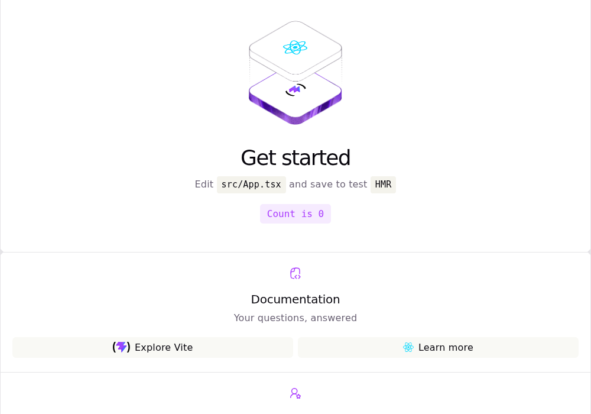

# Chapter 1 — Getting Started

You've built pages with HTML, CSS and JavaScript that changes the DOM directly. This chapter shows what
React changes about that, sets up the tools a React project needs (Node.js, npm, Vite) and creates the
`five-dice` project. You tour its files, try the dev server, the production build and the browser's
developer tools, React's included, and strip the template down to one heading.
[Chapter 2](02-from-vanilla-dom-to-react.md) puts a vanilla DOM widget and its React version side by side.

You need **Node.js 26 or newer** with its bundled npm 11, and any current browser (Chrome, Edge, Firefox or
Safari). Installing Node isn't covered. Check your versions:

```console
$ node --version
v26.13.0
$ npm --version
11.20.0
```

## From DOM code to React

DOM code is **imperative**: for every change in your data you write the matching change to the page. Find
the node, set its text, toggle its class. React is **declarative**: you write a function that returns what
the UI should look like for the current data, and React makes the DOM match. Two sketches of the same
button (Chapter 2 has full versions):

```ts
// Vanilla: change the data, then patch the DOM yourself.
let value = 1
rollButton.addEventListener('click', () => {
  value = rollDie()
  output.textContent = `You rolled ${value}`
})
```

```tsx
// React: describe the UI for the current data. React updates the DOM.
function Roller() {
  const [value, setValue] = useState(1)
  return <button onClick={() => setValue(rollDie())}>You rolled {value}</button>
}
```

- You write **components**: functions that take data and return a description of the UI.
  **UI = f(state)**.
- When the data changes, React calls them again for a new description.
- React compares it with the previous one and applies only the differences to the DOM.

The `react` package is this core; `react-dom` connects it to the browser's DOM
([Chapter 4](04-components-and-jsx.md) shows how).

### React owns its root

React renders into one element, usually `<div id="root">`, and from then on owns the DOM inside it. Don't
change those nodes with DOM calls: the next render may overwrite your change or trip over it. When you do
need a node (to focus it, measure it or pass it to a browser API), a **ref** hands it to you
([Chapter 12](12-refs-and-the-dom.md)).

### Single-page apps and frameworks

Five Dice is a **single-page application** (SPA): one almost-empty HTML file plus a JavaScript bundle, and
React builds every element you see. Clicks change the DOM without loading a new page. It needs no server
code; any static file host can serve it.

React's documentation recommends starting a new production app with a **framework** such as Next.js or
React Router, which add routing, data loading and optional server rendering
([Creating a React App](https://react.dev/learn/creating-a-react-app)). It also documents building one from
scratch on a build tool such as Vite ([Build a React app from scratch](https://react.dev/learn/build-a-react-app-from-scratch)).
This course does that, so you see every moving part; [Chapter 20](20-where-next.md) explains what frameworks
add.

## Node.js and npm: the tooling runtime

Instead of `<script>` tags pointing at a CDN, a React project installs its libraries and tools with **npm**
and runs the tools on **Node.js**, JavaScript outside the browser. Node runs the dev server, TypeScript
compiler, bundler, linter and tests; the game runs in the browser, so players never need Node. The crash
course's [Setup](https://github.com/sipak-gh/learn-typescript-crashcourse/blob/master/01-setup.md) covers
npm, `npx` and running `.ts` files with Node. The difference that matters here: Node has no DOM.

`examples/ch01/where-am-i.ts`
```ts
// Run with Node: `node ch01/where-am-i.ts`. Node is a JavaScript runtime with no browser around it.
const runtime = typeof document === 'undefined' ? 'Node (no browser)' : 'a browser'

console.log('Running in:', runtime)
console.log('typeof document:', typeof document)
console.log('typeof window:', typeof window)
console.log('typeof setTimeout:', typeof setTimeout)
console.log('typeof fetch:', typeof fetch)
console.log('Node version:', process.version)
```

```console
$ node ch01/where-am-i.ts
Running in: Node (no browser)
typeof document: undefined
typeof window: undefined
typeof setTimeout: function
typeof fetch: function
Node version: v26.13.0
```

`setTimeout`, `fetch` and `console` exist in both places; `document` and `window` only in the browser.

### npm: packages, scripts and the lockfile

A project is a folder with a `package.json`. Here is the one you're about to create:

```json
{
  "name": "five-dice",
  "private": true,
  "version": "0.0.0",
  "type": "module",
  "scripts": {
    "dev": "vite",
    "build": "tsc -b && vite build",
    "lint": "oxlint",
    "preview": "vite preview"
  },
  "dependencies": {
    "react": "^19.3.1",
    "react-dom": "^19.3.1"
  },
  "devDependencies": {
    "@types/node": "^24.19.2",
    "@types/react": "^19.3.0",
    "@types/react-dom": "^19.3.0",
    "@vitejs/plugin-react": "^6.1.2",
    "oxlint": "^1.89.0",
    "typescript": "~7.0.2",
    "vite": "^8.3.5"
  }
}
```

- `scripts` are named shell commands: `npm run dev` runs `vite`.
- `dependencies` are what the app needs at run time; they end up in the browser bundle. `devDependencies`
  are tools: compiler, bundler, linter, type definitions. The bundler includes whatever the app imports from
  either list, so the split is mostly documentation.
- `^19.3.1` accepts any 19.x from 19.3.1 on. TypeScript gets `~7.0.2` (patches only) because its minor
  releases can add stricter checks.
- `private: true` stops you publishing the app to npm by accident.

Ranges aren't reproducible, so npm also writes **`package-lock.json`**: the exact version, download URL and
checksum of every package, including your dependencies' dependencies. Commit it.

| Command | What it does |
|---|---|
| `npm install` | install everything in `package.json`; create or update the lockfile |
| `npm install <pkg>` | add a runtime dependency (`-D` adds a devDependency) |
| `npm ci` | clean install **exactly** what the lockfile says; deletes `node_modules` first; never changes the lockfile |
| `npm run <script>` | run a script from `package.json` |
| `npx <tool>` | run a tool's command from `node_modules/.bin` (downloads it first if it isn't installed) |
| `npm ls` | show the installed top-level packages |
| `npm explain <pkg>` | show why a package is installed |

Packages go into the project's **`node_modules/`**, not a global folder. It's large and generated, so
`.gitignore` excludes it; delete it any time and `npm ci` brings it back. `npm run` puts `node_modules/.bin`
on the `PATH`, which is why the `dev` script can just say `vite`.

### Running the course examples

The chapters' small examples live in [`examples/`](examples/README.md), one shared Vite app. Install its
packages once, then start its dev server:

```console
$ cd examples
$ npm install
$ npm run dev
```

Plain pages open at `http://localhost:5173/chNN/<name>/` and React demos at
`http://localhost:5173/?demo=chNN/<name>`. Files ending in `.ts` run with Node: `node ch01/where-am-i.ts`.
Stop the dev server with `Ctrl+C`.

## Create the project with Vite

**Vite** is the build tool: a dev server while you work, a bundler for production. `npm create vite@latest`
downloads and runs Vite's project generator, `create-vite`. Arguments after `--` go to `create-vite`, not
npm:

```console
$ npm create vite@latest five-dice -- --template react-ts

> npx
> 'cva' five-dice --template react-ts

create-vite v9.3.3


To create in one go, run: create-vite <DIRECTORY> --no-interactive --template <TEMPLATE>

│
◆  Which linter to use?
│  ● Oxlint
│  ○ ESLint
│  ↑/↓ to navigate • Enter: confirm
└
◇  Which linter to use?
│  Oxlint
│
◇  Install with npm and start now?
│  No
│
◇  Scaffolding project in /home/you/five-dice...
│
└  Done. Now run:

  cd five-dice
  npm install
  npm run dev
```

- `five-dice` is the folder to create; `react-ts` is the React + TypeScript template.
- The first time, npm may ask `Need to install the following packages: create-vite@… Ok to proceed? (y)`.
  Answer `y`.
- Choose **Oxlint** (the default), an ESLint-compatible linter written in Rust. ESLint, the long-standing
  JavaScript linter, fails to install here: its TypeScript plugin doesn't support TypeScript 7 yet.
- Answer **No** to "Install with npm and start now?" so you run each step yourself.
- `create-vite` evolves; newer versions may ask other questions or create slightly different files. This
  chapter shows 9.3.3.

Install the packages:

```console
$ cd five-dice
$ npm install
added 28 packages, and audited 29 packages in 2s

9 packages are looking for funding
  run `npm fund` for details

found 0 vulnerabilities
```

Times vary. Ignore "funding" (projects asking for donations). "Audited" means npm checked the packages
against a database of known vulnerabilities.

Check what you got:

```console
$ npm ls
five-dice@0.0.0 /home/you/five-dice
├── @types/node@24.19.2
├── @types/react-dom@19.3.0
├── @types/react@19.3.0
├── @vitejs/plugin-react@6.1.2
├── oxlint@1.90.0
├── react-dom@19.3.1
├── react@19.3.1
├── typescript@7.0.2
└── vite@8.3.5
```

You may get newer minor or patch versions. For exactly these, copy `project/ch01/package-lock.json` and
run `npm ci`.

## A tour of the project

```text
five-dice/
├── .gitignore            files Git should ignore: node_modules, dist, logs, editor files
├── .oxlintrc.json        linter configuration
├── README.md             the template's README (you replace it in Chapter 20)
├── index.html            the page; the entry point of the app
├── package.json          scripts and dependencies
├── package-lock.json     exact installed versions (created by npm install)
├── public/
│   ├── favicon.svg       the tab icon, copied to the output as-is
│   └── icons.svg         icons used by the template page
├── src/
│   ├── App.css           styles for the template page
│   ├── App.tsx           the root React component
│   ├── assets/           hero.png, react.svg, vite.svg: images imported by App.tsx
│   ├── index.css         global styles
│   └── main.tsx          the JavaScript entry: starts React
├── tsconfig.json         TypeScript: points to the two configs below
├── tsconfig.app.json     TypeScript settings for src/ (browser code)
├── tsconfig.node.json    TypeScript settings for vite.config.ts (Node code)
└── vite.config.ts        Vite configuration
```

### `index.html`: the entry point

```html
<!doctype html>
<html lang="en">
  <head>
    <meta charset="UTF-8" />
    <link rel="icon" type="image/svg+xml" href="/favicon.svg" />
    <meta name="viewport" content="width=device-width, initial-scale=1.0" />
    <title>five-dice</title>
  </head>
  <body>
    <div id="root"></div>
    <script type="module" src="/src/main.tsx"></script>
  </body>
</html>
```

The browser loads this file first. It's almost empty:

- `<div id="root"></div>` is an empty element that React fills.
- `<script type="module" src="/src/main.tsx">` loads the app. Browsers can't run `.tsx`; the Vite dev server
  compiles it to JavaScript when the browser asks for it.

Vite starts its dependency graph here: script tag → `main.tsx` → every `import` from there.

### `src/main.tsx`: starting React

```tsx
import { StrictMode } from 'react'
import { createRoot } from 'react-dom/client'
import './index.css'
import App from './App.tsx'

createRoot(document.getElementById('root')!).render(
  <StrictMode>
    <App />
  </StrictMode>,
)
```

- `document.getElementById('root')` finds the `<div id="root">`. The `!` tells TypeScript it isn't `null`.
- `createRoot(...)` hands that element to React, which now owns everything inside it.
- `.render(...)` renders the `App` component into it. `<App />` is **JSX**, HTML-like syntax in TypeScript
  ([Chapter 4](04-components-and-jsx.md)).
- `<StrictMode>` adds development-only checks, such as rendering components twice to find impure code
  (more in Chapters 4 and 11).
- `import './index.css'` imports a stylesheet from TypeScript. Browsers can't do that, but Vite can: it
  becomes a `<style>` tag in development and a `.css` file in the build.

### `src/App.tsx`: the root component

The template's `App` is a page with logos, links and a counter button. It starts like this:

```tsx
import { useState } from 'react'
import heroImg from './assets/hero.png'
import reactLogo from './assets/react.svg'
import viteLogo from './assets/vite.svg'
import './App.css'

function App() {
  const [count, setCount] = useState(0)
  // … returns the page as JSX
}

export default App
```

A component is a function that returns JSX. You replace this one at the end of the chapter; `useState` and
the counter are [Chapter 5](05-state-and-events.md).

### `vite.config.ts`

```ts
import react from '@vitejs/plugin-react'
import { defineConfig } from 'vite'

// https://vite.dev/config/
export default defineConfig({
  plugins: [react()],
})
```

Vite itself handles HTML, CSS, TypeScript and assets. The `react()` plugin adds JSX compilation and **Fast
Refresh** (React's hot updates, below). `defineConfig` only adds types.

### The TypeScript configs

Browser code (`src/`) and Node code (`vite.config.ts`) need different settings: only the browser has a DOM.
So the template uses **project references**:

```json
{
  "files": [],
  "references": [
    { "path": "./tsconfig.app.json" },
    { "path": "./tsconfig.node.json" }
  ]
}
```

`tsc -b` (build mode) checks both. `tsconfig.app.json` covers `src/`:

```json
{
  "compilerOptions": {
    "tsBuildInfoFile": "./node_modules/.tmp/tsconfig.app.tsbuildinfo",
    "target": "es2023",
    "lib": ["ES2023", "DOM"],
    "module": "esnext",
    "types": ["vite/client"],
    "allowArbitraryExtensions": true,
    "skipLibCheck": true,

    /* Bundler mode */
    "moduleResolution": "bundler",
    "allowImportingTsExtensions": true,
    "verbatimModuleSyntax": true,
    "moduleDetection": "force",
    "noEmit": true,
    "jsx": "react-jsx",

    /* Linting */
    "noUnusedLocals": true,
    "noUnusedParameters": true,
    "erasableSyntaxOnly": true,
    "noFallthroughCasesInSwitch": true
  },
  "include": ["src"]
}
```

The options that matter for a React project built with Vite:

| Option | Why |
|---|---|
| `"types": ["vite/client"]` | types for Vite features: importing `.css` and image files, `import.meta.env` |
| `"moduleResolution": "bundler"` | resolve imports the way Vite does: `./dice` finds `./dice.ts` |
| `"noEmit": true` | `tsc` only type-checks; Vite produces the JavaScript |
| `"jsx": "react-jsx"` | type-check JSX for React's automatic JSX runtime |
| `"verbatimModuleSyntax"`, `"erasableSyntaxOnly"` | only erasable TypeScript syntax (no `enum`), and type imports marked `import type`, so a tool can strip types file by file |

TypeScript 7 is the native compiler, written in Go: it checks like TypeScript 5 and 6, only faster. The
[TypeScript Crash Course](https://github.com/sipak-gh/learn-typescript-crashcourse) explains these options in
chapter 1 ("Configure the type checker") and its
[tsconfig reference](https://github.com/sipak-gh/learn-typescript-crashcourse/blob/master/appendix-b-tsconfig-reference.md),
and project references in chapter 12.

### `.oxlintrc.json`: the linter

```json
{
  "$schema": "./node_modules/oxlint/configuration_schema.json",
  "plugins": ["react", "typescript", "oxc"],
  "rules": {
    "react/rules-of-hooks": "error",
    "react/only-export-components": ["warn", { "allowConstantExport": true }]
  }
}
```

A **linter** finds likely bugs that type-check fine. The `react` plugin knows React's rules, such as the rules
of hooks ([Chapter 13](13-custom-hooks.md)). Oxlint also runs its default correctness rules.

### `public/` versus `src/assets/`

Two places for images and other files:

| | `public/` | `src/assets/` (or anywhere in `src/`) |
|---|---|---|
| How you use it | refer to it by URL: `/favicon.svg` | `import url from './assets/hero.png'` |
| In the build | copied to `dist/` unchanged, same name | processed; the name gets a content hash; small files are inlined |
| Use it for | files that need a fixed name: favicons, `robots.txt` | everything your code uses |

The hash in a name (`hero-Dk3f9a.png`) changes with the content, so browsers can cache these files
forever: a new version gets a new name.

## The dev server and hot updates

Start the dev server:

```console
$ npm run dev

> five-dice@0.0.0 dev
> vite


  VITE v8.3.5  ready in 136 ms

  ➜  Local:   http://localhost:5173/
  ➜  Network: use --host to expose
  ➜  press h + enter to show help
```

Open `http://localhost:5173/` to see the template page:



Leave it running while you work (`Ctrl+C` stops it). How it works:

- It doesn't bundle. When the browser requests `/src/App.tsx`, Vite compiles **that one file** to JavaScript
  (strips the types, compiles the JSX) and sends it. The browser loads the app as native ES modules, one file
  per request.
- Packages from `node_modules` (React, react-dom) are pre-bundled once and cached in `node_modules/.vite/`.
- Only the files the page uses get compiled, so startup stays fast however big the app grows.

### Hot module replacement

Click **Count is 0** three times. Then, with the page still open, change `<h1>Get started</h1>` to
`<h1>Get rolling</h1>` in `src/App.tsx` and save.

The heading changes at once, and the button still says **Count is 3**: no page reload. Vite sent the browser
the new `App.tsx`, and React swapped in the new component while keeping its state. This is **hot module
replacement** (HMR); React's version is **Fast Refresh**. The terminal logs it:

```text
3:55:18 PM [vite] (client) hmr update /src/App.tsx
```

Edits to files such as `index.html` or `vite.config.ts` reload the page or restart the server instead.

### Gotcha: the dev server doesn't type-check

To stay fast, the dev server only **strips** types; it never checks them. Try it: briefly replace
`src/App.tsx` with this file, which has a type error:

`src/App.tsx`
```tsx
function App() {
  const rolls: number = 'three'
  return <h1>Five Dice {rolls}</h1>
}
```

The page still renders "Five Dice three". The build catches it, because `npm run build` runs `tsc -b` first:

```console
$ npm run build

> five-dice@0.0.0 build
> tsc -b && vite build

src/App.tsx(2,9): error TS2322: Type 'string' is not assignable to type 'number'.
```

The build stops (exit code 1). A TypeScript-aware editor shows the error as you type. Undo to restore
`App.tsx`.

### Gotcha: the port is taken

If another program uses port 5173, Vite tries the next one and tells you:

```console
Port 5173 is in use, trying another one...

  VITE v8.3.5  ready in 112 ms

  ➜  Local:   http://localhost:5174/
```

Always open the URL Vite prints. The usual culprit is a forgotten dev server in another terminal.

## Building for production

For players, you **build** the app into plain static files:

```console
$ npm run build

> five-dice@0.0.0 build
> tsc -b && vite build

vite v8.3.5 building client environment for production...
✓ 20 modules transformed.
rendering chunks (1)...
computing gzip size...
dist/index.html                   0.45 kB │ gzip:  0.29 kB
dist/assets/react-CHdo91hT.svg    4.12 kB │ gzip:  2.06 kB
dist/assets/vite-BF8QNONU.svg     8.70 kB │ gzip:  1.60 kB
dist/assets/hero-CLDdwZDr.png    13.05 kB
dist/assets/index-D64VDMd1.css    4.10 kB │ gzip:  1.47 kB
dist/assets/index-GpEN3EET.js   222.44 kB │ gzip: 69.28 kB
✓ built in 144ms
```

Your hashes and time may differ.

`tsc -b` type-checks. `vite build` then **bundles**: it follows every import from `index.html`, combines the
modules into a few files, removes unused code, minifies, and writes `dist/`:

```text
dist/
├── assets/
│   ├── hero-CLDdwZDr.png     imported by App.tsx: hashed name
│   ├── index-D64VDMd1.css    index.css + App.css
│   ├── index-GpEN3EET.js     all the JavaScript: your code, React, react-dom
│   ├── react-CHdo91hT.svg
│   └── vite-BF8QNONU.svg
├── favicon.svg               copied from public/ unchanged
├── icons.svg                 copied from public/ unchanged
└── index.html
```

`dist/index.html` now points at the bundled files instead of `/src/main.tsx`:

```html
    <script type="module" crossorigin src="/assets/index-GpEN3EET.js"></script>
    <link rel="stylesheet" crossorigin href="/assets/index-D64VDMd1.css">
```

Most of the 222 kB is React and react-dom. Vite 8 bundles with **Rolldown**, written in Rust.
[Chapter 19](19-building-and-shipping.md) covers the build in depth.

Serve `dist/` locally to try the real build:

```console
$ npm run preview

> five-dice@0.0.0 preview
> vite preview

  ➜  Local:   http://localhost:4173/
  ➜  Network: use --host to expose
  ➜  press h + enter to show help
```

`vite preview` is a small static server for checking the build, not for production hosting.

### Gotcha: opening `dist/index.html` from disk

Double-clicking `dist/index.html` shows a blank page. The console says:

```text
Access to script at 'file:///assets/index-GpEN3EET.js' from origin 'null' has been blocked by CORS policy: Cross origin requests are only supported for protocol schemes: chrome, chrome-untrusted, data, http, https.
```

On a `file://` URL, `/assets/…` means the file system root, and browsers don't load module scripts from
`file://` pages anyway. Serve the folder over HTTP (`npm run preview`).

### The linter

```console
$ npm run lint

> five-dice@0.0.0 lint
> oxlint

Found 0 warnings and 0 errors.
Finished in 8ms on 3 files with 116 rules using 32 threads.
```

When it finds something, it points at the code. For example, an unused variable in `App`:

```tsx
function App() {
  const sides = 6
  return <h1>Five Dice</h1>
}
```

```console
$ npm run lint

> five-dice@0.0.0 lint
> oxlint

  ⚠ eslint(no-unused-vars): Variable 'sides' is declared but never used. Unused variables should start with a '_'.
   ╭─[src/App.tsx:2:9]
 1 │ function App() {
 2 │   const sides = 6
   ·         ──┬──
   ·           ╰── 'sides' is declared here
 3 │   return <h1>Five Dice</h1>
   ╰────
  help: Consider removing this declaration.

Found 1 warning and 0 errors.
Finished in 9ms on 3 files with 116 rules using 32 threads.
```

Warnings don't fail the command (exit code 0). Rule names keep an `eslint(...)` prefix because Oxlint
reimplements ESLint's rules.

The four scripts:

| Script | Runs | Use it |
|---|---|---|
| `npm run dev` | `vite` | while you work |
| `npm run build` | `tsc -b && vite build` | to type-check and produce `dist/` |
| `npm run preview` | `vite preview` | to try `dist/` in the browser |
| `npm run lint` | `oxlint` | to find likely bugs |

## Browser developer tools

You know the browser's devtools (`F12`, or `Cmd+Option+I` on macOS). On a React app under the dev server,
three panels show something new:

- **Elements** shows the DOM, not the HTML file: the empty `<div id="root">` from `index.html` now holds
  everything React rendered.
- **Network**: reload the page. In development the browser loads one module per source file:

  ```text
  /@vite/client
  /src/main.tsx
  /@react-refresh
  /node_modules/.vite/deps/react.js?v=3d81c193
  /node_modules/.vite/deps/react_jsx-dev-runtime.js?v=3d81c193
  /src/index.css
  /src/App.tsx
  /node_modules/.vite/deps/react-dom_client.js?v=207fecc0
  …
  ```

  The preview build loads just two files, `/assets/index-….js` and `/assets/index-….css`.
- **Sources** (Firefox: Debugger): find `src/App.tsx`. **Source maps** map the compiled code back to your
  TypeScript, so breakpoints and `debugger;` statements work on the code you wrote.

### React Developer Tools

The **React Developer Tools** extension adds two panels that see components instead of DOM nodes:
**Components** (the component tree, with each component's props and state) and **Profiler** (records
renders, [Chapter 16](16-rendering-and-performance.md)). Install it for
[Chrome](https://chrome.google.com/webstore/detail/react-developer-tools/fmkadmapgofadopljbjfkapdkoienihi),
[Firefox](https://addons.mozilla.org/en-US/firefox/addon/react-devtools/) or
[Edge](https://microsoftedge.microsoft.com/addons/detail/react-developer-tools/gpphkfbcpidddadnkolkpfckpihlkkil)
([React Developer Tools](https://react.dev/learn/react-developer-tools) covers Safari too). Until you do,
React logs a reminder in the console in development: `Download the React DevTools for a better development
experience: https://react.dev/link/react-devtools`.

## Building Five Dice: a clean start

Strip the template down to an empty page with a heading. You build everything else yourself, chapter by
chapter.

1. Delete the template's styles and images: `src/App.css`, the folder `src/assets/` and `public/icons.svg`.

   ```console
   $ rm -r src/App.css src/assets public/icons.svg
   ```

2. Replace `src/App.tsx` with:

   `src/App.tsx`
   ```tsx
   function App() {
     return <h1>Five Dice</h1>
   }

   export default App
   ```

3. Replace `src/index.css` with:

   `src/index.css`
   ```css
   body {
     margin: 2rem;
     font-family: system-ui, sans-serif;
   }
   ```

4. In `index.html`, change the title:

   ```html
       <title>Five Dice</title>
   ```

5. Optional: replace `public/favicon.svg` with a die. (`index.html` already points at `/favicon.svg`.)

   `public/favicon.svg`
   ```html
   <svg xmlns="http://www.w3.org/2000/svg" viewBox="0 0 32 32">
     <rect x="2" y="2" width="28" height="28" rx="6" fill="#fff" stroke="#222" stroke-width="2"/>
     <circle cx="10" cy="10" r="3" fill="#222"/>
     <circle cx="16" cy="16" r="3" fill="#222"/>
     <circle cx="22" cy="22" r="3" fill="#222"/>
   </svg>
   ```

Leave everything else as it is: `main.tsx`, `package.json`, the configs, `.gitignore` and `README.md`.

With the dev server running, each save updated the page; the new CSS dropped the template's styles.

### Checkpoint

```console
$ npm run build

> five-dice@0.0.0 build
> tsc -b && vite build

vite v8.3.5 building client environment for production...
✓ 16 modules transformed.
rendering chunks (1)...
computing gzip size...
dist/index.html                   0.45 kB │ gzip:  0.29 kB
dist/assets/index-2b0F2EBd.css    0.05 kB │ gzip:  0.07 kB
dist/assets/index-BbH-ohp5.js   219.54 kB │ gzip: 68.59 kB
✓ built in 104ms

$ npm run lint

> five-dice@0.0.0 lint
> oxlint

Found 0 warnings and 0 errors.
Finished in 8ms on 3 files with 116 rules using 32 threads.
```

Run `npm run dev` and open the printed URL: the heading **Five Dice** in a sans-serif font on a white page,
and a tab titled "Five Dice" with the die icon. The console shows only Vite's connection messages (and
React's DevTools reminder if the extension isn't installed).

Now open the devtools' **Components** panel. The tree shows one component, `App`. Select it: the pane on
the right is where a component's props and state appear, and `App` has neither yet. Hover over `App` in the
tree and the page highlights the heading it rendered. You'll come back here in Chapters 4 and 5, once
components have props and state.

The complete project at this point is in `project/ch01/`. To start from it instead:

```console
$ cd project/ch01
$ npm ci
added 28 packages, and audited 29 packages in 754ms

9 packages are looking for funding
  run `npm fund` for details

found 0 vulnerabilities
$ npm run dev
```

## Summary

- DOM code is **imperative**: every data change needs a hand-written DOM change. React is **declarative**:
  components describe the UI for the current data (**UI = f(state)**), and React applies the differences.
- React owns the DOM inside its root element; don't change it behind React's back.
- Five Dice is a **single-page app**: static files, all UI built by JavaScript in the browser. React's docs
  recommend a framework for new production apps; this course builds from scratch with Vite to show every part.
- **Node** runs the tools. **npm** installs packages (`dependencies` for the app, `devDependencies` for
  tools), runs `scripts`, and pins exact versions in `package-lock.json`; `npm ci` installs from it.
- `npm create vite@latest five-dice -- --template react-ts` creates the project. `index.html` is the entry;
  `src/main.tsx` hands `<div id="root">` to React with `createRoot`.
- `npm run dev` serves source files on demand with hot updates but **doesn't type-check**. `npm run build`
  type-checks with `tsc -b` and bundles into `dist/`; `npm run preview` serves it.
- `public/` files are copied as-is; imported files get hashed names.
- Devtools: Elements shows React's output in the live DOM; Sources maps back to your TypeScript. React
  DevTools adds **Components** (the component tree with props and state) and **Profiler**.

## Exercises

1. **Arguments to scripts.** Run `npm run lint --deny-warnings`, then `npm run lint -- --deny-warnings`.
   Which one passes the flag to Oxlint, and how can you tell?

   <details><summary>Solution</summary>

   Only the second: npm keeps options before `--` for itself. The second header line shows the command
   npm really ran:

   ```console
   $ npm run lint --deny-warnings
   npm warn Unknown cli config "--deny-warnings". This will stop working in the next major version of npm.

   > five-dice@0.0.0 lint
   > oxlint

   Found 0 warnings and 0 errors.
   Finished in 7ms on 3 files with 116 rules using 32 threads.
   $ npm run lint -- --deny-warnings

   > five-dice@0.0.0 lint
   > oxlint --deny-warnings

   Found 0 warnings and 0 errors.
   Finished in 9ms on 3 files with 116 rules using 32 threads.
   ```

   With `--deny-warnings`, any warning makes the exit code non-zero. Later chapters use it to keep the
   project warning-free.

   </details>

2. **Who needs `scheduler`?** `ls node_modules` lists a `scheduler` package that isn't in `package.json`.
   Find out why it's installed.

   <details><summary>Solution</summary>

   ```console
   $ npm explain scheduler
   scheduler@0.28.0
   node_modules/scheduler
     scheduler@"^0.28.0" from react-dom@19.3.1
     node_modules/react-dom
       react-dom@"^19.3.1" from the root project
   ```

   `react-dom` depends on it: a **transitive** dependency, which the lockfile pins too.

   </details>

3. **`public/` versus import.** Create `src/assets/` again and copy `public/favicon.svg` to
   `src/assets/die.svg`. Change `App` to show the die twice, once from each place, then build. What does
   `dist/` contain, and why?

   ```tsx
   import dieUrl from './assets/die.svg'

   function App() {
     console.log('dieUrl is', dieUrl)
     return (
       <>
         <h1>Five Dice</h1>
         
         
       </>
     )
   }

   export default App
   ```

   (`<>…</>` groups two elements; Chapter 4 explains it.)

   <details><summary>Solution</summary>

   ```console
   $ npm run build
   …
   dist/index.html                   0.45 kB │ gzip:  0.29 kB
   dist/assets/index-2b0F2EBd.css    0.05 kB │ gzip:  0.07 kB
   dist/assets/index-CZ-vQJzb.js   220.19 kB │ gzip: 68.87 kB
   ✓ built in 118ms
   $ ls dist dist/assets
   dist:
   assets  favicon.svg  index.html

   dist/assets:
   index-2b0F2EBd.css  index-CZ-vQJzb.js
   ```

   - `favicon.svg` from `public/` is copied unchanged.
   - `die.svg` has no file of its own. It's under Vite's inline limit (4 KiB, the `assetsInlineLimit`
     option), so Vite put it **inside the JavaScript** as a `data:image/svg+xml,…` URL. A larger image would
     appear as `dist/assets/die-<hash>.svg`.
   - The JavaScript grew by about 0.6 kB.

   Undo the changes and delete `src/assets/` when you're done.

   </details>

4. **Dev versus build in the Network tab.** Open the Network panel, reload the page under `npm run dev`, and
   count the requests. Then `npm run build`, `npm run preview` and do the same. Explain the difference.

   <details><summary>Solution</summary>

   In development the browser fetches the HTML, then one module at a time: `/@vite/client`,
   `/src/main.tsx`, `/@react-refresh`, `/src/index.css`, `/src/App.tsx` and the pre-bundled React modules
   under `/node_modules/.vite/deps/`. That's a dozen or so requests (the exact list varies); the dev server
   compiles each file on request.

   The preview loads the HTML, `/assets/index-….js`, `/assets/index-….css` and the favicon: the build bundled
   every module into one JavaScript and one CSS file. Fewer requests load faster over a real network, which
   is why production code is bundled.

   </details>

5. **Read the error, not the page.** In `src/main.tsx`, change `'root'` to `'app'` and save. What happens in
   the browser, and where do you find out why?

   <details><summary>Solution</summary>

   The page goes blank. The Console shows an uncaught error from `createRoot`, then a stack trace:

   ```text
   Uncaught Error: Target container is not a DOM element.
   ```

   `document.getElementById('app')` returns `null`: `index.html` has no element with `id="app"`. The `!`
   silenced TypeScript's `null` warning, so nothing caught it before run time. Change it back.

   </details>

Sources for this chapter: [REFERENCES.md](REFERENCES.md#chapter-1--getting-started)
