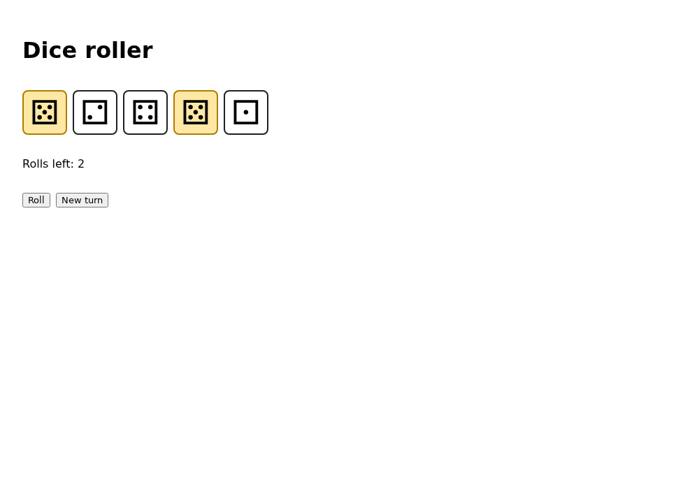
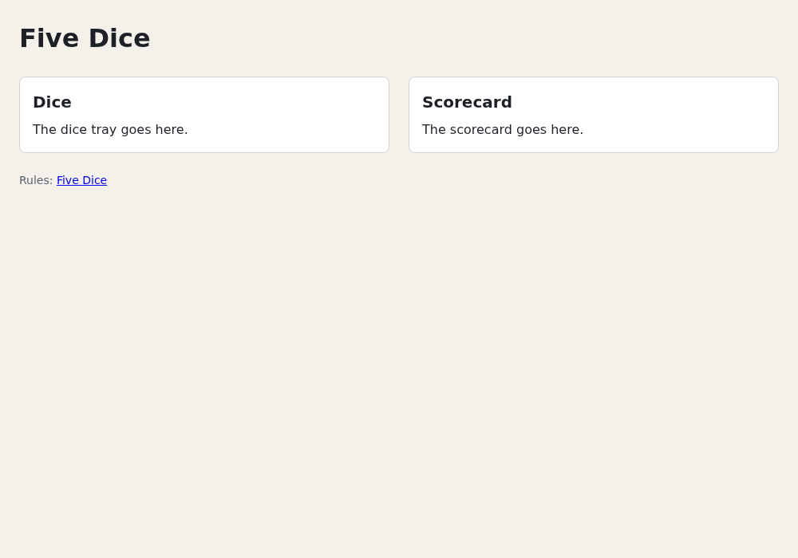

# Chapter 2 — From Vanilla DOM to React

You already build pages with HTML, CSS and the DOM API: `querySelector`, `addEventListener`, `classList`,
`textContent`. This chapter writes a small interactive widget that way, then pushes it until it hurts:
first the forgotten update, then the lost focus when you rebuild everything instead. Then it maps each DOM
technique you use onto what React does instead, and shows the same widget in React as a preview of
Chapters 4 and 5. In the project you build the page skeleton and a base stylesheet.
[Appendix B](appendix-b-web-platform-reference.md) is a refresher for the web platform itself.

Run the examples with the examples' dev server (`npm install` once, see
[Chapter 1](01-getting-started.md#running-the-course-examples)):

```console
$ cd examples
$ npm run dev
```

Plain pages open at `http://localhost:5173/ch02/<name>/`. Keep the devtools (`F12`) open while you read.

## A dice roller without React

Five dice, a Roll button with three rolls per turn, click-to-hold, and a New turn button, written the way
you'd write it without a framework.

`examples/ch02/dice-roller/index.html`
```html
<!doctype html>
<html lang="en">
  <head>
    <meta charset="UTF-8" />
    <meta name="viewport" content="width=device-width, initial-scale=1.0" />
    <title>Dice roller (no React)</title>
    <link rel="stylesheet" href="./style.css" />
  </head>
  <body>
    <main class="roller">
      <h1>Dice roller</h1>
      <div class="dice" id="dice"></div>
      <p id="status">Roll to start.</p>
      <div class="actions">
        <button type="button" id="roll">Roll</button>
        <button type="button" id="new-turn">New turn</button>
      </div>
    </main>
    <script type="module" src="./main.ts"></script>
  </body>
</html>
```

`style.css` lays the dice out with flexbox, dims disabled dice and marks a held one:

`examples/ch02/dice-roller/style.css` (excerpt)
```css
.die:disabled {
  cursor: default;
  opacity: 0.5;
}

.die.held {
  background: #ffe8a3;
  border-color: #b07d00;
}
```

`examples/ch02/dice-roller/main.ts`
```ts
// A dice roller written directly against the DOM, the way you would without React.
const FACES = ['⚀', '⚁', '⚂', '⚃', '⚄', '⚅']
const MAX_ROLLS = 3

// ----- The state: plain variables -----
const values = [1, 1, 1, 1, 1]
const held = [false, false, false, false, false]
let rollsLeft = MAX_ROLLS

// ----- The DOM nodes that show the state -----
const diceBox = document.querySelector<HTMLDivElement>('#dice')!
const status = document.querySelector<HTMLParagraphElement>('#status')!
const rollButton = document.querySelector<HTMLButtonElement>('#roll')!
const newTurnButton = document.querySelector<HTMLButtonElement>('#new-turn')!

const dieButtons = values.map((_, i) => {
  const button = document.createElement('button')
  button.type = 'button'
  button.className = 'die'
  button.disabled = true // nothing to hold before the first roll
  button.setAttribute('aria-pressed', 'false')
  button.addEventListener('click', () => toggleHold(i))
  diceBox.append(button)
  return button
})
dieButtons.forEach((_, i) => showFace(i))

rollButton.addEventListener('click', roll)
newTurnButton.addEventListener('click', newTurn)

// ----- Every change to the state must be copied to the DOM by hand -----
function showFace(i: number) {
  dieButtons[i].textContent = FACES[values[i] - 1]
  dieButtons[i].setAttribute('aria-label', `Die showing ${values[i]}`)
}

function showRollsLeft() {
  status.textContent = rollsLeft === 0 ? 'No rolls left.' : `Rolls left: ${rollsLeft}`
  rollButton.disabled = rollsLeft === 0
}

function roll() {
  for (let i = 0; i < values.length; i++) {
    if (held[i]) continue
    values[i] = Math.floor(Math.random() * 6) + 1
    showFace(i)
  }
  rollsLeft -= 1
  showRollsLeft()
  for (const button of dieButtons) button.disabled = false // dice can be held now
}

function toggleHold(i: number) {
  held[i] = !held[i]
  dieButtons[i].classList.toggle('held', held[i])
  dieButtons[i].setAttribute('aria-pressed', String(held[i]))
}

function newTurn() {
  held.fill(false)
  rollsLeft = MAX_ROLLS
  status.textContent = 'Roll to start.' // the same text as in index.html: keep both in sync
  rollButton.disabled = false
  for (const button of dieButtons) {
    button.disabled = true
    button.classList.remove('held')
    button.setAttribute('aria-pressed', 'false')
  }
}
```

Two TypeScript details: `querySelector<HTMLButtonElement>(…)` says which element type you expect, so
`rollButton.disabled` type-checks, and the `!` asserts the result isn't `null`. Both are covered in the
crash course's [Unions and narrowing](https://github.com/sipak-gh/learn-typescript-crashcourse/blob/master/05-unions-and-narrowing.md).
The dice are the Unicode faces ⚀–⚅; `aria-pressed` makes each die a toggle button for screen readers
([Chapter 15](15-accessibility.md)).

Open `http://localhost:5173/ch02/dice-roller/`, roll, and click dice to hold them. After one roll with dice 1
and 4 held (yours are random):



It works, but look at how. The **state** is three variables; the **view** is a set of DOM nodes. Every
function that changes state must know which nodes show it and patch each one:

| State | Shown by | Updated in |
|---|---|---|
| `values[i]` | die text, `aria-label` | `showFace`, called from setup and `roll` |
| `held[i]` | `held` class, `aria-pressed` | `toggleHold`, `newTurn` |
| `rollsLeft` | status text, Roll `disabled`, dice `disabled` | `showRollsLeft`, `roll`, `newTurn` |

Each row is a rule you keep in your head. The initial UI comes from two places (HTML and setup code), and
`Roll to start.` is written twice. Break it on purpose: delete `button.classList.remove('held')` in
`newTurn`. Hold a die, click New turn, roll again. The die still looks held, but `held[i]` is `false`, so the
roll changes it. The screen lies, and nothing warns you.

That's the core problem of hand-written DOM updates. Each feature (scoring, players, a game-over screen)
multiplies the paths from state to DOM. Possible bugs grow with the number of **transitions**, not screens.

## One render function, and why it isn't enough

The fix you'd reach for first: stop writing transitions. Handlers only change the state, then call one
`render()` that builds the whole UI from it: `UI = f(state)`.

`examples/ch02/dice-roller-render/main.ts` (its `index.html` is the roller's, with another title and `../dice-roller/style.css`)
```ts
// The same dice roller, written as UI = f(state): change the state, then call render().
const FACES = ['⚀', '⚁', '⚂', '⚃', '⚄', '⚅']
const MAX_ROLLS = 3

const values = [1, 1, 1, 1, 1]
const held = [false, false, false, false, false]
let rollsLeft = MAX_ROLLS

const diceBox = document.querySelector<HTMLDivElement>('#dice')!
const status = document.querySelector<HTMLParagraphElement>('#status')!
const rollButton = document.querySelector<HTMLButtonElement>('#roll')!
const newTurnButton = document.querySelector<HTMLButtonElement>('#new-turn')!

// Event handlers only change the state. Then they ask for a render.
rollButton.addEventListener('click', () => {
  for (let i = 0; i < values.length; i++) {
    if (!held[i]) values[i] = Math.floor(Math.random() * 6) + 1
  }
  rollsLeft -= 1
  render()
})

newTurnButton.addEventListener('click', () => {
  held.fill(false)
  rollsLeft = MAX_ROLLS
  render()
})

// One function decides what the whole UI looks like. It rebuilds the dice from scratch.
function render() {
  const hasRolled = rollsLeft < MAX_ROLLS
  const buttons = values.map((value, i) => {
    const button = document.createElement('button')
    button.type = 'button'
    button.className = held[i] ? 'die held' : 'die'
    button.disabled = !hasRolled
    button.textContent = FACES[value - 1]
    button.setAttribute('aria-label', `Die showing ${value}`)
    button.setAttribute('aria-pressed', String(held[i]))
    button.addEventListener('click', () => {
      held[i] = !held[i]
      render()
    })
    return button
  })
  diceBox.replaceChildren(...buttons)

  if (!hasRolled) status.textContent = 'Roll to start.'
  else if (rollsLeft === 0) status.textContent = 'No rolls left.'
  else status.textContent = `Rolls left: ${rollsLeft}`
  rollButton.disabled = rollsLeft === 0
}

render()
```

Open `http://localhost:5173/ch02/dice-roller-render/`. The forgotten-update bug is gone: no handler touches
the DOM, so none can forget part of it, and the status text lives in one place.

Now use the keyboard. Roll, then Tab to the second die, press Space to hold it, and press Tab again. The
focus jumps to the **first** die, not the third. `render()` replaced the focused button with a new one. The
old button left the page, so the focus fell back to `<body>` (check `document.activeElement` in the
console), and Tab starts over. Text selections, scroll positions and half-typed input values are lost the
same way, and every render also throws away and recreates every listener. The original roller kept the focus
because it patched the same button.

So you're stuck between two bad options: patch by hand and forget updates, or rebuild and destroy whatever
state the DOM nodes held. React gives you both halves: you write "rebuild everything", and React compares the
result with the previous one and patches only what changed, keeping the existing nodes.

## The same roller in React

Here is the roller as a React component. Don't type it in: [Chapter 4](04-components-and-jsx.md) explains
JSX and components and [Chapter 5](05-state-and-events.md) explains state and events, and you build the
real game's version there. Read it for its shape.

`examples/ch02/dice-roller.demo.tsx`
```tsx
import { useState } from 'react'

// A preview of Chapters 4 and 5: the same dice roller as a React component.
const FACES = ['⚀', '⚁', '⚂', '⚃', '⚄', '⚅']
const MAX_ROLLS = 3

export default function DiceRoller() {
  // The state: React keeps it between renders.
  const [values, setValues] = useState([1, 1, 1, 1, 1])
  const [held, setHeld] = useState([false, false, false, false, false])
  const [rollsLeft, setRollsLeft] = useState(MAX_ROLLS)

  // Everything else is computed from the state on every render.
  const hasRolled = rollsLeft < MAX_ROLLS
  let status = `Rolls left: ${rollsLeft}`
  if (!hasRolled) status = 'Roll to start.'
  else if (rollsLeft === 0) status = 'No rolls left.'

  function roll() {
    setValues(values.map((value, i) => (held[i] ? value : Math.floor(Math.random() * 6) + 1)))
    setRollsLeft(rollsLeft - 1)
  }

  function newTurn() {
    setHeld([false, false, false, false, false])
    setRollsLeft(MAX_ROLLS)
  }

  // The whole UI, described for the current state. React patches the DOM to match.
  return (
    <main>
      <h1>Dice roller (React)</h1>
      <div>
        {values.map((value, i) => (
          <button
            key={i}
            type="button"
            disabled={!hasRolled}
            aria-pressed={held[i]}
            aria-label={`Die showing ${value}`}
            style={{ fontSize: '3rem', background: held[i] ? '#ffe8a3' : 'white' }}
            onClick={() => setHeld(held.with(i, !held[i]))}
          >
            {FACES[value - 1]}
          </button>
        ))}
      </div>
      <p>{status}</p>
      <button type="button" disabled={rollsLeft === 0} onClick={roll}>
        Roll
      </button>{' '}
      <button type="button" onClick={newTurn}>
        New turn
      </button>
    </main>
  )
}
```

Open `http://localhost:5173/?demo=ch02/dice-roller` and repeat the keyboard test: after Space on the second
die, Tab moves to the third. Compare it with the vanilla version:

- No `querySelector`, `createElement`, `textContent` or `classList`. The JSX says what each element looks
  like for the current state, written once.
- Handlers only call the `set…` functions. Each call schedules a new render; React calls `DiceRoller` again,
  compares the new JSX with the old and changes only the DOM that differs. The die you held keeps its
  button node, so it keeps the focus.
- The status text, `disabled` and `aria-pressed` are computed, not stored, so they can't fall out of sync.
- State is replaced, never mutated: `values.map(…)` and `held.with(…)` return new arrays
  ([Chapter 3](03-javascript-for-react.md) explains why that matters).

## What React changes about your DOM code

Most of what you know still applies: React renders the same elements, the same CSS styles them, and the
same events fire. What changes is who touches the DOM. A map from your habits to their React replacements:

| In vanilla DOM code you… | In React you… | Chapter |
|---|---|---|
| `el.addEventListener('click', fn)` | pass `onClick={fn}` on the element in JSX | [5](05-state-and-events.md) |
| set `el.textContent = value` | write `{value}` in JSX. It's always text: React escapes it, so user input can't inject HTML | [4](04-components-and-jsx.md) |
| set `el.innerHTML = html` | almost never do; `dangerouslySetInnerHTML` exists for trusted HTML | [4](04-components-and-jsx.md) |
| `classList.toggle('held', h)`, `setAttribute('aria-pressed', …)` | compute them from state: `className={h ? 'die held' : 'die'}`, `aria-pressed={h}` | [4](04-components-and-jsx.md), [5](05-state-and-events.md) |
| `createElement` and `append` in a loop | `map` the data to JSX, with a `key` per item | [4](04-components-and-jsx.md) |
| delegate: one listener on a container | write a handler per element; React itself listens at the root, once per event type | [5](05-state-and-events.md) |
| keep module-level variables as state | `useState` or `useReducer`; changing them re-renders | [5](05-state-and-events.md), [7](07-reducers.md) |
| `querySelector` a node, then mutate it | rarely do: a **ref** gives you the node for focus, measuring or browser APIs | [12](12-refs-and-the-dom.md) |
| `preventDefault()` in a `submit` listener | the same in `onSubmit`, or a form **action** | [9](09-forms.md) |
| run setup at load: timers, `window` listeners, `localStorage` | use an **effect**, only to sync with something outside React | [11](11-effects.md) |

One rule underlies the table: React owns the DOM inside its root element. If your code changes those nodes
behind React's back, the next render may undo the change or trip over it. Refs are the sanctioned escape
hatch.

## Building Five Dice: the page skeleton

The project gets structure: a header, a board with two panels (dice and scorecard, filled in from
[Chapter 4](04-components-and-jsx.md)), a footer, and a base stylesheet. The target:



### The stylesheet

Replace `src/index.css`. It has three parts:

1. A small **reset**: `border-box` everywhere, no default margins on the elements you use, form controls
   that inherit the page font.
2. **Design tokens** as custom properties on `:root`: colours, a spacing scale, a corner radius.
3. The **page layout**: a centred column, a flex header, a two-column grid board, card-style panels.

A **custom property** (`--color-bg`, read with `var(--color-bg)`) is inherited and live: it follows the DOM
tree like `color`, and the browser resolves `var()` when it styles each element. Redefine one on an element
and everything inside follows. The course styles everything with these tokens, and
[Chapter 14](14-styling.md) adds a dark theme by redefining them.

<details><summary>Full listing: src/index.css</summary>

`src/index.css`
```css
/* ---------- 1. A small reset: make every browser start from the same place ---------- */
*,
*::before,
*::after {
  box-sizing: border-box; /* width includes padding and border */
}

body,
h1,
h2,
p {
  margin: 0;
}

button,
input {
  font: inherit; /* form controls don't inherit fonts by default */
}

/* ---------- 2. Design tokens: CSS custom properties (variables) ---------- */
:root {
  --color-bg: #f4f1ea;
  --color-surface: #ffffff;
  --color-text: #1d2127;
  --color-muted: #5b6470;
  --color-border: #cfd5dc;
  --color-accent: #1d5fd1;

  --space-1: 0.25rem;
  --space-2: 0.5rem;
  --space-3: 1rem;
  --space-4: 1.5rem;
  --radius: 0.5rem;

  font-family: system-ui, sans-serif;
  line-height: 1.5;
  color: var(--color-text);
  background: var(--color-bg);
}

/* ---------- 3. Page layout ---------- */
.app {
  max-width: 64rem;
  margin: 0 auto;
  padding: var(--space-4);
  display: grid;
  gap: var(--space-4);
}

.app-header {
  display: flex; /* flexbox: lay children out in a row */
  align-items: baseline;
  justify-content: space-between;
}

.board {
  display: grid; /* grid: two equal columns */
  grid-template-columns: 1fr 1fr;
  gap: var(--space-4);
  align-items: start;
}

.panel {
  padding: var(--space-3);
  background: var(--color-surface);
  border: 1px solid var(--color-border);
  border-radius: var(--radius);
}

.panel h2 {
  margin-bottom: var(--space-2);
  font-size: 1.25rem;
}

.app-footer {
  color: var(--color-muted);
  font-size: 0.875rem;
}
```

</details>

Two details:

- `align-items: start` on `.board` makes each panel as tall as its content; the default `stretch` would
  match the taller one.
- The reset sets `h2 { margin: 0 }`, and `.panel h2` sets a bottom margin. The class-plus-type selector is
  more specific, so it wins wherever it appears in the file (the cascade:
  [Appendix B](appendix-b-web-platform-reference.md#the-cascade-which-rule-wins)).

`--color-accent` and `--space-1` are for later chapters.

### The markup

Replace `src/App.tsx`. The function returns **JSX**, which looks almost like HTML
([Chapter 4](04-components-and-jsx.md)). For now, two differences: `className` instead of `class`, and every
element must be closed.

`src/App.tsx`
```tsx
// The page skeleton. It looks like HTML, but it is JSX: note `className`
// instead of `class`. Chapter 4 explains JSX properly.
function App() {
  return (
    <div className="app">
      <header className="app-header">
        <h1>Five Dice</h1>
      </header>

      <main className="board">
        <section className="panel">
          <h2>Dice</h2>
          <p>The dice tray goes here.</p>
        </section>

        <section className="panel">
          <h2>Scorecard</h2>
          <p>The scorecard goes here.</p>
        </section>
      </main>

      <footer className="app-footer">
        <p>
          Rules: <a href="https://beesboardsma.com/pages/five-dice">Five Dice</a>
        </p>
      </footer>
    </div>
  )
}

export default App
```

React renders this into `<div id="root">`, so there's no `<html>` or `<body>`: `index.html` has them. The
landmarks are the usual semantic ones: `header`, `main`, `section` with headings, `footer`.

With the dev server running, the page updates as you save. In the Elements panel, select `main.board` and
click its `grid` badge to see the two columns.

### Checkpoint

```console
$ npm run build
…
dist/index.html                   0.45 kB │ gzip:  0.29 kB
dist/assets/index-C0AM3gPW.css    0.89 kB │ gzip:  0.45 kB
dist/assets/index-DCUOIxk5.js   220.17 kB │ gzip: 68.78 kB
✓ built in 145ms

$ npm run lint
…
Found 0 warnings and 0 errors.
```

The CSS grew from 0.05 kB to 0.89 kB; your hashes and times may differ. Run `npm run dev`: the page looks
like the screenshot above.

The complete project at this point is in `project/ch02/`.

## Summary

- Hand-written DOM updates need one update path per state transition. Miss one and the screen lies, with no
  warning.
- Rebuilding the whole UI from state in one `render()` fixes that, but destroys what the old nodes held:
  focus, selection, scroll position, typed input.
- React combines the two: you describe the whole UI for the current state, and React patches only the DOM
  that changed, keeping existing nodes.
- In React, listeners become `onClick` props, `textContent` becomes auto-escaped `{value}`, classes and
  attributes are computed from state, lists come from `map`, and module variables become `useState`.
  React owns the DOM inside its root; refs are the escape hatch.
- The project has a base stylesheet with design tokens as custom properties, and a JSX page skeleton.

## Exercises

1. **Hold all.** Add a **Hold all** button, disabled until the first roll, to the vanilla roller in
   `examples/ch02/dice-roller/`. Count the places you had to touch. Then add it to
   `examples/ch02/dice-roller.demo.tsx`.

   <details><summary>Solution</summary>

   Vanilla: five places. The button in `index.html`:

   ```html
   <button type="button" id="hold-all">Hold all</button>
   ```

   In `main.ts`, the query and listener next to the others, a handler, and two state transitions that
   must enable and disable it:

   ```ts
   const holdAllButton = document.querySelector<HTMLButtonElement>('#hold-all')!
   holdAllButton.disabled = true
   holdAllButton.addEventListener('click', holdAll)

   function holdAll() {
     held.fill(true)
     for (const button of dieButtons) {
       button.classList.add('held')
       button.setAttribute('aria-pressed', 'true')
     }
   }
   ```

   Plus `holdAllButton.disabled = false` at the end of `roll()` and `holdAllButton.disabled = true` in
   `newTurn()`. Forget either and the button is enabled when it shouldn't be.

   React: one place, next to the other buttons:

   ```tsx
   <button type="button" disabled={!hasRolled} onClick={() => setHeld(held.map(() => true))}>
     Hold all
   </button>
   ```

   Its `disabled` is computed from the state, so no transition can forget it, and the dice update because
   `held` changed.

   </details>

2. **Keep the focus by hand.** Fix the focus loss in `examples/ch02/dice-roller-render/main.ts` without
   giving up the rebuild.

   <details><summary>Solution</summary>

   Remember which die had the focus before the rebuild, and focus the new button at that position after:

   ```ts
   function render() {
     // Which die has the focus, if any? Remember its position.
     const focused = [...diceBox.children].findIndex((child) => child === document.activeElement)
     const hasRolled = rollsLeft < MAX_ROLLS
     // … build `buttons` as before
     diceBox.replaceChildren(...buttons)
     if (focused !== -1) buttons[focused].focus() // put the focus back on the new button
     // … the status and Roll button as before
   }
   ```

   Space then Tab now reaches the third die. But this fixes only focus: a text selection, a scroll
   position or a half-typed input would each need the same treatment. Keeping the old nodes, as React
   does, fixes them all at once.

   </details>

Sources for this chapter: [REFERENCES.md](REFERENCES.md#chapter-2--from-vanilla-dom-to-react)
