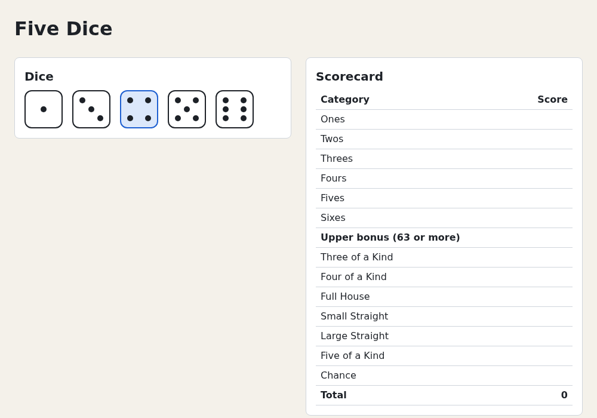

# Chapter 4 — Components and JSX

In React you write small functions called *components* that return what should be on screen for your data,
and React updates the page to match. This chapter covers what React is, what JSX compiles to, components,
lists, conditions and pure rendering. In the project, five dice and a 13-category scorecard replace the
placeholder skeleton from [Chapter 2](02-from-vanilla-dom-to-react.md). Nothing moves yet;
[Chapter 5](05-state-and-events.md) adds clicks and state.

## What React is

Your vanilla dice roller from [Chapter 2](02-from-vanilla-dom-to-react.md) keeps the state in variables and
copies every change to the DOM by hand:

```ts
function toggleHold(i: number) {
  held[i] = !held[i]
  dieButtons[i].classList.toggle('held', held[i])
  dieButtons[i].setAttribute('aria-pressed', String(held[i]))
}
```

Each feature adds more patching code, and one missed update leaves the page out of sync. The `render()`
version (`examples/ch02/dice-roller-render/main.ts`) fixes that: handlers only change the state, and one
function rebuilds the dice from it:

```ts
diceBox.replaceChildren(...buttons) // brand-new <button>s on every change
```

That is easy to get right, but it throws the old nodes away, and with them focus, text typed into inputs,
scroll position and running CSS transitions. Hold a die with the keyboard (`Tab`, `Space`) and focus is
lost, because the focused button no longer exists. Rebuilding a whole page like that (or with `innerHTML`)
on every keystroke is also slow.

React gives you the `render()` style without the rebuild:

```text
UI = f(state)
```

The die becomes a function from its data to markup (a sketch; the project's version comes later):

```tsx
function Die({ value, held }: { value: number; held: boolean }) {
  return (
    <button className={held ? 'die held' : 'die'} aria-pressed={held}>
      {FACES[value - 1]}
    </button>
  )
}
```

There is no `classList.toggle` and no `setAttribute`: you say what the button looks like for *any* `held`,
and React works out what to change.

- **Declarative.** You describe *what* the screen shows for the current data, not the steps from the
  previous screen, like writing HTML instead of a chain of `createElement` and `setAttribute` calls.
- **Components.** `f` is split into small functions like `Die` that take inputs (*props*) and return a
  piece of UI. They nest, like functions calling functions.
- **Reconciliation.** When the data changes, React calls your components again. They return a new tree of
  plain objects called *React elements* (the "virtual DOM"). React compares it with the previous tree and
  applies only the differences to the real DOM, like `diff` and `patch` on two versions of a file. A
  `<button>` that is still there stays the *same* DOM node, so focus and typed text survive.

The win isn't that diffing beats hand-written DOM code: `toggleHold` already does the least work possible.
The win is that you write the simple "rebuild everything" code, and React does the patching for you.

React is two packages:

| Package | What it does |
|---|---|
| `react` | The component model: elements, components, hooks. Knows nothing about browsers. |
| `react-dom` | A *renderer*: turns React's work into DOM operations. `react-dom/client` has `createRoot`. |

Other renderers use the same `react` package to draw native mobile views (React Native), terminals, PDFs or
3D scenes. `src/main.tsx` from [Chapter 1](01-getting-started.md) uses both:

```tsx
import { StrictMode } from 'react'
import { createRoot } from 'react-dom/client'
import './index.css'
import App from './App.tsx'

createRoot(document.getElementById('root')!).render(
  <StrictMode>
    <App />
  </StrictMode>,
)
```

`createRoot` takes over `<div id="root">` from `index.html`, and `render` draws `<App />` into it. From then
on React owns everything inside that `<div>`.

## JSX is JavaScript

The HTML-like syntax in `.tsx` files is **JSX**. Browsers don't understand it: the build tool (Vite, using the
Oxc compiler) rewrites each tag into a function call. This script runs the same transform:

`examples/ch04/compile-jsx.ts`
```ts
// Compile JSX the way Vite does and print the JavaScript it turns into.
// Usage: node ch04/compile-jsx.ts            (compiles the sample below)
//        node ch04/compile-jsx.ts '<p>Hi</p>' (compiles your own snippet)
import { transformWithOxc } from 'vite'

const sample = `
export function Greeting({ name }: { name: string }) {
  return (
    <section className="greeting">
      <h2>Hello, {name}!</h2>
      <p>Welcome to Five Dice.</p>
    </section>
  )
}
const items = [1, 2].map((n) => <li key={n}>{n}</li>)
`

const source = process.argv[2] ?? sample
const result = await transformWithOxc(source, 'example.tsx', {
  // The settings Vite uses for a production build.
  jsx: { runtime: 'automatic', development: false },
})
console.log(result.code)
```

Run it from `examples/`:

```console
$ node ch04/compile-jsx.ts
import { jsxs as _jsxs, jsx as _jsx } from "react/jsx-runtime";
export function Greeting({ name }) {
	return /* @__PURE__ */ _jsxs("section", {
		className: "greeting",
		children: [/* @__PURE__ */ _jsxs("h2", { children: [
			"Hello, ",
			name,
			"!"
		] }), /* @__PURE__ */ _jsx("p", { children: "Welcome to Five Dice." })]
	});
}
const items = [1, 2].map((n) => /* @__PURE__ */ _jsx("li", { children: n }, n));
```

Reading the output:

- Each tag becomes `jsx(type, props)`. The type is a string for HTML elements (`"section"`), the function
  itself for a component (`Greeting`).
- Attributes become a props object; nested content becomes `props.children` (an array for several
  children). `jsxs` is the same function, used when the source writes out several children.
- `{name}` is just the variable: braces switch from JSX back to JavaScript.
- `key` is **not** in the props but a separate third argument, for React itself.
- TypeScript types never reach the browser. (`/* @__PURE__ */` is a hint for the bundler; ignore it.)
- The compiler adds the `react/jsx-runtime` import. Older code and tutorials start every file with
  `import React from 'react'`, because the old transform produced `React.createElement(...)` calls.

What does `jsx()` return? Call it yourself:

`examples/ch04/elements.ts`
```ts
// JSX is sugar for jsx() calls. Call jsx() by hand and look at what it returns.
import { jsx, jsxs } from 'react/jsx-runtime'

const heading = jsx('h1', { className: 'title', children: 'Five Dice' })
console.log(heading)

const second = jsx('li', { children: 'two' }, 'b') // the third argument is the key
const list = jsxs('ul', { children: [jsx('li', { children: 'one' }, 'a'), second] })
console.log(list.type, list.key)
console.log(second)
```

```console
$ node ch04/elements.ts
{
  '$$typeof': Symbol(react.transitional.element),
  type: 'h1',
  key: null,
  props: { className: 'title', children: 'Five Dice' },
  _owner: null,
  _store: {}
}
ul null
{
  '$$typeof': Symbol(react.transitional.element),
  type: 'li',
  key: 'b',
  props: { children: 'two' },
  _owner: null,
  _store: {}
}
```

A **React element** is a small, plain object: type, key and props. The third argument lands in `key`; the
`<ul>` got none, so its key is `null`. (`$$typeof` marks a real element; `_owner` and `_store` are
development-build debugging fields.) Unlike `document.createElement`, creating an element doesn't touch the
page. It's a *description*: React reads the tree later and decides what DOM changes to make. Elements are
immutable; to show something else, create new ones.

## The rules of JSX

JSX compiles to JavaScript objects, and that explains every difference from HTML:

| HTML | JSX | Why |
|---|---|---|
| `class="die"` | `className="die"` | `class` is a reserved word in JavaScript; the DOM property is `className` too |
| `for="name"` | `htmlFor="name"` | `for` is a reserved word; the DOM property is `htmlFor` |
| `style="font-weight: bold"` | `style={{ fontWeight: 'bold' }}` | an object, with camelCase keys like the DOM's `element.style.fontWeight` |
| `onclick="roll()"` | `onClick={roll}` | camelCase, and the value is a function, not a string of code ([Chapter 5](05-state-and-events.md)) |
| `tabindex="0"` | `tabIndex={0}` | most multi-word attributes are camelCase |
| `<br>`, `<input>` | `<br />`, `<input />` | every tag must be closed |
| `aria-label`, `data-id` | `aria-label`, `data-id` | `aria-*` and `data-*` stay as in HTML |
| several top-level elements | exactly one root | a function returns one value; wrap siblings in a fragment `<>…</>` |

This component uses all of them:

`examples/ch04/jsx-rules.demo.tsx`
```tsx
// The rules of JSX in one component.
const player = { name: 'Ada', score: 42 }

export default function JsxRules() {
  const label = 'Hold dice automatically'

  return (
    // One root element. A fragment (<>…</>) groups siblings without adding a DOM node.
    <>
      {/* Comments inside JSX go in braces like this. */}
      <h1 className="title">JSX rules</h1>

      {/* `htmlFor` instead of `for`; every tag must be closed, even <input />. */}
      <input type="checkbox" id="auto-hold" />
      <label htmlFor="auto-hold">{label}</label>

      {/* A style object: camelCase property names; plain numbers mean pixels. */}
      <p style={{ fontWeight: 'bold', marginTop: 8 }}>
        {player.name} has {player.score} points, {player.score >= 40 ? 'well done' : 'keep going'}.
      </p>

      <p>Any expression works in braces: 6 × 7 = {6 * 7}</p>
      <p>Text is escaped, never parsed as HTML: {'<b>not bold</b>'}</p>
      <p>
        These render nothing: [{null}] [{undefined}] [{false}] [{true}], but zero does: [{0}]
      </p>
    </>
  )
}
```

To see it, start the examples app from `examples/`:

```console
$ npm run dev
```

Then open `http://localhost:5173/?demo=ch04/jsx-rules`:

```text
JSX rules
☐ Hold dice automatically

Ada has 42 points, well done.

Any expression works in braces: 6 × 7 = 42

Text is escaped, never parsed as HTML: <b>not bold</b>

These render nothing: [] [] [] [], but zero does: [0]
```

Notes:

- **`style={{ … }}`**: the outer braces switch to JavaScript; the inner ones are an object literal. Length
  properties get `px` added to numbers (`marginTop: 8` is `8px`).
- **Braces take expressions, not statements.** `{score >= 40 ? 'a' : 'b'}` works; `{if (…) …}` doesn't, because
  JSX compiles into function arguments. [Conditional rendering](#conditional-rendering) shows how to use `if`.
- **What renders:** strings, numbers, elements and arrays of them. `null`, `undefined`, `true` and `false`
  render nothing, which is handy for conditions. `0` is a number, so it renders.
- **Whitespace.** JSX drops line breaks and the indentation around them, so text that ends one line and an
  element on the next touch. Write `{' '}` for an explicit space.
- **Text is escaped.** A string containing `<b>` shows the characters. This blocks the most common web
  attack, *cross-site scripting* (XSS): injecting HTML or script through user data. The deliberately scary
  `dangerouslySetInnerHTML` is for the rare trusted HTML string; this course doesn't need it.

### Mistakes TypeScript catches

Your editor and `tsc` know the JSX rules. Typical errors in the project (`npx tsc -b` type-checks like
`npm run build` does):

| Mistake | Error (first line) |
|---|---|
| `<section class="panel">` | `Property 'class' does not exist on type 'DetailedHTMLProps<…>'. Did you mean 'className'?` |
| two elements without a common parent | `error TS2657: JSX expressions must have one parent element.` |

An object where a child should be (`DEMO_DICE[0]` is a `Die` object, not something React can show):

```console
$ npx tsc -b
src/App.tsx:20:12 - error TS2322: Type 'Die' is not assignable to type 'ReactNode'.

20         <p>{DEMO_DICE[0]}</p>
              ~~~~~~~~~~~~~~

  node_modules/@types/react/index.d.ts:2361:9 - The expected type comes from property 'children' which is declared here on type 'DetailedHTMLProps<HTMLAttributes<HTMLParagraphElement>, HTMLParagraphElement>'
    2361         children?: ReactNode | undefined;
                 ~~~~~~~~


Found 1 error in src/App.tsx:20
```

`ReactNode` is the type of anything React can render: elements, strings, numbers, booleans, `null`,
`undefined` and arrays of these. The dev server doesn't type-check ([Chapter 1](01-getting-started.md)); if
you ignore the error, the page goes blank and the browser console shows:

```text
Error: Objects are not valid as a React child (found: object with keys {id, value, held}). If you meant to render a collection of children, use an array instead.
```

Render a field instead: `{DEMO_DICE[0].value}`.

## Components

A component is a function that returns JSX. Its name must start with a capital letter:

```tsx
function Title() {
  return <h1>Five Dice</h1>
}

// Use it like a tag:
const page = <Title />
```

The capital letter tells JSX it's a component: `<title>` compiles to `jsx("title", …)`, so React creates an
HTML `<title>`; `<Title />` compiles to `jsx(Title, …)`, so React calls the function. A lowercase component
name is treated as an unknown HTML tag:

```console
$ npx tsc -b
src/App.tsx:27:9 - error TS2339: Property 'panel' does not exist on type 'JSX.IntrinsicElements'.
```

`JSX.IntrinsicElements` lists the built-in HTML (and SVG) tags that `@types/react` knows.

Never call a component yourself (`Title()`); write `<Title />` and let React decide *when* to call it. React
tracks each instance and, from [Chapter 5](05-state-and-events.md) on, gives each its own memory.

### Props

A component takes one argument: an object of **props** (properties), the attributes written on the tag.
Describe them with an interface and destructure them in the parameter list:

`examples/ch04/components.demo.tsx`
```tsx
import type { ReactNode } from 'react'

interface BadgeProps {
  label: string
  count?: number // optional prop
  tone?: 'info' | 'warning'
}

// Default values come from destructuring defaults.
function Badge({ label, count = 0, tone = 'info' }: BadgeProps) {
  const color = tone === 'warning' ? 'darkred' : 'navy'
  return (
    <span style={{ color, marginRight: 12 }}>
      {label}: {count}
    </span>
  )
}

interface CardProps {
  title: string
  children: ReactNode // whatever is nested between <Card> and </Card>
  footer?: ReactNode // JSX can be passed in any prop, not only children
}

function Card({ title, children, footer }: CardProps) {
  return (
    <section style={{ border: '1px solid gray', padding: 8, margin: 8 }}>
      <h2>{title}</h2>
      {children}
      {footer}
    </section>
  )
}

// Specialisation by composition: a WarningCard is a Card with some parts filled in.
function WarningCard({ children }: { children: ReactNode }) {
  return (
    <Card title="Warning" footer={<Badge label="Severity" count={2} tone="warning" />}>
      {children}
    </Card>
  )
}

export default function Components() {
  return (
    <>
      <Card title="Players">
        <Badge label="Ada" count={3} />
        <Badge label="Bo" />
      </Card>
      <WarningCard>
        <p>Your turn is about to end.</p>
      </WarningCard>
    </>
  )
}
```

Open `http://localhost:5173/?demo=ch04/components`:

```text
Players
Ada: 3   Bo: 0

Warning
Your turn is about to end.
Severity: 2
```

Open the **Components** tab of React DevTools ([Chapter 1](01-getting-started.md)). It shows the component
tree, not the DOM: `Components` → `Card` → two `Badge`s, then `WarningCard` → `Card` → `Badge`. Click the
second `Badge`: the right-hand pane lists its props, `label: "Bo"`, with no `count` or `tone` because the
parent didn't pass them (the defaults are local variables inside `Badge`). The Elements panel, by contrast,
shows only the `<section>`s and `<span>`s; components leave no trace in the DOM.

How props work:

- **String props** can be plain attributes: `label="Ada"`. Everything else goes in braces: `count={3}`,
  `tone={'warning'}`, `onDone={handler}`.
- **A prop with no value is `true`**: `<input disabled />` means `disabled={true}`.
- **Optional props** (`count?: number`) may be left out; a destructuring default (`count = 0`) fills them in.
- **Props are read-only.** Never assign to them or change objects inside them. The parent owns the data, so
  the parent changes it ([Chapter 6](06-thinking-in-react.md)).
- **Spreading** forwards many props at once: `<Badge {...badgeProps} />`. Use it sparingly; explicit props
  are easier to follow.

TypeScript checks every use of a component, so a wrong prop fails the build instead of rendering garbage:

| Mistake | Error |
|---|---|
| `<DiceTray />` | `Property 'dice' is missing in type '{}' but required in type 'DiceTrayProps'.` |
| a die `{ id: 4, value: 7, held: false }` | `Type '7' is not assignable to type 'DieValue'.` |

### `children`

Whatever you nest between a component's tags arrives as the `children` prop, typed `ReactNode`. `Card` above
just places its children without knowing what they are. That's how you build *layout* components: frames,
panels, dialogs, toolbars.

Other types you'll meet:

| Type | Means |
|---|---|
| `ReactNode` | anything renderable: elements, strings, numbers, booleans, `null`, `undefined`, arrays. Use it for `children` and "slot" props like `footer`. |
| `ReactElement` | exactly one element, e.g. the result of `<Badge />` |
| `React.JSX.Element` | what a JSX expression evaluates to (a `ReactElement`). There is no global `JSX` namespace in React 19's types: write `React.JSX.Element`, or `import type { JSX } from 'react'` and then `JSX.Element` |
| `PropsWithChildren<P>` | `P` plus an optional `children?: ReactNode` |
| `ComponentProps<'button'>` | all the props a `<button>` accepts, handy for wrappers |

### Composition over inheritance

Without React you might build a reusable widget as a class (`class FancyButton extends HTMLElement` for a
custom element) and specialise it by subclassing. React components don't inherit; you **put components
inside components**:

- **Containment:** a generic box receives its contents as `children` (`Card`, and the project's `Panel`).
- **Slots:** extra `ReactNode` props for other holes (`footer` above); a component can have several.
- **Specialisation:** a specific component renders a generic one with some props filled in (`WarningCard`
  renders `Card`), replacing "subclass and override".

This is "prefer composition to inheritance", and in React it's all you need: a wrapper with props can do
anything a subclass could, and the relationships stay visible in the JSX.

### File conventions

- One exported component per file, named after it: `Panel.tsx` exports `Panel`.
- Named exports (`export function Panel`), except `App`, which the template exports as default.
- Helper components used by one file can stay unexported there (like `CategoryRow` in `Scorecard.tsx`).
- Define components at the top level of a module, **never inside another component**. A nested definition
  is a new function on every render, so React sees a different component each time and throws away its
  DOM nodes (and, from [Chapter 5](05-state-and-events.md), its state) on every render.
  [Chapter 10](10-composition-and-context.md) shows what that costs.

Oxlint's rule `react/only-export-components` warns when a `.tsx` file exports anything besides components.
Vite's *Fast Refresh* (the React part of hot module replacement, [Chapter 1](01-getting-started.md)) can
swap a components-only file in place and keep your state. With other exports the update spreads to the
files that import it, which often ends in a full page reload.

## Rendering lists

Without React you might build a list from a template string:

```ts
list.innerHTML = players.map((p) => `<li>${p.name}</li>`).join('')
```

JSX looks similar, but `map` returns an array of *elements*, not strings: no `join`, no HTML injection if
a name contains `<`, and on the next render React updates the existing `<li>`s instead of reparsing the
whole list. JSX has no loop syntax of its own; `map` ([Chapter 3](03-javascript-for-react.md)) is the loop,
and React renders arrays:

`examples/ch04/lists.demo.tsx`
```tsx
import { Fragment } from 'react'

interface Player {
  id: string
  name: string
  score: number
}

const PLAYERS: Player[] = [
  { id: 'p1', name: 'Ada', score: 212 },
  { id: 'p2', name: 'Bo', score: 87 },
  { id: 'p3', name: 'Cy', score: 154 },
]

export default function Lists() {
  // Sort a copy (toSorted), never the shared array.
  const ranked = PLAYERS.toSorted((a, b) => b.score - a.score)
  const over100 = PLAYERS.filter((player) => player.score > 100)

  return (
    <>
      <h2>Standings</h2>
      <ol>
        {ranked.map((player) => (
          <li key={player.id}>
            {player.name}: {player.score}
          </li>
        ))}
      </ol>

      <h2>Over 100</h2>
      <ul>
        {over100.map((player) => (
          <li key={player.id}>{player.name}</li>
        ))}
      </ul>

      <h2>Details</h2>
      <dl>
        {/* Two elements per item: a keyed Fragment groups them without a wrapper. */}
        {PLAYERS.map((player) => (
          <Fragment key={player.id}>
            <dt>{player.name}</dt>
            <dd>{player.score} points</dd>
          </Fragment>
        ))}
      </dl>
    </>
  )
}
```

`http://localhost:5173/?demo=ch04/lists`:

```text
Standings
1. Ada: 212
2. Cy: 154
3. Bo: 87
Over 100
• Ada
• Cy
Details
Ada
    212 points
Bo
    87 points
Cy
    154 points
```

Filter, sort and format in plain TypeScript *before* the JSX; the JSX only lays things out. The short
`<>…</>` can't take a key, so for keyed groups import `Fragment` and write it out.

### Keys

Every element in an array needs a **`key`**, a string or number that identifies it among its siblings. React
matches old and new children by key: same key, update in place; new key, create; missing key, remove.
Without keys, React can only match by position.

A key is like a primary key in a database: a row's position in a query result can change, its key doesn't.
Good keys come from the data (a database id, a die's `id`, a category name), are **unique among siblings**
(different lists may reuse keys) and are **stable** across renders. Bad keys:

- `Math.random()` or anything else new on every render: every item looks new, so React recreates its DOM
  every time.
- The array index, if items can be reordered, filtered or inserted. The index describes the position, not
  the item.

Inputs make the index problem visible: React doesn't control what the user types into a plain `<input />`;
that text lives in the DOM node. This test types into Ada's input, then renders again with Bo inserted at the
top. Testing Library's `render` draws a component into a simulated DOM; `rerender` draws it again with new
props, as a parent would ([Chapter 8](08-testing.md)).

`examples/ch04/keys.test.tsx`
```tsx
import { render, screen } from '@testing-library/react'
import { describe, expect, it } from 'vitest'

interface Row {
  id: number
  name: string
}

// Each row has an input that React does not control: the browser keeps what you type.
function NoteList({ rows, keyBy }: { rows: Row[]; keyBy: 'id' | 'index' }) {
  return (
    <ul>
      {rows.map((row, index) => (
        <li key={keyBy === 'id' ? row.id : index}>
          <label>
            {row.name} <input />
          </label>
        </li>
      ))}
    </ul>
  )
}

const ada = { id: 1, name: 'Ada' }
const bo = { id: 2, name: 'Bo' }

describe.each(['index', 'id'] as const)('key = %s', (keyBy) => {
  it('inserting a row at the top', () => {
    const { rerender } = render(<NoteList rows={[ada]} keyBy={keyBy} />)
    // Pretend the user typed into Ada's input.
    screen.getByLabelText<HTMLInputElement>('Ada').value = 'notes for Ada'

    // Render again with Bo inserted before Ada, as a parent component would.
    rerender(<NoteList rows={[bo, ada]} keyBy={keyBy} />)

    const adaNote = screen.getByLabelText<HTMLInputElement>('Ada').value
    const boNote = screen.getByLabelText<HTMLInputElement>('Bo').value
    console.log(`key=${keyBy}: Ada's input has "${adaNote}", Bo's input has "${boNote}"`)
    if (keyBy === 'id') {
      expect(adaNote).toBe('notes for Ada')
    } else {
      expect(boNote).toBe('notes for Ada') // the text stayed in the first <li>
    }
  })
})
```

```console
$ npx vitest run ch04
…
key=index: Ada's input has "", Bo's input has "notes for Ada"
…
key=id: Ada's input has "notes for Ada", Bo's input has ""
…
      Tests  2 passed (2)
```

With index keys, React sees "item 0's label changed from Ada to Bo;
item 1 is new", so the first `<li>` keeps its input, with Ada's notes. With id keys, React sees "Bo is new,
Ada moved", and Ada's input moves with her. The same applies to anything held in a DOM node or component
instance: input text, focus, scroll position, and the state of [Chapter 5](05-state-and-events.md).

The key is for React only; your component doesn't receive it as a prop (it's a separate argument in the
compiled code). If the component needs the id, pass it again: `<Die key={die.id} id={die.id} />`.

### Forgetting the key

You get two warnings. The linter: `npm run lint` in the project after deleting `key={die.id}` from
`DiceTray` (written at the end of this chapter) prints, with a pointer to the `map` and the `<Die>`:

```text
  ⚠ react(jsx-key): Missing "key" prop for element in iterator.
```

A warning doesn't fail the command (exit code 0); `npm run lint -- --deny-warnings` would. The page still
works, and in development React logs this in the browser console (F12, Console tab):

```text
Each child in a list should have a unique "key" prop.

Check the render method of `DiceTray`. See https://react.dev/link/warning-keys for more information.
```

Production builds skip this check, so fix it during development.

## Conditional rendering

A component is a function, so you choose what to show with plain JavaScript. Five patterns cover everything:

`examples/ch04/conditional.demo.tsx`
```tsx
interface TurnStatusProps {
  player: string
  rollsLeft: number
  held: number
}

function TurnStatus({ player, rollsLeft, held }: TurnStatusProps) {
  // 1. if + early return: pick a whole different output.
  if (rollsLeft === 0) {
    return <p>{player}: no rolls left, pick a category.</p>
  }

  // 2. A variable that holds JSX (or nothing).
  let hint = null
  if (rollsLeft < 3) {
    hint = <em> Click a die to hold it.</em>
  }

  return (
    <p>
      {/* 3. Ternary: choose between two values. */}
      {player}: {rollsLeft === 3 ? 'roll to start' : `${rollsLeft} rolls left`}
      {/* 4. &&: render something or nothing. */}
      {held > 0 && `, holding ${held}`}.{hint}
    </p>
  )
}

// 5. Returning null renders nothing at all.
function Nothing() {
  return null
}

// The && trap: when `held` is 0, `held && …` evaluates to 0, and React renders numbers.
function ZeroBug({ held }: { held: number }) {
  return <p>Bug: {held && `${held} held`}</p>
}

export default function Conditional() {
  return (
    <>
      <TurnStatus player="Ada" rollsLeft={3} held={0} />
      <TurnStatus player="Bo" rollsLeft={2} held={2} />
      <TurnStatus player="Cy" rollsLeft={0} held={5} />
      <Nothing />
      <ZeroBug held={0} />
    </>
  )
}
```

`http://localhost:5173/?demo=ch04/conditional`:

```text
Ada: roll to start.

Bo: 2 rolls left, holding 2. Click a die to hold it.

Cy: no rolls left, pick a category.

Bug: 0
```

| Pattern | Use it for |
|---|---|
| `if (…) return …` | completely different output, or nothing (`return null`) |
| `let x = null; if (…) x = <…/>` | building up pieces with full `if`/`else` or `switch` logic |
| `cond ? <A /> : <B />` | one of two things, inline |
| `cond && <A />` | something or nothing, inline |

The `&&` trap: `a && b` returns `a` when `a` is falsy. `false`, `null` and `undefined` render nothing, but
`0` (or `NaN`) renders as a number. Put a real boolean on the left: `held > 0 && …`, not `held && …`.

A condition that turns false **removes** the elements from the DOM; it doesn't hide them like
`element.hidden = true` or `style.display = 'none'` in vanilla code. Anything inside them (typed text,
focus, and the state of [Chapter 5](05-state-and-events.md)) is gone when they come back. To keep a node
and only hide it, render it always and set `hidden={!visible}`.

## Keep components pure

React expects every component to be a **pure function** of its props (and, later, its state): the same
inputs give the same JSX, and rendering has **no side effects**. Don't change variables or objects that
existed before the call, write to the DOM, or start timers or network requests. *Local* values are fine:
`const ranked = PLAYERS.toSorted(…)` makes a new array only this render sees; changing `PLAYERS` is not.

An impure component:

`examples/ch04/purity.demo.tsx`
```tsx
// An IMPURE component: it changes a variable outside itself while rendering.
let guest = 0

function ImpureCup() {
  // oxlint-disable-next-line react/globals -- impure on purpose, to show the problem
  guest = guest + 1
  return <li>Tea cup for guest #{guest}</li>
}

// The pure version: the same props always give the same output.
function Cup({ guest }: { guest: number }) {
  return <li>Tea cup for guest #{guest}</li>
}

export default function Purity() {
  return (
    <>
      <h2>Impure</h2>
      <ul>
        <ImpureCup />
        <ImpureCup />
        <ImpureCup />
      </ul>
      <h2>Pure</h2>
      <ul>
        <Cup guest={1} />
        <Cup guest={2} />
        <Cup guest={3} />
      </ul>
    </>
  )
}
```

`http://localhost:5173/?demo=ch04/purity`:

```text
Impure
• Tea cup for guest #2
• Tea cup for guest #4
• Tea cup for guest #6
Pure
• Tea cup for guest #1
• Tea cup for guest #2
• Tea cup for guest #3
```

The impure cups count 2, 4, 6 because React called each component **twice** (see StrictMode below). A
production build calls them once and shows 1, 2, 3, hiding the bug until something renders the list again.
The pure version shows what its props say, however often it runs. The linter catches this; without the
`oxlint-disable` comment, `npx oxlint ch04` points at `guest = guest + 1`:

```text
  ⚠ react(globals): Cannot reassign variables declared outside of the component/hook
```

Why React insists on purity:

- **React calls components when it wants.** It may render many times, skip unchanged components, or start a
  render, pause it and throw it away (interruptible rendering, [Chapter 17](17-async-react.md)). That's only
  safe without side effects.
- **Pure renders are cacheable.** React can reuse an old result for unchanged inputs; the React Compiler
  ([Chapter 16](16-rendering-and-performance.md)) does that automatically.
- **Pure functions are easy to test and reason about**, as anywhere in programming.

Side effects belong in **event handlers** (code that runs because the user did something,
[Chapter 5](05-state-and-events.md)) and, as a last resort, in **effects** ([Chapter 11](11-effects.md)).

## StrictMode

The template wraps your app in `<StrictMode>` (see `main.tsx` above). It renders nothing; **in development
only**, it adds checks for the components inside it:

- Every component renders twice and React keeps one result, so impure components show their bugs (like
  the tea cups).
- Effects and ref callbacks run, clean up and run again ([Chapter 11](11-effects.md),
  [Chapter 12](12-refs-and-the-dom.md)).
- Warnings about deprecated APIs.

In production it costs nothing. It makes hidden bugs fail loudly in development instead of randomly later.
Keep it on.

## Building five-dice: a static board

Replace the placeholder text from [Chapter 2](02-from-vanilla-dom-to-react.md) with components: five dice with
real pips (one shown as held) and a scorecard listing all 13 categories. The data is hard-coded;
[Chapter 5](05-state-and-events.md) makes it change.

Start with the component hierarchy: draw a box around each part of the screen that has its own job.

```text
App
├── Panel "Dice"
│   └── DiceTray          the row of dice
│       └── Die × 5       one die: a 3×3 grid of pips
└── Panel "Scorecard"
    └── Scorecard         a <table>
        └── CategoryRow × 13
```

`Panel` is the white card with a heading that both halves of the board share. Data flows from the top: `App`
holds the dice and passes them down as props.

### Category types

Append the scoring categories to `src/game/types.ts`. A string-literal union gives each category a name the
compiler checks:

`src/game/types.ts` (append)
```ts
/** The six upper-section categories: score the sum of one face. */
export type UpperCategory = 'ones' | 'twos' | 'threes' | 'fours' | 'fives' | 'sixes'

/** The seven lower-section categories: score a pattern. */
export type LowerCategory =
  | 'threeOfAKind'
  | 'fourOfAKind'
  | 'fullHouse'
  | 'smallStraight'
  | 'largeStraight'
  | 'fiveOfAKind'
  | 'chance'

export type Category = UpperCategory | LowerCategory
```

### Game constants

Create `src/game/rules.ts` with the category lists in display order and their labels. Like everything in
`src/game/`, it's plain TypeScript with no React:

`src/game/rules.ts`
```ts
import type { Category, LowerCategory, UpperCategory } from './types'

export const UPPER_CATEGORIES: readonly UpperCategory[] = [
  'ones',
  'twos',
  'threes',
  'fours',
  'fives',
  'sixes',
]

export const LOWER_CATEGORIES: readonly LowerCategory[] = [
  'threeOfAKind',
  'fourOfAKind',
  'fullHouse',
  'smallStraight',
  'largeStraight',
  'fiveOfAKind',
  'chance',
]

/** Display names. `Record<Category, string>` makes the compiler check that no category is missing. */
export const CATEGORY_LABELS: Record<Category, string> = {
  ones: 'Ones',
  twos: 'Twos',
  threes: 'Threes',
  fours: 'Fours',
  fives: 'Fives',
  sixes: 'Sixes',
  threeOfAKind: 'Three of a Kind',
  fourOfAKind: 'Four of a Kind',
  fullHouse: 'Full House',
  smallStraight: 'Small Straight',
  largeStraight: 'Large Straight',
  fiveOfAKind: 'Five of a Kind',
  chance: 'Chance',
}
```

The `readonly` arrays stop any component from sorting or pushing into them by accident. Add a category to
`Category` later and `CATEGORY_LABELS` stops compiling until you give it a label.

### `Panel`: a component with children

Create the folder `src/components/` and the file `Panel.tsx`:

`src/components/Panel.tsx`
```tsx
import type { ReactNode } from 'react'

interface PanelProps {
  title: string
  /** Whatever JSX is nested between <Panel> and </Panel>. */
  children: ReactNode
}

export function Panel({ title, children }: PanelProps) {
  return (
    <section className="panel">
      <h2>{title}</h2>
      {children}
    </section>
  )
}
```

It produces the `<section class="panel">` markup you wrote by hand in Chapter 2, but now that markup exists
once.

### `Die`: pips on a CSS grid

A die face is a 3×3 grid. Number the cells 0–8, left to right, top to bottom; each face lists the cells that
hold a pip:

```text
0 1 2        ●   ●         face 5 = cells 0, 2, 4, 6, 8
3 4 5          ●
6 7 8        ●   ●
```

`src/components/Die.tsx`
```tsx
import type { DieValue } from '../game/types'

// Which cells of a 3×3 grid hold a pip for each face.
// Cells are numbered 0–8: left to right, top to bottom.
const PIP_CELLS: Record<DieValue, number[]> = {
  1: [4],
  2: [0, 8],
  3: [0, 4, 8],
  4: [0, 2, 6, 8],
  5: [0, 2, 4, 6, 8],
  6: [0, 2, 3, 5, 6, 8],
}

interface DieProps {
  value: DieValue
  held: boolean
}

export function Die({ value, held }: DieProps) {
  return (
    <div className={held ? 'die die--held' : 'die'}>
      {PIP_CELLS[value].map((cell) => (
        <span
          key={cell}
          className="pip"
          // A style object: camelCase CSS properties, numbers for unitless values.
          style={{ gridRow: Math.floor(cell / 3) + 1, gridColumn: (cell % 3) + 1 }}
        />
      ))}
    </div>
  )
}
```

- `PIP_CELLS` is a module-level constant, safely shared by all renders.
- A held die gets the extra `die--held` class. There is no `classList.add` or `toggle`: you compute the
  whole class string from the props on every render, and React writes it if it changed.
- An inline style places each pip. Grid lines count from 1, so cell 5 goes to row
  `Math.floor(5 / 3) + 1 = 2`, column `(5 % 3) + 1 = 3`. `gridRow` and `gridColumn` are unitless, so React
  adds no `px`. Use inline styles for values computed from data; fixed styling stays in CSS.
- `key={cell}`: cell numbers are unique within one die.

A `<div>` die can't be clicked or focused. [Chapter 5](05-state-and-events.md) makes it a `<button>`.

### `DiceTray`: a list of components

`src/components/DiceTray.tsx`
```tsx
import type { Die as DieModel } from '../game/types'
import { Die } from './Die'

interface DiceTrayProps {
  dice: readonly DieModel[]
}

export function DiceTray({ dice }: DiceTrayProps) {
  return (
    <div className="dice-tray">
      {dice.map((die) => (
        // `key` tells React which die is which between renders.
        <Die key={die.id} value={die.value} held={die.held} />
      ))}
    </div>
  )
}
```

Two things are called `Die`: the data type and the component, so the type is imported as `DieModel`.
`die.id` (0–4) identifies each die for the whole game, so it's the right key: when a die's value changes in
Chapter 5, React updates that `Die` instead of replacing it.

### `Scorecard`: a table

The upper and lower sections are two `<tbody>`s of one `<table>`.

`src/components/Scorecard.tsx`
```tsx
import { CATEGORY_LABELS, LOWER_CATEGORIES, UPPER_CATEGORIES } from '../game/rules'
import type { Category } from '../game/types'

function CategoryRow({ category }: { category: Category }) {
  return (
    <tr>
      <td>{CATEGORY_LABELS[category]}</td>
      <td className="score"></td>
    </tr>
  )
}

export function Scorecard() {
  return (
    <table className="scorecard">
      <thead>
        <tr>
          <th>Category</th>
          <th className="score">Score</th>
        </tr>
      </thead>
      <tbody>
        {UPPER_CATEGORIES.map((category) => (
          <CategoryRow key={category} category={category} />
        ))}
        <tr className="subtotal">
          <td>Upper bonus (63 or more)</td>
          <td className="score"></td>
        </tr>
      </tbody>
      <tbody>
        {LOWER_CATEGORIES.map((category) => (
          <CategoryRow key={category} category={category} />
        ))}
      </tbody>
      <tfoot>
        <tr className="total">
          <td>Total</td>
          <td className="score">0</td>
        </tr>
      </tfoot>
    </table>
  )
}
```

- `CategoryRow` is a helper only `Scorecard` uses, so it isn't exported. An inline props type is fine for one
  prop.
- The category name is a perfect key: unique and stable.
- A list (`UPPER_CATEGORIES.map(…)`) and fixed elements (the bonus row) can be siblings in one parent.
- The empty cells get scores in [Chapter 6](06-thinking-in-react.md).

### `App`: put it together

Replace `src/App.tsx`:

`src/App.tsx`
```tsx
import { DiceTray } from './components/DiceTray'
import { Panel } from './components/Panel'
import { Scorecard } from './components/Scorecard'
import type { Die } from './game/types'

// Hard-coded for now. Chapter 5 makes the dice roll.
const DEMO_DICE: Die[] = [
  { id: 0, value: 1, held: false },
  { id: 1, value: 3, held: false },
  { id: 2, value: 4, held: true },
  { id: 3, value: 5, held: false },
  { id: 4, value: 6, held: false },
]

function App() {
  return (
    <div className="app">
      <header className="app-header">
        <h1>Five Dice</h1>
      </header>

      <main className="board">
        <Panel title="Dice">
          <DiceTray dice={DEMO_DICE} />
        </Panel>

        <Panel title="Scorecard">
          <Scorecard />
        </Panel>
      </main>

      <footer className="app-footer">
        <p>
          Rules: <a href="https://beesboardsma.com/pages/five-dice">Five Dice</a>
        </p>
      </footer>
    </div>
  )
}

export default App
```

The two hand-written `<section className="panel">` blocks became `<Panel>` elements. The header and footer
stay plain JSX: extract a component only when a piece repeats, has its own job, or makes the parent hard to
read.

### Styles

Append two sections to `src/index.css`. The die is a 3×3 CSS grid; the inline `gridRow`/`gridColumn` styles
put each pip in its cell.

`src/index.css` (append)
```css
/* ---------- 4. Dice ---------- */
.dice-tray {
  display: flex;
  flex-wrap: wrap;
  gap: var(--space-3);
}

.die {
  width: 4rem;
  aspect-ratio: 1; /* height follows width: always square */
  padding: 0.5rem;
  display: grid;
  grid-template: repeat(3, 1fr) / repeat(3, 1fr); /* 3 rows / 3 columns */
  background: var(--color-surface);
  border: 2px solid var(--color-text);
  border-radius: 0.75rem;
}

.die--held {
  border-color: var(--color-accent);
  background: #dce8fb;
}

.pip {
  width: 70%;
  aspect-ratio: 1;
  place-self: center;
  border-radius: 50%;
  background: var(--color-text);
}

/* ---------- 5. Scorecard ---------- */
.scorecard {
  width: 100%;
  border-collapse: collapse;
}

.scorecard th,
.scorecard td {
  padding: var(--space-1) var(--space-2);
  border-bottom: 1px solid var(--color-border);
  text-align: left;
}

.scorecard .score {
  width: 5rem;
  text-align: right;
}

.scorecard .subtotal,
.scorecard .total {
  font-weight: 600;
}
```

`grid-template: repeat(3, 1fr) / repeat(3, 1fr)` is three equal rows / three equal columns;
`place-self: center` centres each pip in its cell.

### Checkpoint

Start the dev server in your `five-dice` folder:

```console
$ npm run dev
```

The page shows five dice (the third held, with a blue border) and the scorecard with all 13 categories:



The browser console should be empty apart from Vite's and React's info messages. In React DevTools'
**Components** tab, expand `App` → `Panel` → `DiceTray` and select the third `Die`: its props are
`value: 4` and `held: true`, straight from `DEMO_DICE`.

Then run the checks (the full output is longer; these are the lines that matter):

```console
$ npm run build
…
✓ 21 modules transformed.
…
✓ built in 114ms
$ npm run lint
…
Found 0 warnings and 0 errors.
$ npx vitest run
…
      Tests  5 passed (5)
```

The build has 21 modules now (16 before): your five new files. The tests are still Chapter 3's; this chapter
added no logic worth testing.

Try the key warning: delete `key={die.id}` in `DiceTray.tsx`, run `npm run lint` and check the browser
console (see [Forgetting the key](#forgetting-the-key)). Then put it back.

The complete project at this point is in `project/ch04/`.

## Summary

- **UI = f(state)**: you describe the UI, like a vanilla `render()` that rebuilds everything; React diffs it
  against the last description (reconciliation) and patches the DOM, so nodes, focus and typed text survive. `react` is the component model, `react-dom` the browser renderer.
- **JSX compiles to `jsx(type, props, key)` calls** that return plain, immutable elements. Braces hold
  JavaScript expressions.
- JSX rules: one root (`<>…</>`), closed tags, `className`, `htmlFor`, style objects, camelCase. Text is
  escaped; `null`, `undefined` and booleans render nothing, `0` renders.
- **Components** are capitalised functions from typed, read-only props to JSX; `children: ReactNode` takes
  nested content. Combine them by **composition** (children, slots, wrappers), not inheritance.
- Lists: `map`, with a **stable, unique `key`** from the data. Index keys break when the order changes.
- Conditions: early `return`, variables, `? :`, `&&` with a boolean on the left. A false condition removes
  the nodes; it doesn't hide them.
- **Rendering must be pure.** StrictMode renders twice in development to expose impure components; side
  effects go in event handlers and effects.

## Exercises

1. **Predict the compiler.** Write down what this compiles to, then check with `node ch04/compile-jsx.ts` in
   `examples/`:

   ```console
   $ node ch04/compile-jsx.ts 'export const tray = <><Die value={3} held /><Panel {...props} title="Dice" /></>'
   ```

   <details><summary>Solution</summary>

   ```console
   $ node ch04/compile-jsx.ts 'export const tray = <><Die value={3} held /><Panel {...props} title="Dice" /></>'
   import { jsx as _jsx, Fragment as _Fragment, jsxs as _jsxs } from "react/jsx-runtime";
   export const tray = /* @__PURE__ */ _jsxs(_Fragment, { children: [/* @__PURE__ */ _jsx(Die, {
   	value: 3,
   	held: true
   }), /* @__PURE__ */ _jsx(Panel, {
   	...props,
   	title: "Dice"
   })] });
   ```

   - The fragment is a real element of type `Fragment`. It has two children, so `jsxs`.
   - `Die` and `Panel` are capitalised, so the type is the function itself, not a string.
   - `held` with no value became `held: true`.
   - The spread became an object spread. Props after it (`title`) override what `props` contains.

   </details>

2. **Fix the component.** This snippet has five mistakes. Fix them so that it type-checks and renders one
   table row:

   ```tsx
   function scoreRow({ label, points }) {
     return (
       <td class="label">{label}</td>
       <td style="text-align: right">{points}</td>
     )
   }

   export const row = <scoreRow label="Chance" points={23} />
   ```

   <details><summary>Solution</summary>

   ```tsx
   interface ScoreRowProps {
     label: string
     points: number
   }

   function ScoreRow({ label, points }: ScoreRowProps) {
     return (
       <tr>
         <td className="label">{label}</td>
         <td style={{ textAlign: 'right' }}>{points}</td>
       </tr>
     )
   }

   export const row = <ScoreRow label="Chance" points={23} />
   ```

   1. The name must be capitalised, or `<scoreRow>` is treated as an unknown HTML tag.
   2. The props have no type (under `strict`, an implicit `any` is an error). Add an interface.
   3. Two root elements: wrap them, here in the `<tr>` that table cells need anyway.
   4. `class` → `className`.
   5. `style` takes an object with camelCase keys, not a CSS string.

   Render it inside `<table><tbody>…</tbody></table>`; a `<tr>` is only valid inside a table.

   </details>

3. **A name on the scorecard.** Give `Scorecard` a required `playerName: string` prop and show it in the
   header instead of "Score". Pass `"Ada"` from `App`. What error do you get before you update `App`?

   <details><summary>Solution</summary>

   `src/components/Scorecard.tsx` (changed parts):

   ```tsx
   interface ScorecardProps {
     playerName: string
   }

   export function Scorecard({ playerName }: ScorecardProps) {
     return (
       <table className="scorecard">
         <thead>
           <tr>
             <th>Category</th>
             <th className="score">{playerName}</th>
           </tr>
         </thead>
         {/* … the rest is unchanged … */}
   ```

   `src/App.tsx`: `<Scorecard playerName="Ada" />`.

   Before `App` passes it, `npx tsc -b` reports `error TS2741: Property 'playerName' is missing in type
   '{}' but required in type 'ScorecardProps'.` The header then reads "Category | Ada". The project doesn't
   keep this change: player names arrive with the new-game form in [Chapter 9](09-forms.md).

   </details>

4. **A dice summary.** Write `DiceSummary` in `src/components/DiceSummary.tsx`: given the dice, it shows
   their total and the held values, for example "Showing 19 in total. Held: 4." or "Showing 15 in total. No
   dice held." Render it under the `DiceTray` in `App`, using `reduce`, `filter` and a ternary.

   <details><summary>Solution</summary>

   `src/components/DiceSummary.tsx`
   ```tsx
   import type { Die } from '../game/types'

   interface DiceSummaryProps {
     dice: readonly Die[]
   }

   export function DiceSummary({ dice }: DiceSummaryProps) {
     const total = dice.reduce((sum, die) => sum + die.value, 0)
     const held = dice.filter((die) => die.held)

     return (
       <p>
         Showing {total} in total.{' '}
         {held.length === 0 ? 'No dice held.' : `Held: ${held.map((die) => die.value).join(', ')}.`}
       </p>
     )
   }
   ```

   In `App.tsx`, import it and render it inside the Dice panel:

   ```tsx
   <Panel title="Dice">
     <DiceTray dice={DEMO_DICE} />
     <DiceSummary dice={DEMO_DICE} />
   </Panel>
   ```

   With the demo dice it shows "Showing 19 in total. Held: 4." `{' '}` is an explicit space, because JSX
   drops whitespace at the start and end of a line. The total is computed from props during render, never
   stored; [Chapter 6](06-thinking-in-react.md) makes this a rule.

   </details>

Sources for this chapter: [REFERENCES.md](REFERENCES.md#chapter-4--components-and-jsx)
