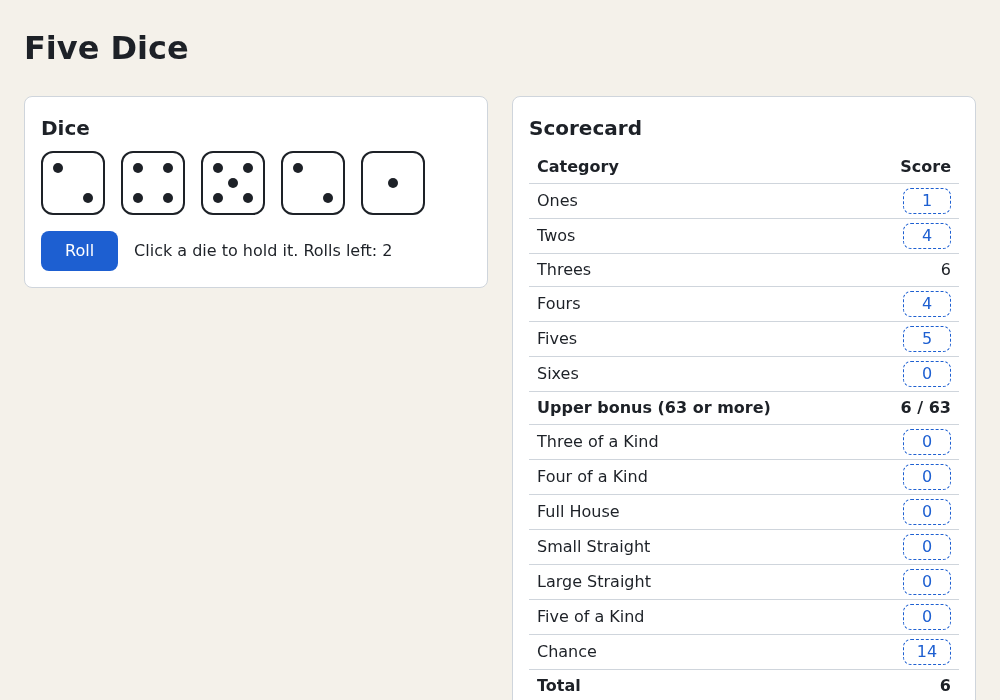

# Chapter 6 — Thinking in React

You have components, props, state and events. This chapter shows how to combine them: which components to
make, what goes into state, where it lives and how data moves. You follow React's five steps on Five Dice,
*derive* values instead of storing them, and *lift state up* when components must agree. The game rules
become pure TypeScript functions with table-driven tests. In the project the scorecard comes alive: after a
roll it offers a score for every open category, a click records it and starts the next turn, and the bonus
and total rows add up. [Chapter 7](07-reducers.md) then gathers the game logic into a reducer.

## The five steps

The React docs suggest five steps for building any UI:

| Step | Question | Five Dice |
|---|---|---|
| 1. Component hierarchy | Which boxes make up the screen? | Chapter 4 |
| 2. Static version | What does it look like with fixed data? | Chapter 4 |
| 3. Minimal state | What is the least data that can change? | Chapters 5 and 6 |
| 4. Where state lives | Which component owns each piece? | Chapters 5 and 6 |
| 5. Inverse data flow | How do children report changes? | Chapters 5 and 6 |

You've done most of this already; naming the steps lets you repeat them on your own apps.

### Step 1: Break the UI into a component hierarchy

Draw a box around every part of the design and name it; each box is a component. A component should do one
thing; if it grows, split it. Boundaries often follow the data: one component per object in your model.

```text
App
├── Panel "Dice"
│   └── DiceTray
│       └── Die  (×5, one per die)
└── Panel "Scorecard"
    └── Scorecard
        └── CategoryRow  (×13, one per category)
```

Five dice and thirteen categories give `Die` and `CategoryRow`.

### Step 2: Build a static version

Build the whole UI from props only, with fixed data and no state ([Chapter 4](04-components-and-jsx.md)).
This separates two kinds of work, which is easier than doing both at once:

- **Building the UI** is mostly typing: JSX, CSS, props passed down.
- **Adding interactivity** is mostly thinking: what changes, who owns it, who changes it.

### Step 3: Find the minimal but complete state

State is data that changes over time and must be remembered. Keep it **minimal**: don't store what you can
compute (DRY, "don't repeat yourself", for state). Store `items`, compute `items.length`. Data is **not**
state if any answer is yes:

1. Does it stay the same over time? Then it's a constant.
2. Is it passed in from a parent through props? Then the parent owns it.
3. Can you compute it from existing state or props? Then compute it during render.

Every piece of data Five Dice shows:

| Data | Unchanged? | From props? | Computable? | Verdict |
|---|---|---|---|---|
| The 13 categories and their labels | yes | | | constant (`rules.ts`) |
| Rolls per turn (3) | yes | | | constant (`MAX_ROLLS`) |
| The five dice: value and held flag | no | no | no | **state** (`dice`) |
| Rolls left this turn | no | no | no | **state** (`rollsLeft`) |
| The scores recorded so far | no | no | no | **state** (`sheet`) |
| Has the player rolled this turn? | | | from `rollsLeft` | derived |
| What each open category would score | | | from `dice` and `sheet` | derived |
| Upper total, bonuses, grand total | | | from `sheet` | derived |
| Turn number (1 to 13) | | | from `sheet` | derived |
| Is the game over? | | | from `sheet` | derived |

Three pieces of state run the whole single-player game; everything else on screen is a function of them.

### Step 4: Decide where each piece of state lives

For each piece of state, find the closest common parent of every component that renders something based on
it, and put the state there or higher (making a new component to hold it if none fits).

| State | Read by | Changed by | Lives in |
|---|---|---|---|
| `dice` | `DiceTray` (shows them), `App` (scores them) | Roll, hold, score | `App` |
| `rollsLeft` | `DiceTray` (Roll button), `App` (has the player rolled?) | Roll, score | `App` |
| `sheet` | `Scorecard` (shows it), `App` (potential scores) | score | `App` |

The dice are the interesting case. Only `DiceTray` *shows* them, but the scorecard needs their values for
potential scores, and the two are siblings. Their closest common parent is `App`, which is why
[Chapter 5](05-state-and-events.md) put the dice there from the start.

### Step 5: Add inverse data flow

Data flows **down** as props, but the user clicks deep in the tree (a `Die`, a score button) and the state
lives at the top. A child can't change its parent's state directly; the parent passes down a function, and
the child calls it:

```text
               App   state: dice, rollsLeft, sheet
              /   \
   props ↓   /     \   ↓ props: sheet, potential, onScore
            /       \
      DiceTray     Scorecard
   ↑ onRoll()       ↑ onScore('chance')
```

This is **one-way data flow**: props down, callbacks up, as with `onRoll` and `onToggleHold` in Chapter 5.
In vanilla code a widget might report with `this.dispatchEvent(new CustomEvent('score'))` while the page
listens for `'score'`; an `onScore` prop is the same idea without the event plumbing. The child reports
*that* something happened, the parent decides *what* it means.

Some frameworks offer *two-way data binding* (Vue's `v-model`, Angular's `[(ngModel)]`), where a child's
change updates the parent's data automatically. React's explicit callback is more typing, but every change runs through the owner's code:
when the screen is wrong, find the owner up the tree and read its handlers.

## Choosing the state structure

Knowing *what* is state is half the job; the other half is its shape. The React docs give five principles:

| Principle | Meaning | In Five Dice |
|---|---|---|
| Group related state | Values that always change together belong in one variable | A die's `value` and `held` live in one object, not in two parallel arrays |
| Avoid contradictions | Don't store state that can disagree with itself | No separate `hasRolled` flag that could say "no" while `rollsLeft` says 2 |
| Avoid redundant state | Don't store what you can compute | Potential scores and totals are computed |
| Avoid duplication | Don't store the same data twice | Hold flags live on the dice, not in a second list of held dice |
| Avoid deep nesting | Prefer flat data | `sheet.scores` is one flat object keyed by category |

The common thread: store every fact once. Two copies drift apart, and you lose an afternoon finding the wrong
one.

### Derived state: compute it, don't store it

The most common violation is adding state for something you show, like the total:

```tsx
// Redundant: the total can be computed from the sheet.
const [sheet, setSheet] = useState(createSheet)
const [total, setTotal] = useState(0)

function handleScore(category: Category) {
  const next = scoreTurn(sheet, category, values)
  setSheet(next)
  setTotal(totals(next).grand) // forget this line and the total is wrong
}
```

Now every handler that changes `sheet` must also update `total`. Compute it during render instead:

```tsx
const [sheet, setSheet] = useState(createSheet)
const total = totals(sheet).grand
```

With nothing to keep in sync, the total can't be wrong. A value computed during render from state or props
is called **derived state**.

Is that slow? Usually not: scoring 13 categories for 5 dice takes microseconds, far less than the render.
For truly expensive work, [Chapter 16](16-rendering-and-performance.md) caches with `useMemo`. Compute
first; cache only when you measure a problem.

### Don't mirror props in state

Copying a prop into state is a special case of redundant state:

`examples/ch06/mirror.demo.tsx`
```tsx
import { useState } from 'react'

function MirroredScore({ score }: { score: number }) {
  // Copies the prop into state on the first render, and never again.
  const [shown] = useState(score)
  return <p>Mirrored in state: {shown}</p>
}

function DirectScore({ score }: { score: number }) {
  return <p>Read from props: {score}</p>
}

export default function MirrorDemo() {
  const [score, setScore] = useState(10)

  return (
    <>
      <h1>Props in state</h1>
      <button type="button" onClick={() => setScore(score + 5)}>
        +5
      </button>
      <MirroredScore score={score} />
      <DirectScore score={score} />
    </>
  )
}
```

Run the examples app and open the demo:

```console
$ cd examples
$ npm run dev
```

At `?demo=ch06/mirror`, click **+5** twice:

```text
Props in state

+5

Mirrored in state: 10

Read from props: 20
```

`useState(score)` uses its argument only on the first render ([Chapter 5](05-state-and-events.md)); then
`shown` belongs to `MirroredScore` and ignores the prop. `DirectScore` reads the prop on every render, so
it's always current.

Read props directly. Copy a prop into state only when you *want* just its first value, such as a starting
value the user then edits, and name it `initialX` or `defaultX` so callers know later changes are ignored
(like `defaultValue` on an `<input>`).

### Preview: state lives at a position, and `key` resets it

Where does `shown` live? Not in the function, and not in the DOM: React keeps state for each component *at
its position in the tree*. While a `MirroredScore` is rendered at the same spot in `MirrorDemo`, React hands
it the same state on every render, whatever its props say. That gives three rules:

- **Same component, same position: state is kept.** That's why `shown` stays 10.
- **Removed, or a different component there: state is destroyed.** A condition that turns false
  ([Chapter 4](04-components-and-jsx.md#conditional-rendering)) throws the state away; when the component
  comes back, `useState` starts from its initial value again.
- **A different `key` counts as a different component.** So `key` works as a reset switch:

  ```tsx
  <MirroredScore key={score} score={score} />
  ```

  Each new score is a new key. React discards the old `MirroredScore` with its state and creates a fresh one,
  which copies the new prop: the line now shows 20 after two clicks. It's like replacing an element with
  `replaceWith(newElement)` instead of updating it.

That's the clean way to reset state when a prop changes, for example one form per player:
`<ScoreForm key={player.id} player={player} />`. Switching players resets the form instead of showing the
last player's half-typed values. [Chapter 10](10-composition-and-context.md#state-lives-in-the-tree-position-and-key)
covers the rules in full.

## Lifting state up

Two components sometimes must change together. Here are two collapsible sections of a rules page, each with
its own `isOpen` flag:

`examples/ch06/lifting.demo.tsx`
```tsx
import { useState, type ReactNode } from 'react'

// Before: each section owns its state, so they can't coordinate.
function SelfSection({ title, children }: { title: string; children: ReactNode }) {
  const [isOpen, setIsOpen] = useState(false)

  return (
    <section>
      <h3>{title}</h3>
      {isOpen ? (
        <p>{children}</p>
      ) : (
        <button type="button" onClick={() => setIsOpen(true)}>
          Show
        </button>
      )}
    </section>
  )
}

// After: the parent owns the state. The section is controlled by its props.
interface SectionProps {
  title: string
  isOpen: boolean
  onShow: () => void
  children: ReactNode
}

export function Section({ title, isOpen, onShow, children }: SectionProps) {
  return (
    <section>
      <h3>{title}</h3>
      {isOpen ? (
        <p>{children}</p>
      ) : (
        <button type="button" onClick={onShow}>
          Show
        </button>
      )}
    </section>
  )
}

export function Rules() {
  const [openIndex, setOpenIndex] = useState(0)

  return (
    <>
      <Section title="Upper section" isOpen={openIndex === 0} onShow={() => setOpenIndex(0)}>
        Add up one face. 63 or more earns a bonus.
      </Section>
      <Section title="Lower section" isOpen={openIndex === 1} onShow={() => setOpenIndex(1)}>
        Score patterns: kinds, a full house, straights.
      </Section>
    </>
  )
}

export default function LiftingDemo() {
  return (
    <>
      <h1>Lifting state up</h1>
      <h2>Each section owns its state</h2>
      <SelfSection title="Upper section">Add up one face. 63 or more earns a bonus.</SelfSection>
      <SelfSection title="Lower section">Score patterns: kinds, a full house, straights.</SelfSection>
      <h2>The parent owns the state</h2>
      <Rules />
    </>
  )
}
```

In the first attempt, `SelfSection`, each section remembers whether it's open, and each **Show** button opens
its own. Then the requirement changes: only one section may be open at a time. Neither section knows the
other's state, so neither can enforce that. **Lift the state up** to their closest common parent:

1. **Remove the state from the child.** `Section` gets `isOpen` as a prop instead of `useState`.
2. **Pass data down from the parent.** `Rules` passes `isOpen={openIndex === 0}` and `isOpen={openIndex === 1}`.
3. **Add state to the parent, with callbacks.** `Rules` holds `openIndex` and passes `onShow` so a section can
   ask to be opened.

`Rules` stores *which* section is open (one number), not a boolean per section, so two open sections can't
even be expressed.

At `?demo=ch06/lifting`, click both **Show** buttons in the first half: both sections open. In the second
half "Upper section" starts open; click the **Show** under "Lower section" and the upper one closes:

```text
The parent owns the state
Upper section
Show
Lower section

Score patterns: kinds, a full house, straights.
```

A test pins the behavior down:

`examples/ch06/lifting.test.tsx`
```tsx
import { fireEvent, render, screen } from '@testing-library/react'
import { expect, it } from 'vitest'
import { Rules } from './lifting.demo'

it('shows one section at a time', () => {
  render(<Rules />)
  expect(screen.getByText(/Add up one face/)).toBeInTheDocument()
  expect(screen.queryByText(/Score patterns/)).not.toBeInTheDocument()

  // Only the closed section has a Show button.
  fireEvent.click(screen.getByRole('button', { name: 'Show' }))

  expect(screen.queryByText(/Add up one face/)).not.toBeInTheDocument()
  expect(screen.getByText(/Score patterns/)).toBeInTheDocument()
})
```

```console
$ npx vitest run ch06
…
   ✓ shows one section at a time 91ms
…
      Tests  1 passed (1)
```

### Controlled and uncontrolled components

The two section components have names you met with inputs in Chapter 5:

- **Uncontrolled**: `SelfSection` keeps its important information in its own state, out of its parent's
  reach. Like `<input defaultValue="…">`, it drops in with no wiring.
- **Controlled**: `Section` gets it from props; its parent decides. Like `<input value={…} onChange={…}>`,
  it needs wiring but can be coordinated with anything else.

Neither is better: go uncontrolled when nobody outside cares, controlled when a parent must read or change
the state. Every interactive component in Five Dice is controlled (`Die` gets `held`, `DiceTray` gets `dice`
and `rollsLeft`, `Scorecard` gets `sheet` and `potential`): the game state must be consistent across the
board, so `App` decides.

### A single source of truth

After lifting, each piece of state has one owner, its **single source of truth**. Everyone else reads it
through props and requests changes through callbacks.

That doesn't put all state at the top. Put it in the *lowest* common parent of its users: a text field's
draft value that only the field uses stays there. State placed too high re-renders more than needed and
clutters the top component. Lift state when a new requirement needs it higher; move it down when it's
needed lower.

## Game rules as pure functions

The scoring rules aren't about React: "three 4s, a 2 and a 1 score 15 in Three of a Kind" holds in a
browser, a terminal or a test. So they live in plain TypeScript in `src/game/`, and components only call
them. Each function is **pure**, like a component ([Chapter 4](04-components-and-jsx.md)): same inputs, same
output, no argument mutation, randomness or DOM. That gives you:

- **Easy tests**: call, check the result; no browser, rendering or mocks.
- **Safety in React**: pure functions can run during render and inside updaters, which React may call twice
  in development.
- **Reuse**: [Chapter 7](07-reducers.md)'s reducer calls the same functions.

It's the split you'd make in a vanilla game too: the rules in plain functions, and a thin layer that touches
the page. Here the rules are `src/game/` and the thin layer is the components. In the project, TypeScript checks that every category has a scoring rule, and table-driven tests check each rule
against hand-worked examples.

## Building five-dice: scoring

The scorecard starts scoring:

- After a roll, every open category shows a dashed button with the points it would score.
- Clicking one records the score, resets the dice and starts a new turn with three rolls.
- The upper bonus row shows progress, such as "21 / 63", until you reach 63, then the 35 bonus.
- A Five of a Kind bonus row appears when you earn one.
- The total row adds everything up.

All of it rests on one new piece of state, `sheet`, and one new file, `scoring.ts`. There's no game over yet:
after 13 turns there's simply nothing left to click. [Chapter 7](07-reducers.md) adds the end of the game.

### `types.ts`: the score sheet

Add two types at the end of `src/game/types.ts`:

`src/game/types.ts`
```ts
/** Points recorded so far. A category is absent until it has been scored. */
export type Scores = Partial<Record<Category, number>>

/** One player's scorecard. */
export interface ScoreSheet {
  scores: Scores
  /** How many +100 Five of a Kind bonuses have been earned. */
  fiveOfAKindBonuses: number
}
```

- `Partial<Record<Category, number>>` is an object with an optional number per category
  ([TypeScript Crash Course, chapter 8](https://github.com/sipak-gh/learn-typescript-crashcourse/blob/master/08-type-manipulation.md#built-in-utility-types)).
- An unscored category is **absent**, not 0. Scoring 0 is a real move (you may write 0 in a category your
  dice don't match), so 0 can't also mean "empty".
- `fiveOfAKindBonuses` counts bonuses; their points (100 each) are derived.

### `rules.ts`: the numbers of the game

Append the full category list and the point values to `src/game/rules.ts`:

`src/game/rules.ts`
```ts
/** All 13 categories, top to bottom. One turn fills one category, so a game is 13 turns. */
export const CATEGORIES: readonly Category[] = [...UPPER_CATEGORIES, ...LOWER_CATEGORIES]

export const UPPER_BONUS_THRESHOLD = 63
export const UPPER_BONUS = 35
export const FULL_HOUSE_POINTS = 25
export const SMALL_STRAIGHT_POINTS = 30
export const LARGE_STRAIGHT_POINTS = 40
export const FIVE_OF_A_KIND_POINTS = 50
/** Optional rule: each extra Five of a Kind after scoring 50 in that box. */
export const FIVE_OF_A_KIND_BONUS = 100
```

Named constants keep the magic numbers in one place. [Appendix C](appendix-c-five-dice-rules.md) has the full
rules.

### `scoring.ts`: the rules as code

Create `src/game/scoring.ts`. It's plain TypeScript with no React; the components only use its exports:

| Export | Returns |
|---|---|
| `scoreCategory(category, values)` | the points these dice would score in one category (0 if the pattern is missing) |
| `createSheet()` | an empty sheet: `{ scores: {}, fiveOfAKindBonuses: 0 }` |
| `scoreTurn(sheet, category, values, bonusRule = true)` | a **new** sheet with that category scored; throws if it was already scored |
| `totals(sheet)` | `{ upper, upperBonus, lower, fiveOfAKindBonus, grand }` |
| `potentialScores(sheet, values)` | what each still-open category would score (a `Scores` object) |
| `isSheetComplete(sheet)` | whether all 13 categories are filled |
| `isFiveOfAKind(values)` | whether all five dice match |

What matters for React:

- **`scoreTurn` never changes its argument.** It builds the new sheet with spread syntax
  ([Chapter 5](05-state-and-events.md)), so it can feed a set function directly. It throws on an
  already-scored category: the UI never offers one, so that's a bug, and failing loudly finds it fast.
- **`totals` and `potentialScores` are pure derivations** from a sheet, cheap enough to call during render.
- **The Five of a Kind bonus is optional**, so `bonusRule` defaults to `true`; [Chapter 9](09-forms.md) adds
  a checkbox for it.
- `scoreCategory`'s `switch` has one `case` per category and no `default`. With the return type `number`,
  forgetting a category is a compile error (`TS2366: Function lacks ending return statement…`); see
  [TypeScript Crash Course, chapter 5](https://github.com/sipak-gh/learn-typescript-crashcourse/blob/master/05-unions-and-narrowing.md#exhaustiveness-checking-with-never).

Inside, `countFaces` turns the dice into a histogram (`[4, 4, 4, 2, 1]` becomes "one 1, one 2, three 4s"),
so three of a kind is "some face appears 3+ times" and a full house is "the counts contain a 3 and a 2".
`longestRun` finds straights whatever the dice order.

<details><summary>Full listing: <code>src/game/scoring.ts</code></summary>

`src/game/scoring.ts`
```ts
import {
  CATEGORIES,
  FIVE_OF_A_KIND_BONUS,
  FIVE_OF_A_KIND_POINTS,
  FULL_HOUSE_POINTS,
  LARGE_STRAIGHT_POINTS,
  LOWER_CATEGORIES,
  SMALL_STRAIGHT_POINTS,
  UPPER_BONUS,
  UPPER_BONUS_THRESHOLD,
  UPPER_CATEGORIES,
} from './rules'
import type { Category, DieValue, Scores, ScoreSheet, UpperCategory } from './types'

const FACE: Record<UpperCategory, DieValue> = {
  ones: 1,
  twos: 2,
  threes: 3,
  fours: 4,
  fives: 5,
  sixes: 6,
}

/** counts[face] = how many dice show that face. Index 0 is unused. */
function countFaces(values: readonly DieValue[]): number[] {
  const counts = [0, 0, 0, 0, 0, 0, 0]
  for (const value of values) counts[value]++
  return counts
}

function sum(values: readonly number[]): number {
  return values.reduce((total, value) => total + value, 0)
}

/** Length of the longest run of consecutive faces, e.g. 2-3-4-5 → 4. */
function longestRun(counts: readonly number[]): number {
  let longest = 0
  let run = 0
  for (let face = 1; face <= 6; face++) {
    run = counts[face] > 0 ? run + 1 : 0
    longest = Math.max(longest, run)
  }
  return longest
}

export function isFiveOfAKind(values: readonly DieValue[]): boolean {
  return values.length === 5 && values.every((value) => value === values[0])
}

/** The points these dice would score in `category`. 0 if the pattern is missing. */
export function scoreCategory(category: Category, values: readonly DieValue[]): number {
  const counts = countFaces(values)
  const most = Math.max(...counts)

  switch (category) {
    case 'ones':
    case 'twos':
    case 'threes':
    case 'fours':
    case 'fives':
    case 'sixes':
      return counts[FACE[category]] * FACE[category]
    case 'threeOfAKind':
      return most >= 3 ? sum(values) : 0
    case 'fourOfAKind':
      return most >= 4 ? sum(values) : 0
    case 'fullHouse':
      // "Three of one number and two of another": five of a kind does not count.
      return counts.includes(3) && counts.includes(2) ? FULL_HOUSE_POINTS : 0
    case 'smallStraight':
      return longestRun(counts) >= 4 ? SMALL_STRAIGHT_POINTS : 0
    case 'largeStraight':
      return longestRun(counts) === 5 ? LARGE_STRAIGHT_POINTS : 0
    case 'fiveOfAKind':
      return most === 5 ? FIVE_OF_A_KIND_POINTS : 0
    case 'chance':
      return sum(values)
  }
}

export function createSheet(): ScoreSheet {
  return { scores: {}, fiveOfAKindBonuses: 0 }
}

/**
 * Record the score for `category` and return a new sheet.
 * With `bonusRule` on, rolling another Five of a Kind after already scoring
 * 50 in that box earns a +100 bonus, whichever category you score it in.
 */
export function scoreTurn(
  sheet: ScoreSheet,
  category: Category,
  values: readonly DieValue[],
  bonusRule = true,
): ScoreSheet {
  if (sheet.scores[category] !== undefined) {
    throw new Error(`${category} has already been scored`)
  }
  const earnsBonus =
    bonusRule && isFiveOfAKind(values) && sheet.scores.fiveOfAKind === FIVE_OF_A_KIND_POINTS
  return {
    scores: { ...sheet.scores, [category]: scoreCategory(category, values) },
    fiveOfAKindBonuses: sheet.fiveOfAKindBonuses + (earnsBonus ? 1 : 0),
  }
}

export interface Totals {
  upper: number
  upperBonus: number
  lower: number
  fiveOfAKindBonus: number
  grand: number
}

export function totals(sheet: ScoreSheet): Totals {
  const add = (categories: readonly Category[]) =>
    sum(categories.map((category) => sheet.scores[category] ?? 0))
  const upper = add(UPPER_CATEGORIES)
  const upperBonus = upper >= UPPER_BONUS_THRESHOLD ? UPPER_BONUS : 0
  const lower = add(LOWER_CATEGORIES)
  const fiveOfAKindBonus = sheet.fiveOfAKindBonuses * FIVE_OF_A_KIND_BONUS
  return { upper, upperBonus, lower, fiveOfAKindBonus, grand: upper + upperBonus + lower + fiveOfAKindBonus }
}

export function isSheetComplete(sheet: ScoreSheet): boolean {
  return CATEGORIES.every((category) => sheet.scores[category] !== undefined)
}

/** What each still-open category would score with these dice. Used ones are left out. */
export function potentialScores(sheet: ScoreSheet, values: readonly DieValue[]): Scores {
  const result: Scores = {}
  for (const category of CATEGORIES) {
    if (sheet.scores[category] === undefined) {
      result[category] = scoreCategory(category, values)
    }
  }
  return result
}
```

</details>

### `scoring.test.ts`: table-driven tests

Scoring rules are easy to get subtly wrong. Is five of a kind a full house? Does a large straight count as a
small one? Write the answers down as tests in `src/game/scoring.test.ts`. The core is one table:

```ts
describe('scoreCategory', () => {
  // it.each runs the same test once per row of the table.
  it.each<[Category, DieValue[], number]>([
    ['ones', [1, 1, 2, 3, 1], 3],
    // … 18 more rows …
    ['chance', [1, 2, 3, 4, 6], 16],
  ])('%s with %j scores %i', (category, values, expected) => {
    expect(scoreCategory(category, values)).toBe(expected)
  })
})
```

- **`it.each(table)(name, fn)`** runs `fn` once per row with the row's values as arguments. In this
  *table-driven test*, a new case is a new row. The type argument `<[Category, DieValue[], number]>` types
  each row, so a typo like `'chanse'` or a die of 7 doesn't compile.
- **The name is a template**: `%s` prints a string, `%j` a value as JSON, `%i` an integer, in argument
  order.
- **The edge cases are the point.** The commented rows in the full listing answer the questions above, each
  a rule decision from [Appendix C](appendix-c-five-dice-rules.md).
- The other `describe` blocks check that `scoreTurn` leaves the old sheet alone, allows a 0, refuses a
  second score and applies the bonus rule; that `potentialScores` skips used categories; that `totals` gives
  the bonus at exactly 63 but not 62; and that `isSheetComplete` turns true only after 13 turns.
- `toEqual` compares objects by content, `toBe` with `Object.is`; `toMatchObject` checks only the listed
  keys. `toThrow('…')` passes if the error message contains the text.
- `describe` blocks nest; the Five of a Kind tests share two prepared sheets.

<details><summary>Full listing: <code>src/game/scoring.test.ts</code></summary>

`src/game/scoring.test.ts`
```ts
import { describe, expect, it } from 'vitest'
import { createSheet, isSheetComplete, potentialScores, scoreCategory, scoreTurn, totals } from './scoring'
import { CATEGORIES } from './rules'
import type { Category, DieValue, ScoreSheet } from './types'

describe('scoreCategory', () => {
  // it.each runs the same test once per row of the table.
  it.each<[Category, DieValue[], number]>([
    ['ones', [1, 1, 2, 3, 1], 3],
    ['threes', [3, 3, 2, 3, 1], 9],
    ['sixes', [1, 2, 3, 4, 5], 0],
    ['threeOfAKind', [4, 4, 4, 2, 1], 15],
    ['threeOfAKind', [4, 4, 4, 4, 1], 17], // four of a kind also has three
    ['threeOfAKind', [4, 4, 3, 3, 1], 0],
    ['fourOfAKind', [5, 5, 5, 5, 2], 22],
    ['fourOfAKind', [5, 5, 5, 2, 2], 0],
    ['fullHouse', [2, 2, 3, 3, 3], 25],
    ['fullHouse', [6, 6, 6, 6, 6], 0], // five of a kind is not "two of another"
    ['fullHouse', [2, 2, 3, 3, 4], 0],
    ['smallStraight', [1, 2, 3, 4, 6], 30],
    ['smallStraight', [6, 5, 3, 4, 3], 30], // order doesn't matter
    ['smallStraight', [1, 2, 3, 4, 5], 30], // a large straight contains a small one
    ['smallStraight', [1, 2, 3, 5, 6], 0],
    ['largeStraight', [2, 3, 4, 5, 6], 40],
    ['largeStraight', [1, 2, 3, 4, 6], 0],
    ['fiveOfAKind', [3, 3, 3, 3, 3], 50],
    ['fiveOfAKind', [3, 3, 3, 3, 2], 0],
    ['chance', [1, 2, 3, 4, 6], 16],
  ])('%s with %j scores %i', (category, values, expected) => {
    expect(scoreCategory(category, values)).toBe(expected)
  })
})

describe('scoreTurn', () => {
  it('records the score without changing the old sheet', () => {
    const sheet = createSheet()
    const next = scoreTurn(sheet, 'chance', [1, 2, 3, 4, 5])
    expect(next.scores.chance).toBe(15)
    expect(sheet.scores).toEqual({})
  })

  it('allows scoring 0 in a category that does not match', () => {
    expect(scoreTurn(createSheet(), 'largeStraight', [1, 1, 1, 1, 1]).scores.largeStraight).toBe(0)
  })

  it('refuses to score the same category twice', () => {
    const sheet = scoreTurn(createSheet(), 'ones', [1, 1, 1, 2, 3])
    expect(() => scoreTurn(sheet, 'ones', [1, 1, 1, 1, 1])).toThrow('already been scored')
  })

  describe('Five of a Kind bonus', () => {
    const withFifty: ScoreSheet = { scores: { fiveOfAKind: 50 }, fiveOfAKindBonuses: 0 }
    const withZero: ScoreSheet = { scores: { fiveOfAKind: 0 }, fiveOfAKindBonuses: 0 }

    it('is earned by another Five of a Kind after scoring 50', () => {
      expect(scoreTurn(withFifty, 'sixes', [6, 6, 6, 6, 6]).fiveOfAKindBonuses).toBe(1)
    })

    it('is not earned if Five of a Kind was scored as 0', () => {
      expect(scoreTurn(withZero, 'sixes', [6, 6, 6, 6, 6]).fiveOfAKindBonuses).toBe(0)
    })

    it('is not earned when the optional rule is off', () => {
      expect(scoreTurn(withFifty, 'sixes', [6, 6, 6, 6, 6], false).fiveOfAKindBonuses).toBe(0)
    })
  })
})

describe('potentialScores', () => {
  it('lists only the categories that are still open', () => {
    const sheet = scoreTurn(createSheet(), 'chance', [1, 1, 1, 1, 1])
    const potential = potentialScores(sheet, [2, 2, 2, 3, 3])
    expect(potential.chance).toBeUndefined()
    expect(potential).toMatchObject({ twos: 6, threes: 6, fullHouse: 25, threeOfAKind: 12 })
    expect(Object.keys(potential)).toHaveLength(12)
  })
})

describe('totals', () => {
  it('adds the 35 point bonus at exactly 63 in the upper section', () => {
    // Three of each face is exactly 63: 3 + 6 + 9 + 12 + 15 + 18.
    const sheet: ScoreSheet = {
      scores: { ones: 3, twos: 6, threes: 9, fours: 12, fives: 15, sixes: 18, chance: 20 },
      fiveOfAKindBonuses: 1,
    }
    expect(totals(sheet)).toEqual({
      upper: 63,
      upperBonus: 35,
      lower: 20,
      fiveOfAKindBonus: 100,
      grand: 218,
    })
  })

  it('gives no upper bonus at 62', () => {
    expect(totals({ scores: { sixes: 30, fives: 25, twos: 4, ones: 3 }, fiveOfAKindBonuses: 0 }).upperBonus).toBe(0)
  })
})

describe('isSheetComplete', () => {
  it('is true only when all 13 categories are filled', () => {
    let sheet = createSheet()
    for (const category of CATEGORIES) {
      expect(isSheetComplete(sheet)).toBe(false)
      sheet = scoreTurn(sheet, category, [1, 2, 3, 4, 5])
    }
    expect(isSheetComplete(sheet)).toBe(true)
  })
})
```

</details>

Run just this file by passing part of its name; the output lists every row:

```console
$ npx vitest run scoring
…
     ✓ fullHouse with [6,6,6,6,6] scores 0 0ms
…
     ✓ smallStraight with [1,2,3,4,5] scores 30 0ms
…
      Tests  30 passed (30)
```

### `Scorecard`: three kinds of cell

`Scorecard` now gets everything it shows through props. Replace `src/components/Scorecard.tsx`:

`src/components/Scorecard.tsx`
```tsx
import { CATEGORY_LABELS, LOWER_CATEGORIES, UPPER_BONUS_THRESHOLD, UPPER_CATEGORIES } from '../game/rules'
import { totals } from '../game/scoring'
import type { Category, Scores, ScoreSheet } from '../game/types'

interface ScorecardProps {
  sheet: ScoreSheet
  /** What each open category would score with the current dice, or null before the first roll. */
  potential: Scores | null
  onScore: (category: Category) => void
}

interface CategoryRowProps {
  category: Category
  score: number | undefined
  potential: number | null
  onScore: (category: Category) => void
}

function CategoryRow({ category, score, potential, onScore }: CategoryRowProps) {
  // Three possible cells: an existing score, a button to score now, or nothing.
  let cell
  if (score !== undefined) {
    cell = score
  } else if (potential !== null) {
    cell = (
      <button type="button" className="score-button" onClick={() => onScore(category)}>
        {potential}
      </button>
    )
  }

  return (
    <tr>
      <td>{CATEGORY_LABELS[category]}</td>
      <td className="score">{cell}</td>
    </tr>
  )
}

export function Scorecard({ sheet, potential, onScore }: ScorecardProps) {
  const sums = totals(sheet)

  function renderRow(category: Category) {
    return (
      <CategoryRow
        key={category}
        category={category}
        score={sheet.scores[category]}
        potential={potential?.[category] ?? null}
        onScore={onScore}
      />
    )
  }

  return (
    <table className="scorecard">
      <thead>
        <tr>
          <th>Category</th>
          <th className="score">Score</th>
        </tr>
      </thead>
      <tbody>
        {UPPER_CATEGORIES.map(renderRow)}
        <tr className="subtotal">
          <td>Upper bonus ({UPPER_BONUS_THRESHOLD} or more)</td>
          <td className="score">
            {sums.upperBonus > 0 ? sums.upperBonus : `${sums.upper} / ${UPPER_BONUS_THRESHOLD}`}
          </td>
        </tr>
      </tbody>
      <tbody>
        {LOWER_CATEGORIES.map(renderRow)}
        {sums.fiveOfAKindBonus > 0 && (
          <tr className="subtotal">
            <td>Five of a Kind bonus</td>
            <td className="score">{sums.fiveOfAKindBonus}</td>
          </tr>
        )}
      </tbody>
      <tfoot>
        <tr className="total">
          <td>Total</td>
          <td className="score">{sums.grand}</td>
        </tr>
      </tfoot>
    </table>
  )
}
```

- **`CategoryRow`** shows the recorded score, a button with the potential score, or nothing (before the
  first roll). A `let` filled by `if`/`else if` is often clearer than nested ternaries
  ([Chapter 4](04-components-and-jsx.md)); a cell left `undefined` renders nothing.
- **`potential`** is `null` before a turn's first roll. In `potential?.[category] ?? null`, `?.` stops at
  `null` and `?? null` turns a missing entry (a scored category) into `null`.
- **`renderRow`** builds a row from a category, so `UPPER_CATEGORIES.map(renderRow)` reads like a sentence.
  It's a plain function called directly, not a component, so it's part of `Scorecard`'s render.
- **Totals are derived**: `totals(sheet)` runs on every render. The upper bonus cell shows progress
  (`21 / 63`) until the bonus is earned, then 35.
- **`{cond && <tr>…</tr>}`** shows the bonus row once a bonus exists. `sums.fiveOfAKindBonus > 0` is a
  boolean, so `false` renders nothing (a bare `0` would appear; [Chapter 4](04-components-and-jsx.md)).
- `Scorecard` decides nothing: a click calls `onScore(category)`, and `App` decides what scoring means.

### `App`: the third piece of state

Replace `src/App.tsx`:

`src/App.tsx`
```tsx
import { useState } from 'react'
import { DiceTray } from './components/DiceTray'
import { Panel } from './components/Panel'
import { Scorecard } from './components/Scorecard'
import { applyRoll, createDice, rollDice, toggleHold } from './game/dice'
import { MAX_ROLLS } from './game/rules'
import { createSheet, potentialScores, scoreTurn } from './game/scoring'
import type { Category } from './game/types'

function App() {
  const [dice, setDice] = useState(() => createDice())
  const [rollsLeft, setRollsLeft] = useState(MAX_ROLLS)
  const [sheet, setSheet] = useState(createSheet)

  // Derived state: computed during render from the state above, never stored.
  const hasRolled = rollsLeft < MAX_ROLLS
  const values = dice.map((die) => die.value)
  const potential = hasRolled ? potentialScores(sheet, values) : null

  function handleRoll() {
    const values = rollDice()
    setDice((current) => applyRoll(current, values))
    setRollsLeft((n) => n - 1)
  }

  function handleToggleHold(id: number) {
    setDice((current) => toggleHold(current, id))
  }

  function handleScore(category: Category) {
    // Three related updates in one handler. React batches them into one re-render.
    setSheet(scoreTurn(sheet, category, values))
    setDice(createDice())
    setRollsLeft(MAX_ROLLS)
  }

  return (
    <div className="app">
      <header className="app-header">
        <h1>Five Dice</h1>
      </header>

      <main className="board">
        <Panel title="Dice">
          <DiceTray
            dice={dice}
            rollsLeft={rollsLeft}
            onRoll={handleRoll}
            onToggleHold={handleToggleHold}
          />
        </Panel>

        <Panel title="Scorecard">
          <Scorecard sheet={sheet} potential={potential} onScore={handleScore} />
        </Panel>
      </main>

      <footer className="app-footer">
        <p>
          Rules: <a href="https://beesboardsma.com/pages/five-dice">Five Dice</a>
        </p>
      </footer>
    </div>
  )
}

export default App
```

- **`useState(createSheet)`** passes the function itself: lazy initial state
  ([Chapter 5](05-state-and-events.md)). Two Chapter 5 comments are gone to keep the file short; the code is
  unchanged.
- **Derived values** sit right under the state: `hasRolled`, `values` and `potential` are recomputed every
  render, never stored. `potential` is `null` until the player rolls, so nothing is offered for the starting
  dice.
- **`handleScore`** ends a turn with three set calls. React **batches** them
  ([Chapter 5](05-state-and-events.md)) into one re-render with the new sheet, fresh dice and three rolls, so
  the screen never shows a half-finished turn.
- `handleScore` reads `sheet` and `values` from the render's snapshot. That's correct: one click scores once,
  from the dice the player sees. [Chapter 7](07-reducers.md) moves the three updates into one function.
- `DiceTray` is unchanged: `dice` and `rollsLeft` down, clicks up.

### Styles

Append the score button styles to the end of `src/index.css`:

`src/index.css`
```css
.score-button {
  min-width: 3rem;
  padding: 0 var(--space-2);
  color: var(--color-accent);
  background: transparent;
  border: 1px dashed var(--color-accent);
  border-radius: var(--radius);
  cursor: pointer;
}

.score-button:hover {
  color: #fff;
  background: var(--color-accent);
}
```

The dashed border marks a cell you *could* fill, as on a paper scorecard; on `:hover` the button fills with
the accent color.

### Checkpoint

Run the dev server and open the page:

```console
$ npm run dev
```

- Before the first roll, the scorecard is empty except "0 / 63" in the upper bonus row and a total of 0.
- Click **Roll**: every category offers a dashed button. With 6 5 4 3 3, for example, Threes shows 6, Small
  Straight 30, Chance 21 and Full House 0.
- Roll again or hold dice: the buttons update with every roll.
- Click a button, say Chance: the score is recorded, the total updates, the dice reset to 1 to 5 and the
  text reads "Roll to start your turn. Rolls left: 3".
- Scored categories show plain numbers and aren't offered again; upper scores count toward the bonus row
  ("6 / 63").
- After 13 turns every row is filled and nothing is left to click. Reload to play again.



Then run the checks (these are the lines that matter):

```console
$ npm run build
…
✓ 23 modules transformed.
…
$ npm run lint
…
Found 0 warnings and 0 errors.
$ npx vitest run
…
 ✓ src/game/dice.test.ts (6 tests) 4ms
 ✓ src/game/scoring.test.ts (30 tests) 8ms
…
      Tests  36 passed (36)
```

The build has one more module, `scoring.ts`. With two test files, Vitest prints one line per file; name a
file (`npx vitest run scoring`) to see every test.

The complete project at this point is in `project/ch06/`.

## Summary

- **Thinking in React**: component hierarchy, static version, minimal state, where state lives, inverse data
  flow.
- **Minimal state** excludes what never changes, comes from props, or can be computed. Five Dice needs only
  `dice`, `rollsLeft` and `sheet`; totals, potential scores and "has rolled" are **derived** during render.
- **Structure state** so each fact is stored once: group related values; avoid contradictions, redundancy,
  duplication and deep nesting. Don't copy props into state; name a starting-value prop `initialX`.
- **Lift state up** to the closest common parent when components must agree. **One-way data flow**: props
  down, callbacks up; each piece of state has one owner, its single source of truth.
- **Controlled** components get their important data from props; **uncontrolled** ones keep it in state.
- State lives at a **position** in the tree. A different `key` there means a fresh component with fresh
  state, so `key` resets state when an identity changes ([Chapter 10](10-composition-and-context.md)).
- Keep game rules in **pure TypeScript functions** with **table-driven tests** (`it.each`). An exhaustive
  `switch` with a declared return type makes the compiler catch a missing case.

## Exercises

1. **Turn counter.** Show "Dice: turn 1 of 13" as the dice panel's title, counting up as you score. Don't add
   state.

   <details><summary>Solution</summary>

   The turn number is derived from the sheet: one more than the number of scored categories. In `App.tsx`,
   import `CATEGORIES` too:

   ```tsx
   import { CATEGORIES, MAX_ROLLS } from './game/rules'
   ```

   Add a derived value under `potential`:

   ```tsx
   const turn = Math.min(Object.keys(sheet.scores).length + 1, CATEGORIES.length)
   ```

   and use it in the panel title:

   ```tsx
   <Panel title={`Dice: turn ${turn} of ${CATEGORIES.length}`}>
   ```

   `Math.min` keeps it at 13 once the sheet is full. The title reads "Dice: turn 1 of 13", then "Dice: turn 2
   of 13" after the first score. A `turn` state variable would need updating in `handleScore` and could
   disagree with the sheet.

   </details>

2. **More edge cases.** Add these rows to the `scoreCategory` table and run the tests. Do they pass?

   - Five 2s in Four of a Kind.
   - 1-2-3-4-5 as a Large Straight.
   - 1-1-2-3-4 as a Small Straight.

   <details><summary>Solution</summary>

   Add the rows after the `chance` row:

   ```ts
   ['fourOfAKind', [2, 2, 2, 2, 2], 10], // five of a kind also has four
   ['largeStraight', [1, 2, 3, 4, 5], 40], // the low straight counts too
   ['smallStraight', [1, 1, 2, 3, 4], 30], // a pair inside the run
   ```

   All three pass. `npx vitest run scoring` lists them with the others:

   ```text
        ✓ chance with [1,2,3,4,6] scores 16 0ms
        ✓ fourOfAKind with [2,2,2,2,2] scores 10 0ms
        ✓ largeStraight with [1,2,3,4,5] scores 40 0ms
        ✓ smallStraight with [1,1,2,3,4] scores 30 0ms
   ```

   and the summary says `Tests  33 passed (33)`. `most >= 4` covers five of a kind, `longestRun` sees 1 to 5
   as a run of five, and the counts ignore duplicates. A passing test still documents the rule and protects
   it from future changes.

   </details>

3. **Highlight the best move.** After a roll, give the button(s) with the highest potential score a solid
   border and bold text; on a tie, highlight them all.

   <details><summary>Solution</summary>

   "Best" is derived from `potential`, so compute it in `Scorecard` and pass a flag to each row. In
   `Scorecard.tsx`, add `isBest: boolean` to `CategoryRowProps`, take it in `CategoryRow`, and use it for the
   class name:

   ```tsx
   function CategoryRow({ category, score, potential, isBest, onScore }: CategoryRowProps) {
   ```

   ```tsx
   <button
     type="button"
     className={isBest ? 'score-button score-button--best' : 'score-button'}
     onClick={() => onScore(category)}
   >
   ```

   In `Scorecard`, compute the best score under `sums` and pass the flag in `renderRow`:

   ```tsx
   // The highest score on offer, or null before the first roll.
   const best = potential === null ? null : Math.max(...Object.values(potential))
   ```

   ```tsx
   isBest={potential?.[category] === best}
   ```

   Append to `index.css`:

   ```css
   .score-button--best {
     font-weight: 700;
     border-style: solid;
   }
   ```

   With the dice 6 5 4 3 3, only Small Straight (30) is highlighted. Before a roll `best` is `null` and
   `potential?.[category]` is `undefined`, so no row is flagged.

   </details>

4. **Lift a setting up.** Add a "Five of a Kind bonus" checkbox to the header, on by default. When it's off,
   `handleScore` must call `scoreTurn` with `bonusRule` set to `false`. Where does the state live, and is the
   checkbox controlled?

   <details><summary>Solution</summary>

   The checkbox shows the setting and `handleScore` uses it; both are in `App`, so the state lives there. In
   `App.tsx`, add state:

   ```tsx
   const [bonusRule, setBonusRule] = useState(true)
   ```

   pass it to `scoreTurn`:

   ```tsx
   setSheet(scoreTurn(sheet, category, values, bonusRule))
   ```

   and add a controlled checkbox under the `<h1>`:

   ```tsx
   <label>
     <input
       type="checkbox"
       checked={bonusRule}
       onChange={(e) => setBonusRule(e.target.checked)}
     />{' '}
     Five of a Kind bonus
   </label>
   ```

   For a checkbox, the controlled prop is `checked`, not `value`, and the new value is `e.target.checked`.
   It's controlled: `App` owns the value and the input reports changes up. The existing test
   `is not earned when the optional rule is off` already covers the rule. [Chapter 9](09-forms.md) moves this
   setting into a new-game form.

   </details>

5. **Spot the redundant state.** A colleague writes this. Name every piece of redundant state and rewrite it.

   ```tsx
   const [dice, setDice] = useState(() => createDice())
   const [rollsLeft, setRollsLeft] = useState(MAX_ROLLS)
   const [hasRolled, setHasRolled] = useState(false)
   const [sheet, setSheet] = useState(createSheet)
   const [potential, setPotential] = useState<Scores | null>(null)
   const [total, setTotal] = useState(0)
   ```

   <details><summary>Solution</summary>

   `hasRolled`, `potential` and `total` are all computable:

   ```tsx
   const [dice, setDice] = useState(() => createDice())
   const [rollsLeft, setRollsLeft] = useState(MAX_ROLLS)
   const [sheet, setSheet] = useState(createSheet)

   const hasRolled = rollsLeft < MAX_ROLLS
   const potential = hasRolled ? potentialScores(sheet, dice.map((die) => die.value)) : null
   const total = totals(sheet).grand
   ```

   In the original, every roll, hold and score must update `potential`; every roll and score, `hasRolled`;
   every score, `total`. Miss one and the screen lies: if `handleRoll` forgot `setPotential`, the buttons
   would offer scores for the previous dice.

   </details>

Sources for this chapter: [REFERENCES.md](REFERENCES.md#chapter-6--thinking-in-react)
