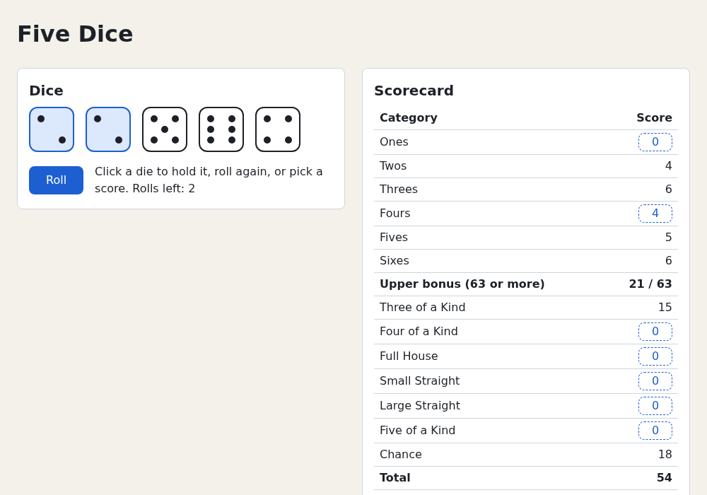

# Chapter 7 — Reducers

In [Chapter 6](06-thinking-in-react.md) the game logic was spread across event handlers. This chapter moves
it into one pure function, a *reducer*. You learn `useReducer`, actions as discriminated unions, compiler
checks that every action is handled, and the game as a state machine. The project becomes a complete game:
13 turns, game over and "Play again". [Chapter 8](08-testing.md) then tests the reducer without a browser.

## Why a reducer

`handleScore` from Chapter 6:

```tsx
function handleScore(category: Category) {
  setSheet(scoreTurn(sheet, category, values))
  setDice(createDice())
  setRollsLeft(MAX_ROLLS)
}
```

Three problems grow with the app:

- **The logic lives in the component.** "Scoring ends the turn" is a game rule, written as setter calls. You
  can't run it without rendering `App`.
- **Linked updates are separate.** Forget one setter and you get a new turn that still shows the old dice.
- **The rules are scattered.** `DiceTray` decides whether you may hold; a `disabled` prop decides whether you
  may roll. Nothing stops a handler from rolling a fourth time.

A *reducer* fixes all three. It is a plain function from the current state and an *action* (what happened)
to the next state:

```ts
type Reducer<S, A> = (state: S, action: A) => S
```

The name comes from `Array.prototype.reduce` ([Chapter 3](03-javascript-for-react.md)): `actions.reduce(reducer,
start)` folds a list of actions into the final state. If you've seen Redux, it's the same idea; `useReducer`
gives one component a small Redux of its own.

The component no longer decides *how* the state changes; it reports *what happened*:

```tsx
function handleScore(category: Category) {
  dispatch({ type: 'score', category })
}
```

## `useReducer`

`useReducer` connects a reducer to a component. A counter with undo:

`examples/ch07/counter.demo.tsx`
```tsx
import { useReducer } from 'react'

interface CounterState {
  count: number
  /** Earlier counts, newest last, for "Undo". */
  history: number[]
}

type CounterAction = { type: 'add'; amount: number } | { type: 'undo' } | { type: 'reset' }

// The reducer: (state, action) => next state. It lives outside the component
// and knows nothing about React.
function counterReducer(state: CounterState, action: CounterAction): CounterState {
  switch (action.type) {
    case 'add':
      return { count: state.count + action.amount, history: [...state.history, state.count] }
    case 'undo':
      if (state.history.length === 0) return state
      return { count: state.history[state.history.length - 1], history: state.history.slice(0, -1) }
    case 'reset':
      return { count: 0, history: [] }
  }
}

export default function Counter() {
  const [state, dispatch] = useReducer(counterReducer, { count: 0, history: [] })

  // The event handlers only say WHAT happened. The reducer decides what it means.
  return (
    <main>
      <h1>Count: {state.count}</h1>
      <button type="button" onClick={() => dispatch({ type: 'add', amount: 1 })}>
        +1
      </button>
      <button type="button" onClick={() => dispatch({ type: 'add', amount: 5 })}>
        +5
      </button>
      <button type="button" onClick={() => dispatch({ type: 'undo' })} disabled={state.history.length === 0}>
        Undo
      </button>
      <button type="button" onClick={() => dispatch({ type: 'reset' })}>
        Reset
      </button>
    </main>
  )
}
```

Run it from the `examples` folder:

```console
$ npm run dev
```

Open `http://localhost:5173/?demo=ch07/counter`. Click +5 and +1: `Count: 6`. Undo goes to 5, then 0, then
disables.

The call:

```ts
const [state, dispatch] = useReducer(reducer, initialArg, init?)
```

- `reducer`: your `(state, action) => state` function.
- `initialArg`: the first state. With `init`, React uses `init(initialArg)`, called once, instead: like the
  lazy `useState(() => …)` from [Chapter 5](05-state-and-events.md).
- `state`: this render's state.
- `dispatch(action)`: requests an update. Call it from event handlers.

### What `dispatch` does

`dispatch` works like a Chapter 5 state setter:

1. It queues the action. `state` does **not** change in the running code; it is this render's snapshot.
2. React renders again, runs `reducer(currentState, action)` for each queued action in order, and uses the
   result as the new `state`.
3. Dispatches in one event handler batch into one re-render.
4. If the reducer returns the *same* object (`Object.is`), React skips re-rendering the component and its
   children (it may still call your component once and discard the result). Returning `state` means
   "nothing happened".

`dispatch` never changes between renders, so pass it to children freely.

### Typing `useReducer`: annotate the reducer, not the hook

Type the reducer's parameters and return value, and let TypeScript infer the rest:

```tsx
function counterReducer(state: CounterState, action: CounterAction): CounterState { … }

const [state, dispatch] = useReducer(counterReducer, { count: 0, history: [] })
// state: CounterState
// dispatch: ActionDispatch<[action: CounterAction]>
```

Older code and tutorials pass the reducer type to the hook, `useReducer<Reducer<CounterState,
CounterAction>>(…)`. React 19's types changed the type parameters to `useReducer<S, A>`, where `A` is the
*tuple* of `dispatch`'s arguments, so that form fails with `error TS2558: Expected 2 type arguments, but got
1.` If you must spell them out, write `useReducer<CounterState, [CounterAction]>(…)`; usually, leave them
out.

To pass `dispatch` itself to a child, type the prop with `Dispatch` from `'react'`:

```tsx
import type { Dispatch } from 'react'

function CounterButtons({ dispatch }: { dispatch: Dispatch<CounterAction> }) {
  return (
    <button type="button" onClick={() => dispatch({ type: 'add', amount: 1 })}>
      +1
    </button>
  )
}
```

`Dispatch<A>` is `(value: A) => void`, and the `dispatch` from `useReducer` fits it. Five Dice passes named
callbacks (`onRoll`, `onScore`) instead, which keeps children unaware of the action type; passing `dispatch`
pays off when a child sends many different actions.

### `useState` is a special case

`useState` is a `useReducer` with one built-in action: "replace the state" (with a value, or what a function
returns). `useReducer` lets you name your own actions and keep their meaning in one place.

## Actions as discriminated unions

`CounterAction` is a *discriminated union*: inside `case 'add':`, TypeScript knows `action.amount` exists
([TypeScript Crash Course, chapter 5](https://github.com/sipak-gh/learn-typescript-crashcourse/blob/master/05-unions-and-narrowing.md#discriminated-unions)).
For React, the payoff is that `dispatch` is typed by it. A typo when dispatching:

```text
ch07/counter.demo.tsx:35:55 - error TS2322: Type '"ad"' is not assignable to type '"add" | "reset" | "undo"'.

35       <button type="button" onClick={() => dispatch({ type: 'ad', amount: 5 })}>
                                                         ~~~~
```

Forgetting `amount` on an `'add'`, or reading `action.amount` in the `'reset'` case, fails the same way. With
`setState` and a loose object, these bugs would reach the browser.

Two habits:

- **Name actions after events, not setters.** `{ type: 'score', category }` says what the player did.
  `{ type: 'setRollsLeft', value: 3 }` is a setter in disguise that moves logic back into the component.
- **Put only facts in the action.** The reducer computes the rest from the state.

## Exhaustive switches with `never`

Reducers suit small state machines. This door is open, closed or locked. The state is itself a discriminated
union, so only a locked door has a `code`:

`examples/ch07/door.ts`
```ts
// A reducer is plain TypeScript. You can run and test it without React or a browser.

// The state is itself a discriminated union: only a locked door has a code.
type DoorState = { phase: 'open' } | { phase: 'closed' } | { phase: 'locked'; code: string }

type DoorAction =
  | { type: 'open' }
  | { type: 'close' }
  | { type: 'lock'; code: string }
  | { type: 'unlock'; code: string }

function doorReducer(state: DoorState, action: DoorAction): DoorState {
  switch (action.type) {
    case 'open':
      return state.phase === 'closed' ? { phase: 'open' } : state
    case 'close':
      return state.phase === 'open' ? { phase: 'closed' } : state
    case 'lock':
      return state.phase === 'closed' ? { phase: 'locked', code: action.code } : state
    case 'unlock':
      return state.phase === 'locked' && state.code === action.code ? { phase: 'closed' } : state
    default: {
      // Every action type is handled above, so `action` has type `never` here.
      const unhandled: never = action
      throw new Error(`Unknown action: ${JSON.stringify(unhandled)}`)
    }
  }
}

const actions: DoorAction[] = [
  { type: 'lock', code: '1234' }, // the door is open: ignored
  { type: 'close' },
  { type: 'lock', code: '1234' },
  { type: 'open' }, // locked: ignored
  { type: 'unlock', code: '0000' }, // wrong code: ignored
  { type: 'unlock', code: '1234' },
  { type: 'open' },
]

let state: DoorState = { phase: 'open' }
for (const action of actions) {
  const next = doorReducer(state, action)
  // An ignored action returns the very same object.
  console.log(JSON.stringify(action).padEnd(32), next === state ? 'ignored' : `-> ${next.phase}`)
  state = next
}

// Replaying the same actions from the same start always gives the same result.
console.log(actions.reduce(doorReducer, { phase: 'open' }))
```

```console
$ node ch07/door.ts
{"type":"lock","code":"1234"}    ignored
{"type":"close"}                 -> closed
{"type":"lock","code":"1234"}    -> locked
{"type":"open"}                  ignored
{"type":"unlock","code":"0000"}  ignored
{"type":"unlock","code":"1234"}  -> closed
{"type":"open"}                  -> open
{ phase: 'open' }
```

No React, no browser: just a function. The last line folds the same list with `reduce` and gets the same
result. Same start and same actions always give the same end, so reducers are easy to test and debug.

### The `never` check

The `default` branch is TypeScript's exhaustiveness check
([TypeScript Crash Course, chapter 5](https://github.com/sipak-gh/learn-typescript-crashcourse/blob/master/05-unions-and-narrowing.md#exhaustiveness-checking-with-never)).
Add `| { type: 'knock' }` to `DoorAction` without a `case`, and the build names the action you forgot:

```text
ch07/door.ts:25:13 - error TS2322: Type '{ type: "knock"; }' is not assignable to type 'never'.
```

That's a compile error instead of a button that silently does nothing. `counterReducer` relies on its
declared return type instead (a missing case gives `TS2366: Function lacks ending return statement`), which
doesn't name the action. `default` also gives you run-time protection: if an action outside the type arrives
anyway (from untyped code or old saved data), `door.ts` throws, so the bug is loud.

## Reducers must be pure

A reducer must be a *pure function*, like a component's render ([Chapter 4](04-components-and-jsx.md)):

- **Don't mutate.** Return a new object; never change `state` or anything in it.
- **No randomness, no clock.** No `Math.random()` or `Date.now()`: the result depends only on `state` and
  `action`.
- **No side effects.** No network requests, timers, `localStorage` or logging that matters.

In development, `StrictMode` calls your reducer **twice** per action and keeps one result. A pure reducer
doesn't notice; an impure one shows its bugs. Two broken reducers:

`examples/ch07/impure-reducer.demo.tsx`
```tsx
import { useReducer } from 'react'

// Two broken reducers. Open this demo, click both buttons, and compare with what you expect.

interface ListState {
  items: string[]
}

// BUG 1: pushes into the existing array. StrictMode calls reducers twice in
// development, and both calls push into the same array.
function listReducer(state: ListState, action: { type: 'add'; item: string }): ListState {
  state.items.push(action.item)
  return { items: state.items }
}

interface CountState {
  count: number
}

// BUG 2: changes the object and returns the same one. React compares the old and
// new state with Object.is, sees the same object, and skips the re-render.
function countReducer(state: CountState, _action: { type: 'increment' }): CountState {
  state.count++
  return state
}

export default function ImpureReducers() {
  const [list, addItem] = useReducer(listReducer, { items: [] })
  const [counter, increment] = useReducer(countReducer, { count: 0 })

  return (
    <main>
      <button type="button" onClick={() => addItem({ type: 'add', item: `Item ${list.items.length + 1}` })}>
        Add item
      </button>
      <ul>
        {list.items.map((item, index) => (
          <li key={index}>{item}</li>
        ))}
      </ul>

      <button type="button" onClick={() => increment({ type: 'increment' })}>
        Count: {counter.count}
      </button>
    </main>
  )
}
```

Open `http://localhost:5173/?demo=ch07/impure-reducer`:

| You do | You see (dev server) |
|---|---|
| Click **Add item** once | `Item 1` twice |
| Click **Add item** again | `Item 1`, `Item 1`, `Item 3`, `Item 3` |
| Click **Count: 0** three times | Still `Count: 0` |
| Click **Add item** once more | The count button suddenly shows `Count: 6` |

What happened:

- **Bug 1.** Both StrictMode calls pushed into the same array. In production the reducer runs once and the
  list looks right, but it still changes the old state, which breaks anything that keeps old states, like
  undo.
- **Bug 2.** `countReducer` returned the same object, so React saw "no change" and skipped the render. The
  count still rose inside the object, twice per click, and appeared when something else (Add item) caused a
  render.

Same fix for both: build a new object.

```ts
return { items: [...state.items, action.item] }
return { count: state.count + 1 }
```

Deeply nested state makes these spreads long. The Immer library lets you write mutating-looking code that
produces a new object instead; react.dev shows it with `useImmerReducer`. This course writes the spreads by
hand.

### Where randomness goes

A reducer can't make random numbers. Roll in the *event handler*, which may be impure, and put the result in
the action:

```tsx
function handleRoll() {
  dispatch({ type: 'roll', values: rollDice() })
}
```

The action records a fact ("the dice came up 3, 5, 5, 1, 6") and the reducer applies it. StrictMode's double
call gets the same result, tests dispatch exactly the values they want, and an action list always replays to
the same game.

## The game as a state machine

A Five Dice turn moves through *phases*. The phase decides what you may do:

| Phase | Meaning | roll | toggleHold | score |
|---|---|---|---|---|
| `ready` | A new turn; nothing rolled yet | ✓ | – | – |
| `rolling` | Rolled 1 or 2 times | ✓ | ✓ | ✓ |
| `mustScore` | No rolls left | – | – | ✓ |
| `gameOver` | All 13 categories filled | – | – | – |

Two design choices, following [Chapter 6](06-thinking-in-react.md)'s rule on derived state:

- **Derive the phase; don't store it.** It follows from `rollsLeft` and the score sheet. A stored `phase`
  could disagree with them; `getPhase(state)` can't.
- **Ignore actions that don't fit the phase**: return the same `state`. The UI disables buttons, but a fast
  double click, a later keyboard shortcut or a test can still send any action. Don't throw: a click that
  arrives a moment late is normal user behaviour, not a programming error.

The door shows another option: make the state a union, so one phase's data (the `code`) exists only there
("make impossible states impossible"). The game keeps a flat state, because every phase uses the same
fields: dice, rolls left and a score sheet.

## When to choose a reducer

`useState` is still right for most state. A guide:

| Use `useState` when… | Use `useReducer` when… |
|---|---|
| The values are independent (an input's text, an "open" flag) | Several values change together |
| The next value is easy to compute in the handler | The update rules are the interesting part of the code |
| There are one or two ways to change it | There are many actions, or the allowed actions depend on a phase |
| You don't need to test the logic on its own | You want to test the logic without React |

Mix both freely, or switch later: a reducer is a refactoring of your existing handlers.

## Building five-dice: a complete one-player game

The rules move into one place and the game becomes playable to the end. The changes:

- **New** `src/game/reducer.ts`: `GameState`, `GameAction`, `Phase`, `getPhase`, `createGame` and
  `gameReducer`.
- **New** `src/components/GameOver.tsx`: the final score and a "Play again" button.
- `src/App.tsx`: one `useReducer` replaces three `useState`s; handlers only dispatch.
- `src/components/DiceTray.tsx`: decides what is enabled from the phase.
- `src/index.css`: game-over styles.

### The reducer

`src/game/reducer.ts`
```ts
import { applyRoll, createDice, toggleHold } from './dice'
import { MAX_ROLLS } from './rules'
import { createSheet, isSheetComplete, scoreTurn } from './scoring'
import type { Category, Die, DieValue, ScoreSheet } from './types'

export interface GameState {
  dice: Die[]
  rollsLeft: number
  sheet: ScoreSheet
}

/**
 * Every way the game can change, as a discriminated union: the `type` field
 * tells TypeScript which other fields exist.
 */
export type GameAction =
  // The random values come in with the action, so the reducer stays pure.
  | { type: 'roll'; values: DieValue[] }
  | { type: 'toggleHold'; id: number }
  | { type: 'score'; category: Category }
  | { type: 'newGame' }

/**
 * The game is a small state machine. The phase is derived from the state,
 * never stored, so it can't get out of sync.
 * - ready:     a new turn; you must roll before anything else
 * - rolling:   rolled at least once, rolls left; hold dice, roll again or score
 * - mustScore: no rolls left; pick a category
 * - gameOver:  all 13 categories are filled
 */
export type Phase = 'ready' | 'rolling' | 'mustScore' | 'gameOver'

export function getPhase(state: GameState): Phase {
  if (isSheetComplete(state.sheet)) return 'gameOver'
  if (state.rollsLeft === MAX_ROLLS) return 'ready'
  if (state.rollsLeft === 0) return 'mustScore'
  return 'rolling'
}

export function createGame(): GameState {
  return { dice: createDice(), rollsLeft: MAX_ROLLS, sheet: createSheet() }
}

/**
 * (state, action) => next state. Pure: no randomness, no mutation, no side
 * effects. Actions that make no sense in the current phase are ignored by
 * returning the same state object, which tells React nothing changed.
 */
export function gameReducer(state: GameState, action: GameAction): GameState {
  const phase = getPhase(state)

  switch (action.type) {
    case 'roll': {
      if (phase !== 'ready' && phase !== 'rolling') return state
      return { ...state, dice: applyRoll(state.dice, action.values), rollsLeft: state.rollsLeft - 1 }
    }
    case 'toggleHold': {
      if (phase !== 'rolling') return state
      return { ...state, dice: toggleHold(state.dice, action.id) }
    }
    case 'score': {
      if (phase !== 'rolling' && phase !== 'mustScore') return state
      if (state.sheet.scores[action.category] !== undefined) return state
      const values = state.dice.map((die) => die.value)
      return {
        dice: createDice(),
        rollsLeft: MAX_ROLLS,
        sheet: scoreTurn(state.sheet, action.category, values),
      }
    }
    case 'newGame':
      return createGame()
    default: {
      // If a new action type is added but not handled above, this line stops compiling.
      const unhandled: never = action
      return unhandled
    }
  }
}
```

- **`GameState`** holds the three values `App` kept in `useState` in Chapter 6. Phase, potential scores and
  totals are derived.
- **`GameAction`** has one member per player move; `roll` carries the values
  ([Where randomness goes](#where-randomness-goes)).
- **`getPhase`** checks for game over first: a finished sheet beats everything.
- **`createGame`** builds a fresh state for the `useReducer` initializer, `newGame` and the Chapter 8 tests.
- **Each `case` starts with a guard** that returns `state` if the action doesn't fit the phase. `score` also
  refuses an already-scored category.
- **Every case builds new objects** with spread and the non-mutating helpers from `dice.ts` and `scoring.ts`.
  `score` does in one return what `handleScore` did with three setters.
- **`default`** is the `never` check. It returns `unhandled` only because the function must return a
  `GameState`, and `never` is assignable to every type. No project code can dispatch an action outside the
  union, so the branch never runs; Chapter 8's coverage report flags these two lines as the only untested
  ones. Try it: add `| { type: 'undo' }` to `GameAction`, and `npm run build` stops before Vite runs with
  `Type '{ type: "undo"; }' is not assignable to type 'never'.` Remove the line again.

Like `scoring.ts`, the file is plain TypeScript with no React import.

### `GameOver`

`src/components/GameOver.tsx`
```tsx
interface GameOverProps {
  total: number
  onPlayAgain: () => void
}

export function GameOver({ total, onPlayAgain }: GameOverProps) {
  return (
    <div className="game-over">
      <h3>Game over</h3>
      <p>
        Final score: <strong>{total}</strong>
      </p>
      <button type="button" className="roll-button" onClick={onPlayAgain}>
        Play again
      </button>
    </div>
  )
}
```

Presentational only. `roll-button` makes "Play again" look like the Roll button it replaces.

### `DiceTray` reads the phase

`src/components/DiceTray.tsx`
```tsx
import type { Phase } from '../game/reducer'
import type { Die as DieModel } from '../game/types'
import { Die } from './Die'

interface DiceTrayProps {
  dice: readonly DieModel[]
  rollsLeft: number
  phase: Phase
  onRoll: () => void
  onToggleHold: (id: number) => void
}

const HINTS: Record<Phase, string> = {
  ready: 'Roll to start your turn.',
  rolling: 'Click a die to hold it, roll again, or pick a score.',
  mustScore: 'No rolls left: pick a score.',
  gameOver: 'Game over.',
}

export function DiceTray({ dice, rollsLeft, phase, onRoll, onToggleHold }: DiceTrayProps) {
  const canRoll = phase === 'ready' || phase === 'rolling'

  return (
    <div className="dice-area">
      <div className="dice-tray">
        {dice.map((die) => (
          <Die
            key={die.id}
            value={die.value}
            held={die.held}
            disabled={phase !== 'rolling'}
            onToggle={() => onToggleHold(die.id)}
          />
        ))}
      </div>

      <div className="roll-row">
        <button type="button" className="roll-button" onClick={onRoll} disabled={!canRoll}>
          Roll
        </button>
        <p>
          {HINTS[phase]} Rolls left: {rollsLeft}
        </p>
      </div>
    </div>
  )
}
```

Changes from Chapter 6:

- The `phase` prop replaces the local `hasRolled` and the `MAX_ROLLS` import.
- Enabled controls match the [state machine table](#the-game-as-a-state-machine). Dice can be held only while
  `rolling`; before, you could click them after the third roll.
- `HINTS` is a `Record<Phase, string>`, so every phase needs a key and a new phase is a compile error here
  too. `gameOver` never shows (App renders `GameOver`), but `Record` requires it.

### `App` dispatches

`src/App.tsx`
```tsx
import { useReducer } from 'react'
import { DiceTray } from './components/DiceTray'
import { GameOver } from './components/GameOver'
import { Panel } from './components/Panel'
import { Scorecard } from './components/Scorecard'
import { rollDice } from './game/dice'
import { createGame, gameReducer, getPhase } from './game/reducer'
import { potentialScores, totals } from './game/scoring'
import type { Category } from './game/types'

function App() {
  // The third argument is an initializer: React calls createGame() once to build the first state.
  const [state, dispatch] = useReducer(gameReducer, undefined, createGame)

  const phase = getPhase(state)
  const values = state.dice.map((die) => die.value)
  const canScore = phase === 'rolling' || phase === 'mustScore'
  const potential = canScore ? potentialScores(state.sheet, values) : null

  function handleRoll() {
    // Event handlers may be impure: roll here, then describe what happened.
    dispatch({ type: 'roll', values: rollDice() })
  }

  function handleScore(category: Category) {
    dispatch({ type: 'score', category })
  }

  return (
    <div className="app">
      <header className="app-header">
        <h1>Five Dice</h1>
      </header>

      <main className="board">
        <Panel title="Dice">
          {phase === 'gameOver' ? (
            <GameOver
              total={totals(state.sheet).grand}
              onPlayAgain={() => dispatch({ type: 'newGame' })}
            />
          ) : (
            <DiceTray
              dice={state.dice}
              rollsLeft={state.rollsLeft}
              phase={phase}
              onRoll={handleRoll}
              onToggleHold={(id) => dispatch({ type: 'toggleHold', id })}
            />
          )}
        </Panel>

        <Panel title="Scorecard">
          <Scorecard sheet={state.sheet} potential={potential} onScore={handleScore} />
        </Panel>
      </main>

      <footer className="app-footer">
        <p>
          Rules: <a href="https://beesboardsma.com/pages/five-dice">Five Dice</a>
        </p>
      </footer>
    </div>
  )
}

export default App
```

- `useReducer(gameReducer, undefined, createGame)`: `createGame` takes no argument, so `initialArg` is
  `undefined`; React calls `createGame(undefined)` once, on the first render.
  `useReducer(gameReducer, createGame())` also works but calls `createGame()` on every render and discards
  the result.
- **Derived values** (`phase`, `values`, `potential`) are computed during render. `potential` is now `null`
  outside `rolling` and `mustScore`, so no score buttons show before the first roll or after the game.
- The imports of `applyRoll`, `createDice`, `toggleHold`, `MAX_ROLLS`, `createSheet` and `scoreTurn` are
  gone. `App` only renders the game; it no longer knows the rules.
- The Dice panel shows `GameOver` or `DiceTray`, by phase.

### Styles

Add a section at the end of `src/index.css`:

`src/index.css`
```css
/* ---------- 6. Game over ---------- */
.game-over {
  display: grid;
  justify-items: start;
  gap: var(--space-2);
}
```

`justify-items: start` stops the grid stretching the button to full width.

### Checkpoint

Start the dev server in your `five-dice` folder:

```console
$ npm run dev
```

Roll, hold some dice, roll again. The hint follows the phase; the scorecard offers every open category. Your
dice will differ:



Play all 13 turns. Then the Dice panel shows "Game over", your final score and "Play again".

In React DevTools' **Components** tab, `App` now has one `Reducer` hook instead of three `State` hooks; its
value is the whole `GameState`, and it updates with every action.

Then run the checks (these are the lines that matter):

```console
$ npm run build
…
✓ 25 modules transformed.
…
$ npm run lint
…
Found 0 warnings and 0 errors.
$ npx vitest run
…
      Tests  36 passed (36)
```

The reducer has no tests yet;
[Chapter 8](08-testing.md) adds them, plus tests that click through the UI.

The complete project at this point is in `project/ch07/`.

## Summary

- A **reducer** is a pure `(state, action) => nextState`, the function you'd pass to `actions.reduce`.
- `const [state, dispatch] = useReducer(reducer, initialArg, init?)`. `dispatch` queues an update; `state`
  changes at the next render. Returning the same object skips the re-render.
- Actions are a **discriminated union** on `type`; TypeScript narrows each `case` and catches typos and
  missing fields in `dispatch` calls.
- **Annotate the reducer, not the hook**: React 19 infers `useReducer`'s types from it. Type a `dispatch` prop
  as `Dispatch<Action>`.
- **Exhaustive switch**: `const unhandled: never = action` in `default` fails to compile, naming any
  unhandled action.
- Reducers are **pure**: no mutation, randomness or side effects. StrictMode calls them twice in development
  to expose impurity. Do impure work in the event handler and put the result in the action.
- **State machine**: derive the phase; ignore actions that don't fit it by returning `state`.
- The component renders state and dispatches what the user did. The reducer is plain TypeScript, testable
  without React.
- `useState` for simple, independent values; `useReducer` when updates belong together or the rules matter.

## Exercises

1. **A new counter action.** Add a `double` action and a "×2" button to `examples/ch07/counter.demo.tsx`.
   Add only the union member first and read the error. Undo must also undo a doubling.

   <details><summary>Solution</summary>

   The union member alone gives the TS2366 error from [The `never` check](#the-never-check):

   ```text
   ch07/counter.demo.tsx:13:70 - error TS2366: Function lacks ending return statement and return type does not include 'undefined'.
   ```

   Then add the case and the button:

   ```tsx
   type CounterAction = { type: 'add'; amount: number } | { type: 'undo' } | { type: 'reset' } | { type: 'double' }

   // in counterReducer:
       case 'double':
         return { count: state.count * 2, history: [...state.history, state.count] }

   // in the JSX, before Reset:
         <button type="button" onClick={() => dispatch({ type: 'double' })}>
           ×2
         </button>
   ```

   Undo only needs the old count on `history`; it doesn't care which action changed it.

   </details>

2. **Change the door code.** Add a `changeCode` action (`oldCode`, `newCode`) to `examples/ch07/door.ts`,
   allowed only on a locked door with the right old code. Extend the list to show the old code no longer
   unlocks.

   <details><summary>Solution</summary>

   ```ts
   type DoorAction =
     | { type: 'open' }
     | { type: 'close' }
     | { type: 'lock'; code: string }
     | { type: 'unlock'; code: string }
     | { type: 'changeCode'; oldCode: string; newCode: string }

   // in doorReducer, before default:
       case 'changeCode':
         return state.phase === 'locked' && state.code === action.oldCode ? { phase: 'locked', code: action.newCode } : state

   // in the list, replacing the last two actions:
     { type: 'changeCode', oldCode: '1234', newCode: '9999' },
     { type: 'unlock', code: '1234' }, // the old code: ignored
     { type: 'unlock', code: '9999' },
     { type: 'open' },
   ```

   ```console
   $ node ch07/door.ts
   {"type":"lock","code":"1234"}    ignored
   {"type":"close"}                 -> closed
   {"type":"lock","code":"1234"}    -> locked
   {"type":"open"}                  ignored
   {"type":"unlock","code":"0000"}  ignored
   {"type":"changeCode","oldCode":"1234","newCode":"9999"} -> locked
   {"type":"unlock","code":"1234"}  ignored
   {"type":"unlock","code":"9999"}  -> closed
   {"type":"open"}                  -> open
   { phase: 'open' }
   ```

   Until you add the `case`, the `never` line reports
   `Type '{ type: "changeCode"; oldCode: string; newCode: string; }' is not assignable to type 'never'`.

   </details>

3. **Show the turn number.** In the project, change the Dice panel's title to "Dice: turn 4 of 13" (with the
   real turn number). Add no state.

   <details><summary>Solution</summary>

   The turn number is derived: scored categories plus one. In `App.tsx`:

   ```tsx
   import { CATEGORIES } from './game/rules'

   // after `potential`:
   const turn = Object.keys(state.sheet.scores).length + 1

   // replace <Panel title="Dice">:
   <Panel title={phase === 'gameOver' ? 'Dice' : `Dice: turn ${turn} of ${CATEGORIES.length}`}>
   ```

   A `turn` field in `GameState` would also work, but `score` and `newGame` would have to keep it in sync. A
   derived value can't drift.

   </details>

4. **Ignore or throw?** `gameReducer` returns `state` for a `roll` during `mustScore`, but `door.ts` throws
   for an unknown action. Why is each right for its case?

   <details><summary>Solution</summary>

   A `roll` during `mustScore` is a valid action at the wrong moment, caused by users: a double click, a
   keyboard shortcut, a click just after the third roll. That is normal, so the reducer ignores it (and
   returning `state` skips a useless render).

   An unknown action type is a programming error: something not in the type at all. TypeScript rules it out at
   compile time; the `throw` is a run-time safety net that makes the bug loud instead of carrying on with bad
   state.

   </details>

Sources for this chapter: [REFERENCES.md](REFERENCES.md#chapter-7--reducers)
