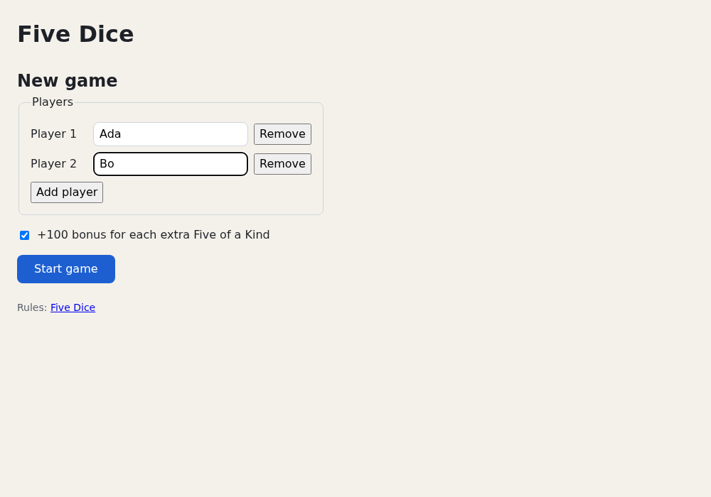

# Chapter 9 — Forms

So far the game starts on page load with one nameless player. This chapter adds a new-game form: player
names, add and remove rows, a rule option, error messages. You learn *controlled* and *uncontrolled* inputs,
how forms submit, React 19's form *actions* with `useActionState` and `useFormStatus`, errors that screen
readers announce, `useId` for labels, checkboxes and selects, and why lists of inputs need stable keys, all
tested with [Chapter 8](08-testing.md)'s tools. [Chapter 10](10-composition-and-context.md) turns the players
into a real hot-seat game.

## Controlled inputs

In vanilla JavaScript the `<input>` owns its value: the user types, the DOM changes, and you read
`input.value` (or `new FormData(form)`) when you need it. React can work that way too. It also offers the
reverse: React state owns the value and the input only displays it. Such an input is *controlled*:

`examples/ch09/controlled.demo.tsx`
```tsx
import { useState } from 'react'

const MAX = 12

export default function Controlled() {
  // The state is the single source of truth. The input only shows it.
  const [name, setName] = useState('')

  return (
    <main>
      <label>
        Name{' '}
        <input
          value={name}
          // Every keystroke goes through state. We may change it on the way.
          onChange={(event) => setName(event.target.value.toUpperCase().slice(0, MAX))}
        />
      </label>{' '}
      <button type="button" onClick={() => setName('')}>
        Clear
      </button>
      <p>
        {name.length}/{MAX} characters. Hello, {name || 'stranger'}!
      </p>
    </main>
  )
}
```

Run the `examples` dev server (`npm run dev`) and open `http://localhost:5173/?demo=ch09/controlled`. Type
"ada lovelace":

```text
Name [ADA LOVELACE] [Clear]
12/12 characters. Hello, ADA LOVELACE!
```

The input shows capitals and stops at 12 characters. On every keystroke:

1. The browser puts the character into the input and fires an `input` event; React calls `onChange`
   (on every keystroke, like the DOM's `input` event, not on blur like `change`).
2. `event.target.value` includes the new character. The handler stores a changed copy: uppercased, cut to
   12.
3. React re-renders and sets the input's value to the state, `"ADA LOVELACE"`, overwriting what the browser
   put there.

The rule: **`value` decides what the input shows; `onChange` is your chance to change it.** Clear sets the
state to `''` and the input follows. Everything depending on the text (counter, greeting) reads the state, so
it can't disagree with the input.

### Two mistakes React warns about

`examples/ch09/read-only-bug.demo.tsx`
```tsx
import { useState } from 'react'

export default function ReadOnlyBug() {
  // undefined at first, a string after the first keystroke.
  const [nickname, setNickname] = useState<string>()

  return (
    <main>
      <p>
        {/* BUG 1: a value without onChange. You can't type here. */}
        <label>
          Name <input value="Ada" />
        </label>
      </p>
      <p>
        {/* BUG 2: value={undefined} means "uncontrolled". The first keystroke makes it controlled. */}
        <label>
          Nickname <input value={nickname} onChange={(event) => setNickname(event.target.value)} />
        </label>
      </p>
    </main>
  )
}
```

Open `?demo=ch09/read-only-bug` with the console open. Type into Name: nothing happens. It keeps showing "Ada"
because the state behind `value` never changes. React warns as soon as the page renders:

```text
You provided a `value` prop to a form field without an `onChange` handler. This will render a read-only field. If the field should be mutable use `defaultValue`. Otherwise, set either `onChange` or `readOnly`.
```

Nickname works, but the first keystroke logs a second warning:

```text
A component is changing an uncontrolled input to be controlled. This is likely caused by the value changing from undefined to a defined value, which should not happen. Decide between using a controlled or uncontrolled input element for the lifetime of the component. More info: https://react.dev/link/controlled-components
```

`useState<string>()` starts as `undefined`, and `value={undefined}` means "no value prop": React leaves the
input alone until the first keystroke makes it a string. Start with `useState('')` instead. For data that
loads later, use `value={name ?? ''}`.

## Uncontrolled inputs and `FormData`

Or let the DOM own the value and read it when you need it, typically on submit, as you would in vanilla
JavaScript. React calls these inputs *uncontrolled*:

`examples/ch09/search.demo.tsx`
```tsx
import { useState, type FormEvent } from 'react'

export default function Search() {
  const [submitted, setSubmitted] = useState<Record<string, FormDataEntryValue>>()

  function handleSubmit(event: FormEvent<HTMLFormElement>) {
    // Without this line the browser sends the form itself and loads a new page.
    event.preventDefault()
    // Read every named field of the form. The inputs are uncontrolled:
    // React never stored what was typed; the DOM did.
    const formData = new FormData(event.currentTarget)
    setSubmitted(Object.fromEntries(formData))
  }

  return (
    <main>
      <h2>With preventDefault</h2>
      <form onSubmit={handleSubmit}>
        <label>
          Search <input name="query" defaultValue="dice" />
        </label>{' '}
        <label>
          <input type="checkbox" name="exact" /> Exact match
        </label>{' '}
        <button type="submit">Search</button>
      </form>
      <pre>{JSON.stringify(submitted)}</pre>

      <h2>Without preventDefault</h2>
      {/* No handler: the browser does what forms did before JavaScript. */}
      <form>
        <label>
          Search <input name="query" defaultValue="dice" />
        </label>{' '}
        <button type="submit">Search</button>
      </form>
    </main>
  )
}
```

The HTML parts work as you know them: `name` decides what is submitted, a `<button>` in a `<form>` is a
submit button unless it says `type="button"`, and Enter in a text field submits. What React adds:

- **`defaultValue`** (`defaultChecked` for checkboxes) sets the *initial* value. Then the browser owns it
  and React never touches it, so there is no read-only warning. (`value` would make the input controlled.)
- **`onSubmit`** is `addEventListener('submit', …)` in JSX. `event.currentTarget` is the `<form>`.

Open `?demo=ch09/search`, type "five" before "dice" in the first form, tick Exact match, click Search:

```text
{"query":"five dice","exact":"on"}
```

Two details of `FormData`:

- **Every value is a string** (or a `File` for file inputs). Convert numbers yourself.
- **A ticked checkbox sends `"on"`; an unticked one sends nothing.** Untick Exact match and search again: no
  `exact` key. So read a checkbox with `formData.get('exact') === 'on'`.

### What `preventDefault` prevents

The second form has no handler, so the browser does its default: it loads `?query=five+dice` as a new page.
All React state is gone, and you're back at the example list. A single-page app almost never wants that, so
`handleSubmit` starts with `event.preventDefault()`.

### Controlled or uncontrolled?

| | Controlled (`value` + `onChange`) | Uncontrolled (`defaultValue` + `name`) |
|---|---|---|
| Who owns the value | React state | The DOM |
| Re-renders per keystroke | Yes | No |
| Read the value | Any time, from state | On submit, from `FormData` (or with a ref, [Chapter 12](12-refs-and-the-dom.md)) |
| Change it from code | Set the state | Hard |
| Good for | Values the UI reacts to while typing (live checks, counters, filters, dependent fields) | Values needed only on submit |

Both are normal React, and many forms mix them: the project's form has controlled name inputs and an
uncontrolled checkbox.

## Form actions

React 19 adds a second way to handle a submit: pass a *function* to the form's `action` prop. Here is one
small form, "type a name, press Add, the name joins a list", written three ways. First vanilla, as you'd
write it today:

`examples/ch09/vanilla-add-player/main.ts`
```ts
const form = document.querySelector<HTMLFormElement>('#add-player')
const list = document.querySelector<HTMLUListElement>('#players')
if (!form || !list) throw new Error('page is missing an element')

form.addEventListener('submit', (event) => {
  event.preventDefault()
  const name = String(new FormData(form).get('name')).trim()
  if (name !== '') {
    const item = document.createElement('li')
    item.textContent = name
    list.append(item)
  }
  form.reset()
})
```

Then React, once with `onSubmit` and once with `action`. Both forms render the same markup,
`<label>Name <input name="name" /></label> <button type="submit">Add</button>`, and a `<ul>` of `players`:

`examples/ch09/add-player.demo.tsx` (excerpt)
```tsx
function WithOnSubmit() {
  const [players, setPlayers] = useState<string[]>([])

  function handleSubmit(event: FormEvent<HTMLFormElement>) {
    event.preventDefault()
    const form = event.currentTarget
    const name = String(new FormData(form).get('name')).trim()
    if (name !== '') setPlayers([...players, name])
    form.reset()
  }

  return (
    <section>
      <h2>onSubmit</h2>
      <form onSubmit={handleSubmit}>…</form>
      …
}

function WithAction() {
  const [players, setPlayers] = useState<string[]>([])

  function addPlayer(formData: FormData) {
    const name = String(formData.get('name')).trim()
    if (name !== '') setPlayers([...players, name])
  }

  return (
    <section>
      <h2>action</h2>
      <form action={addPlayer}>…</form>
      …
}
```

Open `http://localhost:5173/ch09/vanilla-add-player/` and `?demo=ch09/add-player`. All three behave the same:
add "Ada", see her in the list, and the input is empty again.

| | Vanilla | React `onSubmit` | React `action` |
|---|---|---|---|
| Hook up | `addEventListener('submit', …)` | `onSubmit={handleSubmit}` | `action={addPlayer}` |
| Stop the page load | `event.preventDefault()` | `event.preventDefault()` | Automatic |
| Read the fields | `new FormData(form)` | `new FormData(event.currentTarget)` | Passed in as `formData` |
| Show the result | Create and append an `<li>` | Set state; React renders the list | Same |
| Empty the form | `form.reset()` | `form.reset()` | Automatic, after success |

`onSubmit` is the vanilla code translated to React's event props. `action` is new. In plain HTML, `action` is
the URL a form submits to. With a function, React:

- **prevents the navigation** for you and calls your function with the form's `FormData`;
- **runs it in a Transition**, so the form is *pending* until the (possibly async) function finishes
  ([Chapter 17](17-async-react.md) covers Transitions);
- **resets the form** after the function succeeds: every *uncontrolled* field returns to its default;
- sends an error thrown by the function to the nearest *error boundary*, like a rendering error
  ([Chapter 17](17-async-react.md)).

The reset surprises people and matters below. It serves the common case "submit, then start with an empty
form". Exercise 3 shows it on the search demo.

`examples/ch09/add-player.test.tsx` runs both React forms through the same test with `it.each`.

In the DOM, React gives such a form an `action` attribute starting with
`javascript:throw new Error('A React form was unexpectedly submitted…`. It never runs normally; it is a safety
net in case something submits the form behind React's back.

Use `onSubmit` when you need the event itself or have to support React 18. Use `action` for the pending
state, the reset and `useActionState`, next.

## `useActionState`

Most forms also show the result of the last submit, like an error message. `useActionState` wraps an action
and keeps what it returns:

```tsx
const [state, formAction, isPending] = useActionState(action, initialState)
```

- **`action(previousState, formData)`** is your function; its return value becomes the new `state`. It may
  be `async` and, unlike a reducer, have side effects: talk to a server, call a callback.
- **`formAction`** is what you pass to `<form action={formAction}>`.
- **`isPending`** is `true` while the action runs.
- Submitting again while an action runs queues the call; actions run one after another, each with the state
  the previous one returned.

Here is a sign-up form with a (fake) server behind it:

`examples/ch09/signup.demo.tsx`
```tsx
import { useActionState, useId } from 'react'
import { useFormStatus } from 'react-dom'

type Plan = 'free' | 'pro'

interface SignupValues {
  email: string
  plan: Plan
  newsletter: boolean
}

interface SignupState {
  /** What was submitted last, to show it again after an error. */
  values: SignupValues
  error: string | null
  done: boolean
}

interface SignupProps {
  /** Sends the sign-up to a server. Resolves to an error message, or null. Tests pass a fake. */
  register?: (values: SignupValues) => Promise<string | null>
}

// Pretends to be a server that needs a second to answer.
function fakeRegister(values: SignupValues): Promise<string | null> {
  return new Promise((resolve) => {
    const taken = values.email.toLowerCase() === 'ada@example.com'
    setTimeout(() => resolve(taken ? 'That email is already registered.' : null), 1000)
  })
}

const initialState: SignupState = {
  values: { email: '', plan: 'free', newsletter: true },
  error: null,
  done: false,
}

function SubmitButton() {
  // Reads the status of the <form> that this component is rendered inside.
  const { pending } = useFormStatus()
  return (
    <button type="submit" disabled={pending}>
      {pending ? 'Signing up…' : 'Sign up'}
    </button>
  )
}

export default function Signup({ register = fakeRegister }: SignupProps) {
  const id = useId()

  // The action gets the previous state and the form data, and returns the next state.
  // It may be async and may have side effects, unlike a reducer.
  async function signUp(_previous: SignupState, formData: FormData): Promise<SignupState> {
    const values: SignupValues = {
      email: String(formData.get('email')).trim(),
      plan: formData.get('plan') === 'pro' ? 'pro' : 'free',
      newsletter: formData.get('newsletter') === 'on',
    }
    if (!values.email.includes('@')) {
      return { values, error: 'Enter an email address.', done: false }
    }
    const error = await register(values)
    return { values, error, done: error === null }
  }

  const [state, formAction] = useActionState(signUp, initialState)

  if (state.done) {
    return <p>Welcome! We sent a link to {state.values.email}.</p>
  }

  const errorId = `${id}-error`
  return (
    // noValidate: the action checks the email and shows its own accessible error.
    <form action={formAction} noValidate>
      <p>
        <label htmlFor={`${id}-email`}>Email</label>{' '}
        <input
          id={`${id}-email`}
          type="email"
          name="email"
          defaultValue={state.values.email}
          aria-invalid={state.error !== null}
          aria-describedby={state.error ? errorId : undefined}
        />
      </p>
      <p>
        <label htmlFor={`${id}-plan`}>Plan</label>{' '}
        <select
          id={`${id}-plan`}
          name="plan"
          defaultValue={state.values.plan}
          // A <select> uses defaultValue only when it is created. The key makes a
          // new one whenever the submitted plan changes, so the reset keeps it.
          key={state.values.plan}
        >
          <option value="free">Free</option>
          <option value="pro">Pro</option>
        </select>
      </p>
      <p>
        <label>
          <input type="checkbox" name="newsletter" defaultChecked={state.values.newsletter} /> Send me the newsletter
        </label>
      </p>
      {state.error && (
        <p id={errorId} role="alert">
          {state.error}
        </p>
      )}
      <SubmitButton />
    </form>
  )
}
```

Open `?demo=ch09/signup`, enter `ada@example.com` and click Sign up. For one second the button reads
"Signing up…" and is disabled. Then:

```text
Email [ada@example.com]
Plan  [Free ▾]
[✓] Send me the newsletter
That email is already registered.
[Sign up]
```

With `cy@example.com` the form is replaced by "Welcome! We sent a link to cy@example.com."

Notice:

- **The state holds what was submitted**, not only the error. After the action, React resets uncontrolled
  fields to their defaults; since those come from `state.values`, the reset puts back what the user typed.
  Otherwise a failed sign-up would wipe the form.
- **The action decides the outcome.** Validation (`includes('@')`) and the server call are in one place; the
  component only renders `state`. `noValidate` keeps the browser's own checks out of the way
  ([below](#native-validation-and-actions)).
- **Errors are values.** The action *returns* an error message. A thrown error would go to an error boundary
  and replace the UI: right for bugs, wrong for "that email is taken".

### `useFormStatus`

`SubmitButton` gets the pending flag from `useFormStatus`, a hook from `react-dom` (not `react`). It returns
the status of the `<form>` the *calling component* is rendered inside: `pending`, plus the submitted `data`,
`method` and `action`. Two rules:

- Call it in a component rendered **inside** the `<form>`. In the component that renders the `<form>`,
  `pending` is always `false`.
- It suits reusable pieces, like a submit button for any form. In the form's own component, `isPending` from
  `useActionState` tells you the same (Exercise 2).

### `useActionState` beyond forms

The returned function (`formAction` above) is an ordinary function with a stable identity. You can call it
yourself with any payload, not only `FormData`, as long as the call happens inside `startTransition`:

`examples/ch09/save-button.demo.tsx`
```tsx
import { startTransition, useActionState } from 'react'

interface SaveButtonProps {
  /** How long the fake server takes, in milliseconds. */
  delay?: number
}

export default function SaveButton({ delay = 1000 }: SaveButtonProps) {
  // The payload can be anything, not only FormData.
  async function save(total: number, points: number): Promise<number> {
    await new Promise((resolve) => setTimeout(resolve, delay))
    return total + points
  }

  const [total, addPoints, isPending] = useActionState(save, 0)

  return (
    <main>
      <p>Saved: {total} points</p>
      <button type="button" onClick={() => startTransition(() => addPoints(10))}>
        Save 10 points
      </button>
      {isPending && <p>Saving…</p>}
    </main>
  )
}
```

Open `?demo=ch09/save-button` and click three times quickly. "Saving…" shows for about three seconds, then
"Saved: 30 points". The three calls are queued and run one after another, each starting from the previous
total. The screen shows only the final result. `examples/ch09/save-button.test.tsx` checks this with
`delay={10}`.

Without `startTransition`, the click still saves, but React logs:

```text
An async function with useActionState was called outside of a transition. This is likely not what you intended (for example, isPending will not update correctly). Either call the returned function inside startTransition, or pass it to an `action` or `formAction` prop.
```

Three related tools, for later:

- **`formAction` on a button.** `<button formAction={fn}>` overrides the form's `action` for that button,
  like HTML's `formaction` attribute. Use it for "Save draft" next to "Publish".
- **`requestFormReset(form)`** from `react-dom` asks for the same reset from your own action, for example one
  called through `startTransition`. Outside a Transition, React logs an error.
- **State updates after an `await`** inside an action need their own `startTransition`
  ([Chapter 17](17-async-react.md)). Returning the new state from a `useActionState` action, as `save` does,
  needs no `setState` at all.

[Chapter 17](17-async-react.md) also adds `useOptimistic`, which shows the expected result while an action
runs. With a server framework, an action can be a *Server Function* that runs on the server
([Chapter 20](20-where-next.md)). That is where `useActionState`'s optional third argument, a permalink URL,
comes in.

### Testing the form

Chapter 8's tools work as they are. A fake `register` replaces the server:

`examples/ch09/signup.test.tsx`
```tsx
import { render, screen } from '@testing-library/react'
import userEvent from '@testing-library/user-event'
import { describe, expect, it, vi } from 'vitest'
import Signup from './signup.demo'

describe('Signup', () => {
  it('sends the form values to the server', async () => {
    const user = userEvent.setup()
    const register = vi.fn(async () => null)
    render(<Signup register={register} />)

    await user.type(screen.getByLabelText('Email'), 'cy@example.com')
    await user.selectOptions(screen.getByLabelText('Plan'), 'pro')
    await user.click(screen.getByRole('checkbox', { name: 'Send me the newsletter' }))
    await user.click(screen.getByRole('button', { name: 'Sign up' }))

    expect(await screen.findByText('Welcome! We sent a link to cy@example.com.')).toBeInTheDocument()
    expect(register).toHaveBeenCalledExactlyOnceWith({ email: 'cy@example.com', plan: 'pro', newsletter: false })
  })

  it('checks the email before it calls the server', async () => {
    const user = userEvent.setup()
    const register = vi.fn(async () => null)
    render(<Signup register={register} />)

    await user.click(screen.getByRole('button', { name: 'Sign up' }))

    expect(await screen.findByRole('alert')).toHaveTextContent('Enter an email address.')
    expect(screen.getByLabelText('Email')).toBeInvalid()
    expect(screen.getByLabelText('Email')).toHaveAccessibleDescription('Enter an email address.')
    expect(register).not.toHaveBeenCalled()
  })

  it('shows the server error and keeps what was typed', async () => {
    const user = userEvent.setup()
    render(<Signup register={async () => 'That email is already registered.'} />)

    await user.type(screen.getByLabelText('Email'), 'ada@example.com')
    await user.selectOptions(screen.getByLabelText('Plan'), 'pro')
    await user.click(screen.getByRole('checkbox', { name: 'Send me the newsletter' }))
    await user.click(screen.getByRole('button', { name: 'Sign up' }))

    expect(await screen.findByRole('alert')).toHaveTextContent('That email is already registered.')
    expect(screen.getByLabelText('Email')).toHaveValue('ada@example.com')
    expect(screen.getByLabelText('Plan')).toHaveValue('pro')
    expect(screen.getByRole('checkbox', { name: 'Send me the newsletter' })).not.toBeChecked()
  })

  it('disables the button while the server works', async () => {
    const user = userEvent.setup()
    let answer = (_error: string | null) => {}
    const register = () =>
      new Promise<string | null>((resolve) => {
        answer = resolve
      })
    render(<Signup register={register} />)

    await user.type(screen.getByLabelText('Email'), 'cy@example.com')
    await user.click(screen.getByRole('button', { name: 'Sign up' }))
    expect(await screen.findByRole('button', { name: 'Signing up…' })).toBeDisabled()

    answer(null)
    expect(await screen.findByText(/Welcome!/)).toBeInTheDocument()
  })
})
```

```console
$ npx vitest run ch09/signup

 ✓ ch09/signup.test.tsx (4 tests) 328ms

 Test Files  1 passed (1)
      Tests  4 passed (4)
```

- `getByLabelText('Email')` finds the input through its `<label>`. If the label weren't connected, the test
  would fail, and so would a screen reader.
- `user.selectOptions(select, 'pro')` picks an option by value or text.
- The action runs in a Transition, so even with an instant fake the result appears a moment after the
  click. Use `findBy…`.

## Showing errors accessibly

A sighted user sees red text appear; a screen-reader user hears nothing unless the markup says what
happened. The signup form uses three attributes:

| Attribute | On | Effect |
|---|---|---|
| `role="alert"` | the error message | Screen readers announce the text as soon as it appears. |
| `aria-invalid={true}` | the input | The field is announced as invalid. jest-dom's `toBeInvalid()` checks it. |
| `aria-describedby={errorId}` | the input | Points at the element with that `id`, whose text becomes the input's *accessible description*, read after the label. `toHaveAccessibleDescription()` checks it. |

Use `role="alert"` for messages that appear in response to an action. It interrupts the user, so not on text
that is always there. [Chapter 15](15-accessibility.md) goes deeper.

When to validate:

- **On submit**, in the action, as here: simplest, and one place decides.
- **While typing**, with a controlled input, for hints like "12/12 characters". Don't show errors before the
  user has finished typing.
- **In the browser**: HTML attributes like `required`, `type="email"` and `maxLength`, next.
- **On the server, always**, if there is one. Anyone can send a request without your form.

### Native validation and actions

You know the HTML side: `required`, `type="email"`, `pattern`, `min`/`max`. They work unchanged in React,
and they run *before* the submit. An invalid field stops the `submit` event, so neither `onSubmit` nor an
`action` is called:

`examples/ch09/native-validation.demo.tsx`
```tsx
import { useState } from 'react'

function JoinForm({ noValidate }: { noValidate: boolean }) {
  const [joined, setJoined] = useState<string[]>([])

  function join(formData: FormData) {
    setJoined([...joined, String(formData.get('email'))])
  }

  return (
    <section>
      <h2>{noValidate ? 'noValidate' : 'Browser checks'}</h2>
      <form action={join} noValidate={noValidate}>
        <label>
          Email <input type="email" name="email" required />
        </label>{' '}
        <button type="submit">Join</button>
      </form>
      <p>Joined: {joined.map((email) => `"${email}"`).join(', ') || 'nobody yet'}</p>
    </section>
  )
}

export default function NativeValidation() {
  return (
    <main>
      <JoinForm noValidate={false} />
      <JoinForm noValidate />
    </main>
  )
}
```

Open `?demo=ch09/native-validation`:

| You submit | Browser checks | `noValidate` |
|---|---|---|
| Nothing | Bubble "Please fill out this field." The action doesn't run. | `Joined: ""` |
| `ada` | Bubble "Please include an '@' in the email address. …" (Chrome's wording) | `Joined: "ada"` |
| `ada@example.com` | `Joined: "ada@example.com"`, and the field is reset | Same |

`noValidate` (HTML `novalidate`) turns off the blocking and the bubbles; the attributes still mark the field
`:invalid` for CSS and `input.validity`. Pick one owner for error messages:

- **Browser checks** are free and need no code. Good for simple forms.
- **`noValidate` plus checks in the action**, as the signup form does, when you want your own wording, the
  `role="alert"` and `aria-describedby` wiring above, or errors that need the server. Keep `type="email"`
  anyway: phones show an email keyboard.

jsdom runs the same checks, so `examples/ch09/native-validation.test.tsx` can test both forms with
`user-event`.

### `useId`

`aria-describedby` and `<label htmlFor>` need ids that are unique on the page. A hard-coded `id="email"`
breaks once the component appears twice. `useId()` returns a string unique to each component instance and
stable across renders:

```tsx
const id = useId()
// …
<label htmlFor={`${id}-email`}>Email</label>
<input id={`${id}-email`} … />
```

One call serves a whole form: add a suffix per element. In the signup demo the error paragraph gets an id
like `_r_0_-error`. Don't depend on the format, and don't use `useId` for list keys: keys come from your data
([below](#lists-of-inputs-need-stable-keys)).

Wrapping the input in its label, `<label>Email <input /></label>`, connects them without an id. Use `htmlFor`
when the layout keeps them apart, as in a table or grid row.

## Checkboxes and selects

| Element | Controlled | Uncontrolled | In `FormData` |
|---|---|---|---|
| `<input type="checkbox">` | `checked` + `onChange` (read `event.target.checked`) | `defaultChecked` | `"on"` when ticked, missing when not |
| `<select>` | `value` + `onChange` | `defaultValue` | The selected option's `value` |
| `<textarea>` | `value` + `onChange` | `defaultValue` | The text |

HTML marks the chosen option with `<option selected>`; React sets `value` or `defaultValue` on the `<select>`.
A `<textarea>` takes its text from `value`/`defaultValue`, not its children.

### The `<select>` reset trap

The signup form gives its `<select>` a `key`:

```tsx
<select id={`${id}-plan`} name="plan" defaultValue={state.values.plan} key={state.values.plan}>
```

Without the `key`, choose Pro, enter `ada@example.com` and submit. The error appears and the email and
checkbox keep their values, but the plan jumps back to Free. Two React behaviours meet:

1. After the action, React resets the form's uncontrolled fields to their defaults.
2. React applies a `<select>`'s `defaultValue` only when the element is created; changing it later doesn't
   change the default option. (Inputs and checkboxes do pick up a new `defaultValue` / `defaultChecked`.)

So the select resets to the first render's default, Free. Making it controlled doesn't help: the reset
changes the DOM behind React's back, and the same test still showed Free. This is a known, still-open React
issue ([React issue #30580](https://github.com/react/react/issues/30580)), not your bug. The `key`
works around it: when the submitted plan changes, so does the key, React creates a new `<select>` with the
right default, and the reset leaves it there. The third signup test checks exactly this.

## Lists of inputs need stable keys

[Chapter 4](04-components-and-jsx.md) showed what index keys do to inputs when a row is inserted at the top.
Removing one goes wrong the same way:

`examples/ch09/row-keys.demo.tsx`
```tsx
import { useState } from 'react'

interface Row {
  id: number
  name: string
}

const START: Row[] = [
  { id: 1, name: 'Ada' },
  { id: 2, name: 'Bo' },
  { id: 3, name: 'Cy' },
]

function Rows({ useIndexKey }: { useIndexKey: boolean }) {
  const [rows, setRows] = useState(START)

  return (
    <ul>
      {rows.map((row, index) => (
        <li key={useIndexKey ? index : row.id}>
          {/* Uncontrolled: defaultValue is only used when the input is created. */}
          <input aria-label={`Name ${index + 1}`} defaultValue={row.name} />{' '}
          <button type="button" onClick={() => setRows(rows.filter((r) => r.id !== row.id))}>
            Remove {row.name}
          </button>
        </li>
      ))}
    </ul>
  )
}

export default function RowKeys() {
  return (
    <main>
      <h2>key=index</h2>
      <Rows useIndexKey />
      <h2>key=row.id</h2>
      <Rows useIndexKey={false} />
    </main>
  )
}
```

Open `?demo=ch09/row-keys` and click "Remove Ada" in both lists:

| | Inputs show | Buttons say |
|---|---|---|
| `key=index` | Ada, Bo | Remove Bo, Remove Cy |
| `key=row.id` | Bo, Cy | Remove Bo, Remove Cy |

The index version is wrong: Bo is gone from the inputs, Ada is still there. React matches list items between
renders by key. Before, keys 0, 1, 2 held Ada, Bo, Cy; after, Bo, Cy have keys 0, 1. To React that means "key
2 was removed, keys 0 and 1 have new props". It keeps the first two `<li>` elements and their inputs, updates
the button texts and removes the last one. The uncontrolled inputs' values, known only to the DOM, stay put.

With `key={row.id}`, React sees "key 1 was removed" and removes that `<li>`, input and all. All per-item state
works this way: DOM state like typed text and focus, and React state in child components. When rows can be
added, removed or reordered, give each an id when you create it.

## Building five-dice: a new-game form

The game gets a setup screen: enter one to four player names and choose whether the +100 bonus for extra
Five of a Kinds applies. The reducer handles several players and passes the turn around. The screen still
shows only the current player's scorecard; [Chapter 10](10-composition-and-context.md) adds a column per
player. The changes:

- `src/game/types.ts`: `Settings`, `GameSetup`, `Player`.
- `src/game/rules.ts`: player limits and `validatePlayerNames`. **New** `src/game/rules.test.ts`.
- `src/game/reducer.ts`: players, turn rotation, settings. Tests updated.
- **New** `src/components/Game.tsx`: the board, moved out of `App`.
- **New** `src/components/NewGameForm.tsx` and its test.
- `src/App.tsx`: shows the form, then the game.
- `src/components/GameOver.tsx`: a score per player.
- `src/index.css`: form styles.

### Types and rules

Add to the end of `src/game/types.ts`:

`src/game/types.ts`
```ts

/** Options chosen on the new-game form. */
export interface Settings {
  /** Optional rule: +100 for each extra Five of a Kind. */
  fiveOfAKindBonus: boolean
}

/** Everything needed to start a game. */
export interface GameSetup {
  playerNames: string[]
  settings: Settings
}

export interface Player {
  name: string
  sheet: ScoreSheet
}
```

Validation rules are game rules, so they go into `rules.ts` as a plain function, not the form component. Add
to the end of `src/game/rules.ts`:

`src/game/rules.ts`
```ts

export const MIN_PLAYERS = 1
export const MAX_PLAYERS = 4
export const MAX_NAME_LENGTH = 20

/** Check the names typed into the new-game form. Returns an error message, or null if they are fine. */
export function validatePlayerNames(names: readonly string[]): string | null {
  if (names.length < MIN_PLAYERS || names.length > MAX_PLAYERS) {
    return `Choose ${MIN_PLAYERS} to ${MAX_PLAYERS} players.`
  }
  if (names.some((name) => name === '')) {
    return 'Every player needs a name.'
  }
  if (names.some((name) => name.length > MAX_NAME_LENGTH)) {
    return `Names can be at most ${MAX_NAME_LENGTH} characters.`
  }
  const unique = new Set(names.map((name) => name.toLowerCase()))
  if (unique.size !== names.length) {
    return 'Each player needs a different name.'
  }
  return null
}
```

Names must differ (ignoring case): they identify players on screen, and the game-over list uses them as keys.

A pure function with many cases suits `it.each`, which runs one test per table row:

`src/game/rules.test.ts`
```ts
import { describe, expect, it } from 'vitest'
import { validatePlayerNames } from './rules'

describe('validatePlayerNames', () => {
  it.each([
    [['Ada'], null],
    [['Ada', 'Bo', 'Cy', 'Di'], null],
    [[], 'Choose 1 to 4 players.'],
    [['A', 'B', 'C', 'D', 'E'], 'Choose 1 to 4 players.'],
    [['Ada', ''], 'Every player needs a name.'],
    [['x'.repeat(21)], 'Names can be at most 20 characters.'],
    [['Ada', 'ada'], 'Each player needs a different name.'],
  ])('%j → %s', (names, expected) => {
    expect(validatePlayerNames(names)).toBe(expected)
  })
})
```

In the test name, `%j` prints the first argument as JSON and `%s` the second as a string, so each case gets
its own line in verbose output.

### The reducer: several players

The state gets a list of players (each with a score sheet), the index of whose turn it is, and the settings.
The changed parts of `src/game/reducer.ts`:

`src/game/reducer.ts`
```ts
import type { Category, Die, DieValue, GameSetup, Player, Settings } from './types'

export interface GameState {
  players: Player[]
  /** Index into `players` of whoever's turn it is. */
  current: number
  dice: Die[]
  rollsLeft: number
  settings: Settings
}
```

`src/game/reducer.ts`
```ts
export function getPhase(state: GameState): Phase {
  if (state.players.every((player) => isSheetComplete(player.sheet))) return 'gameOver'
  if (state.rollsLeft === MAX_ROLLS) return 'ready'
  if (state.rollsLeft === 0) return 'mustScore'
  return 'rolling'
}

export function createGame(setup: GameSetup): GameState {
  return {
    players: setup.playerNames.map((name) => ({ name, sheet: createSheet() })),
    current: 0,
    dice: createDice(),
    rollsLeft: MAX_ROLLS,
    settings: setup.settings,
  }
}

/** The setup a game was started with, to start another one like it. */
export function setupOf(state: GameState): GameSetup {
  return { playerNames: state.players.map((player) => player.name), settings: state.settings }
}
```

`src/game/reducer.ts`
```ts
    case 'score': {
      if (phase !== 'rolling' && phase !== 'mustScore') return state
      const player = state.players[state.current]
      if (player.sheet.scores[action.category] !== undefined) return state
      const values = state.dice.map((die) => die.value)
      const sheet = scoreTurn(player.sheet, action.category, values, state.settings.fiveOfAKindBonus)
      return {
        ...state,
        // Array.prototype.with: a copy of the array with one element replaced.
        players: state.players.with(state.current, { ...player, sheet }),
        // Next player's turn, wrapping around to the first.
        current: (state.current + 1) % state.players.length,
        dice: createDice(),
        rollsLeft: MAX_ROLLS,
      }
    }
    case 'newGame':
      return createGame(setupOf(state))
```

- **Turns rotate** with `% state.players.length`: with two players, `current` goes 0, 1, 0, 1 …
- **`players.with(index, value)`** returns a new array with one element replaced: an immutable
  `players[index] = value`.
- **`scoreTurn`** already has an optional fourth parameter, `bonusRule` (default `true`); now the setting
  feeds it.
- **The game ends** when *every* sheet is complete: 13 turns per player.
- **`newGame`** starts over with the same players and settings.
- **Update the comment** above `Phase`: `gameOver:  every player has filled all 13 categories`.

In `src/game/reducer.test.ts`, every `createGame()` becomes `createGame(solo)` and `state.sheet` becomes
`state.players[0].sheet`. Add the setups after `rollSixes` and two tests at the end of the `describe`:

`src/game/reducer.test.ts`
```ts
import type { GameSetup } from './types'
// …
const solo: GameSetup = { playerNames: ['Ada'], settings: { fiveOfAKindBonus: true } }
const duo: GameSetup = { playerNames: ['Ada', 'Bo'], settings: { fiveOfAKindBonus: false } }
```

`src/game/reducer.test.ts`
```ts
  it('passes the turn to the next player and back', () => {
    let state = play(createGame(duo), rollSixes, { type: 'score', category: 'sixes' })
    expect(state.current).toBe(1)
    expect(state.players[0].sheet.scores.sixes).toBe(30)
    state = play(state, rollSixes, { type: 'score', category: 'chance' })
    expect(state.current).toBe(0)
    expect(state.players[1].sheet.scores).toEqual({ chance: 30 })
  })

  it('ends only when every player has filled the card', () => {
    let state = createGame(duo)
    for (const category of CATEGORIES) {
      state = play(state, rollSixes, { type: 'score', category })
      expect(getPhase(state)).not.toBe('gameOver')
      state = play(state, rollSixes, { type: 'score', category })
    }
    expect(getPhase(state)).toBe('gameOver')
    // The bonus rule was off for this game: no +100s.
    expect(state.players[0].sheet.fiveOfAKindBonuses).toBe(0)
  })
```

### `Game`: the board on its own

`App` will switch between form and game, so the board moves into its own component: the old `App` body, with
the current player's sheet and name in the panel titles:

`src/components/Game.tsx`
```tsx
import { useReducer } from 'react'
import { rollDice, type Rng } from '../game/dice'
import { createGame, gameReducer, getPhase } from '../game/reducer'
import { potentialScores } from '../game/scoring'
import type { Category, GameSetup } from '../game/types'
import { DiceTray } from './DiceTray'
import { GameOver } from './GameOver'
import { Panel } from './Panel'
import { Scorecard } from './Scorecard'

interface GameProps {
  setup: GameSetup
  rng: Rng
}

export function Game({ setup, rng }: GameProps) {
  // createGame(setup) builds the first state; later renders ignore `setup`.
  const [state, dispatch] = useReducer(gameReducer, setup, createGame)

  const phase = getPhase(state)
  const player = state.players[state.current]
  const values = state.dice.map((die) => die.value)
  const canScore = phase === 'rolling' || phase === 'mustScore'
  const potential = canScore ? potentialScores(player.sheet, values) : null

  function handleRoll() {
    dispatch({ type: 'roll', values: rollDice(rng) })
  }

  function handleScore(category: Category) {
    dispatch({ type: 'score', category })
  }

  return (
    <main className="board">
      <Panel title={phase === 'gameOver' ? 'Results' : `${player.name}'s turn`}>
        {phase === 'gameOver' ? (
          <GameOver players={state.players} onPlayAgain={() => dispatch({ type: 'newGame' })} />
        ) : (
          <DiceTray
            dice={state.dice}
            rollsLeft={state.rollsLeft}
            phase={phase}
            onRoll={handleRoll}
            onToggleHold={(id) => dispatch({ type: 'toggleHold', id })}
          />
        )}
      </Panel>

      <Panel title={`Scorecard: ${player.name}`}>
        <Scorecard sheet={player.sheet} potential={potential} onScore={handleScore} />
      </Panel>
    </main>
  )
}
```

`useReducer(gameReducer, setup, createGame)` is Chapter 7's initializer form, now with an argument: React
calls `createGame(setup)` once, on the first render.

`GameOver` lists every player's total, keyed by the unique names:

`src/components/GameOver.tsx`
```tsx
import { totals } from '../game/scoring'
import type { Player } from '../game/types'

interface GameOverProps {
  players: readonly Player[]
  onPlayAgain: () => void
}

export function GameOver({ players, onPlayAgain }: GameOverProps) {
  return (
    <div className="game-over">
      <h3>Game over</h3>
      <ul>
        {players.map((player) => (
          <li key={player.name}>
            {player.name}: <strong>{totals(player.sheet).grand}</strong>
          </li>
        ))}
      </ul>
      <button type="button" className="roll-button" onClick={onPlayAgain}>
        Play again
      </button>
    </div>
  )
}
```

### The form

`src/components/NewGameForm.tsx`
```tsx
import { useActionState, useId, useState } from 'react'
import { MAX_NAME_LENGTH, MAX_PLAYERS, validatePlayerNames } from '../game/rules'
import type { GameSetup } from '../game/types'

interface NewGameFormProps {
  onStart: (setup: GameSetup) => void
}

/** What the form action returns: kept by useActionState between submissions. */
interface FormState {
  error: string | null
  /** The submitted checkbox value, to show it again after a failed submit. */
  fiveOfAKindBonus: boolean
}

interface PlayerRow {
  /** Stable identity for the `key`. Never the array index: rows can be removed. */
  id: number
  name: string
}

export function NewGameForm({ onStart }: NewGameFormProps) {
  // Controlled inputs: React state is the single source of truth for the names.
  const [rows, setRows] = useState<PlayerRow[]>([{ id: 1, name: 'Player 1' }])
  // useId makes ids that are unique on the page, for pairing labels with inputs.
  const formId = useId()

  // useActionState runs `startGame` when the form is submitted and keeps
  // whatever it returns as `formState` for the next render.
  const [formState, formAction] = useActionState(startGame, {
    error: null,
    fiveOfAKindBonus: true,
  })

  function startGame(_previous: FormState, formData: FormData): FormState {
    // The checkbox is uncontrolled: read its value from the submitted form data.
    // An unchecked checkbox is simply missing from the form data.
    const fiveOfAKindBonus = formData.get('fiveOfAKindBonus') === 'on'
    const playerNames = rows.map((row) => row.name.trim())
    const error = validatePlayerNames(playerNames)
    if (!error) onStart({ playerNames, settings: { fiveOfAKindBonus } })
    return { error, fiveOfAKindBonus }
  }

  function addPlayer() {
    // Derive the next id from the existing rows: no extra state needed.
    const id = Math.max(0, ...rows.map((row) => row.id)) + 1
    setRows([...rows, { id, name: `Player ${id}` }])
  }

  function removePlayer(id: number) {
    setRows(rows.filter((row) => row.id !== id))
  }

  function renamePlayer(id: number, name: string) {
    setRows(rows.map((row) => (row.id === id ? { ...row, name } : row)))
  }

  return (
    <form className="new-game-form" action={formAction}>
      <fieldset>
        <legend>Players</legend>
        {rows.map((row, index) => {
          const inputId = `${formId}-player-${row.id}`
          return (
            <div key={row.id} className="player-row">
              <label htmlFor={inputId}>Player {index + 1}</label>
              <input
                id={inputId}
                value={row.name}
                onChange={(event) => renamePlayer(row.id, event.target.value)}
                maxLength={MAX_NAME_LENGTH}
                autoComplete="off"
              />
              <button
                type="button"
                onClick={() => removePlayer(row.id)}
                disabled={rows.length === 1}
                aria-label={`Remove player ${index + 1}`}
              >
                Remove
              </button>
            </div>
          )
        })}
        <button type="button" onClick={addPlayer} disabled={rows.length === MAX_PLAYERS}>
          Add player
        </button>
      </fieldset>

      <label className="checkbox">
        {/* After an action, React resets the form's uncontrolled fields to their
            defaults, so the default is the value that was just submitted. */}
        <input type="checkbox" name="fiveOfAKindBonus" defaultChecked={formState.fiveOfAKindBonus} />
        +100 bonus for each extra Five of a Kind
      </label>

      {formState.error && (
        <p className="form-error" role="alert">
          {formState.error}
        </p>
      )}

      <button type="submit" className="roll-button">
        Start game
      </button>
    </form>
  )
}
```

This chapter's tools at work:

- **The names are controlled.** The rows live in state because the form changes as you edit: Add disables
  at four rows, Remove at one. Each row has an `id` for its key, never the index.
- **New ids come from the data**: one more than the largest in use. With three rows, removing the second and
  adding one gives ids 1, 3, 4, so the new row is `Player 4`, not a second `Player 3`.
- **The checkbox is uncontrolled.** Nothing else depends on it, so the action reads it from `FormData`.
- **`useActionState`** runs `startGame` on submit: it trims the names, validates them with
  `validatePlayerNames`, and reports the error or calls `onStart`. It reads names from `rows`, not `FormData`:
  the inputs have no `name` attribute, since the state already has the values.
- **`useId` + the row id** make each label's `htmlFor` unique, even with two forms on a page.
- **The Remove buttons** all say "Remove". Their `aria-label` ("Remove player 2") overrides that as the
  accessible name, so screen-reader users know *which* row goes, and tests can find each button.
- **`maxLength`** stops typing at 20 characters. The action still checks: `maxLength` doesn't apply to text
  set from code.
- **`useFormStatus`** isn't needed: `startGame` is synchronous, so the form is never visibly pending.

The controlled name inputs survive React's reset after the action: React keeps a controlled input's `value`
attribute, which the reset restores, in sync with the state.

### `App`

`src/App.tsx`
```tsx
import { useState } from 'react'
import { Game } from './components/Game'
import { NewGameForm } from './components/NewGameForm'
import type { Rng } from './game/dice'
import type { GameSetup } from './game/types'

interface AppProps {
  /** Where random numbers come from. Tests pass a seeded generator. */
  rng?: Rng
}

function App({ rng = Math.random }: AppProps) {
  // null until the new-game form is submitted.
  const [setup, setSetup] = useState<GameSetup | null>(null)

  return (
    <div className="app">
      <header className="app-header">
        <h1>Five Dice</h1>
        {setup && (
          <button type="button" onClick={() => setSetup(null)}>
            New game
          </button>
        )}
      </header>

      {setup ? (
        <Game setup={setup} rng={rng} />
      ) : (
        <main className="setup">
          <h2>New game</h2>
          <NewGameForm onStart={setSetup} />
        </main>
      )}

      <footer className="app-footer">
        <p>
          Rules: <a href="https://beesboardsma.com/pages/five-dice">Five Dice</a>
        </p>
      </footer>
    </div>
  )
}

export default App
```

`setup` is `null` until the form calls `onStart`. "New game" sets it back to `null`: React unmounts `Game`,
discarding its reducer state, and the form mounts fresh with a single "Player 1" row.

### Styles

In `src/index.css`, add `select` and `textarea` to the font rule near the top:

`src/index.css`
```css
button,
input,
select,
textarea {
  font: inherit; /* form controls don't inherit fonts by default */
}
```

Then add a section at the end. It lays the form out as a grid, each player row as a flex row, and colours
the error red:

<details><summary>Full listing: the new section at the end of <code>src/index.css</code></summary>

`src/index.css`
```css
/* ---------- 7. New game form ---------- */
.setup {
  max-width: 32rem;
}

.new-game-form {
  display: grid;
  gap: var(--space-3);
  justify-items: start;
}

.new-game-form fieldset {
  display: grid;
  gap: var(--space-2);
  justify-items: start;
  padding: var(--space-3);
  border: 1px solid var(--color-border);
  border-radius: var(--radius);
}

.player-row {
  display: flex;
  align-items: center;
  gap: var(--space-2);
}

.player-row label {
  min-width: 5rem;
}

.new-game-form input:not([type='checkbox']) {
  padding: var(--space-1) var(--space-2);
  border: 1px solid var(--color-border);
  border-radius: var(--radius);
}

.checkbox {
  display: flex;
  align-items: center;
  gap: var(--space-2);
}

.form-error {
  color: #b42318;
}
```

</details>

### Tests

`src/components/NewGameForm.test.tsx`
```tsx
import { render, screen } from '@testing-library/react'
import userEvent from '@testing-library/user-event'
import { describe, expect, it, vi } from 'vitest'
import { NewGameForm } from './NewGameForm'

describe('NewGameForm', () => {
  it('starts a game with the typed names and options', async () => {
    const user = userEvent.setup()
    // vi.fn() makes a mock function that remembers how it was called.
    const onStart = vi.fn()
    render(<NewGameForm onStart={onStart} />)

    const first = screen.getByRole('textbox', { name: 'Player 1' })
    await user.clear(first)
    await user.type(first, '  Ada ')
    await user.click(screen.getByRole('button', { name: 'Add player' }))
    await user.click(screen.getByRole('checkbox', { name: /bonus/ }))
    await user.click(screen.getByRole('button', { name: 'Start game' }))

    expect(onStart).toHaveBeenCalledExactlyOnceWith({
      playerNames: ['Ada', 'Player 2'],
      settings: { fiveOfAKindBonus: false },
    })
  })

  it('adds up to four players and removes them', async () => {
    const user = userEvent.setup()
    render(<NewGameForm onStart={() => {}} />)
    const add = screen.getByRole('button', { name: 'Add player' })

    await user.click(add)
    await user.click(add)
    await user.click(add)
    expect(screen.getAllByRole('textbox')).toHaveLength(4)
    expect(add).toBeDisabled()

    await user.click(screen.getByRole('button', { name: 'Remove player 2' }))
    expect(screen.getAllByRole('textbox').map((input) => (input as HTMLInputElement).value)).toEqual([
      'Player 1',
      'Player 3',
      'Player 4',
    ])
  })

  it('shows an error and keeps the inputs when names are invalid', async () => {
    const user = userEvent.setup()
    const onStart = vi.fn()
    render(<NewGameForm onStart={onStart} />)

    await user.clear(screen.getByRole('textbox', { name: 'Player 1' }))
    await user.click(screen.getByRole('checkbox', { name: /bonus/ }))
    await user.click(screen.getByRole('button', { name: 'Start game' }))

    expect(await screen.findByRole('alert')).toHaveTextContent('Every player needs a name.')
    expect(screen.getByRole('checkbox', { name: /bonus/ })).not.toBeChecked()
    expect(onStart).not.toHaveBeenCalled()
  })
})
```

- `getByRole('textbox', { name: 'Player 1' })` works only because `htmlFor` connects the label.
- The first test types `'  Ada '` and expects `'Ada'`: the action trims.
- `toHaveBeenCalledExactlyOnceWith` checks the whole setup object, deeply.

`App` now starts on the form, so every game test must first click Start game. A helper does it. In
`src/App.test.tsx`, add it after `diceValues`, and in each game test replace the two lines that create `user`
and render `App` with a call to it:

`src/App.test.tsx`
```tsx
/** Render the app and start a one-player game from the new-game form. */
async function startSoloGame(rng?: Rng) {
  const user = userEvent.setup()
  render(<App rng={rng} />)
  await user.click(screen.getByRole('button', { name: 'Start game' }))
  return user
}
```

`src/App.test.tsx`
```tsx
  it('rolls the dice and shows what each category would score', async () => {
    const user = await startSoloGame(fakeDice(6))
```

The first test becomes two: one for the form, one for the start of a turn. The new one begins with the
helper and a turn heading check; the old test's remaining checks follow unchanged:

`src/App.test.tsx`
```tsx
  it('starts with the new-game form', () => {
    render(<App />)
    expect(screen.getByRole('heading', { name: 'New game' })).toBeInTheDocument()
    expect(screen.getByRole('textbox', { name: 'Player 1' })).toHaveValue('Player 1')
  })

  it('starts a turn with the Roll button and no scores to pick', async () => {
    await startSoloGame()
    expect(screen.getByRole('heading', { name: "Player 1's turn" })).toBeInTheDocument()
```

At the end of the full game, the score now comes from the list: this line replaces the `Final score`
check. A new test at the end of the `describe` checks the turn order and the New game button:

`src/App.test.tsx`
```tsx
    expect(screen.getByRole('listitem')).toHaveTextContent('Player 1: 270')
```

`src/App.test.tsx`
```tsx
  it('takes turns between players', async () => {
    const user = userEvent.setup()
    render(<App rng={fakeDice(6)} />)
    await user.click(screen.getByRole('button', { name: 'Add player' }))
    await user.click(screen.getByRole('button', { name: 'Start game' }))

    await user.click(screen.getByRole('button', { name: 'Roll' }))
    await user.click(scoreButton('Sixes'))
    expect(screen.getByRole('heading', { name: "Player 2's turn" })).toBeInTheDocument()

    await user.click(screen.getByRole('button', { name: 'New game' }))
    expect(screen.getByRole('heading', { name: 'New game' })).toBeInTheDocument()
  })
```

### The reset gotcha in the project

A first version of the form was simpler: the action returned only the error, and the checkbox was
`defaultChecked` with no value:

```tsx
const [error, formAction] = useActionState(startGame, null)
// …
<input type="checkbox" name="fiveOfAKindBonus" defaultChecked />
```

Its third test unticks the bonus, clears the name and submits. The error appears, but the test fails:

```text
 FAIL  src/components/NewGameForm.test.tsx > NewGameForm > shows an error and keeps the inputs when names are invalid
Error: expect(element).not.toBeChecked()

Received element is checked:
  <input
  checked=""
  name="fiveOfAKindBonus"
  type="checkbox"
/>
 ❯ src/components/NewGameForm.test.tsx:55:65
     53|
     54|     expect(await screen.findByRole('alert')).toHaveTextContent('Every …
     55|     expect(screen.getByRole('checkbox', { name: /bonus/ })).not.toBeCh…
       |                                                                 ^
     56|     expect(onStart).not.toHaveBeenCalled()
     57|   })
```

Returning an error is a *successful* action, so React reset the form and the checkbox went back to its
default, ticked: the user's choice was lost over a typo in a name. The fix is the signup form's: return the
submitted value with the error and take the default from it, `defaultChecked={formState.fiveOfAKindBonus}`.

### Checkpoint

Start the dev server in your `five-dice` folder:

```console
$ npm run dev
```

The page opens on the new-game form:



Try it:

- Add players up to four (Add player disables) and remove down to one (Remove disables).
- Clear a name, untick the bonus and click Start game: "Every player needs a name." appears and the bonus
  stays unticked. Name two players "Ada" and "ada": "Each player needs a different name."
- Start a two-player game. The panel titles show whose turn it is, alternating after each score.
- Click New game in the header to get back to the form.

Then run the checks (trimmed):

```console
$ npm test
…
 ✓ src/components/NewGameForm.test.tsx (3 tests) 350ms
 ✓ src/App.test.tsx (7 tests) 1333ms
…
 Test Files  7 passed (7)
      Tests  63 passed (63)

$ npm run build
…
✓ 27 modules transformed.
…
$ npm run lint
…
Found 0 warnings and 0 errors.
```

The test file order varies between runs: Vitest runs them in parallel. The complete project at this point is
in `project/ch09/`.

## Summary

- **Controlled** input: `value` + `onChange`; React state owns the value and every keystroke goes through
  your handler. Start with `''`, never `undefined`. `value` without `onChange` is read-only.
- **Uncontrolled** input: `defaultValue` (`defaultChecked`) + `name`; the DOM owns it, and you read it on
  submit with **`new FormData(form)`**. Values are strings; a checkbox sends `"on"` or nothing.
- **`onSubmit`** is vanilla `addEventListener('submit', …)` in JSX: call `event.preventDefault()` or the
  browser navigates away.
- **Form actions** (React 19): `<form action={fn}>` calls `fn(formData)` in a Transition, prevents the
  navigation, then **resets uncontrolled fields**.
- **`useActionState(action, initial)`** returns `[state, formAction, isPending]`. The action gets
  `(previousState, formData)`, may be async, and returns the next state. Return errors as values, with the
  submitted values, so the reset can put them back.
- **`useFormStatus`** (`react-dom`) gives a component *inside* a form its `pending` status.
- The function from `useActionState` takes any payload. Outside a form, call it inside **`startTransition`**;
  calls queue up and run in order.
- **Native validation** (`required`, `type="email"`) runs before the submit, so an invalid form never reaches
  the action. **`noValidate`** hands all checking to your action.
- Errors: **`role="alert"`** on the message, **`aria-invalid`** and **`aria-describedby`** on the field.
- **`useId`** makes unique ids for `htmlFor` and ARIA attributes, not keys.
- A `<select>` applies `defaultValue` only when created; a `key` gives it a new default.
- Lists of inputs need **stable keys from the data**; index keys attach DOM state to the wrong row after a
  removal.

## Exercises

1. **Blank names.** Add a test to `NewGameForm.test.tsx`: a name of three spaces is rejected with "Every
   player needs a name." and the input still shows the spaces.

   <details><summary>Solution</summary>

   ```tsx
   it('rejects a name made of spaces', async () => {
     const user = userEvent.setup()
     const onStart = vi.fn()
     render(<NewGameForm onStart={onStart} />)

     const first = screen.getByRole('textbox', { name: 'Player 1' })
     await user.clear(first)
     await user.type(first, '   ')
     await user.click(screen.getByRole('button', { name: 'Start game' }))

     expect(await screen.findByRole('alert')).toHaveTextContent('Every player needs a name.')
     expect(first).toHaveValue('   ')
     expect(onStart).not.toHaveBeenCalled()
   })
   ```

   The action trims before validating (`validatePlayerNames` doesn't). The controlled input keeps the
   spaces: the action never changes `rows`.

   </details>

2. **`isPending`.** In the signup demo, show `<p>Contacting the server…</p>` below the button while the
   action runs. Use the third value of `useActionState`, not `useFormStatus`.

   <details><summary>Solution</summary>

   ```tsx
   const [state, formAction, isPending] = useActionState(signUp, initialState)
   ```

   ```tsx
         <SubmitButton />
         {isPending && <p>Contacting the server…</p>}
       </form>
   ```

   `isPending` belongs to the component calling `useActionState`, so it works here, without a child
   component. The four signup tests still pass.

   </details>

3. **Search with an action.** Change the first form in `search.demo.tsx` to `<form action={search}>`, with
   `function search(formData: FormData)`. What changes when you submit?

   <details><summary>Solution</summary>

   ```tsx
   function search(formData: FormData) {
     setSubmitted(Object.fromEntries(formData))
   }
   ```

   ```tsx
   <form action={search}>
   ```

   `handleSubmit` and its `preventDefault()` go away: React prevents the navigation. Type "five dice", tick
   Exact match and submit. The `<pre>` still shows `{"query":"five dice","exact":"on"}`, but the form
   resets: the input shows "dice" and the checkbox is unticked. For a search box that is probably unwanted;
   keep the query in state and use it as `defaultValue`, like the signup form.

   </details>

4. **Count the players.** Make the fieldset's legend say "Players (2 of 4)", using `MAX_PLAYERS`, and add a
   test that finds the group by that name after one click on Add player.

   <details><summary>Solution</summary>

   ```tsx
   <legend>
     Players ({rows.length} of {MAX_PLAYERS})
   </legend>
   ```

   ```tsx
   it('counts the players in the legend', async () => {
     const user = userEvent.setup()
     render(<NewGameForm onStart={() => {}} />)
     await user.click(screen.getByRole('button', { name: 'Add player' }))
     expect(screen.getByRole('group', { name: 'Players (2 of 4)' })).toBeInTheDocument()
   })
   ```

   A `<fieldset>` has the role `group`; its `<legend>` is its accessible name, the joined text of the four
   JSX pieces.

   </details>

Sources for this chapter: [REFERENCES.md](REFERENCES.md#chapter-9--forms)
