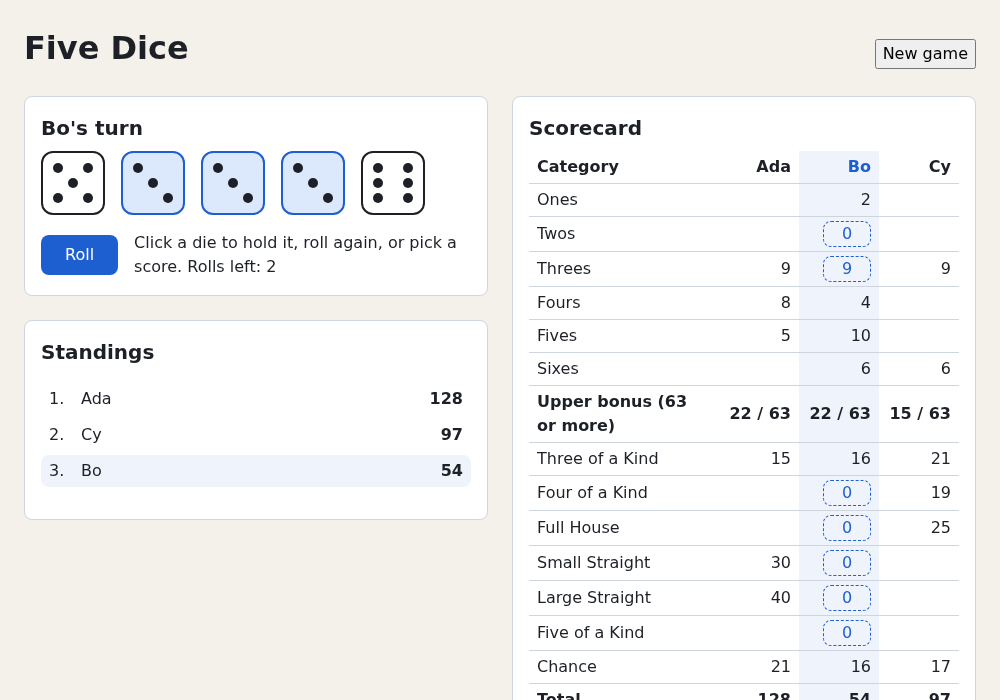
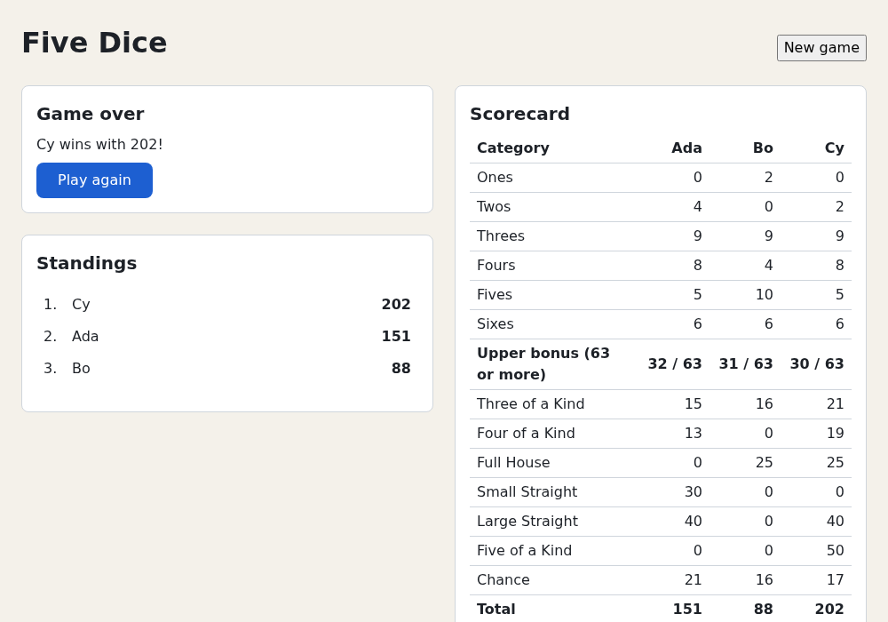

# Chapter 10 — Composition and Context

Three ways to get data to the leaves of a component tree: props, composition (passing JSX into a component) and context (reading a value from far up the tree, with nobody passing it down). You'll pair context with the reducer from [Chapter 7](07-reducers.md), learn when *not* to use it, and see when React keeps a component's state and how a `key` resets it. The project's one-player game from [Chapter 9](09-forms.md) becomes a hot-seat game for up to four players, with live standings and a winner. [Chapter 11](11-effects.md) connects it to the world outside React.

## Composing larger UIs

Data flows **down** as props. Changes flow **up** through callback props (`onRoll`, `onScore`) that a child calls and a parent handles. A component sees only its props, as a function sees only its arguments, so it's easy to reason about.

The game's tree at the end of Chapter 9:

```text
App                      setup state; renders the form or the game
└── Game                 useReducer: state + dispatch
    ├── DiceTray         dice, rollsLeft, phase, onRoll, onToggleHold
    │   └── Die ×5       value, held, disabled, onToggle
    ├── Scorecard        sheet, potential, onScore
    └── GameOver         players, onPlayAgain
```

`Game` owns the state and hands each child what it needs. With two levels that's fine. Deeper trees get harder.

### Prop drilling

**Prop drilling** is passing a prop through components that don't use it, for one further down. Split `Scorecard` into `ScoreTable` → `ScoreRow` → `ScoreCell`, and if only `ScoreCell` needs `onScore`, the other two must still accept and pass it. Every new value a leaf needs touches every layer in between.

Drilling isn't wrong; it's explicit, so you can see where each value comes from. It becomes a problem when:

- many layers only pass a value through;
- many distant components need the same value (the current game, the theme, the logged-in user).

**Composition** often removes the middle layers. **Context** skips them.

## Component APIs: `children`, slots and render props

A component's props are its API. Three patterns let the *caller* supply part of the UI, so the component needs none of the caller's data.

`examples/ch10/component-apis.demo.tsx`

```tsx
import type { ReactNode } from 'react'

// 1. children: the caller nests any content inside.
// 2. "Slots": more props that take JSX, for content in other places.
interface CardProps {
  title: string
  actions?: ReactNode
  children: ReactNode
}

function Card({ title, actions, children }: CardProps) {
  return (
    <section style={{ border: '1px solid #999', padding: '0.5rem', marginBottom: '1rem' }}>
      <h2>{title}</h2>
      {children}
      {actions && <footer>{actions}</footer>}
    </section>
  )
}

// 3. A render prop: a function the component calls to render each part.
// List owns the loop and the keys; the caller decides what one item looks like.
interface ListProps<T> {
  items: readonly T[]
  getKey: (item: T) => string
  renderItem: (item: T, index: number) => ReactNode
}

function List<T>({ items, getKey, renderItem }: ListProps<T>) {
  if (items.length === 0) return <p>Nobody yet.</p>
  return (
    <ol>
      {items.map((item, index) => (
        <li key={getKey(item)}>{renderItem(item, index)}</li>
      ))}
    </ol>
  )
}

interface Score {
  name: string
  total: number
}

const scores: Score[] = [
  { name: 'Ada', total: 212 },
  { name: 'Bo', total: 187 },
]

export default function ComponentApisDemo() {
  return (
    <main>
      <Card title="Standings" actions={<button type="button">Share</button>}>
        <List
          items={scores}
          getKey={(score) => score.name}
          renderItem={(score, index) => (
            <>
              {index === 0 ? '🏆 ' : ''}
              {score.name}: <strong>{score.total}</strong>
            </>
          )}
        />
      </Card>
      <Card title="Waiting room">
        <List items={[]} getKey={String} renderItem={String} />
      </Card>
    </main>
  )
}
```

- **`children`**: whatever you nest between `<Card>` and `</Card>`, typed `ReactNode` (anything React can render: elements, strings, numbers, arrays, `null`).
- **Slots**: any `ReactNode` prop can carry JSX, so a component can have several "holes" (`actions`, `header`, `icon`).
- **Render props**: a *function* prop that returns JSX. `List` calls it per item: `List` owns the loop, keys and empty case; the caller decides how an item looks. TypeScript infers `T = Score` for the generic `List<T>` from `items`, so `score` in `renderItem` is typed. (Generics: [TypeScript Crash Course, chapter 7](https://github.com/sipak-gh/learn-typescript-crashcourse/blob/master/07-generics.md).)

`Card` never sees `scores`, only the rendered list. That's how composition removes drilling: pass down the rendered child, not the data.

Render props once also shared logic; today a custom Hook ([Chapter 13](13-custom-hooks.md)) does that, and render props remain for "you decide how each item looks".

The test reads the two cards:

`examples/ch10/component-apis.test.tsx`

```tsx
import { render, screen, within } from '@testing-library/react'
import { expect, it } from 'vitest'
import ComponentApisDemo from './component-apis.demo'

// The <section> that holds the heading with this text.
const card = (title: string) => screen.getByRole('heading', { name: title }).closest('section')!

it('fills children, slots and render props', () => {
  render(<ComponentApisDemo />)
  const standings = card('Standings')
  const items = within(standings).getAllByRole('listitem').map((li) => li.textContent)
  expect(items).toEqual(['🏆 Ada: 212', 'Bo: 187'])
  expect(within(standings).getByRole('button', { name: 'Share' })).toBeInTheDocument()

  const waiting = card('Waiting room')
  expect(waiting).toHaveTextContent('Nobody yet.')
  expect(within(waiting).queryByRole('button')).not.toBeInTheDocument()
})
```

`within(element)` runs queries inside one element only. `closest('section')` is a DOM method that walks up to the nearest ancestor matching a CSS selector. (A `<section>` without an accessible name has no ARIA role, so `getByRole('region')` wouldn't find it.)

```console
$ npx vitest run ch10/component-apis
 ✓ ch10/component-apis.test.tsx (1 test) 147ms
   ✓ fills children, slots and render props 146ms

 Test Files  1 passed (1)
      Tests  1 passed (1)
```

Timings vary. From here on, the `RUN` header and footer lines are left out. To see the cards, run `npm run dev` in `examples/` and open `http://localhost:5173/?demo=ch10/component-apis`.

## Context: `createContext` and `useContext`

**Context** lets a component read a value provided by *any* ancestor. It works like a CSS custom property: set `--accent` on an element and every descendant can read it with `var(--accent)`, and the nearest ancestor that sets it wins. The value depends on where in the tree you are, not on what your parent passed.

Three steps:

1. **Create** a context object with a default value: `createContext(defaultValue)`.
2. **Provide** a value to a subtree: `<MyContext value={...}>...</MyContext>`.
3. **Read** it in any component below: `useContext(MyContext)`.

`examples/ch10/theme-context.demo.tsx`

```tsx
import { createContext, useContext, useState } from 'react'

type Theme = 'light' | 'dark'

// The argument is the default: what useContext returns when no provider is above.
const ThemeContext = createContext<Theme>('light')

function Badge({ label }: { label: string }) {
  const theme = useContext(ThemeContext)
  return (
    <p>
      {label}: {theme}
    </p>
  )
}

// Toolbar neither takes nor passes a theme prop.
function Toolbar() {
  return (
    <div>
      <Badge label="Badge in the toolbar" />
    </div>
  )
}

export default function ThemeContextDemo() {
  const [theme, setTheme] = useState<Theme>('dark')

  return (
    <main>
      <Badge label="Badge outside any provider" />
      <ThemeContext value={theme}>
        <Toolbar />
        {/* The nearest provider wins. */}
        <ThemeContext value="light">
          <Badge label="Badge under a nested provider" />
        </ThemeContext>
      </ThemeContext>
      <button type="button" onClick={() => setTheme(theme === 'dark' ? 'light' : 'dark')}>
        Toggle theme
      </button>
    </main>
  )
}
```

Open `http://localhost:5173/?demo=ch10/theme-context`. The page shows:

```text
Badge outside any provider: light
Badge in the toolbar: dark
Badge under a nested provider: light
```

**Toggle theme** turns the middle line to `light`. The test checks the same:

`examples/ch10/theme-context.test.tsx`

```tsx
import { render, screen } from '@testing-library/react'
import userEvent from '@testing-library/user-event'
import { expect, it } from 'vitest'
import ThemeContextDemo from './theme-context.demo'

const texts = () => screen.getAllByRole('paragraph').map((p) => p.textContent)

it('reads the nearest provider, or the default without one', async () => {
  const user = userEvent.setup()
  render(<ThemeContextDemo />)
  expect(texts()).toEqual([
    'Badge outside any provider: light',
    'Badge in the toolbar: dark',
    'Badge under a nested provider: light',
  ])

  await user.click(screen.getByRole('button', { name: 'Toggle theme' }))
  expect(texts()[1]).toBe('Badge in the toolbar: light')
})
```

```console
$ npx vitest run ch10/theme-context
 ✓ ch10/theme-context.test.tsx (1 test) 131ms
   ✓ reads the nearest provider, or the default without one 130ms
```

The rules:

- `useContext` returns the nearest provider's value above it, or the `createContext` default if there is none.
- The default isn't "the initial value": it's only for components with no provider above, and it never changes.
- Providers nest; the inner one wins for its subtree.
- When a provider's `value` changes (compared with `Object.is`, like `useState`), **every component that reads the context re-renders**, even if components in between skip rendering. (`Toolbar` re-renders here only because its parent `ThemeContextDemo` owns the state. The counter store below shows the middle being skipped.)
- `useContext` is a Hook: call it at the top level of a component ([Chapter 5](05-state-and-events.md)). React 19's `use(ThemeContext)` reads a context too, and may be called after an early return or inside an `if` ([Chapter 17](17-async-react.md)).

### `<Context>` is the provider (React 19)

Since React 19 the context itself is the provider: `<ThemeContext value={...}>`. Older code's `<ThemeContext.Provider value={...}>` still works, but React plans to deprecate it.

### Gotcha: a new object every render

```tsx
// 🔴 A new object on every render of App: every reader re-renders every time.
<UserContext value={{ name, setName }}>
```

`{ name, setName }` is a new object on every render of `App`, so `Object.is` sees a change even when `name` didn't change. With few readers that's harmless. If it matters, pass values that change only when they should (a reducer's state, or separate contexts as below). [Chapter 16](16-rendering-and-performance.md) measures and fixes re-renders.

## Context + reducer: a small store

Context pairs well with `useReducer` ([Chapter 7](07-reducers.md)). One component owns the state and provides it to the subtree; components deep inside read the state or send actions, with no drilling. The project uses this pattern.

Put the contexts and the reducer in a `.ts` file:

`examples/ch10/counter-contexts.ts`

```ts
import { createContext, type Dispatch } from 'react'

export type CountAction = { type: 'add'; amount: number } | { type: 'reset' }

export function countReducer(count: number, action: CountAction): number {
  switch (action.type) {
    case 'add':
      return count + action.amount
    case 'reset':
      return 0
  }
}

// null = "no provider above": a bug that the consumers report.
export const CountContext = createContext<number | null>(null)
export const CountDispatchContext = createContext<Dispatch<CountAction> | null>(null)
```

`Dispatch<CountAction>` is React's type for the `dispatch` function from `useReducer`: `(action: CountAction) => void`.

The provider component and two consumers:

`examples/ch10/counter-store.demo.tsx`

```tsx
import { useContext, useReducer, type ReactNode } from 'react'
import { CountContext, CountDispatchContext, countReducer } from './counter-contexts'

/** Owns the state; shares the value and the dispatch function in two contexts. */
export function CounterProvider({ children }: { children: ReactNode }) {
  const [count, dispatch] = useReducer(countReducer, 0)
  return (
    <CountContext value={count}>
      <CountDispatchContext value={dispatch}>{children}</CountDispatchContext>
    </CountContext>
  )
}

export function Display() {
  const count = useContext(CountContext)
  if (count === null) throw new Error('Display must be used inside <CounterProvider>')
  return <p>Count: {count}</p>
}

export function Buttons() {
  const dispatch = useContext(CountDispatchContext)
  if (!dispatch) throw new Error('Buttons must be used inside <CounterProvider>')
  return (
    <p>
      <button type="button" onClick={() => dispatch({ type: 'add', amount: 1 })}>
        +1
      </button>
      <button type="button" onClick={() => dispatch({ type: 'reset' })}>
        Reset
      </button>
    </p>
  )
}

export default function CounterStoreDemo() {
  return (
    <CounterProvider>
      <Display />
      <section>
        <h2>Controls</h2>
        <Buttons />
      </section>
    </CounterProvider>
  )
}
```

Three design choices:

1. **Two contexts.** The state changes often; `dispatch` never does (React keeps one function for the component's lifetime). Components that only send actions read only `CountDispatchContext`, so a count change doesn't re-render them.
2. **`null` default, then throw.** A forgotten provider becomes a clear error instead of a silent wrong value. The check also narrows the type: after the `if`, `count` is a `number`.
3. **Contexts live in a `.ts` file.** Vite's Fast Refresh (the hot reload from [Chapter 1](01-getting-started.md)) updates a module in place only if it exports nothing but components, and the template's linter, Oxlint, flags other exports from a `.tsx` component file (`react(only-export-components)`). So contexts, reducers and helpers get their own module.

`examples/ch10/counter-store.test.tsx`

```tsx
import { render, screen } from '@testing-library/react'
import userEvent from '@testing-library/user-event'
import { useContext } from 'react'
import { expect, it } from 'vitest'
import { CountContext, CountDispatchContext } from './counter-contexts'
import CounterStoreDemo, { CounterProvider, Display } from './counter-store.demo'

it('shares the state and the dispatch function through context', async () => {
  const user = userEvent.setup()
  render(<CounterStoreDemo />)
  await user.click(screen.getByRole('button', { name: '+1' }))
  await user.click(screen.getByRole('button', { name: '+1' }))
  expect(screen.getByText('Count: 2')).toBeInTheDocument()
  await user.click(screen.getByRole('button', { name: 'Reset' }))
  expect(screen.getByText('Count: 0')).toBeInTheDocument()
})

it('re-renders only the components that read the changed context', async () => {
  const renders: string[] = []
  function CountReader() {
    renders.push('CountReader')
    return <p>{useContext(CountContext)}</p>
  }
  function DispatchReader() {
    renders.push('DispatchReader')
    const dispatch = useContext(CountDispatchContext)
    return (
      <button type="button" onClick={() => dispatch?.({ type: 'add', amount: 1 })}>
        Add
      </button>
    )
  }

  const user = userEvent.setup()
  render(
    <CounterProvider>
      <CountReader />
      <DispatchReader />
    </CounterProvider>,
  )
  expect(renders).toEqual(['CountReader', 'DispatchReader'])

  renders.length = 0
  await user.click(screen.getByRole('button', { name: 'Add' }))
  // dispatch never changes, so DispatchReader is skipped.
  expect(renders).toEqual(['CountReader'])
})

it('fails loudly without a provider', () => {
  expect(() => render(<Display />)).toThrow('Display must be used inside <CounterProvider>')
})
```

```console
$ npx vitest run ch10/counter-store
 ✓ ch10/counter-store.test.tsx (3 tests) 172ms
   ✓ shares the state and the dispatch function through context 155ms
   ✓ re-renders only the components that read the changed context 12ms
   ✓ fails loudly without a provider 5ms
```

The second test is subtle: `CounterProvider` re-renders on every click, but `DispatchReader` doesn't. The *test* created its element and passed it in as `children`, so React sees the same element object and skips it, unless it reads a changed context. `CountReader` reads `CountContext`, so it re-renders.

### Gotcha: forgetting the null check

Use a `null`-default context's value without a check and TypeScript stops you. Here is the project's `Scoreboard` without its `if (!state) throw ...` line:

```console
$ npx tsc -b
src/components/Scoreboard.tsx(11,28): error TS2345: Argument of type 'GameState | null' is not assignable to parameter of type 'GameState'.
  Type 'null' is not assignable to type 'GameState'.
src/components/Scoreboard.tsx(11,59): error TS18047: 'state' is possibly 'null'.
src/components/Scoreboard.tsx(11,73): error TS18047: 'state' is possibly 'null'.
src/components/Scoreboard.tsx(15,20): error TS18047: 'state' is possibly 'null'.
```

Don't silence it with `state!`. The check costs one line, and its error names the misplaced component. [Chapter 13](13-custom-hooks.md) moves this check into a custom Hook.

## When not to use context

Context is a hidden input: a component that calls `useContext` depends on where it's rendered, so it's harder to reuse and test alone. Reach for it last:

1. **Pass props.** Two or three levels of explicit props is normal and easy to follow.
2. **Compose.** If middle components only pass data through, have the caller pass the rendered child (`children`, slots).
3. **Use context** when many components at different depths need the same thing: the theme, the signed-in user, the current game, a service such as a random number generator.

Nor is context a performance tool: every reader re-renders on every change. For large, fast-changing shared state, apps often use a state library (Redux Toolkit, Zustand, Jotai and others) that lets each component subscribe to just its slice. This course doesn't need one; [Chapter 20](20-where-next.md) lists them.

## State lives in the tree: position and `key`

React stores `useState` state in the tree, at the **position** where the component renders, not "in the function". Each render, it matches the new tree against the old one (reconciliation, [Chapter 4](04-components-and-jsx.md)):

- **Same type, same position:** the state stays, even if the props changed.
- **A different type there, or nothing:** the old component and its state are destroyed; one that appears later starts fresh.
- **A different `key`:** a different component, even with the same type and position.

`examples/ch10/state-position.demo.tsx`

```tsx
import { useState } from 'react'

function Counter({ label }: { label: string }) {
  const [count, setCount] = useState(0)
  return (
    <button type="button" onClick={() => setCount(count + 1)}>
      {label}: {count}
    </button>
  )
}

export default function StatePositionDemo() {
  const [player, setPlayer] = useState('Ada')
  const isAda = player === 'Ada'

  return (
    <main>
      <button type="button" onClick={() => setPlayer(isAda ? 'Bo' : 'Ada')}>
        Switch player
      </button>

      <h2>1. Same component, same position</h2>
      {/* Only a prop changes: React keeps the state. */}
      <Counter label={player} />

      <h2>2. A ternary: still the same position</h2>
      {isAda ? <Counter label="Ada" /> : <Counter label="Bo" />}

      <h2>3. Two different positions</h2>
      {isAda && <Counter label="Ada" />}
      {!isAda && <Counter label="Bo" />}

      <h2>4. Same position, different key</h2>
      <Counter key={player} label={player} />
    </main>
  )
}
```

Open `http://localhost:5173/?demo=ch10/state-position`, click each counter once (all show `Ada: 1`), then click **Switch player**:

| Case | After the switch | Why |
| --- | --- | --- |
| 1. same position | `Bo: 1` | Same type, same place: the state stays. Only the label prop changed. |
| 2. ternary | `Bo: 1` | Both branches put a `Counter` in the same slot. React can't tell them apart. |
| 3. two `&&` | `Bo: 0` | Two slots. The first now holds `false` (nothing), so Ada's counter is destroyed; Bo's is new. |
| 4. `key` | `Bo: 0` | The key changed from `Ada` to `Bo`: a different component. |

Case 2 surprises people. The JSX looks like two counters, but React sees "a `Counter` in the second slot" both times. To keep them separate, give them different keys or use case 3.

The test clicks everything and checks the table:

`examples/ch10/state-position.test.tsx` (first test)

```tsx
import { render, screen } from '@testing-library/react'
import userEvent from '@testing-library/user-event'
import { useState } from 'react'
import { expect, it } from 'vitest'
import StatePositionDemo from './state-position.demo'

const counters = () =>
  screen
    .getAllByRole('button')
    .slice(1) // skip "Switch player"
    .map((button) => button.textContent)

it('keeps state by position and resets it by key', async () => {
  const user = userEvent.setup()
  render(<StatePositionDemo />)

  // Click every counter once: all show 1.
  for (const button of screen.getAllByRole('button').slice(1)) await user.click(button)
  expect(counters()).toEqual(['Ada: 1', 'Ada: 1', 'Ada: 1', 'Ada: 1'])

  await user.click(screen.getByRole('button', { name: 'Switch player' }))
  expect(counters()).toEqual(['Bo: 1', 'Bo: 1', 'Bo: 0', 'Bo: 0'])
})
```

### Resetting with `key`

To reset all state in a subtree, change the `key` on its root. No reset logic: React throws the old subtree away and mounts a new one, like replacing a DOM element with a fresh one instead of resetting each of its fields. Typical uses:

- a profile editor with `key={userId}`, so a new user never sees the previous user's draft;
- a game with `key={gameId}`, so "Play again" starts from scratch (the project does this below).

It's the same `key` as in lists ([Chapter 4](04-components-and-jsx.md)): a child's identity among its siblings.

### Gotcha: defining a component inside a component

`examples/ch10/state-position.test.tsx` (second test)

```tsx
// 🔴 A component defined inside another component.
function Parent() {
  const [count, setCount] = useState(0)
  // A brand-new Inner function, so a new component type, on every render of Parent.
  function Inner() {
    const [clicks, setClicks] = useState(0)
    return (
      <button type="button" onClick={() => setClicks(clicks + 1)}>
        Inner: {clicks}
      </button>
    )
  }
  return (
    <>
      <button type="button" onClick={() => setCount(count + 1)}>
        Parent: {count}
      </button>
      {/* oxlint-disable-next-line react/static-components -- the bug being shown */}
      <Inner />
    </>
  )
}

it('loses the state of a component defined inside another one', async () => {
  const user = userEvent.setup()
  render(<Parent />)
  await user.click(screen.getByRole('button', { name: 'Inner: 0' }))
  expect(screen.getByRole('button', { name: 'Inner: 1' })).toBeInTheDocument()

  await user.click(screen.getByRole('button', { name: 'Parent: 0' }))
  expect(screen.getByRole('button', { name: 'Inner: 0' })).toBeInTheDocument()
})
```

The component *type* is the function itself. Each render of `Parent` creates a new `Inner` function, so React sees a new type and resets it. Declare components at the top level of a module. Without the disable comment, Oxlint catches it:

```console
$ npx oxlint ch10/state-position.test.tsx
  ⚠ react(static-components): Cannot create components during render
    ╭─[ch10/state-position.test.tsx:42:8]
 28 │   // A brand-new Inner function, so a new component type, on every render of Parent.
 29 │   function Inner() {
    ·   ─────────┬────────
    ·            ╰── The component is created during render here
 30 │     const [clicks, setClicks] = useState(0)
 31 │     return (
 32 │       <button type="button" onClick={() => setClicks(clicks + 1)}>
 33 │         Inner: {clicks}
 34 │       </button>
 35 │     )
 36 │   }
 37 │   return (
 38 │     <>
 39 │       <button type="button" onClick={() => setCount(count + 1)}>
 40 │         Parent: {count}
 41 │       </button>
 42 │       <Inner />
    ·        ──┬──
    ·          ╰── This component is created during render
 43 │     </>
    ╰────
  help: Components created during render will reset their state each time they are created. Declare components outside of render
  note: React Compiler skipped optimizing this component or hook. Additional guidance: https://react.dev/reference/eslint-plugin-react-hooks/lints/static-components

Found 1 warning and 0 errors.
Finished in 14ms on 1 file with 116 rules using 32 threads.
```

The "React Compiler" note refers to an optional optimizer that [Chapter 16](16-rendering-and-performance.md) turns on.

```console
$ npx vitest run ch10/state-position
 ✓ ch10/state-position.test.tsx (2 tests) 227ms
   ✓ keeps state by position and resets it by key 199ms
   ✓ loses the state of a component defined inside another one 27ms
```

## Building five-dice: hot-seat multiplayer

The Chapter 9 form already collects one to four names, and the reducer already rotates `current` after each score; only the UI is missing. You'll:

- move the game state into a `GameProvider` that shares it through context;
- let board components read from context instead of `Game`'s props;
- show one scorecard column per player, highlighting the current one;
- add a live **Standings** panel;
- announce the winner, or a tie, at game over;
- make "Play again" and "New game" reset the game with a `key`, and delete the reducer's `newGame` action.

The new tree:

```text
App                      session state: which game, with which setup
└── GameProvider key=…   useReducer; provides GameStateContext + GameDispatchContext
    └── Game             layout only
        ├── DiceTray     reads state, dispatch, RngContext
        ├── GameOver     reads state
        ├── Scoreboard   reads state
        └── Scorecard    reads state, dispatch
```

### Ranking players: `rankPlayers`

The standings and the game-over text both need players sorted by total, with ties sharing a rank. That's pure game logic, so it goes in `src/game/scoring.ts`. Add `Player` to the type import at the top:

```ts
import type { Category, DieValue, Player, Scores, ScoreSheet, UpperCategory } from './types'
```

Then add this at the end of the file:

```ts
export interface Standing {
  name: string
  total: number
  /** 1 for the leader. Equal totals share a rank, and the next rank is skipped: 1, 1, 3. */
  rank: number
}

/** Players sorted from highest to lowest total, with ties sharing a rank. */
export function rankPlayers(players: readonly Player[]): Standing[] {
  const sorted = players
    .map((player) => ({ name: player.name, total: totals(player.sheet).grand }))
    .toSorted((a, b) => b.total - a.total)
  return sorted.map((entry) => ({
    ...entry,
    // Rank = 1 + how many players scored strictly more.
    rank: 1 + sorted.filter((other) => other.total > entry.total).length,
  }))
}
```

`toSorted` returns a sorted copy and leaves the original alone, like `with` in the reducer. That matters: `players` is React state, which you must never mutate. "1, 1, 3" is called standard competition ranking.

In `src/game/scoring.test.ts`, add `rankPlayers` to the import from `./scoring` and add a `describe` block at the end:

```ts
describe('rankPlayers', () => {
  const player = (name: string, chance: number) => ({
    name,
    sheet: { scores: { chance }, fiveOfAKindBonuses: 0 },
  })

  it('sorts by total and lets ties share a rank', () => {
    expect(rankPlayers([player('Cy', 10), player('Ada', 20), player('Bo', 20)])).toEqual([
      { name: 'Ada', total: 20, rank: 1 },
      { name: 'Bo', total: 20, rank: 1 },
      { name: 'Cy', total: 10, rank: 3 },
    ])
  })
})
```

### The contexts

Create `src/components/contexts.ts`:

```ts
import { createContext, type Dispatch } from 'react'
import type { Rng } from '../game/dice'
import type { GameAction, GameState } from '../game/reducer'

// Contexts live in their own .ts file: a file that exports components should
// export only components, so Fast Refresh (HMR) can update them in place.

/** The current game. null means "no <GameProvider> above": a bug we want to catch. */
export const GameStateContext = createContext<GameState | null>(null)

/** The reducer's dispatch function, in a separate context because it never changes. */
export const GameDispatchContext = createContext<Dispatch<GameAction> | null>(null)

/**
 * Where dice rolls come from. The default value is used when no provider is
 * above, so the real app needs no provider at all; tests provide a fake one.
 */
export const RngContext = createContext<Rng>(Math.random)
```

`RngContext` lets tests swap the dice. In Chapters 8 and 9, `App` took an `rng` prop, only for tests' fake dice, and drilled it to the tray. Now the app uses the default, `Math.random`, with no provider, and a test overrides it with `<RngContext value={fakeDice(6)}>`: the same trick as a function parameter with a default value.

### `GameProvider`

Create `src/components/GameProvider.tsx`:

```tsx
import { useReducer, type ReactNode } from 'react'
import { createGame, gameReducer } from '../game/reducer'
import type { GameSetup } from '../game/types'
import { GameDispatchContext, GameStateContext } from './contexts'

interface GameProviderProps {
  setup: GameSetup
  children: ReactNode
}

/** Owns the game state and shares it with every component below it. */
export function GameProvider({ setup, children }: GameProviderProps) {
  const [state, dispatch] = useReducer(gameReducer, setup, createGame)

  // React 19: a context object itself is the provider (no more <Context.Provider>).
  return (
    <GameStateContext value={state}>
      <GameDispatchContext value={dispatch}>{children}</GameDispatchContext>
    </GameStateContext>
  )
}
```

The `useReducer` line moved here from `Game`. As before, `setup` is only read on the first render (`createGame(setup)`).

### `App`: a session with a key

`App` used to keep the form's `setup`. Now it keeps a **session**: the setup plus an id. A new id means a new game.

Replace `src/App.tsx`:

```tsx
import { useState } from 'react'
import { Game } from './components/Game'
import { GameProvider } from './components/GameProvider'
import { NewGameForm } from './components/NewGameForm'
import type { GameSetup } from './game/types'

/** One game from start to finish. A new id means a brand-new game. */
interface Session {
  id: number
  setup: GameSetup
}

function App() {
  // null until the new-game form is submitted.
  const [session, setSession] = useState<Session | null>(null)

  function handlePlayAgain() {
    // Same players and options, new id. The new `key` below makes React throw
    // away the old <GameProvider> and its state, and mount a fresh one.
    setSession((current) => current && { id: current.id + 1, setup: current.setup })
  }

  return (
    <div className="app">
      <header className="app-header">
        <h1>Five Dice</h1>
        {session && (
          <button type="button" onClick={() => setSession(null)}>
            New game
          </button>
        )}
      </header>

      {session ? (
        <GameProvider key={session.id} setup={session.setup}>
          <Game onPlayAgain={handlePlayAgain} />
        </GameProvider>
      ) : (
        <main className="setup">
          <h2>New game</h2>
          <NewGameForm onStart={(setup) => setSession({ id: 1, setup })} />
        </main>
      )}

      <footer className="app-footer">
        <p>
          Rules: <a href="https://beesboardsma.com/pages/five-dice">Five Dice</a>
        </p>
      </footer>
    </div>
  )
}

export default App
```

- **Play again** bumps the id. Without the key, React would keep `GameProvider`'s state (same type, same position): the finished game. With `key={session.id}`, React mounts a new provider and `useReducer` runs `createGame` again.
- **New game** sets the session to `null`, so the game leaves the tree and its state is destroyed. The next session gets a new provider.
- `current && {...}` keeps `null` as `null`. `handlePlayAgain` only runs during a game, but the type says `Session | null`.
- The `rng` prop is gone; `RngContext` replaces it.

### The reducer loses `newGame`

Resetting is now React's job (a new key), so the reducer doesn't need `newGame`. In `src/game/reducer.ts`:

- delete `| { type: 'newGame' }` from `GameAction`;
- delete the `setupOf` function (only `newGame` used it);
- delete the `case 'newGame':` branch and its `return`.

The union now has three members:

```ts
export type GameAction =
  // The random values come in with the action, so the reducer stays pure.
  | { type: 'roll'; values: DieValue[] }
  | { type: 'toggleHold'; id: number }
  | { type: 'score'; category: Category }
```

Forget the `case` and the `never` check in `default` (Chapter 7) fails the build. That's its job.

In `src/game/reducer.test.ts`, the last test played a `newGame` action. Rename it and drop that line:

```ts
  it('ends after 13 turns', () => {
    let state = createGame(solo)
    for (const category of CATEGORIES) {
      state = play(state, rollSixes, { type: 'score', category })
    }
    expect(getPhase(state)).toBe('gameOver')
    expect(play(state, rollSixes)).toBe(state)
  })
```

### `Game`: layout only

`Game` no longer owns state or passes props down. It reads the state only to pick the panel titles and which panel to show. Replace `src/components/Game.tsx`:

```tsx
import { useContext } from 'react'
import { getPhase } from '../game/reducer'
import { DiceTray } from './DiceTray'
import { GameOver } from './GameOver'
import { Panel } from './Panel'
import { Scoreboard } from './Scoreboard'
import { Scorecard } from './Scorecard'
import { GameStateContext } from './contexts'

interface GameProps {
  onPlayAgain: () => void
}

/** Lays out the board. The pieces read the game from context themselves. */
export function Game({ onPlayAgain }: GameProps) {
  const state = useContext(GameStateContext)
  if (!state) throw new Error('Game must be used inside <GameProvider>')

  const phase = getPhase(state)
  const player = state.players[state.current]

  return (
    <main className="board">
      <div className="stack">
        <Panel title={phase === 'gameOver' ? 'Game over' : `${player.name}'s turn`}>
          {phase === 'gameOver' ? <GameOver onPlayAgain={onPlayAgain} /> : <DiceTray />}
        </Panel>
        <Panel title="Standings">
          <Scoreboard />
        </Panel>
      </div>

      <Panel title="Scorecard">
        <Scorecard />
      </Panel>
    </main>
  )
}
```

`onPlayAgain` stays a prop: it belongs to `App`, it's needed one level down, and passing it is simplest. Not everything belongs in context.

### `DiceTray` reads context

Replace `src/components/DiceTray.tsx`:

```tsx
import { useContext } from 'react'
import { rollDice } from '../game/dice'
import { getPhase, type Phase } from '../game/reducer'
import { Die } from './Die'
import { GameDispatchContext, GameStateContext, RngContext } from './contexts'

const HINTS: Record<Phase, string> = {
  ready: 'Roll to start your turn.',
  rolling: 'Click a die to hold it, roll again, or pick a score.',
  mustScore: 'No rolls left: pick a score.',
  gameOver: 'Game over.',
}

export function DiceTray() {
  // No props: everything comes from context.
  const state = useContext(GameStateContext)
  const dispatch = useContext(GameDispatchContext)
  const rng = useContext(RngContext)
  if (!state || !dispatch) throw new Error('DiceTray must be used inside <GameProvider>')

  const phase = getPhase(state)
  const canRoll = phase === 'ready' || phase === 'rolling'

  return (
    <div className="dice-area">
      <div className="dice-tray">
        {state.dice.map((die) => (
          <Die
            key={die.id}
            value={die.value}
            held={die.held}
            disabled={phase !== 'rolling'}
            onToggle={() => dispatch({ type: 'toggleHold', id: die.id })}
          />
        ))}
      </div>

      <div className="roll-row">
        <button
          type="button"
          className="roll-button"
          onClick={() => dispatch({ type: 'roll', values: rollDice(rng) })}
          disabled={!canRoll}
        >
          Roll
        </button>
        <p>
          {HINTS[phase]} Rolls left: {state.rollsLeft}
        </p>
      </div>
    </div>
  )
}
```

The markup is unchanged; five props became three `useContext` calls. `Die` keeps its props: it's a small reusable piece, and props keep it independent of the game.

### `Scorecard`: one column per player

The scorecard now has a column per player. Only the current player's column is highlighted and shows score buttons. Replace `src/components/Scorecard.tsx`:

```tsx
import { useContext } from 'react'
import { getPhase } from '../game/reducer'
import { CATEGORY_LABELS, LOWER_CATEGORIES, UPPER_BONUS_THRESHOLD, UPPER_CATEGORIES } from '../game/rules'
import { potentialScores, totals } from '../game/scoring'
import type { Category } from '../game/types'
import { GameDispatchContext, GameStateContext } from './contexts'

interface ScoreCellProps {
  score: number | undefined
  /** Only set in the current player's column, after a roll. */
  potential: number | undefined
  isCurrent: boolean
  onScore: () => void
}

function ScoreCell({ score, potential, isCurrent, onScore }: ScoreCellProps) {
  let content
  if (score !== undefined) {
    content = score
  } else if (potential !== undefined) {
    content = (
      <button type="button" className="score-button" onClick={onScore}>
        {potential}
      </button>
    )
  }
  return <td className={isCurrent ? 'score current' : 'score'}>{content}</td>
}

/** One column per player; the current player's column is highlighted. */
export function Scorecard() {
  const state = useContext(GameStateContext)
  const dispatch = useContext(GameDispatchContext)
  if (!state || !dispatch) throw new Error('Scorecard must be used inside <GameProvider>')

  const { players } = state
  const phase = getPhase(state)
  const canScore = phase === 'rolling' || phase === 'mustScore'
  const values = state.dice.map((die) => die.value)
  const potential = canScore ? potentialScores(players[state.current].sheet, values) : {}
  const playerTotals = players.map((player) => totals(player.sheet))
  const showBonusRow = playerTotals.some((sums) => sums.fiveOfAKindBonus > 0)
  const isCurrent = (index: number) => phase !== 'gameOver' && index === state.current

  const renderRow = (category: Category) => (
    <tr key={category}>
      <td>{CATEGORY_LABELS[category]}</td>
      {players.map((player, index) => (
        <ScoreCell
          key={player.name}
          score={player.sheet.scores[category]}
          potential={isCurrent(index) ? potential[category] : undefined}
          isCurrent={isCurrent(index)}
          onScore={() => dispatch({ type: 'score', category })}
        />
      ))}
    </tr>
  )

  // A row of computed values (bonus, totals) with one cell per player.
  const renderSumRow = (label: string, cell: (index: number) => string | number, className: string) => (
    <tr className={className}>
      <td>{label}</td>
      {players.map((player, index) => (
        <td key={player.name} className={isCurrent(index) ? 'score current' : 'score'}>
          {cell(index)}
        </td>
      ))}
    </tr>
  )

  return (
    <table className="scorecard">
      <thead>
        <tr>
          <th>Category</th>
          {players.map((player, index) => (
            <th key={player.name} className={isCurrent(index) ? 'score current' : 'score'}>
              {player.name}
            </th>
          ))}
        </tr>
      </thead>
      <tbody>
        {UPPER_CATEGORIES.map(renderRow)}
        {renderSumRow(
          `Upper bonus (${UPPER_BONUS_THRESHOLD} or more)`,
          (index) => {
            const sums = playerTotals[index]
            return sums.upperBonus > 0 ? sums.upperBonus : `${sums.upper} / ${UPPER_BONUS_THRESHOLD}`
          },
          'subtotal',
        )}
      </tbody>
      <tbody>
        {LOWER_CATEGORIES.map(renderRow)}
        {showBonusRow &&
          renderSumRow('Five of a Kind bonus', (index) => playerTotals[index].fiveOfAKindBonus, 'subtotal')}
      </tbody>
      <tfoot>{renderSumRow('Total', (index) => playerTotals[index].grand, 'total')}</tfoot>
    </table>
  )
}
```

- `ScoreCell` renders one cell: a recorded score, a score button, or nothing.
- `renderRow` and `renderSumRow` are plain functions returning JSX, defined inside `Scorecard` to use its variables. Calling `renderRow(category)` is fine; rendering `<RenderRow />` would be the gotcha above.
- Player names are unique (the form checks), so they serve as column keys.
- The Five of a Kind bonus row appears only once someone has earned a bonus.
- Every cell in the current player's column gets the `current` class, so CSS can tint the whole column.

### `Scoreboard`: live standings

Create `src/components/Scoreboard.tsx`:

```tsx
import { useContext } from 'react'
import { getPhase } from '../game/reducer'
import { rankPlayers } from '../game/scoring'
import { GameStateContext } from './contexts'

/** Live standings, best first. */
export function Scoreboard() {
  const state = useContext(GameStateContext)
  if (!state) throw new Error('Scoreboard must be used inside <GameProvider>')

  // Nobody's turn once the game is over.
  const current = getPhase(state) === 'gameOver' ? null : state.players[state.current].name

  return (
    <ol className="scoreboard">
      {rankPlayers(state.players).map((standing) => (
        <li key={standing.name} className={standing.name === current ? 'current' : undefined}>
          <span className="rank">{standing.rank}.</span>
          <span>{standing.name}</span>
          <strong>{standing.total}</strong>
        </li>
      ))}
    </ol>
  )
}
```

The standings are derived from `state.players` on every render; nothing new is stored.

### `GameOver`: winners and ties

Replace `src/components/GameOver.tsx`:

```tsx
import { useContext } from 'react'
import { rankPlayers } from '../game/scoring'
import { GameStateContext } from './contexts'

interface GameOverProps {
  onPlayAgain: () => void
}

/** "Ada wins", "Ada and Bo tie" or, for one player, the final score. */
function resultText(winners: string[], total: number, playerCount: number): string {
  if (playerCount === 1) return `Final score: ${total}`
  if (winners.length === 1) return `${winners[0]} wins with ${total}!`
  return `It's a tie: ${new Intl.ListFormat('en').format(winners)} with ${total}!`
}

export function GameOver({ onPlayAgain }: GameOverProps) {
  const state = useContext(GameStateContext)
  if (!state) throw new Error('GameOver must be used inside <GameProvider>')

  const standings = rankPlayers(state.players)
  const winners = standings.filter((standing) => standing.rank === 1).map((standing) => standing.name)

  return (
    <div className="game-over">
      <p>{resultText(winners, standings[0].total, standings.length)}</p>
      <button type="button" className="roll-button" onClick={onPlayAgain}>
        Play again
      </button>
    </div>
  )
}
```

`Intl.ListFormat` is the browser's list formatter: `format(['Ada', 'Bo', 'Cy'])` gives `"Ada, Bo, and Cy"`, and two names give `"Ada and Bo"`. The old per-player list is gone, since the Standings panel next to it shows the same.

### Styles

Add this section to the end of `src/index.css`:

<details><summary>Full listing: the new section at the end of <code>src/index.css</code></summary>

```css
/* ---------- 8. Multiplayer ---------- */
.stack {
  display: grid;
  align-content: start;
  gap: var(--space-4);
}

.scorecard .current {
  background: #eef3fc;
}

.scorecard th.current {
  color: var(--color-accent);
}

.scoreboard {
  display: grid;
  gap: var(--space-1);
  padding: 0;
  list-style: none;
}

.scoreboard li {
  display: grid;
  grid-template-columns: 2rem 1fr auto;
  padding: var(--space-1) var(--space-2);
  border-radius: var(--radius);
}

.scoreboard li.current {
  background: #eef3fc;
}
```

</details>

`.stack` stacks the turn panel and the Standings panel left of the scorecard. Each standings row is a three-column grid: rank, name, total.

### Tests

`App` no longer takes an `rng` prop, so the tests provide fake dice through `RngContext`. In `src/App.test.tsx`, add the import:

```tsx
import { RngContext } from './components/contexts'
```

Replace the `startSoloGame` helper with two helpers:

```tsx
/** Render the app, with fake dice if `rng` is given. */
function renderApp(rng: Rng = Math.random) {
  // A provider in the test replaces the context's default (Math.random).
  render(
    <RngContext value={rng}>
      <App />
    </RngContext>,
  )
  return userEvent.setup()
}

/** Render the app and start a game from the new-game form. */
async function startGame(rng?: Rng, players = 1) {
  const user = renderApp(rng)
  for (let i = 1; i < players; i++) {
    await user.click(screen.getByRole('button', { name: 'Add player' }))
  }
  await user.click(screen.getByRole('button', { name: 'Start game' }))
  return user
}
```

Then:

- rename every `startSoloGame(` call to `startGame(`;
- in "plays 13 turns to the end and starts again", the game-over check becomes `expect(screen.getByText('Final score: 270')).toBeInTheDocument()`;
- replace the old "takes turns between players" test with these three:

```tsx
  it('takes turns between players and highlights whose turn it is', async () => {
    const user = await startGame(fakeDice(6), 2)
    const columnHeader = (name: string) => screen.getByRole('columnheader', { name })

    expect(columnHeader('Player 1')).toHaveClass('current')
    await user.click(screen.getByRole('button', { name: 'Roll' }))
    await user.click(scoreButton('Sixes'))

    expect(screen.getByRole('heading', { name: "Player 2's turn" })).toBeInTheDocument()
    expect(columnHeader('Player 2')).toHaveClass('current')
    expect(screen.getByRole('row', { name: 'Sixes 30' })).toBeInTheDocument()
    // The standings list the leader first.
    expect(screen.getAllByRole('listitem').map((item) => item.textContent)).toEqual([
      '1.Player 130',
      '2.Player 20',
    ])
  })

  it('announces a tie when players finish level', async () => {
    const user = await startGame(fakeDice(6), 2)
    for (const category of CATEGORIES) {
      for (let player = 0; player < 2; player++) {
        await user.click(screen.getByRole('button', { name: 'Roll' }))
        await user.click(scoreButton(CATEGORY_LABELS[category]))
      }
    }
    expect(screen.getByText("It's a tie: Player 1 and Player 2 with 270!")).toBeInTheDocument()
  })

  it('goes back to the form for a new game', async () => {
    const user = await startGame(fakeDice(6), 2)
    await user.click(screen.getByRole('button', { name: 'Roll' }))
    await user.click(screen.getByRole('button', { name: 'New game' }))
    expect(screen.getByRole('heading', { name: 'New game' })).toBeInTheDocument()
  })
```

`'1.Player 130'` is the `<li>`'s `textContent`: `1.` + `Player 1` + `30`, with no spaces because there's no text between the three `<span>`s. The row `Sixes 30` gets its accessible name from its cells: `Sixes`, `30` and an empty cell for Player 2.

The "plays 13 turns" test also proves the `key` reset. Remove `key={session.id}` from `App` and "Play again" keeps the finished game, so the test fails:

```text
 FAIL  src/App.test.tsx > App > plays 13 turns to the end and starts again
TestingLibraryElementError: Unable to find an accessible element with the role "row" and name "Total 0"
```

The error goes on to list the roles it found: the heading still says "Game over".

### Checkpoint

The checks, trimmed to the lines that matter:

```console
$ npm test
…
 ✓ src/App.test.tsx (9 tests) 2393ms
   ✓ App (9)
     ✓ plays 13 turns to the end and starts again 555ms
     ✓ announces a tie when players finish level 1235ms

 Test Files  7 passed (7)
      Tests  66 passed (66)

$ npm run build
…
✓ 30 modules transformed.
…
$ npm run lint
…
Found 0 warnings and 0 errors.
```

Timings vary. Vitest lists slow tests under their file.

In the browser (`npm run dev`):

- Add players (try Ada, Bo and Cy) and start. The scorecard has one column per player. The current player's column is tinted, and only it shows score buttons after a roll.
- After each score the turn passes on, and the **Standings** panel re-sorts with the leader first.



- At the end the left panel says **Game over** and names the winner ("Cy wins with 202!") or the tie. **Play again** starts a fresh game with the same players; **New game** returns to the form.



Your scores will differ: the dice are random.

The complete project at this point is in `project/ch10/`.

## Summary

- Props flow down, callbacks flow up. Passing props through layers that don't use them is **prop drilling**.
- **Composition** often removes drilling: pass rendered JSX via `children` or slot props. A **render prop** is a function prop the component calls to render each part.
- **Context**: `createContext(default)`, `<Ctx value={...}>` (React 19; `<Ctx.Provider>` is the old form), `useContext(Ctx)`. The nearest provider wins, else the default. Every reader re-renders when the value changes (`Object.is`).
- **Context + reducer** is a small store. Split state and `dispatch` into two contexts so dispatch-only components don't re-render.
- Use a `null` default plus a throw when a provider is required. Keep contexts in `.ts` files for Fast Refresh.
- Prefer props, then composition, then context: context hides a dependency and isn't a performance tool.
- State lives at a **position in the tree**. A different type or position resets it; a different **`key`** resets it on purpose.
- Declare components at module top level; one defined inside another is a new type each render and loses its state.

## Exercises

1. **Current-player hint.** Show "Your turn, Bo!" under the Standings list, using only context. Write a `TurnBanner` component in `src/components/TurnBanner.tsx` that reads `GameStateContext` and shows nothing at game over. Render it in the Standings panel after `<Scoreboard />`.

<details><summary>Solution</summary>

```tsx
import { useContext } from 'react'
import { getPhase } from '../game/reducer'
import { GameStateContext } from './contexts'

export function TurnBanner() {
  const state = useContext(GameStateContext)
  if (!state) throw new Error('TurnBanner must be used inside <GameProvider>')
  if (getPhase(state) === 'gameOver') return null
  return <p>Your turn, {state.players[state.current].name}!</p>
}
```

In `Game.tsx`:

```tsx
        <Panel title="Standings">
          <Scoreboard />
          <TurnBanner />
        </Panel>
```

No component between `GameProvider` and `TurnBanner` changed: that's what context buys you. The project's tests still pass. A test that starts a two-player game finds `Your turn, Player 1!`, then `Your turn, Player 2!` after one score.

</details>

2. **Reset a form with a key.** This form's `name` field starts from a `defaultName` prop. When the parent passes a different `defaultName`, the field keeps the old text, because `useState` uses its argument only on the first render. Fix it in the parent, without changing `NameForm`.

```tsx
function NameForm({ defaultName }: { defaultName: string }) {
  const [name, setName] = useState(defaultName)
  return <input aria-label="Name" value={name} onChange={(e) => setName(e.target.value)} />
}

export function Editor() {
  const [player, setPlayer] = useState('Ada')
  return (
    <>
      <button type="button" onClick={() => setPlayer(player === 'Ada' ? 'Bo' : 'Ada')}>
        Next player
      </button>
      <NameForm defaultName={player} />
    </>
  )
}
```

<details><summary>Solution</summary>

Give the form a key that changes with the player:

```tsx
      <NameForm key={player} defaultName={player} />
```

A new key means a new component, so `useState(defaultName)` runs again. To test: type "x" (the field shows `Adax`), click **Next player**, and the field shows `Bo`. Without the key it still shows `Adax`.

</details>

3. **A segmented toggle with a render prop.** Write `Segmented<T extends string>({ options, children }: { options: readonly T[]; children: (selected: T) => ReactNode })`. It renders one `<button>` per option, with `aria-pressed` on the selected one, and below them `children(selected)`. It keeps the selected option in its own state, starting at the first.

<details><summary>Solution</summary>

```tsx
import { useState, type ReactNode } from 'react'

interface SegmentedProps<T extends string> {
  options: readonly T[]
  children: (selected: T) => ReactNode
}

export function Segmented<T extends string>({ options, children }: SegmentedProps<T>) {
  const [selected, setSelected] = useState(options[0])
  return (
    <div>
      {options.map((option) => (
        <button key={option} type="button" aria-pressed={option === selected} onClick={() => setSelected(option)}>
          {option}
        </button>
      ))}
      <div>{children(selected)}</div>
    </div>
  )
}
```

Use it as `<Segmented options={['Rules', 'Scores'] as const}>{(view) => <p>Showing {view}</p>}</Segmented>`; `view` has the type `'Rules' | 'Scores'`. Clicking **Scores** shows "Showing Scores" and sets `aria-pressed="true"` on that button. `children` can be a function: it's just a prop, and the type says what it must be.

`aria-pressed` makes these toggle buttons, which fits a small view switcher. Real *tabs* follow a different ARIA pattern: `role="tablist"`, `role="tab"` with `aria-selected`, a `role="tabpanel"`, and arrow keys to move between tabs ([WAI-ARIA Tabs pattern](https://www.w3.org/WAI/ARIA/apg/patterns/tabs/)).

</details>

4. **Why two contexts?** Merge the counter example's two contexts into one: `createContext<{ count: number; dispatch: Dispatch<CountAction> } | null>(null)`, provided with `value={{ count, dispatch }}`. Predict, then check with the render-count test: after one click on **Add**, which components re-render?

<details><summary>Solution</summary>

Both. The provider builds a new `{ count, dispatch }` object on every render, and the count changed anyway, so every reader of the one context re-renders, including the dispatch-only one. The test's last assertion becomes:

```tsx
  expect(renders).toEqual(['CountReader', 'DispatchReader'])
```

Splitting costs one more context. For two small components it doesn't matter; for a game board with dozens of dispatch-only buttons it starts to.

</details>

Sources for this chapter: [REFERENCES.md](REFERENCES.md#chapter-10--composition-and-context)
