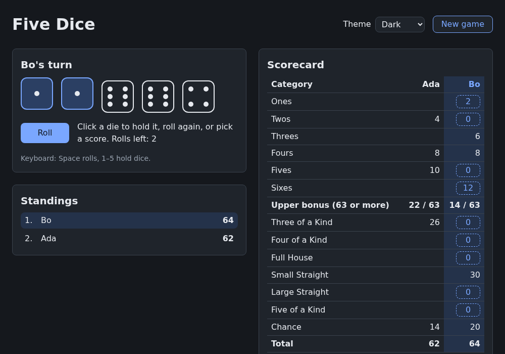
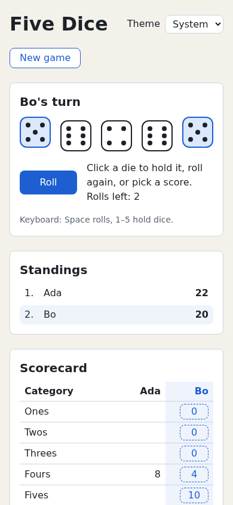

# Chapter 14 — Styling

five-dice keeps all its styles in one global stylesheet, where any rule can affect any element and nothing says which component a rule belongs to. This chapter covers where a React app's CSS can live (global stylesheets, CSS Modules, inline styles; briefly, CSS-in-JS and utility frameworks), how module files are ordered in the cascade, and where React meets responsive layout, user-chosen themes and transitions. The CSS itself (media queries, custom properties, transitions) works as on any page. In the project, each component gets its own CSS Module, the board works on a phone, and a theme menu appears. It uses [Chapter 13](13-custom-hooks.md)'s Hooks; [Chapter 15](15-accessibility.md) makes the game accessible.

## Where the CSS goes

React styles nothing itself. It sets two attributes, `className` (HTML's `class`) and `style`, and every approach ends in one of them.

| Approach | You write | React gets | Scope |
|---|---|---|---|
| Global stylesheet | `index.css`, imported once | `className="panel"` | The whole page |
| CSS Modules | `Panel.module.css`, imported by `Panel.tsx` | `className={styles.panel}` | One file; names are renamed so they can't clash |
| Inline styles | A JavaScript object | `style={{ width: '30%' }}` | One element |
| CSS-in-JS (styled-components, Emotion…) | CSS in template strings in `.tsx` files | A generated class name | One component |
| Utility classes (Tailwind CSS…) | Many tiny ready-made classes | `className="p-4 rounded bg-blue-600"` | Global, but each class does one thing |

React's docs recommend `className` for most styling and `style` only for values not known ahead of time. The first three approaches need only Vite; the last two need libraries ([Other approaches](#other-approaches)). This chapter uses the first two, plus `style` for computed values.

### What Vite does with an imported `.css` file

Since [Chapter 1](01-getting-started.md), `src/main.tsx` has had this line:

```tsx
import './index.css'
```

JavaScript can't import CSS; Vite makes it work. In development, the file becomes a module that adds a `<style>` element, swapped without a reload when you edit it. In a build, all imported CSS goes into one `dist/assets/index-<hash>.css`, linked from `index.html`.

An imported `.css` file is global. Importing it from `Panel.tsx` doesn't limit it to panels; it only makes it load with the component.

Vite also handles Sass, Less and Stylus once installed (e.g. `npm install -D sass`), but with custom properties and nesting in plain CSS you rarely need them.

## CSS Modules

A **CSS Module** is a CSS file whose class names are local to it. Vite treats any `*.module.css` file as one. Importing it gives an object mapping each class name to a unique generated name:

`examples/ch14/badge.module.css`

```css
/* Class names here are local to this file: Vite renames them so they can't clash. */
.badge {
  display: inline-block;
  padding: 0.125rem 0.5rem;
  border: 1px solid currentColor;
  border-radius: 999px;
  font-size: 0.875rem;
}

/* composes: an element with .warning also gets every .badge rule. */
.warning {
  composes: badge;
  color: #8a4b00;
  background: #fff4e0;
}

/* A second, independent class to combine with either of the above. */
.large {
  font-size: 1.25rem;
}
```

`examples/ch14/badge.demo.tsx`

```tsx
import styles from './badge.module.css'

export default function BadgeDemo() {
  return (
    <main>
      <p>
        <span className={styles.badge}>New</span> <span className={styles.warning}>Beta</span>{' '}
        {/* Two classes from one module: join them with a space. */}
        <span className={`${styles.warning} ${styles.large}`}>Big beta</span>
      </p>
      {/* The module object maps each class name in the file to its real, renamed class. */}
      <pre>{JSON.stringify(styles, null, 2)}</pre>
    </main>
  )
}
```

Run `npm run dev` in `examples/` and open `http://localhost:5173/?demo=ch14/badge`. Three pill-shaped badges appear, with the module object below:

```text
{
  "badge": "_badge_1s33b_2",
  "warning": "_warning_1s33b_10 _badge_1s33b_2",
  "large": "_large_1s33b_18"
}
```

Each name is the class name plus a hash of the file's contents, so it differs per file and changes when you edit: never copy one into code. In devtools' Elements panel, the Big beta badge is:

```html
<span class="_warning_1s33b_10 _badge_1s33b_2 _large_1s33b_18">Big beta</span>
```

and Vite's `<style>` element holds rules like `._badge_1s33b_2 { display: inline-block; … }`.

Why this design:

- **No clashes.** `Die.module.css` and `Panel.module.css` can both have a short `.title`.
- **The import is the link.** A rule belongs to the components that import its file, so deleting a component and its CSS file is safe.
- **It's still plain CSS.** Selectors, media queries, `:hover` and custom properties work as usual. Only class and keyframe names are renamed; in `.list li`, `li` stays.

Use camelCase class names (`.rollRow`) so you can write `styles.rollRow`, not `styles['roll-row']`.

### Combining classes

`className` is one string; join several classes with spaces:

```tsx
<span className={`${styles.warning} ${styles.large}`}>Big beta</span>
```

For a conditional class, choose between two strings:

```tsx
<li className={isCurrent ? styles.current : undefined}>…</li>
```

`undefined` leaves the attribute out. `false` causes a React warning, and `''` leaves an empty `class=""`. With many conditions, use a helper such as the tiny `clsx` package (exercise 1 writes one).

### `composes`: one class built from another

`composes: badge` inside `.warning` copies no CSS. `styles.warning` becomes *two* names, `_warning_… _badge_…`, so the element matches both rules (see the JSON above). It can also pull from another module (`composes: primary from '../styles/buttons.module.css'`), but five-dice combines classes from different files in TSX, where the use site shows each class's origin.

### Gotchas

- **Typos don't fail.** Vite types every module as `{ readonly [key: string]: string }`, so `styles.badgr` type-checks but is `undefined` in the browser: no class, no error. Check the `class` attribute in devtools.
- **Escaping to global.** `:global(.hint) { … }` inside a module targets the real class `hint`. Keep it rare; it brings back the problem modules solve.
- **The file name matters.** Without `.module`, `badge.css` is a global stylesheet.

### Which rule wins: import order and `@layer`

Combining a shared class with a component's own, as in `className={`${buttons.primary} ${styles.roll}`}`, raises an old question in a new place. When both set the same property with equal specificity, the rule that comes *later in the CSS* wins ([the cascade](appendix-b-web-platform-reference.md#the-cascade-which-rule-wins)). The order of names in `className` plays no part. With CSS Modules, "later in the CSS" means "imported later": Vite adds each file's CSS in the order the JavaScript imports it, in development and in the build alike. So a component's look can depend on the order of its `import` lines, or on which other component imported a shared file first.

*Cascade layers* take order out of it. Rules inside `@layer name { … }` lose to every rule outside a layer, whatever their specificity or position. Put shared styles in a layer and a component's own module always overrides them. The demo puts the same shared button in two modules, one plain and one layered:

`examples/ch14/shared-layered.module.css`

```css
/* The same shared button, inside a cascade layer. Any unlayered rule beats it,
   whatever the specificity or the order the files load in. */
@layer shared {
  .primary {
    padding: 0.5rem 1rem;
    color: white;
    background: #1d5fd1;
    border: 2px solid transparent;
    border-radius: 0.375rem;
  }
}
```

`examples/ch14/shared-plain.module.css` holds the same `.primary` rule without the `@layer` wrapper. The component's own tweak:

`examples/ch14/layers.module.css`

```css
/* This component's own tweak: a quiet, outlined version of the shared button. */
.quiet {
  color: #1d5fd1;
  background: transparent;
  border: 2px solid currentColor;
}
```

`examples/ch14/layers.demo.tsx`

```tsx
// This component's own module is imported first, so the shared modules'
// rules come later in the page's CSS.
import styles from './layers.module.css'
import layered from './shared-layered.module.css'
import plain from './shared-plain.module.css'

export default function LayersDemo() {
  return (
    <main>
      <p>
        {/* 🔴 styles.quiet is last in className, but plain.primary's rules come later in the CSS, so they win. */}
        <button type="button" className={`${plain.primary} ${styles.quiet}`}>
          Unlayered
        </button>{' '}
        {/* Unlayered styles.quiet beats anything in a layer. */}
        <button type="button" className={`${layered.primary} ${styles.quiet}`}>
          Layered
        </button>
      </p>
    </main>
  )
}
```

Open `?demo=ch14/layers`. **Unlayered** is a solid blue button: `.primary` and `.quiet` are both one class, and `.primary` comes later. **Layered** is outlined: the layered `.primary` loses. Move `import styles` below the other two imports and both buttons are outlined; the build gives the same results as the dev server.

Layers can also be ordered against each other (`@layer reset, shared;` up front: later layers win), and work in global stylesheets too. five-dice doesn't need them: its shared classes and component classes never set the same property. `main.tsx` imports `index.css` before any component, so the global rules come first.

### CSS Modules in tests

Vitest doesn't process CSS by default (jsdom does no layout anyway). A CSS Module import becomes a stand-in that returns a name for *any* key:

`examples/ch14/badge.test.tsx`

```tsx
import { render, screen } from '@testing-library/react'
import { expect, it } from 'vitest'
import BadgeDemo from './badge.demo'
import styles from './badge.module.css'

it('puts the module class names on the elements', () => {
  render(<BadgeDemo />)
  // Ask the module for the real name; never hard-code it.
  expect(screen.getByText('New')).toHaveClass(styles.badge)
  expect(screen.getByText('Big beta')).toHaveClass(styles.warning, styles.large)
  // In tests, the module is a stand-in: any key gives a name, even a typo.
  console.log(styles.badge, styles.warning, styles.typo)
})
```

```console
$ npx vitest run ch14/badge

stdout | ch14/badge.test.tsx > puts the module class names on the elements
_badge_593d28 _warning_593d28 _typo_593d28

 ✓ ch14/badge.test.tsx (1 test) 28ms

 Test Files  1 passed (1)
      Tests  1 passed (1)
```

Unlike the browser:

- Names are `_<class>_<hash of the file path>`, with no line number. Editing the CSS doesn't change them; moving the file does.
- `styles.typo` returns a valid-looking name.
- `composes` isn't applied: `styles.warning` is one name.

So ask the module for names (`toHaveClass(styles.badge)`), never hard-code them. Better, test what the user sees (roles, names, text, `aria-pressed`), and check classes only when a class is the only signal, such as a highlight.

## Inline styles

The `style` prop takes an object with camelCase keys (`marginTop`); a number means pixels for most properties:

`examples/ch14/progress.module.css`

```css
.track {
  width: 20rem;
  height: 1.5rem;
  background: #ddd;
  border-radius: 0.75rem;
  overflow: hidden;
}

.bar {
  height: 100%;
  /* --hue is set per element from React; 120 is the fallback if it's missing. */
  background: hsl(var(--hue, 120) 70% 45%);
  transition: width 300ms ease-out;
}
```

`examples/ch14/progress.demo.tsx`

```tsx
import { useState, type CSSProperties } from 'react'
import styles from './progress.module.css'

export default function ProgressDemo() {
  const [percent, setPercent] = useState(30)

  // An inline style is an object with camelCase keys. Numbers mean pixels
  // for most properties, so build other units as strings.
  const barStyle = {
    width: `${percent}%`,
    // A custom property: CSSProperties doesn't know about it, hence the cast.
    '--hue': (percent / 100) * 120,
  } as CSSProperties

  return (
    <main>
      <div className={styles.track}>
        <div className={styles.bar} style={barStyle} />
      </div>
      <label>
        Progress{' '}
        <input type="range" min={0} max={100} value={percent} onChange={(e) => setPercent(Number(e.target.value))} />
      </label>
      <p style={{ marginTop: 8, color: 'gray' }}>{percent}%</p>
    </main>
  )
}
```

Open `?demo=ch14/progress` and drag the slider: the bar grows and turns from red (hue 0) to green (hue 120). The test shows the HTML React writes:

`examples/ch14/progress.test.tsx`

```tsx
import { fireEvent, render, screen } from '@testing-library/react'
import { expect, it } from 'vitest'
import ProgressDemo from './progress.demo'

it('turns the style object into an inline style attribute', () => {
  const { container } = render(<ProgressDemo />)
  fireEvent.change(screen.getByRole('slider', { name: 'Progress' }), { target: { value: '75' } })
  console.log(container.querySelector('[style]')?.outerHTML)
  console.log(screen.getByText('75%').outerHTML)
  expect(screen.getByText('75%')).toHaveStyle({ marginTop: '8px' })
})
```

```console
$ npx vitest run ch14/progress

stdout | ch14/progress.test.tsx > turns the style object into an inline style attribute
<div class="_bar_e4054c" style="width: 75%; --hue: 90;"></div>
<p style="margin-top: 8px; color: gray;">75%</p>

 ✓ ch14/progress.test.tsx (1 test) 108ms

 Test Files  1 passed (1)
      Tests  1 passed (1)
```

- `marginTop: 8` became `margin-top: 8px`. Unitless properties (`opacity`, `zIndex`, `lineHeight`, `flexGrow`) keep the number.
- `'--hue': 90` became `--hue: 90`: custom properties pass through.
- `fireEvent.change` sets the value directly; `user-event` can't drag a slider.

### When to use `style`

Inline styles can't use pseudo-classes, `::before` or media queries, and they beat every stylesheet rule except `!important` ones ([the cascade](appendix-b-web-platform-reference.md#the-cascade-which-rule-wins)). So:

- Put the look (colours, spacing, states, breakpoints) in a class.
- Use `style` for runtime values, like the pips' `gridRow` and `gridColumn` in `Die` since [Chapter 4](04-components-and-jsx.md).
- To hand a runtime value to the stylesheet, set a **custom property** with `style`, like `--hue`. The stylesheet decides how to use it, even in `:hover` or media queries.

### The type errors you'll meet

`style` is typed as `CSSProperties`, which lists every standard property:

```tsx
export function A() {
  return <p style="color: red">Hi</p>
}

export function B({ hue }: { hue: number }) {
  return <div style={{ '--hue': hue }} />
}

export function C() {
  return <p style={{ 'font-size': '2rem' }}>Big</p>
}
```

```console
$ npx tsc -b
ch14/bad-style.tsx:2:13 - error TS2559: Type 'string' has no properties in common with type 'Properties<string | number, string & {}>'.

2   return <p style="color: red">Hi</p>
              ~~~~~

ch14/bad-style.tsx:6:24 - error TS2353: Object literal may only specify known properties, and ''--hue'' does not exist in type 'Properties<string | number, string & {}>'.

6   return <div style={{ '--hue': hue }} />
                         ~~~~~~~

ch14/bad-style.tsx:10:22 - error TS2353: Object literal may only specify known properties, and ''font-size'' does not exist in type 'Properties<string | number, string & {}>'.

10   return <p style={{ 'font-size': '2rem' }}>Big</p>
                        ~~~~~~~~~~~

Found 3 errors in the same file, starting at: ch14/bad-style.tsx:2
```

- **TS2559**: a string, as in HTML. Use an object: `style={{ color: 'red' }}`.
- **TS2353 with `'--hue'`**: `CSSProperties` doesn't list custom properties. Cast the object (`as CSSProperties`), as the progress demo does; any `--name` is valid CSS.
- **TS2353 with `'font-size'`**: use the camelCase key `fontSize`.

## Other approaches

The project doesn't use these, but you'll meet them:

- **CSS-in-JS** (styled-components, Emotion): CSS in template strings beside the component, able to use props; the library generates class names, ships to the browser and works during rendering. "Zero-runtime" libraries (vanilla-extract, Linaria) emit CSS files at build time.
- **Utility-first CSS** (Tailwind CSS): instead of naming a class and writing its rules, you combine many single-purpose classes in `className`. A build step scans your `.tsx` files and generates only the classes you use. Few CSS files, long markup, and the styles sit right in the JSX:

  ```tsx
  // Illustrative only: needs Tailwind CSS installed, which this course doesn't do.
  <button className="rounded px-4 py-2 bg-blue-700 text-white hover:bg-blue-800 disabled:bg-gray-400">Roll</button>
  ```

  `hover:` and `disabled:` prefixes stand in for pseudo-classes, and `md:` for a media query. Repetition moves into components: the `<RollButton>` component *is* the reusable style.
- **Class-name helpers** (`clsx`, `classnames`) join names and skip falsy ones: `clsx(styles.die, held && styles.held)`.

CSS Modules sit in the middle: plain CSS, local names, no runtime library, nothing to install with Vite.

React 19 can also load a stylesheet that the bundler doesn't handle, such as a theme on a CDN, from inside a component: `<link rel="stylesheet" href="…" precedence="default" />`. With `precedence`, React moves the `<link>` into `<head>`, adds it once however many components render it, and holds back the component's update until the file has loaded, so there's no flash of unstyled content. Precedence values seen later go later in `<head>`, so they win. Without `precedence`, it's an ordinary `<link>` element. With Vite, importing the CSS file is simpler.

## Responsive layout, themes and motion

Media queries, custom properties and transitions work in a React app exactly as on any page, and inside CSS Modules too: only class and keyframe names are renamed. This section covers the parts where React comes in.

### Responsive layout

five-dice goes *desktop first*: the wide layout, then `max-width` media queries at the end of each module that needs them (the page, the board and the dice). A media query adds no specificity, so it must come after the rules it overrides. Within one module that's easy to see. Across modules, it's import order again. Keep a component's breakpoints in its own module, next to the rules they change.

Media queries ask about the *window*. Container queries (`@container`) ask about a parent element, so a component adapts to the space it's given, wherever it's used: a good fit for reusable components. five-dice doesn't need them.

### A theme the user picks

`@media (prefers-color-scheme: dark)` follows the operating system. Users may want a different theme in one app, so five-dice offers **System**, **Light** and **Dark**. That choice is React state, and CSS can't read React state. The bridge is an attribute: the app writes `<html data-theme="dark">`, and selectors match it.

```css
/* The OS says dark, and the user didn't pick "Light". */
@media (prefers-color-scheme: dark) {
  :root:not([data-theme='light']) {
    /* dark values */
  }
}

/* The user picked "Dark", whatever the OS says. */
:root[data-theme='dark'] {
  /* the same dark values */
}
```

| OS setting | User's choice | `data-theme` | Theme |
|---|---|---|---|
| light | System | (none) | light |
| dark | System | (none) | dark |
| any | Light | `light` | light |
| any | Dark | `dark` | dark |

The dark values appear twice: plain CSS can't share a block between a media query and a selector. Alternatives are `light-dark()` (`--color-bg: light-dark(#f4f1ea, #15181d)` picks by the element's `color-scheme`, so the switch only sets `color-scheme`) or a preprocessor mixin. five-dice keeps the easy-to-check duplicate. `color-scheme: dark` in the dark blocks makes the browser draw form controls and scrollbars dark too.

`<html>` is outside the React tree (`createRoot` renders into `#root`), so no JSX can set its attribute. An Effect copies the choice there, and `localStorage` keeps it across reloads (you'll write both in the project). The Effect runs after React's first render, so on a light OS a saved Dark choice can flash light while the page loads. A small inline `<script>` in `index.html` can set `data-theme` before the first paint ([exercise 4](#exercises)).

### Transitions and reduced motion

A `transition` animates a property when its value changes. It doesn't care what changed it, a `:hover`, a class React toggles or an inline style, so React needs no animation code for this. One React-specific catch: the transition needs the *same* DOM element before and after. If React replaces the element, because its `key` or component type changed ([Chapter 10](10-composition-and-context.md#state-lives-in-the-tree-position-and-key)), the new element simply starts with the new value, and nothing animates. Animate `transform` and `opacity` where you can: the browser moves drawn pixels without redoing layout.

Some people get dizzy or sick from movement on screen, and operating systems have a "reduce motion" setting. CSS reads it as `@media (prefers-reduced-motion: reduce)`, JavaScript via [Chapter 13](13-custom-hooks.md)'s `usePrefersReducedMotion`. One global rule tames every module's transitions at once:

```css
@media (prefers-reduced-motion: reduce) {
  *,
  *::before,
  *::after {
    transition-duration: 0.01ms !important;
  }
}
```

`*` has no specificity, so `!important` is needed to beat each module's `transition`: a rare good use, as the user's needs override the design. `0.01ms` rather than `0s`, because a zero-duration transition doesn't run, so `transitionend` never fires and code waiting for it hangs. Reduced motion means *less* motion: an instant colour change is fine; sliding and spinning should go.

## Building five-dice: CSS Modules, a responsive board and dark mode

The plan:

1. Cut `src/index.css` to what's truly global: reset, design tokens, dark theme, two utilities, the reduced-motion rule.
2. Move each component's rules into a `*.module.css` beside it, plus shared buttons and tables modules in `src/styles/`.
3. Make the board responsive: one column on narrow screens, smaller dice.
4. Add transitions: held dice slide up, buttons fade on hover.
5. Add a theme menu (System, Light, Dark) that remembers the choice.
6. Fix the two tests the renamed classes break.

New files in `src/`:

```text
src/
├── App.module.css
├── components/
│   ├── DiceTray.module.css
│   ├── Die.module.css
│   ├── Game.module.css
│   ├── GameOver.module.css
│   ├── NewGameForm.module.css
│   ├── Panel.module.css
│   ├── Scoreboard.module.css
│   ├── Scorecard.module.css
│   ├── ThemeSelect.module.css
│   └── ThemeSelect.tsx
├── hooks/
│   └── useTheme.ts
└── styles/
    ├── buttons.module.css
    └── tables.module.css
```

Old global classes map to module classes like this:

| Old global class | New module class |
|---|---|
| `.app`, `.app-header`, `.setup`, `.app-footer` | `App.module.css`: `.app`, `.header`, `.setup`, `.footer` |
| `.board`, `.stack` | `Game.module.css`: `.board`, `.stack` |
| `.panel` | `Panel.module.css`: `.panel`, `.title` |
| `.dice-area`, `.dice-tray`, `.roll-row` | `DiceTray.module.css`: `.area`, `.tray`, `.rollRow`, `.roll` |
| `.die`, `.die--held`, `.pip` | `Die.module.css`: `.die`, `.held`, `.pip` |
| `.roll-button` | `buttons.module.css`: `.primary` (and `.secondary` for less important buttons) |
| `.scorecard`, `.high-scores`, `.score` | `tables.module.css`: `.table`, `.number` |
| `.score-button`, `.current`, `.subtotal`, `.total` | `Scorecard.module.css` |
| `.scoreboard`, `.current` | `Scoreboard.module.css`: `.list`, `.current` |
| `.game-over` | `GameOver.module.css`: `.gameOver` |
| `.new-game-form`, `.player-row`, `.checkbox`, `.form-error` | `NewGameForm.module.css`: `.form`, `.fieldset`, `.row`, `.checkbox`, `.error` |
| `.hint` | stays global in `index.css` |

`.hint` stays global: it's a utility any component may use, and `className="hint"` reads easily.

### The global stylesheet

Replace all of `src/index.css`:

<details><summary>Full listing: <code>src/index.css</code></summary>

`src/index.css`

```css
/* Global styles only: the reset, design tokens, themes and a few utilities.
   Each component's own styles live next to it in a *.module.css file. */

/* ---------- 1. A small reset: make every browser start from the same place ---------- */
*,
*::before,
*::after {
  box-sizing: border-box; /* width includes padding and border */
}

body,
h1,
h2,
p {
  margin: 0;
}

button,
input,
select,
textarea {
  font: inherit; /* form controls don't inherit fonts by default */
}

/* ---------- 2. Design tokens: CSS custom properties (variables) ---------- */
:root {
  --color-bg: #f4f1ea;
  --color-surface: #ffffff;
  --color-text: #1d2127;
  --color-muted: #5b6470;
  --color-border: #cfd5dc;
  --color-accent: #1d5fd1;
  --color-on-accent: #ffffff;
  --color-highlight: #eef3fc;
  --color-held: #dce8fb;
  --color-error: #b42318;

  --space-1: 0.25rem;
  --space-2: 0.5rem;
  --space-3: 1rem;
  --space-4: 1.5rem;
  --radius: 0.5rem;

  /* Tells the browser which palette its own UI (form controls, scrollbars) should use. */
  color-scheme: light;
  font-family: system-ui, sans-serif;
  line-height: 1.5;
  color: var(--color-text);
  background: var(--color-bg);
}

/* ---------- 3. Dark theme ---------- */
/* Follow the operating system's setting, unless the user picked "Light"… */
@media (prefers-color-scheme: dark) {
  :root:not([data-theme='light']) {
    --color-bg: #15181d;
    --color-surface: #1f242b;
    --color-text: #e6e9ee;
    --color-muted: #9aa4b1;
    --color-border: #3a424d;
    --color-accent: #7aa7ff;
    --color-on-accent: #10141a;
    --color-highlight: #24324a;
    --color-held: #2b3f63;
    --color-error: #ff8a80;
    color-scheme: dark;
  }
}

/* …or "Dark" explicitly (the ThemeSelect component sets data-theme on <html>). */
:root[data-theme='dark'] {
  --color-bg: #15181d;
  --color-surface: #1f242b;
  --color-text: #e6e9ee;
  --color-muted: #9aa4b1;
  --color-border: #3a424d;
  --color-accent: #7aa7ff;
  --color-on-accent: #10141a;
  --color-highlight: #24324a;
  --color-held: #2b3f63;
  --color-error: #ff8a80;
  color-scheme: dark;
}

/* ---------- 4. Global utilities ---------- */
a {
  color: var(--color-accent);
}

.hint {
  color: var(--color-muted);
  font-size: 0.875rem;
}

/* ---------- 5. Reduced motion ---------- */
/* Users who asked their OS for less motion get (nearly) instant transitions. */
@media (prefers-reduced-motion: reduce) {
  *,
  *::before,
  *::after {
    transition-duration: 0.01ms !important;
  }
}
```

</details>

Token changes:

- Four new colours replace inline ones in component rules: `--color-on-accent` (text on accent), `--color-highlight` (current player), `--color-held` (held die), `--color-error`. A theme only changes what goes through a variable, so every module colour is a `var()`.
- The dark block redefines only colours.

`:root` scores one pseudo-class; `:root:not([data-theme='light'])` and `:root[data-theme='dark']` score two (`:not()` counts its argument), so they beat the light values in any order.

`main.tsx` imports `index.css` first, so it comes first in the built CSS and modules can override the reset.

### Shared modules: buttons and tables

Shared button and table styles get their own modules in `src/styles/`:

<details><summary>Full listing: <code>src/styles/buttons.module.css</code></summary>

`src/styles/buttons.module.css`

```css
/* Shared button styles. Components import this file and combine its classes
   with their own, e.g. className={`${buttons.primary} ${styles.roll}`}. */
.primary {
  padding: var(--space-2) var(--space-4);
  color: var(--color-on-accent);
  background: var(--color-accent);
  border: none;
  border-radius: var(--radius);
  cursor: pointer;
  transition: filter 150ms ease-out;
}

.primary:hover:not(:disabled) {
  filter: brightness(1.1);
}

.primary:disabled {
  background: var(--color-muted);
  cursor: not-allowed;
}

/* Less prominent actions: "New game", "Add player", "Remove". */
.secondary {
  padding: var(--space-1) var(--space-3);
  color: var(--color-accent);
  background: var(--color-surface);
  border: 1px solid var(--color-accent);
  border-radius: var(--radius);
  cursor: pointer;
  transition: background-color 150ms ease-out;
}

.secondary:hover:not(:disabled) {
  background: var(--color-highlight);
}

.secondary:disabled {
  color: var(--color-muted);
  border-color: var(--color-border);
  cursor: not-allowed;
}
```

</details>

<details><summary>Full listing: <code>src/styles/tables.module.css</code></summary>

`src/styles/tables.module.css`

```css
.table {
  width: 100%;
  border-collapse: collapse;
}

.table th,
.table td {
  padding: var(--space-1) var(--space-2);
  border-bottom: 1px solid var(--color-border);
  text-align: left;
}

/* Numbers line up on the right. */
.table .number {
  width: 5rem;
  text-align: right;
}
```

</details>

`.table th` is a class then an element selector. Only `.table` is renamed, so the rule reaches every `th` inside a table with that class, whichever component rendered it.

### The die

<details><summary>Full listing: <code>src/components/Die.module.css</code></summary>

`src/components/Die.module.css`

```css
.die {
  width: 4rem;
  aspect-ratio: 1; /* height follows width: always square */
  padding: 0.5rem;
  display: grid;
  grid-template: repeat(3, 1fr) / repeat(3, 1fr); /* 3 rows / 3 columns */
  background: var(--color-surface);
  border: 2px solid var(--color-text);
  border-radius: 0.75rem;
  /* Animate these properties whenever they change, e.g. when a die is held. */
  transition:
    transform 150ms ease-out,
    background-color 150ms ease-out,
    border-color 150ms ease-out;
}

.die:not(:disabled) {
  cursor: pointer;
}

.die:disabled {
  opacity: 0.6;
}

/* Class composition: .held gets every rule of .die, plus its own.
   So styles.held is two class names: "<die class> <held class>". */
.held {
  composes: die;
  border-color: var(--color-accent);
  background: var(--color-held);
  transform: translateY(-0.375rem);
}

.pip {
  width: 70%;
  aspect-ratio: 1;
  place-self: center;
  border-radius: 50%;
  background: var(--color-text);
}

@media (max-width: 40rem) {
  .die {
    width: 3.25rem;
    padding: 0.375rem;
  }
}
```

</details>

- A held die moves up 0.375rem with an animated `transform`, which doesn't affect layout, so other dice don't shift.
- `.held` composes `.die`, so the component picks *one* class per state instead of ``held ? `${styles.die} ${styles.held}` : styles.die``.
- The media query comes last, overriding `width` and `padding` on narrow screens, held dice included (they have `.die` too).

In `src/components/Die.tsx`, import the module and use its classes:

`src/components/Die.tsx`

```tsx
import type { Ref } from 'react'
import type { DieValue } from '../game/types'
import styles from './Die.module.css'
```

```tsx
    <button
      ref={ref}
      type="button"
      // styles.held already includes the .die rules (see `composes` in the CSS).
      className={held ? styles.held : styles.die}
      disabled={disabled}
      aria-label={`Die showing ${value}`}
      aria-pressed={held}
      onClick={onToggle}
    >
      {PIP_CELLS[value].map((cell) => (
        <span
          key={cell}
          className={styles.pip}
          style={{ gridRow: Math.floor(cell / 3) + 1, gridColumn: (cell % 3) + 1 }}
        />
      ))}
    </button>
```

The pips keep their inline `style`: their grid cell is data, computed from the face value.

### The dice tray

<details><summary>Full listing: <code>src/components/DiceTray.module.css</code></summary>

`src/components/DiceTray.module.css`

```css
.area {
  display: grid;
  gap: var(--space-3);
}

.tray {
  display: flex;
  flex-wrap: wrap;
  gap: var(--space-3);
  padding-top: var(--space-2); /* room for held dice, which move up */
}

.rollRow {
  display: flex;
  align-items: center;
  gap: var(--space-3);
}

/* Used together with the shared buttons.primary class (see DiceTray.tsx). */
.roll {
  min-width: 6rem;
}
```

</details>

In `src/components/DiceTray.tsx`, add the imports after the others:

```tsx
import buttons from '../styles/buttons.module.css'
import styles from './DiceTray.module.css'
```

and change the class names in the returned JSX:

```tsx
  return (
    <div className={styles.area}>
      <div className={styles.tray}>
        {state.dice.map((die) => (
          <Die
            key={die.id}
            // …unchanged props…
          />
        ))}
      </div>

      <div className={styles.rollRow}>
        <button
          ref={rollButtonRef}
          type="button"
          // Two classes from two modules: the shared look, plus this button's tweaks.
          className={`${buttons.primary} ${styles.roll}`}
          onClick={roll}
          disabled={!canRoll}
        >
          Roll
        </button>
        <p>
          {HINTS[phase]} Rolls left: {state.rollsLeft}
        </p>
      </div>
      <p className="hint">Keyboard: Space rolls, 1–5 hold dice.</p>
    </div>
  )
```

The Roll button is a primary button with a minimum width, so its size holds between "Roll" and longer labels. The template literal shows which file each of its two classes comes from. Where two such classes set the same property, import order decides, not their order in `className` ([above](#which-rule-wins-import-order-and-layer)); these two don't overlap.

### The board and the page

The board is where the layout responds to the screen: two columns side by side, one column below 48rem.

<details><summary>Full listing: <code>src/components/Game.module.css</code></summary>

`src/components/Game.module.css`

```css
.board {
  display: grid; /* grid: two equal columns */
  grid-template-columns: 1fr 1fr;
  gap: var(--space-4);
  align-items: start;
}

/* Narrow screens (phones, split windows): a single column. */
@media (max-width: 48rem) {
  .board {
    grid-template-columns: 1fr;
  }
}

.stack {
  display: grid;
  align-content: start;
  gap: var(--space-4);
}
```

</details>

In `src/components/Game.tsx`, import it after the other imports and use it in the JSX:

```tsx
import styles from './Game.module.css'
```

```tsx
  return (
    <main className={styles.board}>
      <div className={styles.stack}>
```

The page frame:

<details><summary>Full listing: <code>src/App.module.css</code></summary>

`src/App.module.css`

```css
.app {
  max-width: 64rem;
  margin: 0 auto;
  padding: var(--space-4);
  display: grid;
  gap: var(--space-4);
}

.header {
  display: flex; /* flexbox: lay children out in a row */
  flex-wrap: wrap;
  align-items: center;
  gap: var(--space-3);
}

/* Push everything after the title to the right. */
.header h1 {
  margin-right: auto;
}

.setup {
  max-width: 32rem;
  display: grid;
  gap: var(--space-3);
}

.footer {
  color: var(--color-muted);
  font-size: 0.875rem;
}

/* On small screens, use less padding around the page. */
@media (max-width: 40rem) {
  .app {
    padding: var(--space-3);
  }
}
```

</details>

The header is a wrapping flex row. The title's `margin-right: auto` takes the free space, pushing the theme menu and New game right; on a phone, New game wraps to its own line.

In `src/App.tsx`, import the theme menu (written below) and the two modules:

```tsx
import { ThemeSelect } from './components/ThemeSelect'
import { setupOf, type GameState } from './game/reducer'
import { clearSavedGame, loadGame } from './game/storage'
import type { GameSetup } from './game/types'
import buttons from './styles/buttons.module.css'
import styles from './App.module.css'
```

Then use them in the returned JSX:

```tsx
  return (
    <div className={styles.app}>
      <header className={styles.header}>
        <h1>Five Dice</h1>
        <ThemeSelect />
        {session && (
          <button type="button" className={buttons.secondary} onClick={handleNewGame}>
            New game
          </button>
        )}
      </header>

      {session ? (
        <GameProvider key={session.id} setup={session.setup} saved={session.saved}>
          <Game onPlayAgain={handlePlayAgain} />
        </GameProvider>
      ) : (
        <main className={styles.setup}>
          <h2>New game</h2>
          <NewGameForm onStart={(setup) => setSession({ id: 1, setup })} />
          <h2>High scores</h2>
          <HighScores />
        </main>
      )}

      <footer className={styles.footer}>
```

Only the `className`s, the `<ThemeSelect />` line and the New game button's class are new; the `GameProvider` props and footer content are unchanged.

### Panels, standings and the game-over message

<details><summary>Full listing: <code>src/components/Panel.module.css</code></summary>

`src/components/Panel.module.css`

```css
.panel {
  padding: var(--space-3);
  background: var(--color-surface);
  border: 1px solid var(--color-border);
  border-radius: var(--radius);
}

.title {
  margin-bottom: var(--space-2);
  font-size: 1.25rem;
}
```

</details>

`src/components/Panel.tsx`

```tsx
import type { ReactNode } from 'react'
import styles from './Panel.module.css'

interface PanelProps {
  title: string
  children: ReactNode
}

export function Panel({ title, children }: PanelProps) {
  return (
    <section className={styles.panel}>
      <h2 className={styles.title}>{title}</h2>
      {children}
    </section>
  )
}
```

The global stylesheet used to style `.panel h2`. Now the heading has its own class, so the rule can't reach an `<h2>` a child component renders inside the panel.

<details><summary>Full listing: <code>src/components/Scoreboard.module.css</code></summary>

`src/components/Scoreboard.module.css`

```css
.list {
  display: grid;
  gap: var(--space-1);
  padding: 0;
  margin: 0;
  list-style: none;
}

.list li {
  display: grid;
  grid-template-columns: 2rem 1fr auto;
  padding: var(--space-1) var(--space-2);
  border-radius: var(--radius);
}

.list .current {
  background: var(--color-highlight);
}
```

</details>

`src/components/Scoreboard.tsx`

```tsx
import { getPhase } from '../game/reducer'
import { rankPlayers } from '../game/scoring'
import { useGameState } from '../hooks/useGame'
import styles from './Scoreboard.module.css'

/** Live standings, best first. */
export function Scoreboard() {
  const state = useGameState()

  // Nobody's turn once the game is over.
  const current = getPhase(state) === 'gameOver' ? null : state.players[state.current].name

  return (
    <ol className={styles.list}>
      {rankPlayers(state.players).map((standing) => (
        <li key={standing.name} className={standing.name === current ? styles.current : undefined}>
          <span>{standing.rank}.</span>
          <span>{standing.name}</span>
          <strong>{standing.total}</strong>
        </li>
      ))}
    </ol>
  )
}
```

The rank's `className="rank"` is gone: the grid's first column (`2rem`) places it, so it needs no rule. `.list .current` is two classes, so it beats `.list li` (one class, one element) regardless of order.

<details><summary>Full listing: <code>src/components/GameOver.module.css</code></summary>

`src/components/GameOver.module.css`

```css
.gameOver {
  display: grid;
  justify-items: start;
  gap: var(--space-2);
}
```

</details>

In `src/components/GameOver.tsx`, add the imports and change two class names:

```tsx
import buttons from '../styles/buttons.module.css'
import styles from './GameOver.module.css'
```

```tsx
  return (
    <div className={styles.gameOver}>
      {/* tabIndex={-1}: focusable from code, but not a Tab stop. Moving focus
          here makes screen readers read the result straight away. */}
      <p ref={focusOnMount} tabIndex={-1}>
        {resultText(winners, standings[0].total, standings.length)}
      </p>
      <button type="button" className={buttons.primary} onClick={onPlayAgain}>
        Play again
      </button>
    </div>
  )
```

### The scorecard and the high-score table

Both tables use the shared `tables` module. The scorecard adds classes for the current player's column, the sum rows and the score buttons:

<details><summary>Full listing: <code>src/components/Scorecard.module.css</code></summary>

`src/components/Scorecard.module.css`

```css
.subtotal,
.total {
  font-weight: 600;
}

.current {
  background: var(--color-highlight);
}

th.current {
  color: var(--color-accent);
}

.scoreButton {
  min-width: 3rem;
  padding: 0 var(--space-2);
  color: var(--color-accent);
  background: transparent;
  border: 1px dashed var(--color-accent);
  border-radius: var(--radius);
  cursor: pointer;
  transition:
    color 150ms ease-out,
    background-color 150ms ease-out;
}

.scoreButton:hover {
  color: var(--color-on-accent);
  background: var(--color-accent);
}
```

</details>

Every score cell needs `tables.number`, plus `styles.current` for the current player; a helper replaces three copies of that logic. Changes in `src/components/Scorecard.tsx`:

```diff
 import type { Category } from '../game/types'
 import { useGameState } from '../hooks/useGame'
+import tables from '../styles/tables.module.css'
+import styles from './Scorecard.module.css'
+
+/** Class names for a score cell; the current player's column is highlighted. */
+function numberClass(isCurrent: boolean) {
+  return isCurrent ? `${tables.number} ${styles.current}` : tables.number
+}
 
 interface ScoreCellProps {
@@
   } else if (potential !== undefined) {
     content = (
-      <button type="button" className="score-button" onClick={onScore}>
+      <button type="button" className={styles.scoreButton} onClick={onScore}>
         {potential}
       </button>
     )
   }
-  return <td className={isCurrent ? 'score current' : 'score'}>{content}</td>
+  return <td className={numberClass(isCurrent)}>{content}</td>
 }
 
@@
       <td>{label}</td>
       {players.map((player, index) => (
-        <td key={player.name} className={isCurrent(index) ? 'score current' : 'score'}>
+        <td key={player.name} className={numberClass(isCurrent(index))}>
           {cell(index)}
         </td>
@@
 
   return (
-    <table className="scorecard">
+    <table className={tables.table}>
       <thead>
         <tr>
           <th>Category</th>
           {players.map((player, index) => (
-            <th key={player.name} className={isCurrent(index) ? 'score current' : 'score'}>
+            <th key={player.name} className={numberClass(isCurrent(index))}>
               {player.name}
             </th>
@@
             return sums.upperBonus > 0 ? sums.upperBonus : `${sums.upper} / ${UPPER_BONUS_THRESHOLD}`
           },
-          'subtotal',
+          styles.subtotal,
         )}
       </tbody>
@@
         {LOWER_CATEGORIES.map(renderRow)}
         {showBonusRow &&
-          renderSumRow('Five of a Kind bonus', (index) => playerTotals[index].fiveOfAKindBonus, 'subtotal')}
+          renderSumRow('Five of a Kind bonus', (index) => playerTotals[index].fiveOfAKindBonus, styles.subtotal)}
       </tbody>
-      <tfoot>{renderSumRow('Total', (index) => playerTotals[index].grand, 'total')}</tfoot>
+      <tfoot>{renderSumRow('Total', (index) => playerTotals[index].grand, styles.total)}</tfoot>
     </table>
   )
```

`renderSumRow` used to receive the strings `'subtotal'` and `'total'`; now it receives the real names, `styles.subtotal` and `styles.total`.

In `src/components/HighScores.tsx`, import the tables module and use it:

```tsx
import { useHighScores } from '../hooks/useHighScores'
import tables from '../styles/tables.module.css'
```

```tsx
    <table className={tables.table}>
      <thead>
        <tr>
          <th>#</th>
          <th>Name</th>
          <th className={tables.number}>Score</th>
          <th>Date</th>
        </tr>
      </thead>
```

and in the body rows:

```tsx
            <td className={tables.number}>{entry.score}</td>
```

### The new-game form

<details><summary>Full listing: <code>src/components/NewGameForm.module.css</code></summary>

`src/components/NewGameForm.module.css`

```css
.form {
  display: grid;
  gap: var(--space-3);
  justify-items: start;
}

.fieldset {
  display: grid;
  gap: var(--space-2);
  justify-items: start;
  padding: var(--space-3);
  border: 1px solid var(--color-border);
  border-radius: var(--radius);
}

.row {
  display: flex;
  flex-wrap: wrap;
  align-items: center;
  gap: var(--space-2);
}

.row label {
  min-width: 5rem;
}

.row input {
  padding: var(--space-1) var(--space-2);
  color: var(--color-text);
  background: var(--color-surface);
  border: 1px solid var(--color-border);
  border-radius: var(--radius);
}

.checkbox {
  display: flex;
  align-items: center;
  gap: var(--space-2);
}

.error {
  color: var(--color-error);
}
```

</details>

In `src/components/NewGameForm.tsx`, add the imports:

```tsx
import buttons from '../styles/buttons.module.css'
import styles from './NewGameForm.module.css'
```

Then change the class names, one line each:

| Element | Before | After |
|---|---|---|
| `<form>` | `className="new-game-form"` | `className={styles.form}` |
| `<fieldset>` | (none) | `className={styles.fieldset}` |
| each player's `<div>` | `className="player-row"` | `className={styles.row}` |
| Remove button | (none) | `className={buttons.secondary}` |
| checkbox `<label>` | `className="checkbox"` | `className={styles.checkbox}` |
| error `<p>` | `className="form-error"` | `className={styles.error}` |
| Start game button | `className="roll-button"` | `className={buttons.primary}` |

The Add player button gets a class too:

```tsx
        <button
          type="button"
          className={buttons.secondary}
          onClick={addPlayer}
          disabled={rows.length === MAX_PLAYERS}
        >
          Add player
        </button>
```

### The theme menu

The theme is state that must survive reloads and be applied to `<html>`. [Chapter 13](13-custom-hooks.md)'s `useLocalStorage` handles the first part. An Effect handles the second, because `<html>` is outside the React tree:

`src/hooks/useTheme.ts`

```ts
import { useEffect } from 'react'
import { useLocalStorage } from './useLocalStorage'

export type Theme = 'system' | 'light' | 'dark'

/** The user's theme choice, saved in localStorage and applied to <html>. */
export function useTheme() {
  const [theme, setTheme] = useLocalStorage<Theme>('five-dice:theme', 'system')

  // <html data-theme="dark"> switches the CSS variables (see index.css).
  // <html> lives outside our React tree, so we synchronise it with an Effect.
  useEffect(() => {
    const root = document.documentElement
    if (theme === 'system') {
      delete root.dataset.theme
    } else {
      root.dataset.theme = theme
    }
  }, [theme])

  return [theme, setTheme] as const
}
```

- **System** removes the attribute (`delete root.dataset.theme`), so only the media query decides.
- `as const` makes the return type a tuple, `readonly [Theme, …]`, like `useState`'s, not an array of either type ([TypeScript Crash Course, chapter 2](https://github.com/sipak-gh/learn-typescript-crashcourse/blob/master/02-basic-types.md#as-const)).
- Thanks to `useLocalStorage`'s `storage` listener, other tabs follow a theme change.

The menu is a controlled `<select>` ([Chapter 9](09-forms.md)):

`src/components/ThemeSelect.tsx`

```tsx
import { useTheme, type Theme } from '../hooks/useTheme'
import styles from './ThemeSelect.module.css'

export function ThemeSelect() {
  const [theme, setTheme] = useTheme()

  return (
    <label className={styles.label}>
      Theme
      <select
        className={styles.select}
        value={theme}
        onChange={(event) => setTheme(event.target.value as Theme)}
      >
        <option value="system">System</option>
        <option value="light">Light</option>
        <option value="dark">Dark</option>
      </select>
    </label>
  )
}
```

`event.target.value` is a `string`. The cast to `Theme` is safe because the `<select>` can only produce its own `<option>`s.

<details><summary>Full listing: <code>src/components/ThemeSelect.module.css</code></summary>

`src/components/ThemeSelect.module.css`

```css
.label {
  display: flex;
  align-items: center;
  gap: var(--space-2);
}

.select {
  padding: var(--space-1) var(--space-2);
  color: var(--color-text);
  background: var(--color-surface);
  border: 1px solid var(--color-border);
  border-radius: var(--radius);
}
```

</details>

### The tests

Run the tests now:

```console
$ npm test
```

Two tests fail. The first is [Chapter 8](08-testing.md)'s snapshot in `src/components/Die.test.tsx`:

```console
 FAIL  src/components/Die.test.tsx > renders a three as three pips on the diagonal
Error: Snapshot `renders a three as three pips on the diagonal 1` mismatched

Expected: ""<button type="button" class="die" aria-label="Die showing 3" aria-pressed="false"><span class="pip" style="grid-row: 1; grid-column: 1;"></span><span class="pip" style="grid-row: 2; grid-column: 2;"></span><span class="pip" style="grid-row: 3; grid-column: 3;"></span></button>""
Received: ""<button type="button" class="_die_652121" aria-label="Die showing 3" aria-pressed="false"><span class="_pip_652121" style="grid-row: 1; grid-column: 1;"></span><span class="_pip_652121" style="grid-row: 2; grid-column: 2;"></span><span class="_pip_652121" style="grid-row: 3; grid-column: 3;"></span></button>""

 ❯ src/components/Die.test.tsx:9:31
```

This is the brittleness Chapter 8 warned about: a player sees no change, only class names changed. A snapshot can't tell real from harmless; you must. This change is expected, so rewrite the snapshot with `-u` (update):

```console
$ npx vitest run src/components/Die.test.tsx -u
 ✓ src/components/Die.test.tsx (1 test) 24ms

  Snapshots  1 updated
 Test Files  1 passed (1)
      Tests  1 passed (1)
```

Vitest edits the test file in place. The inline snapshot now reads:

```tsx
  expect(container.innerHTML).toMatchInlineSnapshot(`"<button type="button" class="_die_652121" aria-label="Die showing 3" aria-pressed="false"><span class="_pip_652121" style="grid-row: 1; grid-column: 1;"></span><span class="_pip_652121" style="grid-row: 2; grid-column: 2;"></span><span class="_pip_652121" style="grid-row: 3; grid-column: 3;"></span></button>"`)
```

Put options *after* the file name: in `npx vitest run -u src/components/Die.test.tsx`, the file name isn't a filter, so Vitest runs (and updates) every test file. Always read the diff first: `-u` accepts whatever the code does now, bugs included.

The second failure is in `src/App.test.tsx`, which checked the current player's column by class name:

```console
Error: expect(element).toHaveClass("current")

Expected the element to have class:
  current
Received:
  _number_c21273 _current_4d98db
```

Only a class shows the highlight, so a class check is the right test. Ask the module for the name. Add the import:

```tsx
import App from './App'
import scorecardStyles from './components/Scorecard.module.css'
```

and change the two assertions in the "takes turns between players and highlights whose turn it is" test:

```tsx
    // CSS Modules rename classes (here to something like "_current_1d4bc2"),
    // so ask the module for the real name.
    expect(columnHeader('Player 1')).toHaveClass(scorecardStyles.current)
    await user.click(screen.getByRole('button', { name: 'Roll' }))
    await user.click(scoreButton('Sixes'))

    expect(screen.getByRole('heading', { name: "Player 2's turn" })).toBeInTheDocument()
    expect(columnHeader('Player 2')).toHaveClass(scorecardStyles.current)
```

Last, a new test for the theme menu, at the end of the `describe('App', …)` block:

```tsx
  it('applies the chosen theme to <html> and remembers it', async () => {
    const user = userEvent.setup()
    renderApp()
    const theme = screen.getByRole('combobox', { name: 'Theme' })
    expect(theme).toHaveValue('system')

    await user.selectOptions(theme, 'dark')
    expect(document.documentElement).toHaveAttribute('data-theme', 'dark')
    expect(localStorage.getItem('five-dice:theme')).toBe('"dark"')

    await user.selectOptions(theme, 'system')
    expect(document.documentElement).not.toHaveAttribute('data-theme')
  })
```

- A `<select>` has the role `combobox`; its accessible name "Theme" comes from the surrounding `<label>`.
- `user.selectOptions` picks an option and fires the change events.
- The stored value is `'"dark"'`, with quotes: `useLocalStorage` stores JSON.
- The test ends on System, leaving no `data-theme` on `<html>`: jsdom shares one `document` across a file's tests.

It checks the attribute, not colours: Vitest doesn't load CSS Modules, so colours are for your eyes.

### Checkpoint

```console
$ npm test
...
 ✓ src/App.test.tsx (15 tests) 2872ms
...
 Test Files  10 passed (10)
      Tests  79 passed (79)

$ npm run build
...
✓ 53 modules transformed.
...
dist/index.html                   0.45 kB │ gzip:  0.29 kB
dist/assets/index-CkVW0bBy.css    5.88 kB │ gzip:  1.60 kB
dist/assets/index-DZeBY72x.js   234.95 kB │ gzip: 73.97 kB

$ npm run lint
...
Found 0 warnings and 0 errors.
```

Timings and file-name hashes vary. The build has 53 modules, up from 39, since each CSS Module is one; the CSS still ends up in one file.

In the browser (`npm run dev`), start a two-player game and hold two dice:


- Held dice slide up and turn blue, and slide back when clicked again.
- Buttons and score cells change colour smoothly on hover.
- In devtools, a held die is `<button class="_held_9ize7_25 _die_9ize7_1" …>`: the composed class is two names (your hashes may differ).

Choose **Dark**: every colour changes, including the menu and scrollbars (`color-scheme`), and it survives a reload. Choose **System** and switch your OS theme: the page follows at once.



At phone size (device toolbar, 390 × 844), the board is one column, the dice shrink, and New game wraps under the title:



To test reduced motion, run "Emulate CSS prefers-reduced-motion: reduce" from the devtools command menu (Ctrl+Shift+P in Chrome). Held dice jump at once, and rolls no longer tumble ([Chapter 13](13-custom-hooks.md)'s `usePrefersReducedMotion`).

The complete project at this point is in `project/ch14/`.

## Summary

- React styles with `className` (a string) and `style` (an object).
- Imported `.css` is global, whoever imports it.
- `*.module.css` files are CSS Modules: per-file class names (`_die_9ize7_1`), mapped by the import. No clashes, and imports show who uses what. `composes` builds one class from another.
- Combine classes with a template literal or helper; `undefined` means no class.
- In tests, module objects return a name for any key and ignore `composes`: ask the module, don't hard-code.
- `style` takes camelCase keys and pixel numbers. Use it for runtime values, or pass them to CSS as custom properties (cast to `CSSProperties`).
- Between modules, equal-specificity rules are ordered by import order, not by order in `className`. Shared styles in an `@layer` always lose to a component's unlayered rules.
- A user-chosen theme is React state; an Effect copies it to `<html data-theme>`, where CSS can see it.
- Transitions run whenever a value changes on the *same* element; a new `key` remounts it and skips the animation. Honour `prefers-reduced-motion`.
- React 19 hoists `<link rel="stylesheet" precedence>` into `<head>`, once, and waits for it to load.
- Snapshots break on harmless markup changes. Read the diff, then `vitest run <file> -u`.

## Exercises

1. **A class-name helper.** Write `cx(...classes)` in `src/styles/cx.ts`: it joins string arguments with spaces and skips `false`, `null` and `undefined`, so `cx(tables.number, isCurrent && styles.current)` works. Test it, then use it in `numberClass` in `Scorecard.tsx` and on the Roll button in `DiceTray.tsx`.

   <details><summary>Solution</summary>

   `src/styles/cx.ts`

   ```ts
   /** Join class names with spaces, skipping false, null and undefined. */
   export function cx(...classes: (string | false | null | undefined)[]): string {
     return classes.filter(Boolean).join(' ')
   }
   ```

   `src/styles/cx.test.ts`

   ```ts
   import { expect, it } from 'vitest'
   import { cx } from './cx'

   it('joins the class names that are strings', () => {
     expect(cx('a', 'b')).toBe('a b')
     expect(cx('a', false, null, undefined, 'b')).toBe('a b')
     expect(cx()).toBe('')
   })
   ```

   In `src/components/Scorecard.tsx`:

   ```tsx
   import { cx } from '../styles/cx'
   import tables from '../styles/tables.module.css'
   import styles from './Scorecard.module.css'

   /** Class names for a score cell; the current player's column is highlighted. */
   function numberClass(isCurrent: boolean) {
     return cx(tables.number, isCurrent && styles.current)
   }
   ```

   In `src/components/DiceTray.tsx`, import `cx` from `'../styles/cx'` and write `className={cx(buttons.primary, styles.roll)}` on the Roll button.

   `filter(Boolean)` also drops `''`, which is harmless. `npm test` now reports 11 test files and 80 tests. Avoid a test like `cx('a', 1 > 2 && 'b')`: Oxlint flags the constant condition (`no-constant-binary-expression`).

   </details>

2. **A sepia theme.** Add a fourth Theme choice, **Sepia**: warm paper colours with dark brown text. Extend the theme test to check it.

   <details><summary>Solution</summary>

   Three small changes. The type, in `src/hooks/useTheme.ts`:

   ```ts
   export type Theme = 'system' | 'light' | 'dark' | 'sepia'
   ```

   The option, in `src/components/ThemeSelect.tsx`, after Dark:

   ```tsx
           <option value="sepia">Sepia</option>
   ```

   The tokens, in `src/index.css`, before section 4:

   ```css
   /* A third theme: only the tokens change. */
   :root[data-theme='sepia'] {
     --color-bg: #f1e7d0;
     --color-surface: #fbf5e6;
     --color-text: #3b2f22;
     --color-muted: #6e5d48;
     --color-border: #d8c7a6;
     --color-accent: #8a4b14;
     --color-on-accent: #ffffff;
     --color-highlight: #f3e2bf;
     --color-held: #ecd5a8;
     --color-error: #a1260d;
     color-scheme: light;
   }
   ```

   In the theme test in `src/App.test.tsx`, before going back to System:

   ```tsx
       await user.selectOptions(theme, 'sepia')
       expect(document.documentElement).toHaveAttribute('data-theme', 'sepia')

       await user.selectOptions(theme, 'system')
   ```

   `useTheme` and the components need no other change: any value but `'system'` goes into `data-theme`, and every colour is a variable. `:root[data-theme='sepia']` has the same specificity as the dark media rule, and `:not([data-theme='light'])` doesn't exclude sepia, so on a dark OS both match and sepia wins only by coming later. Keep it after section 3.

   </details>

3. **Style from `aria-pressed`.** `Die` keeps two things in step: `aria-pressed={held}` for screen readers, and `held ? styles.held : styles.die` for the look. Drop the class switch: style held dice from the attribute, so the two can never disagree.

   <details><summary>Solution</summary>

   In `src/components/Die.module.css`, replace the `.held` rule and its comment:

   ```css
   /* Held dice: styled from the same attribute screen readers use. */
   .die[aria-pressed='true'] {
     border-color: var(--color-accent);
     background: var(--color-held);
     transform: translateY(-0.375rem);
   }
   ```

   In `src/components/Die.tsx`, every die gets the same class:

   ```tsx
         // The held look comes from aria-pressed in the CSS: no class to keep in step.
         className={styles.die}
   ```

   Held dice still rise and turn blue: in Chromium, a held die's computed `transform` is `matrix(1, 0, 0, 1, 0, -6)`, a 6px lift. `.die[aria-pressed='true']` (a class and an attribute) beats `.die`, and the narrow-screen media query only sets `width` and `padding`, so held dice still shrink on phones. All 79 tests pass unchanged: the tests already checked `aria-pressed`, and now that same attribute drives the style. The same works for `:disabled`, `[aria-invalid='true']` or `[aria-current]`.

   </details>

4. **No flash of the wrong theme.** Pick **Dark** on a light OS and reload: the page can show light for a moment, until React renders and `useTheme`'s Effect sets `data-theme`. Fix it in `index.html`, without changing any React code.

   <details><summary>Solution</summary>

   An inline script in `<head>` runs before the page is drawn and before React loads. Add it after `<title>`:

   ```html
       <script>
         // Apply a saved Light or Dark choice before the first paint. useTheme's
         // Effect would only do it after React's first render: a flash of the
         // wrong theme. Same key and JSON format as useLocalStorage.
         try {
           const theme = JSON.parse(localStorage.getItem('five-dice:theme'))
           if (theme === 'light' || theme === 'dark') document.documentElement.dataset.theme = theme
         } catch {
           // Corrupt value: leave it to useTheme.
         }
       </script>
   ```

   To check it, run `npm run build` and `npm run preview` (in development the CSS also arrives through JavaScript). Save Dark, then block the app's script in devtools (Network panel → right-click `index-….js` → **Block request URL**) and reload: the page is dark, with no React at all. With System saved, or none, there's no attribute and the media query decides.

   - The script is a copy of logic that also lives in TypeScript: the key, the JSON format, the valid values. If `useTheme` changes, change it too. Vitest never loads `index.html`, so no test will remind you.
   - Once React runs, `useTheme`'s Effect sets the same attribute again, which changes nothing.
   - Keep it a plain `<script>`, not `type="module"`: module scripts wait until the page is parsed.

   </details>

Sources for this chapter: [REFERENCES.md](REFERENCES.md#chapter-14--styling)
