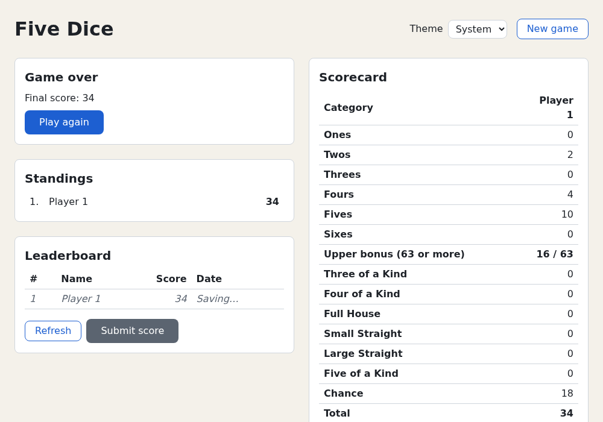

# Chapter 17 — Async React

So far all of Five Dice's data was on hand at render time. Real apps wait for a server. This chapter covers
how React handles waiting: loading states with `<Suspense>` and `use()`, failures with **error
boundaries**, slow updates with **transitions** and **Actions**, instant feedback with `useOptimistic`, and
cancellation with `AbortController`. There's no real backend: in the project you build a fake
**leaderboard server** that is slow and sometimes fails, then show and submit scores with it.
[Chapter 16](16-rendering-and-performance.md) made rendering cheap; [Chapter 18](18-portals-and-dialogs.md)
adds dialogs.

## Waiting for a server

In the browser, talking to a server is always asynchronous. `fetch()` sends an HTTP request and returns a
**promise** (promises and `async`/`await`: [TypeScript Crash Course, chapter 10](https://github.com/sipak-gh/learn-typescript-crashcourse/blob/master/10-async-iterators-and-resources.md);
how other code runs between `await`s: [Chapter 3](03-javascript-for-react.md#the-event-loop-and-async-code)). A small client
for a real scores API:

```ts
async function getTopScores({ signal }: { signal?: AbortSignal } = {}): Promise<HighScore[]> {
  const response = await fetch('/api/scores', { signal })
  if (!response.ok) throw new Error(`The server answered ${response.status}.`)
  return (await response.json()) as HighScore[]
}
```

`fetch` resolves once the response headers arrive, even for an error status such as 404 or 500, so check
`response.ok` yourself. `response.json()` reads and parses the body: a second wait. DevTools' **Network**
tab shows every request with its timing and body.

While a request is in flight, the UI is **loading**, **failed**, or showing **data**. You could track that
with `useState` and an Effect ([Chapter 11](11-effects.md)). React 19 does better: describe each state where
it belongs and let React switch between them.

The examples use a pretend server instead of `fetch`, so they need no network. It answers after `ms`
milliseconds, fails for negative ids, and supports cancelling:

`examples/ch17/fake-server.ts`

```ts
export interface Player {
  id: number
  name: string
  best: number
}

const NAMES = ['Ada', 'Bo', 'Cy', 'Di']

interface FetchOptions {
  /** How long the "server" takes to answer, in milliseconds. */
  ms?: number
  signal?: AbortSignal
}

/** A pretend server: answers after `ms` milliseconds, unless `signal` aborts first. */
export function fetchPlayer(id: number, { ms = 800, signal }: FetchOptions = {}): Promise<Player> {
  return new Promise((resolve, reject) => {
    if (signal?.aborted) return reject(signal.reason)
    const timer = setTimeout(() => {
      if (id < 0) reject(new Error(`No player with id ${id}.`))
      else resolve({ id, name: NAMES[id % NAMES.length], best: 150 + id * 17 })
    }, ms)
    signal?.addEventListener(
      'abort',
      () => {
        clearTimeout(timer)
        reject(signal.reason)
      },
      { once: true },
    )
  })
}
```

### Cancelling with `AbortController`

Sometimes the answer is no longer wanted: the user navigated away or asked for something else. An
**`AbortController`** (a web platform object; Node has it too) cancels work. It has two parts:

- `controller.signal`: an `AbortSignal` you pass to the work. It's an event target: work listens for its
  `abort` event, as a button listens for `click`.
- `controller.abort()`: fires that event, so everyone listening stops.

`fetch(url, { signal })` supports it, and so does the fake server: on abort it clears its timer and rejects
with `signal.reason`, an error named `AbortError`. `AbortSignal.timeout(ms)` makes a signal that aborts
itself.

`examples/ch17/abort.ts`

```ts
import { fetchPlayer } from './fake-server.ts'

const describe = (error: unknown) => (error instanceof Error ? `${error.name}: ${error.message}` : String(error))

// 1. await waits for the promise to settle.
console.log('asking for player 1…')
console.log('got', await fetchPlayer(1, { ms: 200 }))

// 2. A failure arrives as a rejection: catch it around the await.
try {
  await fetchPlayer(-1, { ms: 100 })
} catch (error) {
  console.log('failed:', describe(error))
}

// 3. Cancel: controller.abort() makes the promise reject with an AbortError.
const controller = new AbortController()
const request = fetchPlayer(2, { ms: 1000, signal: controller.signal })
setTimeout(() => controller.abort(), 100)
try {
  await request
} catch (error) {
  console.log('cancelled:', describe(error))
}

// 4. A timeout is just a signal that aborts itself.
try {
  await fetchPlayer(3, { ms: 1000, signal: AbortSignal.timeout(50) })
} catch (error) {
  console.log('timed out:', describe(error))
}
```

Run it from `examples/`:

```console
$ node ch17/abort.ts
asking for player 1…
got { id: 1, name: 'Bo', best: 167 }
failed: Error: No player with id -1.
cancelled: AbortError: This operation was aborted
timed out: TimeoutError: The operation was aborted due to timeout
```

Check `error.name` to tell a cancel from a real failure. A cancel usually deserves no error message.

In a component, the place to cancel is an Effect's cleanup ([Chapter 11](11-effects.md)): create the
controller in the Effect and call `controller.abort()` in the cleanup, instead of setting an `ignore` flag
(Exercise 3). `use()`, coming next, receives a finished promise, not a request, so it can't cancel anything;
data libraries and frameworks cancel for you.

## `use()` and `<Suspense>`: show something while you wait

`use(promise)` reads a promise's value during render:

- Resolved: `use` returns the value.
- Pending: the component **suspends**. React stops rendering it and shows the `fallback` of the nearest
  `<Suspense>` boundary above. When the promise settles, React renders the component again.
- Rejected: `use` throws the error (caught in the next section).

So the component handles only the "data" state. The loading state lives in a `<Suspense>` boundary,
wherever you put it.

Compare Chapter 11's search, which fetched in an Effect:

| | Effect + state ([Chapter 11](11-effects.md)) | `use` + `<Suspense>` + error boundary |
|---|---|---|
| Loading | an `if (!answer)` branch in the component | the nearest `<Suspense fallback>` |
| Failure | an error state you set in `.catch` | the nearest error boundary (next section) |
| Stale answers | an `ignore` flag in the cleanup | none: the promise is replaced, and React reads the current one |
| When the request starts | after the first paint, in the Effect | in a state initializer or event handler |

`use` isn't a Hook despite its name: you may call it inside `if` and loops, though still only from a
component or Hook. It also reads context: `use(SomeContext)` works like `useContext`.

A player card. The promise lives in **state**: created once in the `useState` initializer, replaced by the
event handler.

`examples/ch17/player-card.demo.tsx`

```tsx
import { Suspense, use, useState, useTransition } from 'react'
import { fetchPlayer, type Player } from './fake-server.ts'

function PlayerCard({ playerPromise }: { playerPromise: Promise<Player> }) {
  // Suspends until the promise resolves; then returns its value.
  const player = use(playerPromise)
  return (
    <p>
      {player.name}: best score {player.best}
    </p>
  )
}

export default function PlayerCardDemo() {
  const [id, setId] = useState(0)
  // The promise is state: created once, replaced only by the event handler.
  const [playerPromise, setPlayerPromise] = useState(() => fetchPlayer(0))
  const [isPending, startTransition] = useTransition()

  function showNext(asTransition: boolean) {
    const update = () => {
      setId(id + 1)
      setPlayerPromise(fetchPlayer(id + 1))
    }
    if (asTransition) startTransition(update)
    else update()
  }

  return (
    <main>
      <button type="button" onClick={() => showNext(false)}>
        Next player
      </button>{' '}
      <button type="button" onClick={() => showNext(true)}>
        Next player (transition)
      </button>
      {isPending && ' Loading…'}
      <Suspense fallback={<p>Loading player…</p>}>
        <PlayerCard playerPromise={playerPromise} />
      </Suspense>
    </main>
  )
}
```

Run `npm run dev` in `examples/` and open `http://localhost:5173/?demo=ch17/player-card`. "Loading player…"
shows for 0.8 s, then "Ada: best score 150". (The second button is explained under
[transitions](#transitions-keep-the-old-ui-while-the-new-one-loads).)

Click **Next player**: the card disappears, "Loading player…" shows, then "Bo: best score 167". React
didn't unmount the old card; it hid it with `display: none` next to the fallback, so the card's state
survives.

The test uses Vitest's fake timers ([Chapter 11](11-effects.md)) to decide when the server answers:

`examples/ch17/player-card.test.tsx`

```tsx
import { act, fireEvent, render, screen } from '@testing-library/react'
import { afterEach, beforeEach, expect, it, vi } from 'vitest'
import PlayerCardDemo from './player-card.demo'

beforeEach(() => {
  vi.useFakeTimers() // the fake server uses setTimeout: we decide when it answers
})
afterEach(() => {
  vi.useRealTimers()
})

// Let the "server" answer, inside act() so React finishes rendering first.
const answer = () => act(async () => vi.advanceTimersByTime(800))
// A click that suspends: await act() lets React finish the work it starts.
const click = (name: string) => act(async () => fireEvent.click(screen.getByRole('button', { name })))

it('shows the Suspense fallback until the promise resolves', async () => {
  await act(async () => render(<PlayerCardDemo />))
  expect(screen.getByText('Loading player…')).toBeInTheDocument()

  await answer()
  expect(screen.getByText('Ada: best score 150')).toBeInTheDocument()
})

it('replaces the content with the fallback on a normal update', async () => {
  await act(async () => render(<PlayerCardDemo />))
  await answer()

  await click('Next player')
  expect(screen.getByText('Loading player…')).toBeInTheDocument()
  // The old card is still in the DOM, but hidden with display: none.
  expect(screen.getByText('Ada: best score 150')).not.toBeVisible()

  await answer()
  expect(screen.getByText('Bo: best score 167')).toBeInTheDocument()
})

it('keeps the old content during a transition', async () => {
  await act(async () => render(<PlayerCardDemo />))
  await answer()

  await click('Next player (transition)')
  expect(screen.getByText('Ada: best score 150')).toBeInTheDocument()
  expect(screen.getByText(/Loading…/)).toBeInTheDocument() // isPending
  expect(screen.queryByText('Loading player…')).not.toBeInTheDocument()

  await answer()
  expect(screen.getByText('Bo: best score 167')).toBeInTheDocument()
  expect(screen.queryByText(/Loading/)).not.toBeInTheDocument()
})
```

```console
$ npx vitest run ch17/player-card.test.tsx --reporter=verbose

 RUN  v5.0.5 /home/you/learn-react/examples

 ✓ ch17/player-card.test.tsx > shows the Suspense fallback until the promise resolves 29ms
 ✓ ch17/player-card.test.tsx > replaces the content with the fallback on a normal update 81ms
 ✓ ch17/player-card.test.tsx > keeps the old content during a transition 10ms

 Test Files  1 passed (1)
      Tests  3 passed (3)
   Start at  16:28:07
   Duration  617ms (environment 63%, tests 22%, setup 11%, transform 2%, import 1%, worker 1%)
```

The tests wrap rendering and clicks in `await act(async () => …)`; [Testing async
components](#testing-async-components) explains why.

`<Suspense>` boundaries nest: each covers the components below it, down to the next boundary. Put one
around each part of the page that can usefully appear on its own, so a sidebar can show while the main
content loads.

### Gotcha: a new promise on every render

This looks reasonable but never finishes:

`examples/ch17/uncached-promise.demo.tsx`

```tsx
import { Suspense, use } from 'react'
import { fetchPlayer } from './fake-server.ts'

// WRONG: a new promise on every render. Watch the console.
function PlayerCard() {
  const player = use(fetchPlayer(0, { ms: 300 }))
  return (
    <p>
      {player.name}: best score {player.best}
    </p>
  )
}

export default function UncachedPromiseDemo() {
  return (
    <Suspense fallback={<p>Loading player…</p>}>
      <PlayerCard />
    </Suspense>
  )
}
```

Open `?demo=ch17/uncached-promise`: "Loading player…" stays forever, and the console stays quiet. Each
render calls `fetchPlayer` again, so when a promise resolves, the new render creates a *new* pending promise
and suspends again. A `console.log` in `PlayerCard` would show a new request about three times a second,
forever.

React can only wait for a promise that stays the same between renders. Create it outside render: in a state
initializer or event handler (as in the player card), in a module-level cache, or in a data library or
framework. Libraries such as TanStack Query ([Chapter 20](20-where-next.md)) cache server promises for you.

## Error boundaries: catch what goes wrong

If a component throws during render, React has nothing sensible to show, so it removes the **whole app**: a
blank screen. An **error boundary** limits the damage: it catches errors thrown below it and shows a
fallback, and the rest of the page keeps working. It's `try`/`catch` for part of the tree.

There's no Hook for this. Error boundaries still need a **class component**, the pre-Hooks way to write
components ([TypeScript Crash Course, chapter 6](https://github.com/sipak-gh/learn-typescript-crashcourse/blob/master/06-classes.md)
covers class syntax): a class that extends `Component`, keeps state in `this.state`, changes it with
`this.setState()`, and returns JSX from `render()`. An error boundary has one or both of:

- `static getDerivedStateFromError(error)`: runs during render and turns the error into state, so the next
  render shows the fallback. Like any render code, it must be pure.
- `componentDidCatch(error, info)`: runs after the commit, for side effects such as reporting to a logging
  service. `info.componentStack` lists the components above the one that threw.

`examples/ch17/error-boundary.demo.tsx`

```tsx
import { Component, Suspense, use, useState, type ErrorInfo, type ReactNode } from 'react'
import { fetchPlayer, type Player } from './fake-server.ts'

interface BoundaryProps {
  children: ReactNode
}

interface BoundaryState {
  error: Error | null
}

// Error boundaries must be classes: there is no hook for this (yet).
export class ErrorBoundary extends Component<BoundaryProps, BoundaryState> {
  state: BoundaryState = { error: null }

  // Render phase: turn the error into state. Must be pure.
  static getDerivedStateFromError(error: Error): BoundaryState {
    return { error }
  }

  // Commit phase: side effects, such as reporting the error to a server.
  componentDidCatch(error: Error, info: ErrorInfo) {
    console.log(`Reported: ${error.message}`, info.componentStack)
  }

  render() {
    if (this.state.error) return <p role="alert">Something went wrong: {this.state.error.message}</p>
    return this.props.children
  }
}

function PlayerCard({ playerPromise }: { playerPromise: Promise<Player> }) {
  const player = use(playerPromise) // a rejected promise throws here
  return (
    <p>
      {player.name}: best score {player.best}
    </p>
  )
}

export default function ErrorBoundaryDemo() {
  const [id, setId] = useState(0)
  const [playerPromise, setPlayerPromise] = useState(() => fetchPlayer(0))

  function load(next: number) {
    setId(next)
    setPlayerPromise(fetchPlayer(next))
  }

  return (
    <main>
      <button type="button" onClick={() => load(1)}>
        Load player 1
      </button>{' '}
      <button type="button" onClick={() => load(-1)}>
        Load player -1
      </button>
      {/* A new key gives a fresh boundary, without the old error. */}
      <ErrorBoundary key={id}>
        <Suspense fallback={<p>Loading player…</p>}>
          <PlayerCard playerPromise={playerPromise} />
        </Suspense>
      </ErrorBoundary>
    </main>
  )
}
```

A rejected promise read with `use()` counts as a render error, so the boundary catches it. Open
`?demo=ch17/error-boundary` and click **Load player -1**: "Something went wrong: No player with id -1."
appears and the buttons still work. The console shows two entries:

```text
Error: No player with id -1.
    at http://localhost:5173/ch17/fake-server.ts:…
The above error occurred in the <PlayerCard> component.

React will try to recreate this component tree from scratch using the error boundary you provided, ErrorBoundary.

Reported: No player with id -1.
    at PlayerCard (http://localhost:5173/ch17/error-boundary.demo.tsx:…)
    at Suspense (<anonymous>)
    at ErrorBoundary (http://localhost:5173/ch17/error-boundary.demo.tsx:…)
    at main (<anonymous>)
    at ErrorBoundaryDemo (http://localhost:5173/ch17/error-boundary.demo.tsx:…)
```

(Line and column numbers left out.)

The first, in red, is React logging every caught error with `console.error` (a production build logs just
the error; pass `onCaughtError` to `createRoot` to change this). The second is our `componentDidCatch`.

Click **Load player 1** and Bo appears. A boundary in the error state stays there until its state changes,
so it must be reset. Here the `key` does it: a new `key` gives a brand-new boundary (reset-by-key is from
[Chapter 10](10-composition-and-context.md)). The project's boundary has a `reset` method instead.

`examples/ch17/error-boundary.test.tsx`

```tsx
import { act, fireEvent, render, screen } from '@testing-library/react'
import { afterEach, beforeEach, expect, it, vi } from 'vitest'
import ErrorBoundaryDemo, { ErrorBoundary } from './error-boundary.demo'

beforeEach(() => {
  vi.useFakeTimers()
  // React logs every caught error with console.error; keep the test output clean.
  vi.spyOn(console, 'error').mockImplementation(() => {})
  vi.spyOn(console, 'log').mockImplementation(() => {})
})
afterEach(() => {
  vi.useRealTimers()
  vi.restoreAllMocks()
})

const answer = () => act(async () => vi.advanceTimersByTime(800))
const click = (name: string) => act(async () => fireEvent.click(screen.getByRole('button', { name })))

it('catches an error thrown while rendering', () => {
  function Broken(): never {
    throw new Error('Boom')
  }
  render(
    <ErrorBoundary>
      <Broken />
    </ErrorBoundary>,
  )
  expect(screen.getByRole('alert')).toHaveTextContent('Something went wrong: Boom')
  expect(console.log).toHaveBeenCalledWith('Reported: Boom', expect.stringContaining('at Broken'))
})

it('catches a rejected promise read with use(), and resets with a new key', async () => {
  await act(async () => render(<ErrorBoundaryDemo />))
  await answer()
  expect(screen.getByText('Ada: best score 150')).toBeInTheDocument()

  await click('Load player -1')
  await answer()
  expect(screen.getByRole('alert')).toHaveTextContent('Something went wrong: No player with id -1.')

  await click('Load player 1')
  await answer()
  expect(screen.getByText('Bo: best score 167')).toBeInTheDocument()
})
```

```console
$ npx vitest run ch17/error-boundary.test.tsx --reporter=verbose

 RUN  v5.0.5 /home/you/learn-react/examples

 ✓ ch17/error-boundary.test.tsx > catches an error thrown while rendering 85ms
 ✓ ch17/error-boundary.test.tsx > catches a rejected promise read with use(), and resets with a new key 33ms

 Test Files  1 passed (1)
      Tests  2 passed (2)
   Start at  16:28:08
   Duration  597ms (environment 64%, tests 23%, setup 10%, transform 2%, import 1%, worker 1%)
```

Error boundaries catch only errors during React's render and commit. They do **not** catch errors:

- in event handlers (React isn't rendering then; use `try`/`catch` and state, as the next sections do). The
  exception: an error thrown by a function passed to `useTransition`'s `startTransition` (next section)
  does reach the nearest boundary,
- in async code such as a `setTimeout` callback or a promise not passed to `use()`,
- in the boundary itself (it catches errors *below* it).

Placing boundaries is a design choice, like placing `<Suspense>`. One near the root avoids the blank
screen; more around independent widgets keep one failure from hiding the rest.

Most apps don't write the class themselves. The `react-error-boundary` package provides a ready-made
`<ErrorBoundary>` with `fallbackRender`, `onError` and `onReset` props, much like the one the project builds
below.

## Transitions: keep the old UI while the new one loads

In the player card, "Loading player…" replaced Ada's card while Bo loaded. On first load that's right:
there's nothing else to show. On an update it's jarring: what you were reading vanishes, and the page may
jump.

A **transition** marks a state update as non-urgent. `useTransition` returns two things:

```tsx
const [isPending, startTransition] = useTransition()
```

`startTransition(fn)` runs `fn` and marks its state updates as a transition. React renders the new UI in
the background. If that render suspends, React **keeps showing the old UI** instead of a fallback and
commits the new one when ready. Meanwhile `isPending` is `true`, for a lighter hint.

That's the player card's second button: `startTransition(update)`. Click **Next player (transition)**:
Ada's card stays, " Loading…" appears beside the buttons, then Bo replaces Ada. The third test checks this.

Transitions also keep the page responsive: React can pause a background render to handle a keystroke or
click, then continue. That's the background render `useDeferredValue` uses
([Chapter 16](16-rendering-and-performance.md)). With Suspense, `useDeferredValue` behaves like a
transition too: while the new value's data loads, the old UI stays. Use it when the value comes from props or
another Hook and you can't wrap the update in `startTransition`.

A transition doesn't *delay* anything; the update starts at once. It changes what React shows until the
update finishes. Don't use one for typing into an input, which must update immediately.

A plain `startTransition` function, imported from `react`, does the same without `isPending`. Use it where
you can't call a Hook or don't need the flag.

### Actions

A function passed to `startTransition` may be `async`; React calls it an **Action**. `isPending` then stays
`true` until the returned promise settles, so a whole server round-trip counts as pending:

```tsx
startTransition(async () => {
  const saved = await save(text)
  startTransition(() => setMessages((current) => [...current, saved]))
})
```

Note the second `startTransition`. React loses track of the transition across an `await`, so updates after
it are urgent and may show a Suspense fallback after all. Wrap them again. The React team calls this a
current limitation, to be fixed later. (Exercise 1 shows what goes wrong without it.)

Forms run Actions for you. `<form action={…}>` and `useActionState` ([Chapter 9](09-forms.md)) both run the
function in a transition, so all of the above applies: the form stays pending until the async function
finishes.

## `useOptimistic`: show the result before the server agrees

Most saves succeed. Instead of a spinner, show the result at once and fix it up if the server says no: an
**optimistic update**.

```tsx
const [shown, addOptimistic] = useOptimistic(actual, (current, change) => next)
```

- Outside an Action, `shown` is just `actual`.
- Inside an Action, `addOptimistic(change)` computes a temporary value with your update function and shows
  it at once.
- When the Action finishes, React drops the temporary value and shows `actual` again. On success `actual`
  holds the new data; on failure the optimistic change just disappears. Nothing to roll back by hand.

`examples/ch17/optimistic.demo.tsx`

```tsx
import { startTransition, useOptimistic, useState } from 'react'

/** A pretend server: saves after a second, but refuses messages with a "!". */
function save(text: string): Promise<string> {
  return new Promise((resolve, reject) => {
    setTimeout(() => (text.includes('!') ? reject(new Error('No shouting.')) : resolve(text)), 1000)
  })
}

export default function OptimisticDemo() {
  const [messages, setMessages] = useState<string[]>([])
  const [error, setError] = useState('')
  // While an Action runs, `shown` is `messages` plus the optimistic additions.
  // When the Action ends, React drops the additions and shows `messages` again.
  const [shown, addOptimistic] = useOptimistic(messages, (current, text: string) => [...current, `${text} (sending…)`])

  async function send(formData: FormData) {
    const text = String(formData.get('text'))
    setError('')
    addOptimistic(text)
    try {
      const saved = await save(text)
      // After an await, wrap state updates in startTransition again.
      startTransition(() => setMessages((current) => [...current, saved]))
    } catch (e) {
      setError(e instanceof Error ? e.message : String(e))
    }
  }

  return (
    <main>
      <ul>
        {shown.map((message, index) => (
          <li key={index}>{message}</li>
        ))}
      </ul>
      {/* A function passed to `action` runs as an Action (a transition). */}
      <form action={send}>
        <input name="text" aria-label="Message" required /> <button type="submit">Send</button>
      </form>
      {error && <p role="alert">Not sent: {error}</p>}
    </main>
  )
}
```

Open `?demo=ch17/optimistic`, type "Hi" and press **Send**: "Hi (sending…)" appears at once and becomes
"Hi" a second later. Send "Hi!": "Hi! (sending…)" appears, then disappears, and "Not sent: No shouting."
shows. React resets the form after an Action, so the input is empty either way.

`examples/ch17/optimistic.test.tsx`

```tsx
import { act, fireEvent, render, screen } from '@testing-library/react'
import { afterEach, beforeEach, expect, it, vi } from 'vitest'
import OptimisticDemo from './optimistic.demo'

beforeEach(() => {
  vi.useFakeTimers()
})
afterEach(() => {
  vi.useRealTimers()
})

async function send(text: string) {
  fireEvent.change(screen.getByRole('textbox', { name: 'Message' }), { target: { value: text } })
  await act(async () => fireEvent.click(screen.getByRole('button', { name: 'Send' })))
}
const items = () => screen.queryAllByRole('listitem').map((item) => item.textContent)

it('shows the message at once, then the saved version', async () => {
  render(<OptimisticDemo />)
  await send('Hi')
  expect(items()).toEqual(['Hi (sending…)'])

  await act(async () => vi.advanceTimersByTime(1000))
  expect(items()).toEqual(['Hi'])
})

it('takes the optimistic message back when saving fails', async () => {
  render(<OptimisticDemo />)
  await send('Hi!')
  expect(items()).toEqual(['Hi! (sending…)'])

  await act(async () => vi.advanceTimersByTime(1000))
  expect(items()).toEqual([])
  expect(screen.getByRole('alert')).toHaveTextContent('Not sent: No shouting.')
})
```

```console
$ npx vitest run ch17/optimistic.test.tsx --reporter=verbose

 RUN  v5.0.5 /home/you/learn-react/examples

 ✓ ch17/optimistic.test.tsx > shows the message at once, then the saved version 158ms
 ✓ ch17/optimistic.test.tsx > takes the optimistic message back when saving fails 30ms

 Test Files  1 passed (1)
      Tests  2 passed (2)
   Start at  16:28:09
   Duration  671ms (environment 55%, tests 32%, setup 9%, transform 2%, import 1%, worker 1%)
```

Call `addOptimistic` inside an Action (a form action or a function passed to `startTransition`). From a
plain click handler it changes nothing on screen, and React logs "An optimistic state update occurred
outside a transition or action. To fix, move the update to an action, or wrap with startTransition."

## Testing async components

Tests need two new tools.

**`act()`.** React batches renders and runs some later. `act(fn)` from Testing Library (a thin wrapper over
React's) runs `fn`, then makes React finish *all* the work it caused before the test continues. Testing
Library already wraps `render`, `fireEvent` and `user.click` in `act`, which suffices for synchronous work.
When a component suspends, the work includes waiting for promises, which needs the *async* form:
`await act(async () => …)`.

Render a suspending component with a plain `render(…)` and React warns:

```text
A component suspended inside an `act` scope, but the `act` call was not awaited. When testing React components that depend on asynchronous data, you must await the result:

await act(() => ...)
```

Worse, the fallback then never goes away, even after the promise resolves. So:

- Render with `await act(async () => render(…))`.
- Click with `await act(async () => fireEvent.click(…))` when the click makes something suspend.
  `await act(() => user.click(…))` fails: user-event uses `act` itself, and nesting warns "The current
  testing environment is not configured to support act(...)".
- Settle promises inside `act` too, such as `await act(async () => vi.advanceTimersByTime(800))`.
- Form actions are transitions, so a plain `await user.click(…)` on a submit button is fine.

**Control time.** Don't wait for real network delays in tests. Fake the timers, as the examples do, or give
the component a service whose promises the test settles by hand, as the project does.

## Building Five Dice: the leaderboard

The high-score table from [Chapter 13](13-custom-hooks.md) read `localStorage` synchronously. Now it moves to
a "server". You build:

- a fake leaderboard service: slow, sometimes failing, backed by `localStorage`;
- a reusable `ErrorBoundary`;
- a `Leaderboard` component that loads with Suspense, refreshes with a transition, and submits scores with
  an Action and optimistic rows.

The setup screen shows the leaderboard; at game over, players submit their scores to it.



### Step 1: the fake leaderboard service

Components shouldn't know whether scores come from a real server or a fake, so the service is an
**interface**: one object that hides where the data comes from, so tests can swap in another. Create
`src/services/leaderboard.ts`. The part components see:

```ts
export interface LeaderboardService {
  /** The top scores, best first. */
  getTopScores(options?: RequestOptions): Promise<HighScore[]>
  /** Add new scores; resolves with the updated top scores. */
  submitScores(entries: readonly HighScore[], options?: RequestOptions): Promise<HighScore[]>
}
```

`createFakeLeaderboard({ latency, failureRate })` implements it. It stores scores in `localStorage` but
behaves like a network: each request waits about `latency` ms (randomly between half and one and a half
times that) and fails with probability `failureRate`. The file is plain TypeScript with no React in it:

<details><summary>Full listing: <code>src/services/leaderboard.ts</code></summary>

```ts
import { addHighScores, type HighScore } from '../game/highScores'

/**
 * What the app needs from a leaderboard server. Components only see this
 * interface, so tests (and one day a real server) can provide another one.
 */
export interface LeaderboardService {
  /** The top scores, best first. */
  getTopScores(options?: RequestOptions): Promise<HighScore[]>
  /** Add new scores; resolves with the updated top scores. */
  submitScores(entries: readonly HighScore[], options?: RequestOptions): Promise<HighScore[]>
}

export interface RequestOptions {
  /** Abort the request with `controller.abort()`. */
  signal?: AbortSignal
}

export interface FakeLeaderboardOptions {
  /** Average simulated network delay, in milliseconds. */
  latency?: number
  /** The chance (0 to 1) that a request fails. */
  failureRate?: number
  storageKey?: string
}

/** Resolve after `ms` milliseconds, or reject as soon as `signal` aborts. */
function delay(ms: number, signal?: AbortSignal): Promise<void> {
  return new Promise((resolve, reject) => {
    if (signal?.aborted) return reject(signal.reason)
    if (ms <= 0) return resolve() // no latency (in tests): no timer either
    const timer = setTimeout(resolve, ms)
    signal?.addEventListener(
      'abort',
      () => {
        clearTimeout(timer)
        reject(signal.reason) // a DOMException named "AbortError"
      },
      { once: true },
    )
  })
}

/**
 * A pretend leaderboard server: the data lives in localStorage, but every
 * request is slow and may fail, like a real network request.
 */
export function createFakeLeaderboard({
  latency = 600,
  failureRate = 0,
  storageKey = 'five-dice:leaderboard:v1',
}: FakeLeaderboardOptions = {}): LeaderboardService {
  function load(): HighScore[] {
    try {
      const data: unknown = JSON.parse(localStorage.getItem(storageKey) ?? '[]')
      return Array.isArray(data) ? data : []
    } catch {
      return []
    }
  }

  async function request<T>(work: () => T, signal?: AbortSignal): Promise<T> {
    // Somewhere between half and one and a half times the average latency.
    await delay(latency * (0.5 + Math.random()), signal)
    if (Math.random() < failureRate) throw new Error('The leaderboard server did not respond.')
    return work()
  }

  // The read that is in flight right now, if any.
  let pendingRead: Promise<HighScore[]> | null = null

  return {
    getTopScores(options = {}) {
      if (options.signal) return request(load, options.signal)
      // Callers asking at the same time share one request, as data-fetching
      // libraries do. (StrictMode runs a useState initializer twice in
      // development: without this, the second, unused promise could fail
      // with nobody listening, logging "Uncaught (in promise)".)
      pendingRead ??= request(load).finally(() => {
        pendingRead = null
      })
      return pendingRead
    },
    submitScores: (entries, options = {}) =>
      request(() => {
        const updated = addHighScores(load(), entries)
        localStorage.setItem(storageKey, JSON.stringify(updated))
        return updated
      }, options.signal),
  }
}

/** Add ?failure=0.5 to the address to make half of all requests fail. */
export function failureRateFromUrl(): number {
  const rate = Number(new URLSearchParams(window.location.search).get('failure'))
  return rate >= 0 && rate <= 1 ? rate : 0
}
```

</details>

Three details:

- `delay` resolves without a timer when `latency` is 0. Tests rely on that: the promise settles in a
  microtask, which an awaited `act()` waits for.
- `getTopScores` without a signal shares a read already in flight. In development, StrictMode's double
  render ([Chapter 4](04-components-and-jsx.md)) runs `useState` initializers twice. Without sharing, the
  second promise would be discarded, and if it failed, nobody would handle the rejection: the console would
  show "Uncaught (in promise)". Data-fetching libraries share requests the same way.
- `failureRateFromUrl` reads the page address (`URLSearchParams` parses the part after `?`). Add
  `?failure=1` to the URL to make every request fail, or `?failure=0.5` for half of them. In this chapter
  that works in every build, production included; [Chapter 19](19-building-and-shipping.md) limits it to
  development.

The service reuses `addHighScores` from `src/game/highScores.ts` for sorting and trimming. The storage key is
new (`five-dice:leaderboard:v1`), so the old high-score table's scores don't carry over.

Test it in `src/services/leaderboard.test.ts`; `latency: 0` keeps the tests instant. The four tests check
storage, the shared read, failure, and cancelling with an `AbortController`.

<details><summary>Full listing: <code>src/services/leaderboard.test.ts</code></summary>

```ts
import { describe, expect, it } from 'vitest'
import { createFakeLeaderboard } from './leaderboard'

const ada = { name: 'Ada', score: 200, date: '2026-01-02' }
const bo = { name: 'Bo', score: 250, date: '2026-01-02' }

describe('fake leaderboard service', () => {
  it('stores submitted scores, best first', async () => {
    const service = createFakeLeaderboard({ latency: 0 })
    expect(await service.getTopScores()).toEqual([])
    expect(await service.submitScores([ada, bo])).toEqual([bo, ada])
    expect(await service.getTopScores()).toEqual([bo, ada])
  })

  it('shares a read that is already in flight', async () => {
    const service = createFakeLeaderboard({ latency: 0 })
    const first = service.getTopScores()
    expect(service.getTopScores()).toBe(first)
    await first
    expect(service.getTopScores()).not.toBe(first)
  })

  it('fails when told to', async () => {
    const service = createFakeLeaderboard({ latency: 0, failureRate: 1 })
    await expect(service.getTopScores()).rejects.toThrow('did not respond')
  })

  it('can be cancelled with an AbortController', async () => {
    const service = createFakeLeaderboard({ latency: 1000 })
    const controller = new AbortController()
    const request = service.submitScores([ada], { signal: controller.signal })
    controller.abort()
    await expect(request).rejects.toHaveProperty('name', 'AbortError')
    // The aborted request never reached the "server".
    expect(localStorage.getItem('five-dice:leaderboard:v1')).toBeNull()
  })
})
```

</details>

### Step 2: provide the service through context

Components get the service from a context, like the dice's random-number generator in
[Chapter 10](10-composition-and-context.md). The default value is the real fake, so the app needs no
provider; tests provide a fast one.

At the end of `src/components/contexts.ts`, add an import and a context:

```ts
import { createFakeLeaderboard, failureRateFromUrl, type LeaderboardService } from '../services/leaderboard'
```

```ts
/** The leaderboard "server". Tests provide a fast, predictable one. */
export const LeaderboardContext = createContext<LeaderboardService>(
  createFakeLeaderboard({ failureRate: failureRateFromUrl() }),
)
```

### Step 3: a reusable error boundary

The project's boundary takes the fallback as a function prop, `fallback(error, reset)`, so each user decides
what to show. `reset` calls `onReset` and then clears the error, so the parent can start a new request
before the children render again. `onError` reports the error.

`src/components/ErrorBoundary.tsx`

```tsx
import { Component, type ErrorInfo, type ReactNode } from 'react'

interface ErrorBoundaryProps {
  /** Shown instead of the children after an error; call `reset` to try again. */
  fallback: (error: unknown, reset: () => void) => ReactNode
  /** Called by `reset`, before the children render again: e.g. start a new request. */
  onReset?: () => void
  /** Report the error, e.g. to an error-tracking service. */
  onError?: (error: unknown, info: ErrorInfo) => void
  children: ReactNode
}

interface ErrorBoundaryState {
  error: unknown
  hasError: boolean
}

/**
 * Catches errors thrown while rendering its children, including a rejected
 * promise read with use(). There is no hook for this: error boundaries are
 * the one thing that still needs a class component.
 */
export class ErrorBoundary extends Component<ErrorBoundaryProps, ErrorBoundaryState> {
  state: ErrorBoundaryState = { error: null, hasError: false }

  /** Render phase: turn the error into state, so the next render shows the fallback. */
  static getDerivedStateFromError(error: unknown): ErrorBoundaryState {
    return { error, hasError: true }
  }

  /**
   * Commit phase: the place for side effects such as reporting the error.
   * (React itself already logs caught errors with console.error.)
   */
  componentDidCatch(error: unknown, info: ErrorInfo) {
    this.props.onError?.(error, info)
  }

  reset = () => {
    this.props.onReset?.()
    this.setState({ error: null, hasError: false })
  }

  render() {
    if (this.state.hasError) return this.props.fallback(this.state.error, this.reset)
    return this.props.children
  }
}
```

`reset` is an arrow function in a class field, so `this` is always the boundary, even when `reset` is passed
around as a callback (`this` rules: [TypeScript Crash Course, chapter 6](https://github.com/sipak-gh/learn-typescript-crashcourse/blob/master/06-classes.md)). The error is `unknown` because
JavaScript can throw anything. A separate `hasError` flag covers `throw null`.

Its test, `src/components/ErrorBoundary.test.tsx`, renders a child that throws, checks that `onError` got the
error, then clicks the fallback's reset button:

<details><summary>Full listing: <code>src/components/ErrorBoundary.test.tsx</code></summary>

```tsx
import { render, screen } from '@testing-library/react'
import userEvent from '@testing-library/user-event'
import { expect, it, vi } from 'vitest'
import { ErrorBoundary } from './ErrorBoundary'

it('shows the fallback after an error, reports it, and can reset', async () => {
  vi.spyOn(console, 'error').mockImplementation(() => {})
  let broken = true
  function Fragile() {
    if (broken) throw new Error('Boom')
    return <p>All good</p>
  }
  const onError = vi.fn()
  const user = userEvent.setup()

  render(
    <ErrorBoundary
      onError={onError}
      onReset={() => (broken = false)}
      fallback={(error, reset) => (
        <button type="button" onClick={reset}>
          {error instanceof Error ? error.message : 'Error'}: reset
        </button>
      )}
    >
      <Fragile />
    </ErrorBoundary>,
  )

  expect(onError).toHaveBeenCalledWith(new Error('Boom'), expect.objectContaining({ componentStack: expect.any(String) }))
  await user.click(screen.getByRole('button', { name: 'Boom: reset' }))
  expect(screen.getByText('All good')).toBeInTheDocument()
  vi.mocked(console.error).mockRestore()
})
```

</details>

React logs every caught error with `console.error`; the test silences it with a spy, then restores it.

### Step 4: the `Leaderboard` component

`Leaderboard` combines the whole chapter. Top to bottom:

- `LeaderboardTable` reads the scores with `use(scoresPromise)` and merges in rows being saved.
- `scoresPromise` is state: the initializer starts the first request; `reload` replaces it.
- **Refresh** runs `reload` in a transition, so the old table stays, dimmed by the `stale` class, and the
  button says "Refreshing…".
- `useOptimistic` holds the scores being saved; the table shows them at once, marked "Saving…".
- `useActionState` ([Chapter 9](09-forms.md)) runs the submit Action. After the `await`, the new promise is
  set inside `startTransition`, so the table doesn't fall back to "Loading leaderboard…".
- An `ErrorBoundary` with a **Try again** button wraps the `<Suspense>`; its `onReset` starts a new request.
- Without `results` (the setup screen) it shows only the board.

`src/components/Leaderboard.tsx`

```tsx
import { startTransition, Suspense, use, useActionState, useContext, useOptimistic, useState, useTransition } from 'react'
import { addHighScores, type HighScore } from '../game/highScores'
import buttons from '../styles/buttons.module.css'
import tables from '../styles/tables.module.css'
import { LeaderboardContext } from './contexts'
import { ErrorBoundary } from './ErrorBoundary'
import styles from './Leaderboard.module.css'

interface LeaderboardTableProps {
  scoresPromise: Promise<HighScore[]>
  /** Scores on their way to the server, shown optimistically. */
  saving: readonly HighScore[]
}

function LeaderboardTable({ scoresPromise, saving }: LeaderboardTableProps) {
  // use() reads the promise's value. While it is pending, the component
  // "suspends" and the nearest <Suspense> shows its fallback; if it rejects,
  // the nearest error boundary catches the error.
  const scores = use(scoresPromise)
  const rows = addHighScores(scores, saving)

  if (rows.length === 0) {
    return <p className="hint">No scores yet. Finish a game to get on the board!</p>
  }

  return (
    <table className={tables.table}>
      <caption className="visually-hidden">Top {rows.length} scores</caption>
      <thead>
        <tr>
          <th scope="col">#</th>
          <th scope="col">Name</th>
          <th scope="col" className={tables.number}>
            Score
          </th>
          <th scope="col">Date</th>
        </tr>
      </thead>
      <tbody>
        {rows.map((entry, index) => {
          const isSaving = saving.includes(entry)
          return (
            // The table is always replaced as a whole, so the position is a fine key.
            <tr key={index} className={isSaving ? styles.saving : undefined}>
              <td>{index + 1}</td>
              <td>{entry.name}</td>
              <td className={tables.number}>{entry.score}</td>
              <td>{isSaving ? 'Saving…' : entry.date}</td>
            </tr>
          )
        })}
      </tbody>
    </table>
  )
}

type SubmitState = { status: 'idle' | 'saved' } | { status: 'failed'; message: string }

interface LeaderboardProps {
  /** Final scores the players can submit. Leave out to just show the board. */
  results?: readonly { name: string; score: number }[]
}

export function Leaderboard({ results }: LeaderboardProps) {
  const service = useContext(LeaderboardContext)

  // Promises given to use() must not be created during render: a new promise
  // on every render would suspend forever. Keep it in state instead: created
  // once here, and replaced by event handlers.
  const [scoresPromise, setScoresPromise] = useState(() => service.getTopScores())
  const [isRefreshing, startRefresh] = useTransition()

  // While a submit is in progress, `saving` holds the new scores; afterwards
  // React drops them again (by then the real list includes them).
  const [saving, addSaving] = useOptimistic<HighScore[], HighScore[]>([], (current, added) => [
    ...current,
    ...added,
  ])

  const [submitState, submitAction, isSubmitting] = useActionState(
    async (previous: SubmitState): Promise<SubmitState> => {
      if (!results) return previous
      const date = new Date().toISOString().slice(0, 10)
      const entries = results.map((result) => ({ ...result, date }))
      addSaving(entries)
      try {
        const updated = await service.submitScores(entries)
        // State updates after an `await` need their own startTransition
        // (a current React limitation), or React would show the fallback.
        startTransition(() => setScoresPromise(Promise.resolve(updated)))
        return { status: 'saved' }
      } catch (error) {
        return { status: 'failed', message: error instanceof Error ? error.message : String(error) }
      }
    },
    { status: 'idle' },
  )

  function reload() {
    setScoresPromise(service.getTopScores())
  }

  return (
    <div className={styles.leaderboard}>
      <ErrorBoundary
        onReset={reload}
        fallback={(error, reset) => (
          <div role="alert" className={styles.error}>
            <p>Couldn't load the leaderboard. {error instanceof Error ? error.message : ''}</p>
            <button type="button" className={buttons.secondary} onClick={reset}>
              Try again
            </button>
          </div>
        )}
      >
        <Suspense fallback={<p className="hint">Loading leaderboard…</p>}>
          {/* While a transition is pending, React keeps showing the old table. */}
          <div className={isRefreshing ? styles.stale : undefined}>
            <LeaderboardTable scoresPromise={scoresPromise} saving={saving} />
          </div>
        </Suspense>
      </ErrorBoundary>

      <div className={styles.actions}>
        <button
          type="button"
          className={buttons.secondary}
          disabled={isRefreshing}
          // A Transition: keep the current table on screen while loading.
          onClick={() => startRefresh(reload)}
        >
          {isRefreshing ? 'Refreshing…' : 'Refresh'}
        </button>

        {results && (
          <form action={submitAction}>
            <button
              type="submit"
              className={buttons.primary}
              disabled={isSubmitting || submitState.status === 'saved'}
            >
              {results.length === 1 ? 'Submit score' : 'Submit scores'}
            </button>
          </form>
        )}
      </div>

      {submitState.status === 'saved' && <p role="status">Saved!</p>}
      {submitState.status === 'failed' && !isSubmitting && (
        <p role="alert" className={styles.error}>
          Not saved: {submitState.message} Try again.
        </p>
      )}
    </div>
  )
}
```

`saving.includes(entry)` compares by identity. `addHighScores` keeps the entry objects it was given, so the
optimistic rows are exactly the objects in `saving`.

`Promise.resolve(updated)` wraps the scores the server just returned in an already-resolved promise; no need
to ask again.

The error boundary is *outside* `<Suspense>`, so a failed load replaces the whole board, "Loading…" fallback
included, with the error message.

`src/components/Leaderboard.module.css` lays out the board and actions, mutes the `.saving` rows, fades the
`.stale` table to 60% opacity, and colours `.error` text:

<details><summary>Full listing: <code>src/components/Leaderboard.module.css</code></summary>

```css
.leaderboard {
  display: grid;
  gap: var(--space-3);
}

.actions {
  display: flex;
  flex-wrap: wrap;
  align-items: center;
  gap: var(--space-2);
}

/* Not on the server yet. */
.saving {
  color: var(--color-muted);
  font-style: italic;
}

/* Old data, shown while newer data loads. */
.stale {
  opacity: 0.6;
  transition: opacity 150ms ease-out;
}

.error {
  color: var(--color-error);
}
```

</details>

### Step 5: show it in the app

Delete `src/components/HighScores.tsx` and `src/hooks/useHighScores.ts`. Keep `src/game/highScores.ts`.

In `src/App.tsx`, import `Leaderboard` instead of `HighScores`:

```tsx
import { Leaderboard } from './components/Leaderboard'
```

and change the end of the setup screen:

```tsx
          <h2>Leaderboard</h2>
          <Leaderboard />
```

`Game` no longer records the result; the players submit it. In `src/components/Game.tsx`, replace the
imports of `gameReducer`, `useHighScores` and `HighScores`, adding `totals` and `Leaderboard`. The import
block becomes:

```tsx
import { useRef, type Ref } from 'react'
import { flushSync } from 'react-dom'
import { getPhase } from '../game/reducer'
import { CATEGORIES } from '../game/rules'
import { totals } from '../game/scoring'
import type { Category } from '../game/types'
import { useDocumentTitle } from '../hooks/useDocumentTitle'
import { useGameDispatch, useGameState } from '../hooks/useGame'
import { Announcer } from './Announcer'
import { DiceTray } from './DiceTray'
import { GameOver } from './GameOver'
import { Leaderboard } from './Leaderboard'
import { Panel } from './Panel'
import { Scoreboard } from './Scoreboard'
import { Scorecard } from './Scorecard'
import styles from './Game.module.css'
```

Remove the `useHighScores()` line and the look-ahead in `handleScore`, which becomes:

```tsx
  function handleScore(category: Category) {
    // The score button we clicked is about to disappear, which would drop
    // keyboard focus to <body>. Move it to the Roll button instead. flushSync
    // applies the update right now, so the button is already enabled again
    // (it was disabled with no rolls left) when we call focus().
    flushSync(() => dispatch({ type: 'score', category }))
    rollButtonRef.current?.focus()
  }
```

In the JSX, the game-over panel shows the leaderboard with each player's final score:

```tsx
        {phase === 'gameOver' && (
          <Panel title="Leaderboard">
            <Leaderboard
              results={state.players.map((player) => ({ name: player.name, score: totals(player.sheet).grand }))}
            />
          </Panel>
        )}
```

### Step 6: update the tests

`src/components/Leaderboard.test.tsx` uses hand-made services. The `deferred()` helper returns a promise
with its `resolve` and `reject` functions, so the test decides when the "server" answers and what it says.
Five tests: loading then scores, the real fake service, an error with **Try again**, an optimistic row while
saving, and the row taken back when saving fails.

<details><summary>Full listing: <code>src/components/Leaderboard.test.tsx</code></summary>

```tsx
import { act, fireEvent, render, screen } from '@testing-library/react'
import userEvent from '@testing-library/user-event'
import { describe, expect, it, vi } from 'vitest'
import type { HighScore } from '../game/highScores'
import { createFakeLeaderboard, type LeaderboardService } from '../services/leaderboard'
import { LeaderboardContext } from './contexts'
import { Leaderboard } from './Leaderboard'

const bo: HighScore = { name: 'Bo', score: 250, date: '2026-01-02' }

/** A promise plus the functions that settle it, so a test decides when a request finishes. */
function deferred<T>() {
  let resolve!: (value: T) => void
  let reject!: (reason: unknown) => void
  const promise = new Promise<T>((res, rej) => {
    resolve = res
    reject = rej
  })
  return { promise, resolve, reject }
}

async function renderLeaderboard(service: LeaderboardService, results?: { name: string; score: number }[]) {
  // The component suspends while it loads. An awaited act() lets React
  // finish that work before the test goes on.
  await act(async () => {
    render(
      <LeaderboardContext value={service}>
        <Leaderboard results={results} />
      </LeaderboardContext>,
    )
  })
  return userEvent.setup()
}

describe('Leaderboard', () => {
  it('shows a loading message, then the scores', async () => {
    const load = deferred<HighScore[]>()
    await renderLeaderboard({ getTopScores: () => load.promise, submitScores: vi.fn() })
    expect(screen.getByText('Loading leaderboard…')).toBeInTheDocument()

    // The "server" answers. act() lets React show the result before we look.
    await act(async () => load.resolve([bo]))
    expect(screen.getByRole('row', { name: '1 Bo 250 2026-01-02' })).toBeInTheDocument()
  })

  it('reads the scores from the fake service', async () => {
    const service = createFakeLeaderboard({ latency: 0 })
    await service.submitScores([bo])
    await renderLeaderboard(service)
    expect(screen.getByRole('row', { name: '1 Bo 250 2026-01-02' })).toBeInTheDocument()
  })

  it('shows an error with a way to try again', async () => {
    // React reports errors caught by error boundaries with console.error.
    const consoleError = vi.spyOn(console, 'error').mockImplementation(() => {})
    const service: LeaderboardService = {
      getTopScores: vi.fn().mockRejectedValueOnce(new Error('Offline.')).mockResolvedValue([bo]),
      submitScores: vi.fn(),
    }
    await renderLeaderboard(service)

    expect(await screen.findByRole('alert')).toHaveTextContent("Couldn't load the leaderboard. Offline.")
    expect(consoleError).toHaveBeenCalledWith(
      expect.any(String),
      new Error('Offline.'),
      'The above error occurred in the <LeaderboardTable> component.',
      expect.stringContaining('using the error boundary you provided, ErrorBoundary'),
    )

    // Trying again loads (suspends) again, so await act() around the click too.
    await act(async () => fireEvent.click(screen.getByRole('button', { name: 'Try again' })))
    expect(screen.getByRole('row', { name: '1 Bo 250 2026-01-02' })).toBeInTheDocument()
    consoleError.mockRestore()
  })

  it('shows submitted scores right away, while they are saved', async () => {
    const save = deferred<HighScore[]>()
    const service: LeaderboardService = { getTopScores: async () => [], submitScores: () => save.promise }
    const user = await renderLeaderboard(service, [{ name: 'Ada', score: 200 }])
    await screen.findByText(/No scores yet/)

    await user.click(screen.getByRole('button', { name: 'Submit score' }))

    // Optimistic: on screen before the "server" has answered.
    expect(screen.getByRole('row', { name: '1 Ada 200 Saving…' })).toBeInTheDocument()
    expect(screen.getByRole('button', { name: 'Submit score' })).toBeDisabled()

    save.resolve([{ name: 'Ada', score: 200, date: '2026-01-02' }])
    expect(await screen.findByText('Saved!')).toBeInTheDocument()
    expect(screen.getByRole('row', { name: '1 Ada 200 2026-01-02' })).toBeInTheDocument()
    expect(screen.getByRole('button', { name: 'Submit score' })).toBeDisabled()
  })

  it('takes the optimistic row back when saving fails', async () => {
    const save = deferred<HighScore[]>()
    const service: LeaderboardService = { getTopScores: async () => [], submitScores: () => save.promise }
    const user = await renderLeaderboard(service, [{ name: 'Ada', score: 200 }])
    await screen.findByText(/No scores yet/)

    await user.click(screen.getByRole('button', { name: 'Submit score' }))
    expect(screen.getByText('Saving…')).toBeInTheDocument()

    save.reject(new Error('Offline.'))
    expect(await screen.findByRole('alert')).toHaveTextContent('Not saved: Offline. Try again.')
    expect(screen.queryByText('Saving…')).not.toBeInTheDocument()
    expect(screen.getByText(/No scores yet/)).toBeInTheDocument()
    expect(screen.getByRole('button', { name: 'Submit score' })).toBeEnabled()
  })
})
```

</details>

Only the first test needs `await act(async () => load.resolve(…))`. Elsewhere the click is a form action, and
`findBy…` waits for the result.

`App.test.tsx` needs three changes (full file: `project/ch17/src/App.test.tsx`).

`renderApp` becomes async. The setup screen's leaderboard suspends, so it provides an instant leaderboard and
renders inside an awaited `act()`:

```tsx
/** Render the app, with fake dice if `rng` is given, and an instant leaderboard. */
async function renderApp(rng: Rng = Math.random) {
  // The leaderboard suspends while it loads; an awaited act() lets React
  // finish that before the test goes on.
  await act(async () => {
    // A provider in the test replaces the context's default (Math.random).
    render(
      <LeaderboardContext value={createFakeLeaderboard({ latency: 0 })}>
        <RngContext value={rng}>
          <App />
        </RngContext>
      </LeaderboardContext>,
    )
  })
  return userEvent.setup()
}
```

Add `LeaderboardContext` to the `./components/contexts` import, `act` and `fireEvent` to the Testing Library
import, and `import { createFakeLeaderboard } from './services/leaderboard'`. Then `await` every
`renderApp()` call, and use it in the first test too:

```tsx
  it('starts with the new-game form', async () => {
    await renderApp()
```

`startGame` was already async: change its first line to `const user = await renderApp(rng)`.

Clicks that bring up a leaderboard (a game's last score, **New game**) make it suspend. Two helpers below
`scoreButton` handle that:

```tsx
/**
 * Click something that brings up the leaderboard. It suspends while it loads,
 * so click inside an awaited act(): React finishes loading it before we go on.
 */
async function clickAndLoad(element: HTMLElement) {
  await act(async () => fireEvent.click(element))
}

/** Roll and score each category in turn, for every player, until the game is over. */
async function playToTheEnd(user: ReturnType<typeof userEvent.setup>, players = 1) {
  for (const [turn, category] of CATEGORIES.entries()) {
    for (let player = 0; player < players; player++) {
      await user.click(screen.getByRole('button', { name: 'Roll' }))
      const button = scoreButton(CATEGORY_LABELS[category])
      if (turn === CATEGORIES.length - 1 && player === players - 1) {
        await clickAndLoad(button) // the game is over: on to the leaderboard
      } else {
        await user.click(button)
      }
    }
  }
}
```

Use them. In the full-game test, the `for` loop becomes `await playToTheEnd(user)`. The player now submits
the score before the table check, whose comment changes:

```tsx
    await playToTheEnd(user)
    // ... the game-over assertions stay ...
    // Submit the result to the leaderboard (rank, name, score, date).
    await user.click(screen.getByRole('button', { name: 'Submit score' }))
    expect(await screen.findByText('Saved!')).toBeInTheDocument()
    expect(screen.getByRole('row', { name: /^1 Player 1 270 \d{4}-\d\d-\d\d$/ })).toBeInTheDocument()
```

In the tie test, the nested loops become `await playToTheEnd(user, 2)`. The three tests that click
**New game** change that click to `clickAndLoad(…)`:

```tsx
    await clickAndLoad(screen.getByRole('button', { name: 'New game' }))
```

"goes back to the form for a new game" also checks the board loaded, with
`expect(screen.getByText(/No scores yet/)).toBeInTheDocument()`. In "moves focus to the new screen's
heading", `user` is now unused, so its first line becomes plain `await startGame()` (TypeScript rejects
unused variables).

### Step 7: try it

Run `npm run dev`. The setup screen shows "Loading leaderboard…", then "No scores yet. Finish a game to get
on the board!". Play a game (one player: 13 turns). At game over, click **Submit score**: the row appears at
once with "Saving…", then the date, and "Saved!". Back on the setup screen, click **Refresh**: the table
dims, the button says "Refreshing…", and the new table replaces the old.

Now open `http://localhost:5173/?failure=1`. The board shows "Couldn't load the leaderboard. The leaderboard
server did not respond." with a **Try again** button, and the console shows React's report of the caught
error:

```text
Error: The leaderboard server did not respond.
    at request (http://localhost:5173/src/services/leaderboard.ts:…)
The above error occurred in the <LeaderboardTable> component.

React will try to recreate this component tree from scratch using the error boundary you provided, ErrorBoundary.
```

**Try again** shows "Loading leaderboard…", then the same error. With `?failure=0.5` half the requests fail:
**Try again** until the board loads, then submit until saving fails. The "Saving…" row disappears, "Not
saved: The leaderboard server did not respond. Try again." appears, and the button works again.

### Checkpoint

```console
$ npm test
…
 ✓ src/components/ErrorBoundary.test.tsx (1 test) 135ms
 ✓ src/components/Leaderboard.test.tsx (5 tests) 358ms
 ✓ src/components/NewGameForm.test.tsx (3 tests) 389ms
 ✓ src/App.test.tsx (19 tests) 3811ms
…
 Test Files  13 passed (13)
      Tests  93 passed (93)

$ npm run build
…
dist/index.html                   0.45 kB │ gzip:  0.29 kB
dist/assets/index-DWUtI6lY.css    6.37 kB │ gzip:  1.77 kB
dist/assets/index-BJbR1ml7.js   247.95 kB │ gzip: 78.77 kB

✓ built in 1.08s
```

(Timings and file hashes vary.) The browser behaves as in Step 7: a loading message, then the board; a
"Saving…" row after **Submit score**; a dimmed table while refreshing; the **Try again** message with
`?failure=1`.

The complete project at this point is in `project/ch17/`.

## Summary

- Server data arrives as a promise. `fetch` resolves even for error statuses; check `response.ok`.
- `AbortController` cancels work: pass `controller.signal`, call `controller.abort()`. Cancelled work
  rejects with an `AbortError`. `AbortSignal.timeout(ms)` aborts by itself.
- `use(promise)` returns the value, or suspends while pending and the nearest `<Suspense>` shows its
  `fallback`. Don't create the promise during render: keep it in state or a cache.
- An error boundary is a class with `getDerivedStateFromError` (show the fallback) and `componentDidCatch`
  (report). It catches render errors, including rejected promises read with `use`, but not errors in event
  handlers or async callbacks. Reset it with a `key` or a state change.
- `startTransition` marks updates as non-urgent: React keeps the old UI instead of a fallback, and
  `isPending` says it's working. An async function in a transition is an Action; wrap updates after an
  `await` in `startTransition` again.
- `useOptimistic` shows a temporary value while an Action runs. React drops it when the Action ends, so a
  failure needs no manual rollback.
- Tests: render and click inside `await act(async () => …)` when something suspends; control time with fake
  timers or hand-settled promises.

## Exercises

1. **Why the second `startTransition`?** In the project's `Leaderboard`, replace
   `startTransition(() => setScoresPromise(Promise.resolve(updated)))` with a plain
   `setScoresPromise(Promise.resolve(updated))`. What does the user see after a successful submit? Why?

   <details><summary>Solution</summary>

   The table briefly disappears behind "Loading leaderboard…", then the saved table returns. A test that
   records the page text after each DOM change sees three states instead of two:

   ```text
   Top 1 scores#NameScoreDate1Ada200Saving…RefreshSubmit score
   Top 1 scores#NameScoreDate1Ada200Saving…Loading leaderboard…RefreshSubmit score
   Top 1 scores#NameScoreDate1Ada2002026-01-02RefreshSubmit scoreSaved!
   ```

   (The old table stays in the DOM, hidden with `display: none`, so its text still counts.)

   After the `await`, React has lost track of the Action's transition, so the update is urgent, and an
   urgent update that suspends shows the fallback. `Promise.resolve(updated)` is already resolved, but React
   only learns that by reading it, after one suspend. Inside `startTransition`, React keeps the old table
   until the new one is ready. Put the `startTransition` back.

   </details>

2. **A timeout you can still cancel.** In a new file `examples/ch17/timeout.ts`, write
   `fetchPlayerWithin(id, timeoutMs, signal?)`. It calls `fetchPlayer`, gives up after `timeoutMs`, and can
   also be cancelled through the caller's optional `signal`. Hint: look up `AbortSignal.any` on MDN.

   <details><summary>Solution</summary>

   `AbortSignal.any([a, b])` returns a signal that aborts as soon as any given signal does, with that
   signal's reason.

   ```ts
   import { fetchPlayer, type Player } from './fake-server.ts'

   /** Like fetchPlayer, but gives up after `timeoutMs`. The caller can still cancel with `signal`. */
   function fetchPlayerWithin(id: number, timeoutMs: number, signal?: AbortSignal): Promise<Player> {
     const timeout = AbortSignal.timeout(timeoutMs)
     return fetchPlayer(id, { signal: signal ? AbortSignal.any([signal, timeout]) : timeout })
   }

   const describe = (error: unknown) => (error instanceof Error ? error.name : String(error))

   console.log(await fetchPlayerWithin(1, 1000))
   await fetchPlayerWithin(2, 500).catch((error) => console.log('slow:', describe(error)))
   const controller = new AbortController()
   setTimeout(() => controller.abort(), 100)
   await fetchPlayerWithin(3, 1000, controller.signal).catch((error) => console.log('cancelled:', describe(error)))
   ```

   ```console
   $ node ch17/timeout.ts
   { id: 1, name: 'Bo', best: 167 }
   slow: TimeoutError
   cancelled: AbortError
   ```

   The default server takes 800 ms, so the 1000 ms limit suffices and the 500 ms one doesn't. The error name
   tells a timeout from a cancel.

   </details>

3. **Cancel in an Effect.** Write `PlayerName({ id })`, which loads `fetchPlayer(id)` in an Effect and shows
   the name, "Loading…", or the error. When `id` changes or the component unmounts, abort the old request
   instead of ignoring its answer. A cancel must not show as an error.

   <details><summary>Solution</summary>

   ```tsx
   import { useEffect, useState } from 'react'
   import { fetchPlayer, type Player } from './fake-server.ts'

   export function PlayerName({ id }: { id: number }) {
     const [player, setPlayer] = useState<Player | null>(null)
     const [error, setError] = useState('')

     useEffect(() => {
       const controller = new AbortController()
       fetchPlayer(id, { signal: controller.signal })
         .then(setPlayer)
         .catch((e: unknown) => {
           if (e instanceof Error && e.name === 'AbortError') return // we cancelled it: not a failure
           setError(e instanceof Error ? e.message : String(e))
         })
       // Cleanup: the id changed or the component left the page. Stop the request.
       return () => controller.abort()
     }, [id])

     if (error) return <p role="alert">{error}</p>
     return <p>{player ? player.name : 'Loading…'}</p>
   }
   ```

   The fake server's pending answer is a timer, so a test with fake timers can see the cancel: after
   `rerender(<PlayerName id={2} />)`, `vi.getTimerCount()` is 1 (2 without the `abort()`), and after
   `unmount()` it's 0. With real `fetch`, the browser drops the network request too; Chrome's Network tab
   shows it as "(canceled)".

   </details>

Sources for this chapter: [REFERENCES.md](REFERENCES.md#chapter-17--async-react)
