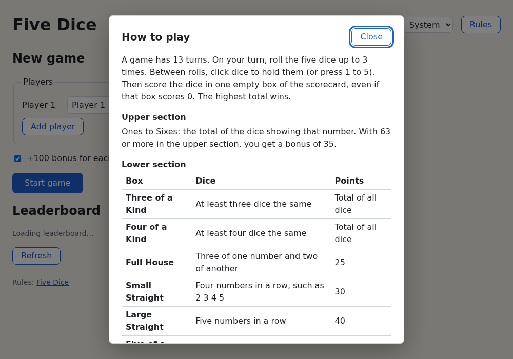
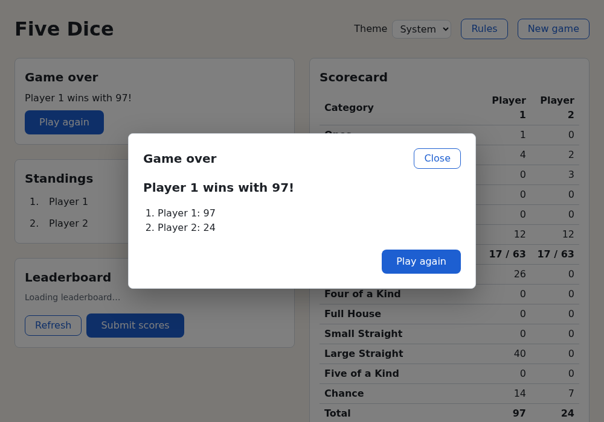

# Chapter 18 — Portals and Dialogs

A dialog sits on top of the page and takes over until you answer it. This chapter covers the two tools for
that: **portals**, which render part of a component elsewhere in the DOM, and the browser's **`<dialog>`**
element, which does most of a modal's hard work for you (drawing it on top, blocking the page behind,
moving focus, handling Escape). You also learn what makes a modal accessible. In the project you add a
Rules dialog, an "are you sure?" dialog before abandoning a game, and a game-over dialog.
[Chapter 17](17-async-react.md) added the leaderboard; [Chapter 19](19-building-and-shipping.md) builds the
app for release.

## Portals: render somewhere else in the DOM

A component's HTML normally ends up inside its parent's. That's not what you want for things that must sit
on top of everything (dialogs, toasts, tooltips, menus), because a parent's CSS can trap them:

- `overflow: hidden` on an ancestor cuts off anything sticking out.
- `z-index` only orders elements within the same **stacking context**. An ancestor with `position` and a
  `z-index`, a `transform`, or `opacity` below 1 starts a new one, and nothing inside can rise above its
  siblings, whatever its own `z-index`.

A **portal** fixes this. `createPortal(jsx, domNode)`, from `react-dom`, renders `jsx` as a child of
`domNode` instead of in place, usually `document.body`.

The DOM moves; the **React tree doesn't**. A portalled component is still the child of the component that
rendered it:

- it reads context from its React parents,
- its events bubble to its React parents' handlers, though its DOM parent is `<body>`,
- it mounts and unmounts with its React parent.

This demo puts a toast inside a small card with `overflow: hidden`; a checkbox switches the portal on and
off:

`examples/ch18/portal.demo.tsx`

```tsx
import { createContext, useContext, useState } from 'react'
import { createPortal } from 'react-dom'

const UserContext = createContext('nobody')

const card = { position: 'relative', height: '3rem', overflow: 'hidden', border: '2px dashed gray' } as const
const toastStyle = { position: 'absolute', top: '0.5rem', right: '0.5rem', padding: '1rem', background: 'gold' } as const

function Toast({ inPortal }: { inPortal: boolean }) {
  const user = useContext(UserContext) // context still arrives through a portal
  const toast = (
    <div role="status" style={toastStyle}>
      <p>Saved, {user}!</p>
      <button type="button">OK</button>
    </div>
  )
  // createPortal(jsx, domNode): render the JSX into domNode instead of here.
  return inPortal ? createPortal(toast, document.body) : toast
}

export default function PortalDemo() {
  const [inPortal, setInPortal] = useState(true)
  const [clicks, setClicks] = useState(0)

  return (
    <UserContext value="Ada">
      {/* Clicks anywhere inside <main> in the React tree bubble up to here. */}
      <main onClick={() => setClicks(clicks + 1)}>
        <label>
          <input type="checkbox" checked={inPortal} onChange={(e) => setInPortal(e.target.checked)} /> Render the
          toast with createPortal
        </label>
        <p>Clicks seen by &lt;main&gt;: {clicks}</p>
        <div style={card}>
          A card with overflow: hidden
          <Toast inPortal={inPortal} />
        </div>
      </main>
    </UserContext>
  )
}
```

Run `npm run dev` in `examples/` and open `http://localhost:5173/?demo=ch18/portal`. With the portal, the
toast shows in full at the top right of the page and reads "Saved, Ada!": the context value arrived. Click
**OK** and the counter goes up: the click bubbled to `<main>` in the React tree. Untick the box and the
toast moves into the card, where `overflow: hidden` cuts it off, hiding **OK**.

The test checks both the DOM side and the React side:

`examples/ch18/portal.test.tsx`

```tsx
import { render, screen } from '@testing-library/react'
import userEvent from '@testing-library/user-event'
import { expect, it } from 'vitest'
import PortalDemo from './portal.demo'

it('puts the DOM elsewhere, but keeps the React tree', async () => {
  const user = userEvent.setup()
  const { container } = render(<PortalDemo />)
  const toast = screen.getByRole('status')

  // In the DOM, the toast is a child of <body>, outside the app's container.
  expect(toast.parentElement).toBe(document.body)
  expect(container).not.toContainElement(toast)

  // In the React tree it is still inside <main> and the context provider.
  expect(toast).toHaveTextContent('Saved, Ada!')
  await user.click(screen.getByRole('button', { name: 'OK' }))
  expect(screen.getByText('Clicks seen by <main>: 1')).toBeInTheDocument()
})

it('renders in place without the portal', async () => {
  const user = userEvent.setup()
  const { container } = render(<PortalDemo />)
  await user.click(screen.getByRole('checkbox'))

  expect(container).toContainElement(screen.getByRole('status'))
})
```

```console
$ npx vitest run ch18/portal.test.tsx --reporter=verbose

 RUN  v5.0.5 /home/you/learn-react/examples

 ✓ ch18/portal.test.tsx > puts the DOM elsewhere, but keeps the React tree 113ms
 ✓ ch18/portal.test.tsx > renders in place without the portal 23ms

 Test Files  1 passed (1)
      Tests  2 passed (2)
   Start at  16:36:13
   Duration  665ms (environment 60%, tests 23%, setup 10%, import 4%, transform 3%, worker 1%)
```

Two things follow the DOM, not the React tree. CSS: the portalled element inherits `<body>`'s styles, not
its React parent's. And plain `addEventListener` listeners ([Chapter 2](02-from-vanilla-dom-to-react.md)): a
listener on the card wouldn't hear the toast's clicks, while one on `window` or `document` hears everything.

## The `<dialog>` element

A modal dialog needs a lot of behavior: draw above everything, dim and block the page, move focus in, keep
Tab inside, close on Escape, and put focus back afterwards. Many libraries built that from `<div>`s. Today
the browser's `<dialog>` does it.

A `<dialog>` is hidden until you open it from JavaScript:

- `dialog.showModal()` opens it as a **modal**. The page behind becomes **inert**: it can't be clicked,
  focused or found by screen readers.
- `dialog.show()` opens it **non-modal**: it appears, and the page still works.
- `dialog.close(value?)` closes it and fires a `close` event.

A plain page, no React, to try the native behavior:

`examples/ch18/dialog/index.html`

```html
<!doctype html>
<html lang="en">
  <head>
    <meta charset="UTF-8" />
    <meta name="viewport" content="width=device-width, initial-scale=1.0" />
    <title>The dialog element</title>
    <style>
      body {
        margin: 2rem;
        font-family: system-ui, sans-serif;
      }
      dialog {
        border: none;
        border-radius: 0.5rem;
        padding: 1.5rem;
      }
      /* The layer between a modal dialog and the page. */
      dialog::backdrop {
        background: rgb(0 0 0 / 0.5);
      }
    </style>
  </head>
  <body>
    <h1>The &lt;dialog&gt; element</h1>
    <button type="button" id="open-modal">showModal()</button>
    <button type="button" id="open">show()</button>
    <p><a href="#">A link on the page</a></p>

    <dialog id="confirm" aria-labelledby="confirm-title">
      <h2 id="confirm-title">Delete the saved game?</h2>
      <!-- method="dialog": submitting closes the dialog instead of sending a request. -->
      <form method="dialog">
        <button value="cancel">Cancel</button>
        <button value="delete">Delete</button>
      </form>
    </dialog>

    <pre id="log"></pre>

    <script type="module" src="./main.ts"></script>
  </body>
</html>
```

`examples/ch18/dialog/main.ts`

```ts
const dialog = document.querySelector<HTMLDialogElement>('#confirm')!
const logElement = document.querySelector('#log')!

function log(text: string) {
  logElement.textContent += text + '\n'
}

document.querySelector('#open-modal')!.addEventListener('click', () => {
  dialog.showModal()
  log(`showModal(): open = ${dialog.open}, focus on "${document.activeElement?.textContent}"`)
})
document.querySelector('#open')!.addEventListener('click', () => {
  dialog.show()
  log(`show(): open = ${dialog.open}, focus on "${document.activeElement?.textContent}"`)
})

// Escape fires "cancel" first. Call event.preventDefault() here to keep the dialog open.
dialog.addEventListener('cancel', () => log('cancel event'))
// Every way of closing fires "close".
dialog.addEventListener('close', () => log(`close event: returnValue = "${dialog.returnValue}"`))
```

A `<form method="dialog">` inside a dialog sends nothing to a server. Submitting it closes the dialog and
sets `dialog.returnValue` to the clicked button's `value`. (Reminder: a `<button>` in a form submits it
unless it has `type="button"`.)

Run `npm run dev` in `examples/`, open `http://localhost:5173/ch18/dialog/` and click **showModal()**:

- The dialog appears mid-window and the page darkens: the `::backdrop` pseudo-element, styled in the
  `<style>` block.
- The page is inert. Clicking the link does nothing; `document.elementFromPoint()` over the link returns
  the `<dialog>` (its backdrop covers the page).
- Focus moved to the first focusable element, **Cancel**. Tab goes to **Delete**, out to the browser's
  toolbar, then back to **Cancel**, never reaching the page.
- Escape fires `cancel`, then `close`, and focus returns to **showModal()**.

Then open it and click **Delete**, open it and press Escape, and finally click **show()**. The log:

```text
showModal(): open = true, focus on "Cancel"
cancel event
close event: returnValue = ""
showModal(): open = true, focus on "Cancel"
close event: returnValue = "delete"
showModal(): open = true, focus on "Cancel"
cancel event
close event: returnValue = ""
show(): open = true, focus on "Cancel"
```

The non-modal `show()` dialog has no backdrop, the link behind still works, and Escape doesn't close it.

`event.preventDefault()` on `cancel` keeps the dialog open, for example when a form has unsaved changes. Use
it sparingly: Escape is how keyboard users expect to get out.

Two attributes worth knowing:

- **`open`** shows the dialog, always **non-modal**: no backdrop, no inert page, no Escape. Don't render
  `<dialog open>` from React and expect a modal; call `showModal()`.
- **`closedby`** chooses how the user may close it: `"any"` adds *light dismiss* (a click outside, on the
  backdrop, closes it), `"closerequest"` (the default for `showModal()`) allows Escape and your buttons, and
  `"none"` only your buttons. Exercise 1 tries it. Chrome and Edge 134+ and Firefox 141+ support it;
  Safari, as of this writing, only in its Technology Preview. A browser without it ignores the attribute and
  uses the default, so Escape and your buttons still work: treat light dismiss as an extra.

### The top layer

`showModal()` also puts the dialog in the **top layer**, above the whole page, where its ancestors'
`overflow`, `z-index` and stacking contexts don't apply. In this demo the dialog sits in a box with
`overflow: hidden`:

`examples/ch18/top-layer.demo.tsx`

```tsx
import { useRef } from 'react'

const box = { position: 'relative', height: '4rem', overflow: 'hidden', border: '2px dashed gray' } as const

export default function TopLayerDemo() {
  const dialogRef = useRef<HTMLDialogElement>(null)

  return (
    <main>
      <button type="button" onClick={() => dialogRef.current?.show()}>
        show()
      </button>{' '}
      <button type="button" onClick={() => dialogRef.current?.showModal()}>
        showModal()
      </button>
      <p>The dialog is inside this box, which has overflow: hidden:</p>
      <div style={box}>
        <dialog ref={dialogRef} aria-label="Hello">
          <p>Hello from the dialog!</p>
          <p>Is this line cut off?</p>
          <button type="button" onClick={() => dialogRef.current?.close()}>
            Close
          </button>
        </dialog>
      </div>
    </main>
  )
}
```

Open `?demo=ch18/top-layer`. **show()** opens the dialog inside the box, which cuts it off: both lines of
text are hidden and only **Close** shows. Click it, then **showModal()**: the whole dialog shows, centered,
over a backdrop.

So a modal `<dialog>` needs no portal to escape clipping. The project uses one anyway, so the dialog's DOM
doesn't depend on where `<Dialog>` is used: it doesn't inherit text styles from a panel or become an
unexpected child for CSS such as `.list > *`.

The **popover** API is the top layer for non-modal things: give any element a `popover` attribute and call
`showPopover()`, or point a button at it with `popovertarget`. A popover closes on an outside click or
Escape and doesn't make the page inert. It suits menus and toasts; Exercise 3 uses it.

## Modals done accessibly

The [WAI-ARIA dialog pattern](https://www.w3.org/WAI/ARIA/apg/patterns/dialog-modal/) lists what a modal
must do for keyboard and screen-reader users. `<dialog>` with `showModal()` covers most of it:

| Requirement | Who does it |
|---|---|
| Role "dialog", and the page behind hidden from screen readers | `<dialog>` + `showModal()` |
| Focus moves into the dialog when it opens | `showModal()` |
| Tab and Shift+Tab stay inside the dialog | `showModal()` (the page is inert) |
| Escape closes it | `showModal()` |
| Focus goes back to where it was when the dialog closes | `close()` |
| An accessible name, read out when the dialog opens | you: `aria-labelledby` pointing at the title |
| A visible way to close it, for mouse and touch users | you: a Close or Cancel button |
| The page behind doesn't scroll | you: a line of CSS (below) |

Use modals sparingly; they interrupt. A message that needs no answer is better as a status message on the
page (live regions: [Chapter 15](15-accessibility.md)).

**Initial focus.** `showModal()` focuses the element with the `autofocus` attribute, or else the first
focusable element. React's `autoFocus` prop doesn't help: React doesn't render the attribute but calls
`focus()` itself at mount, *before* your Effect calls `showModal()`, which then picks its own target. To
start elsewhere, call `.focus()` on that element after `showModal()`. For a destructive question, a harmless
first button (**Close** or **Cancel**) is a good default.

## Dialogs in React

React has no dialog component. Combine `<dialog>` with a ref and an Effect ([Chapter 11](11-effects.md),
[Chapter 12](12-refs-and-the-dom.md)):

- The parent shows a dialog by **rendering** it and hides it by **not rendering** it, like any conditional
  JSX: `{isOpen && <Dialog …/>}`.
- When the `<dialog>` mounts, an Effect calls `showModal()`: synchronizing with the browser, which is what
  Effects are for.
- The dialog can close itself (Escape, a `method="dialog"` form, `close()`). Its `onClose` prop tells the
  parent, which stops rendering it, so the parent's state stays the single source of truth.

Two details make that robust:

- StrictMode runs Effects twice in development, and `showModal()` on an open dialog throws an
  `InvalidStateError`, so check `dialog.open` first.
- No cleanup is needed: when React removes an open dialog, it's closed and the page is no longer inert.

Another common pattern keeps the `<dialog>` mounted and drives it from an `open` prop: an Effect calls
`showModal()` when `open` turns `true` and `close()` when it turns `false`. Component libraries often do this,
because an element that stays in the page can animate closed with CSS. This course mounts and unmounts
instead: less code, and the dialog's state starts fresh every time.

### Testing dialogs

jsdom, the fake browser behind the tests, has `HTMLDialogElement` but no `showModal()` or `close()`, so a
test that opens a dialog fails with a `TypeError`. Stub the two methods in the test setup file, as Step 6
does. A stub can't make the page inert or trap focus; check those in a real browser.

## Building Five Dice: dialogs

You add three dialogs on top of one reusable `Dialog` component:

- **Rules**: a header button opens "How to play", with the rules from
  [Appendix C](appendix-c-five-dice-rules.md).
- **Start a new game?**: **New game** mid-game asks first.
- **Game over**: the result and final standings pop up when the game ends.



### Step 1: a `Dialog` component

`Dialog` portals a `<dialog>` into `document.body` and opens it with `showModal()` on mount. A header holds
the title, which names the dialog through `aria-labelledby`, and a **Close** button. The body and an
optional footer of buttons come from props.

`src/components/Dialog.tsx`

```tsx
import { useEffect, useId, useRef, type ReactNode } from 'react'
import { createPortal } from 'react-dom'
import buttons from '../styles/buttons.module.css'
import styles from './Dialog.module.css'

interface DialogProps {
  title: string
  /** Called after the dialog closed itself: the Close button, or Escape. */
  onClose: () => void
  children: ReactNode
  /** Buttons at the bottom. */
  footer?: ReactNode
}

/**
 * A modal dialog, built on the browser's own <dialog> element. Render it to
 * open it; the parent removes it again in `onClose`.
 */
export function Dialog({ title, onClose, children, footer }: DialogProps) {
  const dialogRef = useRef<HTMLDialogElement>(null)
  const titleId = useId()

  useEffect(() => {
    const dialog = dialogRef.current
    // showModal() puts the dialog on top of everything (the "top layer"),
    // makes the rest of the page inert, moves focus into the dialog and lets
    // Escape close it. The `open` check matters in StrictMode, which runs
    // this Effect twice in development.
    if (dialog && !dialog.open) dialog.showModal()
    // No cleanup needed: a dialog that is removed from the page is closed.
  }, [])

  // A portal renders the dialog as a child of <body>, outside the app's own
  // DOM tree, wherever <Dialog> is used. In React's tree it stays where it is:
  // it still reads context, and its events still bubble to its React parents.
  return createPortal(
    <dialog ref={dialogRef} className={styles.dialog} aria-labelledby={titleId} onClose={onClose}>
      <header className={styles.header}>
        <h2 id={titleId}>{title}</h2>
        {/* close() closes the dialog the browser's way: it fires the "close"
            event (handled above, as for Escape) and moves focus back to
            where it was before the dialog opened. */}
        <button type="button" className={buttons.secondary} onClick={() => dialogRef.current?.close()}>
          Close
        </button>
      </header>
      <div className={styles.body}>{children}</div>
      {footer && <footer className={styles.footer}>{footer}</footer>}
    </dialog>,
    document.body,
  )
}
```

`useId()` ([Chapter 9](09-forms.md)) makes a page-unique id, so two dialogs can't clash.

**Close** calls the native `close()`, which fires `close`, so every way of closing goes through `onClose`.
Calling `onClose` directly would also remove the dialog, but without `close()` the browser doesn't return
focus.

`src/components/Dialog.module.css`

```css
.dialog {
  width: min(36rem, 100% - 2 * var(--space-3));
  max-height: min(40rem, 100% - 2 * var(--space-3));
  padding: var(--space-4);
  color: var(--color-text);
  background: var(--color-surface);
  border: 1px solid var(--color-border);
  border-radius: var(--radius);
  box-shadow: 0 1rem 3rem rgb(0 0 0 / 0.3);
}

/* The layer between the dialog and the (inert) page. */
.dialog::backdrop {
  background: rgb(0 0 0 / 0.5);
}

.header {
  display: flex;
  align-items: center;
  justify-content: space-between;
  gap: var(--space-3);
  margin-bottom: var(--space-3);
}

.header h2 {
  font-size: 1.25rem;
}

.body {
  display: grid;
  gap: var(--space-3);
}

.footer {
  display: flex;
  justify-content: flex-end;
  gap: var(--space-2);
  margin-top: var(--space-4);
}
```

`::backdrop` styles the layer between dialog and page. The `width` caps the dialog at 36rem, and narrower
than the window on a phone.

While a modal is open, the page behind shouldn't scroll. Add this to `src/index.css`, after the focus styles
and before the reduced-motion section:

```css
/* While a modal dialog is open, the page behind it does not scroll. */
:root:has(dialog[open]) {
  overflow: hidden;
}
```

`:has()` selects an element by what it contains: here, the root `<html>` element while the page contains an
open dialog.

### Step 2: `ConfirmDialog` and `RulesDialog`

`ConfirmDialog` is a `Dialog` with two footer buttons. **Cancel** closes the dialog natively. Having no ref
to the `<dialog>`, it finds it with `closest('dialog')`, which walks up the DOM from the clicked button. The
close then reaches the parent through `onClose`, like Escape and **Close**.

`src/components/ConfirmDialog.tsx`

```tsx
import type { ReactNode } from 'react'
import buttons from '../styles/buttons.module.css'
import { Dialog } from './Dialog'

interface ConfirmDialogProps {
  title: string
  children: ReactNode
  confirmLabel: string
  onConfirm: () => void
  /** Called when the player backs out: Cancel, Close or Escape. */
  onCancel: () => void
}

/** "Are you sure?" A dialog with a Cancel and a confirm button. */
export function ConfirmDialog({ title, children, confirmLabel, onConfirm, onCancel }: ConfirmDialogProps) {
  return (
    <Dialog
      title={title}
      onClose={onCancel}
      footer={
        <>
          {/* Close the surrounding <dialog>, just like its Close button. */}
          <button
            type="button"
            className={buttons.secondary}
            onClick={(event) => event.currentTarget.closest('dialog')?.close()}
          >
            Cancel
          </button>
          <button type="button" className={buttons.primary} onClick={onConfirm}>
            {confirmLabel}
          </button>
        </>
      }
    >
      {children}
    </Dialog>
  )
}
```

`RulesDialog` takes every number from the constants in `src/game/rules.ts`, so the rules on screen can't
drift from the code:

`src/components/RulesDialog.tsx`

```tsx
import {
  CATEGORIES,
  FIVE_OF_A_KIND_BONUS,
  FIVE_OF_A_KIND_POINTS,
  FULL_HOUSE_POINTS,
  LARGE_STRAIGHT_POINTS,
  MAX_ROLLS,
  SMALL_STRAIGHT_POINTS,
  UPPER_BONUS,
  UPPER_BONUS_THRESHOLD,
} from '../game/rules'
import tables from '../styles/tables.module.css'
import { Dialog } from './Dialog'
import styles from './RulesDialog.module.css'

const LOWER_SECTION = [
  ['Three of a Kind', 'At least three dice the same', 'Total of all dice'],
  ['Four of a Kind', 'At least four dice the same', 'Total of all dice'],
  ['Full House', 'Three of one number and two of another', `${FULL_HOUSE_POINTS}`],
  ['Small Straight', 'Four numbers in a row, such as 2 3 4 5', `${SMALL_STRAIGHT_POINTS}`],
  ['Large Straight', 'Five numbers in a row', `${LARGE_STRAIGHT_POINTS}`],
  ['Five of a Kind', 'All five dice the same', `${FIVE_OF_A_KIND_POINTS}`],
  ['Chance', 'Anything', 'Total of all dice'],
] as const

interface RulesDialogProps {
  onClose: () => void
}

/** How to play, as this app implements the game. */
export function RulesDialog({ onClose }: RulesDialogProps) {
  return (
    <Dialog title="How to play" onClose={onClose}>
      <p>
        A game has {CATEGORIES.length} turns. On your turn, roll the five dice up to {MAX_ROLLS} times. Between
        rolls, click dice to hold them (or press 1 to 5). Then score the dice in one empty box of the scorecard,
        even if that box scores 0. The highest total wins.
      </p>
      <section className={styles.section}>
        <h3>Upper section</h3>
        <p>
          Ones to Sixes: the total of the dice showing that number. With {UPPER_BONUS_THRESHOLD} or more in the
          upper section, you get a bonus of {UPPER_BONUS}.
        </p>
      </section>
      <section className={styles.section}>
        <h3>Lower section</h3>
        <table className={tables.table}>
          <thead>
            <tr>
              <th scope="col">Box</th>
              <th scope="col">Dice</th>
              <th scope="col">Points</th>
            </tr>
          </thead>
          <tbody>
            {LOWER_SECTION.map(([box, dice, points]) => (
              <tr key={box}>
                <th scope="row">{box}</th>
                <td>{dice}</td>
                <td>{points}</td>
              </tr>
            ))}
          </tbody>
        </table>
      </section>
      <p>
        Five of the same number is not a Full House. If you have already scored {FIVE_OF_A_KIND_POINTS} for Five of
        a Kind, every extra Five of a Kind earns a bonus of {FIVE_OF_A_KIND_BONUS} (you can turn this off when you
        start a game).
      </p>
      <p className="hint">
        Based on the <a href="https://beesboardsma.com/pages/five-dice">Five Dice rules</a>.
      </p>
    </Dialog>
  )
}
```

`src/components/RulesDialog.module.css`

```css
.section {
  display: grid;
  gap: var(--space-1);
}

.section h3 {
  margin: 0;
  font-size: 1rem;
}
```

### Step 3: open them from `App`

`App` keeps one piece of state for which dialog, if any, is open; at most one is. In `src/App.tsx`, add the
two imports:

```tsx
import { ConfirmDialog } from './components/ConfirmDialog'
```

```tsx
import { RulesDialog } from './components/RulesDialog'
```

Inside `App`, below the `session` state, add the dialog state:

```tsx
  // Which dialog is open, if any.
  const [dialog, setDialog] = useState<'rules' | 'confirmNewGame' | null>(null)
```

`handleNewGame` closes the dialog too, in the same screen change:

```tsx
  function handleNewGame() {
    // The player chose to abandon this game: logic for one specific event
    // belongs in its event handler, not in an Effect.
    clearSavedGame()
    changeScreen(() => {
      setSession(null)
      setDialog(null)
    })
  }
```

The header gets a **Rules** button, and **New game** opens the confirm dialog instead of calling
`handleNewGame`:

```tsx
      <header className={styles.header}>
        <h1>Five Dice</h1>
        <ThemeSelect />
        <button type="button" className={buttons.secondary} onClick={() => setDialog('rules')}>
          Rules
        </button>
        {session && (
          <button type="button" className={buttons.secondary} onClick={() => setDialog('confirmNewGame')}>
            New game
          </button>
        )}
      </header>
```

Between the `{session ? … : …}` block and the `<footer>`, render the open dialog:

```tsx
      {dialog === 'rules' && <RulesDialog onClose={() => setDialog(null)} />}
      {dialog === 'confirmNewGame' && (
        <ConfirmDialog
          title="Start a new game?"
          confirmLabel="Start new game"
          onConfirm={handleNewGame}
          onCancel={() => setDialog(null)}
        >
          <p>This game will be lost.</p>
        </ConfirmDialog>
      )}
```

Confirming calls `handleNewGame`, which removes the dialog by setting `dialog` back to `null`, not with
`close()`, so the browser doesn't return focus to **New game**. It couldn't anyway: that button disappears
with the game. `changeScreen` ([Chapter 15](15-accessibility.md#focus-when-the-screen-changes)) moves focus to the setup screen's
"New game" heading instead.

The dialogs are rendered at the end of `App`, but in the DOM they land at the end of `<body>`.

### Step 4: the game-over dialog

`GameOver` keeps its result paragraph and **Play again** button on the board, and also shows them in a
dialog, once, when the game ends. Closing the dialog sets `showDialog` to `false`.

`src/components/GameOver.tsx`

```tsx
import { useState } from 'react'
import { rankPlayers } from '../game/scoring'
import { useGameState } from '../hooks/useGame'
import buttons from '../styles/buttons.module.css'
import { Dialog } from './Dialog'
import styles from './GameOver.module.css'

interface GameOverProps {
  onPlayAgain: () => void
}

/** A ref callback defined outside the component, so it is the same function on every render. */
function focusOnMount(node: HTMLElement | null) {
  node?.focus()
}

/** "Ada wins", "Ada and Bo tie" or, for one player, the final score. */
function resultText(winners: string[], total: number, playerCount: number): string {
  if (playerCount === 1) return `Final score: ${total}`
  if (winners.length === 1) return `${winners[0]} wins with ${total}!`
  return `It's a tie: ${new Intl.ListFormat('en').format(winners)} with ${total}!`
}

export function GameOver({ onPlayAgain }: GameOverProps) {
  const state = useGameState()
  // The result also pops up in a dialog, once, when the game ends.
  const [showDialog, setShowDialog] = useState(true)

  const standings = rankPlayers(state.players)
  const winners = standings.filter((standing) => standing.rank === 1).map((standing) => standing.name)

  const result = resultText(winners, standings[0].total, standings.length)
  const playAgain = (
    <button type="button" className={buttons.primary} onClick={onPlayAgain}>
      Play again
    </button>
  )

  return (
    <div className={styles.gameOver}>
      {/* tabIndex={-1}: focusable from code, but not a Tab stop. Focus waits
          here while the dialog is open: closing it moves focus back here. */}
      <p ref={focusOnMount} tabIndex={-1}>
        {result}
      </p>
      {playAgain}

      {showDialog && (
        <Dialog title="Game over" onClose={() => setShowDialog(false)} footer={playAgain}>
          <p className={styles.result}>{result}</p>
          <ol className={styles.standings}>
            {standings.map((standing) => (
              <li key={standing.name}>
                {standing.name}: {standing.total}
              </li>
            ))}
          </ol>
        </Dialog>
      )}
    </div>
  )
}
```

`playAgain` is a JSX element stored in a variable and rendered twice, on the board and in the dialog footer.
That's fine: an element is only a description, and React creates a separate button for each place.

Focus works out by itself. `focusOnMount` focuses the result paragraph when it mounts, during the commit.
The `Dialog`'s Effect runs after that, so `showModal()` remembers the paragraph as the place to return to.
Close the dialog and focus lands on the result, which screen readers read.

Add the two new classes to `src/components/GameOver.module.css`:

```css
.result {
  font-size: 1.25rem;
  font-weight: 600;
}

.standings {
  margin: 0;
  padding-left: var(--space-4);
}
```



### Step 5: no shortcuts inside a dialog

The keyboard shortcuts from [Chapter 13](13-custom-hooks.md) listen on `window`. An inert page stops clicks
and focus, but key presses inside the dialog still reach `window`: pressing 1 while reading the rules holds
the first die behind the dialog. In `src/hooks/useKeyboardShortcuts.ts`, ignore keys pressed inside a
dialog, and update the comment:

```ts
/**
 * Run `shortcuts[key]` when that key is pressed anywhere on the page,
 * except while typing in a form field or using a dialog.
 */
export function useKeyboardShortcuts(shortcuts: Shortcuts): void {
  // Always sees the latest `shortcuts` without re-subscribing.
  const onKeyDown = useEffectEvent((event: KeyboardEvent) => {
    if (event.repeat || event.ctrlKey || event.metaKey || event.altKey) return
    const target = event.target
    if (target instanceof Element && target.closest('input, select, textarea, dialog')) return
```

### Step 6: tests

Stub the dialog methods in `src/test/setup.ts`. The stubs do what the tests rely on: set `open`, return
focus on `close()`, and fire `close`. Replace the comment above `Element.prototype.animate` and add the
stubs:

```ts
// jsdom implements much of the DOM, but not everything. Stub what the app uses:
// the Web Animations API, matchMedia (media queries from JavaScript) and
// <dialog>'s showModal() and close(), which also returns focus to where it was.
const focusBeforeDialog = new WeakMap<HTMLDialogElement, Element | null>()
HTMLDialogElement.prototype.showModal = function () {
  this.open = true
  focusBeforeDialog.set(this, document.activeElement)
}
HTMLDialogElement.prototype.close = function () {
  this.open = false
  const previous = focusBeforeDialog.get(this)
  if (previous instanceof HTMLElement) previous.focus()
  this.dispatchEvent(new Event('close'))
}
```

In `src/App.test.tsx`, the game-over result is now in a dialog. In the full-game test, replace the four lines
from the `Game over` heading check through the `Roll` check with:

```tsx
    // The result pops up in a dialog.
    const dialog = screen.getByRole('dialog', { name: 'Game over' })
    expect(within(dialog).getByText('Final score: 270')).toBeInTheDocument()
    expect(screen.queryByRole('button', { name: 'Roll' })).not.toBeInTheDocument()
    await user.click(within(dialog).getByRole('button', { name: 'Close' }))
    expect(dialog).not.toBeInTheDocument()
    // Focus waits on the result on the board (the browser returns it there
    // when the dialog closes), so screen readers announce it.
    expect(screen.getByText('Final score: 270')).toHaveFocus()
```

The tie test looks inside the dialog too:

```tsx
  it('announces a tie when players finish level', async () => {
    const user = await startGame(fakeDice(6), 2)
    await playToTheEnd(user, 2)
    const dialog = screen.getByRole('dialog', { name: 'Game over' })
    expect(within(dialog).getByText("It's a tie: Player 1 and Player 2 with 270!")).toBeInTheDocument()
  })
```

Replace the test "goes back to the form for a new game" with one for the confirm flow, and add a test for the
Rules dialog:

```tsx
  it('asks before leaving a game for a new one', async () => {
    const user = await startGame(fakeDice(6), 2)
    await user.click(screen.getByRole('button', { name: 'Roll' }))

    await user.click(screen.getByRole('button', { name: 'New game' }))
    await user.click(within(screen.getByRole('dialog', { name: 'Start a new game?' })).getByRole('button', { name: 'Cancel' }))
    expect(screen.queryByRole('dialog')).not.toBeInTheDocument()
    expect(screen.getByText(/Rolls left: 2/)).toBeInTheDocument()

    await user.click(screen.getByRole('button', { name: 'New game' }))
    await clickAndLoad(screen.getByRole('button', { name: 'Start new game' }))
    expect(screen.getByRole('heading', { name: 'New game' })).toBeInTheDocument()
    expect(screen.getByText(/No scores yet/)).toBeInTheDocument()
  })

  it('explains the rules in a dialog', async () => {
    const user = await startGame(fakeDice(1, 2, 3, 4, 5, 6))
    await user.click(screen.getByRole('button', { name: 'Roll' }))
    await user.click(screen.getByRole('button', { name: 'Rules' }))

    const dialog = screen.getByRole('dialog', { name: 'How to play' })
    expect(within(dialog).getByRole('row', { name: /^Full House .* 25$/ })).toBeInTheDocument()

    // Keyboard shortcuts are off while you use the dialog.
    within(dialog).getByRole('button', { name: 'Close' }).focus()
    await user.keyboard('1')
    expect(screen.getByRole('button', { name: 'Die showing 1' })).toHaveAttribute('aria-pressed', 'false')

    await user.click(within(dialog).getByRole('button', { name: 'Close' }))
    expect(dialog).not.toBeInTheDocument()
  })
```

`within(dialog)` limits queries to the dialog. Key events start at the focused element, so the Rules test
moves focus into the dialog before pressing **1**, as a user would.

The persistence test and "moves focus to the new screen's heading" also have to confirm. The focus test
needs `user` again (`const user = await startGame()`); in both, the **New game** click becomes:

```tsx
    await user.click(screen.getByRole('button', { name: 'New game' }))
    await clickAndLoad(screen.getByRole('button', { name: 'Start new game' }))
```

### Step 7: try it

Run `npm run dev`:

- Click **Rules**. The dialog opens over a dark backdrop with focus on **Close**; the page behind neither
  scrolls nor reacts to clicks. Tab stays in the dialog. Escape closes it, and focus is back on **Rules**.
- Start a game, roll, and click **New game**. "Start a new game?" asks first. **Cancel** or Escape keeps the
  game; **Start new game** goes to the setup screen, with focus on its "New game" heading.
- Finish a game. The game-over dialog shows the result and standings. Close it and focus is on the result on
  the board. **Play again** works from the dialog and the board.

In DevTools' Elements panel, the open `<dialog>` is the last child of `<body>`, after `<div id="root">`.

### Checkpoint

```console
$ npm test
…
 ✓ src/App.test.tsx (20 tests) 4460ms
…
 Test Files  13 passed (13)
      Tests  94 passed (94)

$ npm run build
…
dist/index.html                   0.45 kB │ gzip:  0.29 kB
dist/assets/index-d7ZFiwCG.css    7.26 kB │ gzip:  1.99 kB
dist/assets/index-CO-UhHLn.js   253.03 kB │ gzip: 80.25 kB

✓ built in 1.26s
```

(Timings and file hashes vary.) The browser shows the dialogs as in Step 7 and the screenshots above.

The complete project at this point is in `project/ch18/`.

## Summary

- `createPortal(jsx, domNode)` renders into another DOM node. The React tree stays the same: context, event
  bubbling and lifetime follow the rendering component. CSS and native listeners follow the DOM.
- Use portals for things that must escape their parent's `overflow` or stacking context: dialogs, toasts,
  tooltips.
- `<dialog>` + `showModal()` gives a real modal: top layer, `::backdrop`, inert page, focus moved in and
  back, Escape. `show()` and the `open` attribute give a non-modal dialog.
- `<form method="dialog">` closes the dialog and sets `returnValue`. `cancel` fires on Escape, `close` on
  every close. `closedby="any"` adds light dismiss.
- In React: render the dialog to open it, call `showModal()` in an Effect (check `open` first, for
  StrictMode), and report closing through `onClose` so the parent's state stays the truth.
- Accessible modals need a name (`aria-labelledby`), a visible close button, sensible initial focus and no
  background scrolling. Use them sparingly.
- jsdom lacks `showModal()` and `close()`: stub them in tests, and check focus and inertness in a browser.

## Exercises

1. **Light dismiss.** Let a click outside any Five Dice dialog, on the backdrop, close it. Clicks inside
   must not.

   <details><summary>Solution</summary>

   Add `closedby="any"` to the `<dialog>` in `Dialog.tsx`:

   ```tsx
   <dialog ref={dialogRef} className={styles.dialog} aria-labelledby={titleId} onClose={onClose} closedby="any">
   ```

   React's types already know the attribute. A light dismiss fires `close` like Escape, so `onClose` runs and
   the parent removes the dialog. Checked in Chromium: with the Rules dialog open, a click at the window's
   top left corner closed it and focus went back to **Rules**; a click inside kept it open. Without the
   attribute the backdrop click does nothing.

   Choose where you want this. For the Rules it's handy. For "Start a new game?" a stray outside click counts
   as Cancel, which is safe. Never use it for a dialog with a half-filled form.

   </details>

2. **Why ignore keys inside a dialog?** In `useKeyboardShortcuts.ts`, take `dialog` out of the `closest(…)`
   selector and run `npm test`. Which test fails, and what would a player notice?

   <details><summary>Solution</summary>

   "explains the rules in a dialog" fails:

   ```text
    FAIL  src/App.test.tsx > App > explains the rules in a dialog
   Error: expect(element).toHaveAttribute("aria-pressed", "false") // element.getAttribute("aria-pressed") === "false"

   Expected the element to have attribute:
     aria-pressed="false"
   Received:
     aria-pressed="true"
    ❯ src/App.test.tsx:211:67
   ```

   A real browser does the same: with the Rules dialog open after a roll, pressing **1** holds the first die
   behind the dialog. The inert page blocks clicks and focus, but the keydown still bubbles from the focused
   element inside the dialog up to `window`, where the hook listens. Put `dialog` back.

   </details>

3. **The top layer without a portal.** In `examples/ch18/portal.demo.tsx`, make the toast escape the card
   even when the checkbox is off, without `createPortal`. Use the `popover` attribute.

   <details><summary>Solution</summary>

   Make the toast a popover and open it on mount with a ref callback
   ([Chapter 12](12-refs-and-the-dom.md)) defined outside the component:

   ```tsx
   /** A ref callback: open the popover as soon as React attaches the element. */
   function showPopover(node: HTMLElement | null) {
     if (node && !node.matches(':popover-open')) node.showPopover()
   }
   ```

   ```tsx
   <div role="status" style={toastStyle} popover="manual" ref={showPopover}>
   ```

   `popover="manual"` means only your code closes it: no light dismiss, no Escape. Now, ticked or not, the
   toast is in the top layer and fully visible, and **OK** still bumps the counter (without a portal, DOM and
   React tree agree anyway). Its position changes, though: the browser's default popover styles
   (`position: fixed`, `inset: 0`, `margin: auto`) center it in the window; in Chromium it landed at
   x = 429, y = 299 in a 1000 × 700 window. Override `inset` and `margin` to place it elsewhere.

   </details>

Sources for this chapter: [REFERENCES.md](REFERENCES.md#chapter-18--portals-and-dialogs)
