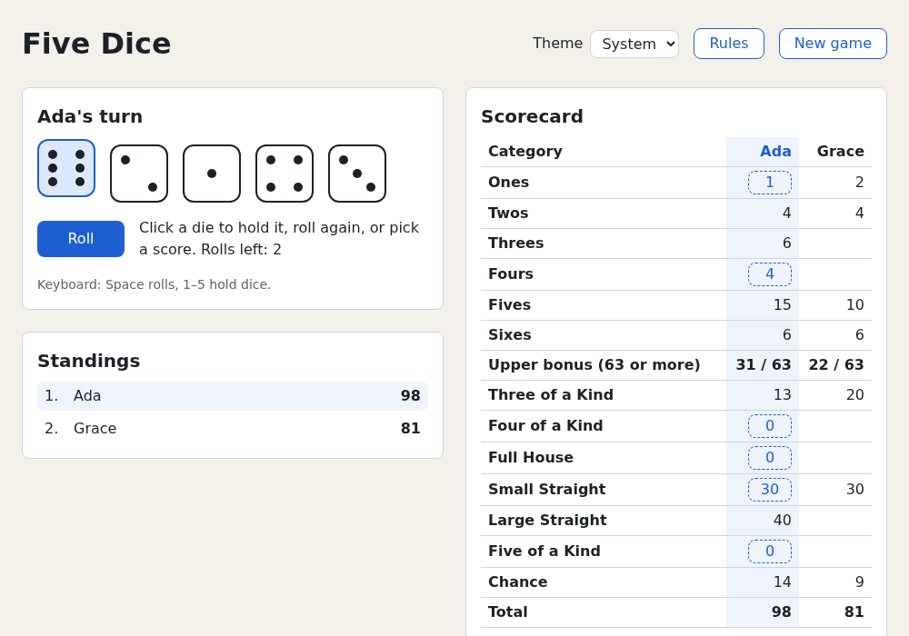

# Chapter 20 — Where Next

You know React now: components, state, effects, refs, Hooks, Suspense, testing and a production build. This
chapter maps it onto the wider React world (frameworks, routing, data libraries, component kits, React's
newest features): what each adds, when you need it, and what five-dice did instead. Then you'll finish the game
with a README, a page description and a version number. [Chapter 19](19-building-and-shipping.md) shipped
the build; this chapter ships the project.

## React's ideas, one more time

Every tool in this chapter builds on these ideas:

| Idea | In one line | Chapter |
|---|---|---|
| UI = f(state) | Describe the screen for the current data; React updates the DOM to match | [1](01-getting-started.md), [4](04-components-and-jsx.md) |
| Components are pure | Same props and state, same output; no side effects while rendering | [4](04-components-and-jsx.md) |
| State is a snapshot | Never mutate; set a new value and React renders again | [5](05-state-and-events.md) |
| Data flows down | Props go down; changes come back up as event handler calls | [6](06-thinking-in-react.md) |
| Events, not commands | A reducer turns an action into the next state | [7](07-reducers.md) |
| Effects sync with the outside | Use an Effect only to talk to something React doesn't control | [11](11-effects.md) |
| Escape hatches are explicit | Refs reach the DOM when you must | [12](12-refs-and-the-dom.md) |
| Logic composes | Custom Hooks share stateful logic, not state | [13](13-custom-hooks.md) |
| Let React schedule | The Compiler memoizes; Transitions and Suspense decide what to show while work is pending | [16](16-rendering-and-performance.md), [17](17-async-react.md) |

Map strange library docs back to this table: a data library is a fancier `use()` + Suspense; a state
library is a store outside React with a subscription, like `useSyncExternalStore`
([Chapter 13](13-custom-hooks.md)); a framework renders the same components, some on a server.

## What a framework adds

Five-dice is a single-page app ([Chapter 1](01-getting-started.md)). Run `npm run preview` in the project
and, in a second terminal, look at what the server sends:

```console
$ curl -s http://localhost:4173/ | grep -A2 '<body>'
  <body>
    <div id="root"></div>
  </body>
```

That empty `<div>` is the page until 80 kB of gzipped JavaScript arrives and renders: fine for a game, not
for a shop, blog or docs site. First paint waits for the bundle, crawlers and link previews without
JavaScript see nothing, and every screen shares one bundle unless you split it by hand.

A **framework** bundles choices about routing, data and rendering with the build tooling to match:

| Problem | What five-dice does | What a framework adds |
|---|---|---|
| Several screens with their own URLs | one screen; dialogs instead of pages | **routing**: a URL maps to a component; links, back button, nested layouts |
| Loading data for a screen | `use()` + Suspense in a component ([Chapter 17](17-async-react.md)) | per-route data loading, started before the route's code renders |
| First paint | empty `<div>` until JS runs | **server-side rendering (SSR)**: HTML on every request; or **static site generation (SSG)**: HTML at build time |
| Code splitting | by hand, with `lazy()` ([Chapter 19](19-building-and-shipping.md)) | one chunk per route, automatically |
| Server code | none; the leaderboard is fake | Server Components and Server Functions in the same project |

With SSR the server runs your components and sends real HTML, shown at once. When the JavaScript arrives,
React **hydrates**: renders the same tree again, matches it to the DOM and attaches event handlers. The two
renders must agree, so reading `localStorage` while rendering (the server has none) causes a hydration
mismatch. Five-dice's `App` does that for the saved game: fine in an SPA, a problem with SSR.

react.dev recommends starting new apps with a framework:

- **Next.js** (App Router): full-stack, built around Server Components.
- **React Router**: a router library turned framework, built on Vite. Modes: *declarative* (just
  `<Routes>` in an SPA like five-dice; [next section](#routing-screens-with-their-own-urls)), *data* (route
  loaders and actions), *framework* (all that plus SSR and type-safe routes). Start with the first and grow.
- **Expo**: native apps with React Native (below).
- Newer: **TanStack Start** and **RedwoodSDK**.

All can still output a static SPA, and plain Vite still suits apps like five-dice: everything runs in the
browser, no search engine needs the content, a static host is enough.

## Routing: screens with their own URLs

Five-dice swaps screens with state, so the address bar never changes: no bookmark, no back button, no link
to share. A **router** makes the URL the state. It reads the path, picks the component for it, and turns
link clicks into `history.pushState()` calls instead of page loads. React Router's declarative mode is the
smallest step: components, no server. The examples already have it installed:

`examples/ch20/router.demo.tsx`
```tsx
import { HashRouter, Link, NavLink, Outlet, Route, Routes, useParams } from 'react-router'

const players: Record<string, { name: string; best: number } | undefined> = {
  ada: { name: 'Ada', best: 270 },
  bo: { name: 'Bo', best: 245 },
  cy: { name: 'Cy', best: 280 },
}

/** Shared by every page: the nav, then the matched child route in <Outlet />. */
function Layout() {
  return (
    <>
      <nav>
        <NavLink to="/" end>
          Home
        </NavLink>{' '}
        | <NavLink to="/players">Players</NavLink>
      </nav>
      <main>
        <Outlet />
      </main>
    </>
  )
}

function Home() {
  return <h1>Five Dice</h1>
}

function PlayerList() {
  return (
    <>
      <h1>Players</h1>
      <ul>
        {Object.entries(players).map(([id, player]) => (
          <li key={id}>
            {/* Relative: from /players, "ada" means /players/ada. */}
            <Link to={id}>{player?.name}</Link>
          </li>
        ))}
      </ul>
    </>
  )
}

function PlayerPage() {
  // The :id part of the URL, e.g. "ada" for /players/ada.
  const { id = '' } = useParams()
  const player = players[id]
  if (!player) return <h1>No player called “{id}”</h1>
  return (
    <>
      <h1>{player.name}</h1>
      <p>Best score: {player.best}</p>
      <Link to="/players">All players</Link>
    </>
  )
}

/** Which component shows for which URL. */
export function DiceRoutes() {
  return (
    <Routes>
      <Route element={<Layout />}>
        <Route index element={<Home />} />
        <Route path="players" element={<PlayerList />} />
        <Route path="players/:id" element={<PlayerPage />} />
        <Route path="*" element={<h1>Page not found</h1>} />
      </Route>
    </Routes>
  )
}

// The examples page is already addressed by ?demo=…, so this demo keeps its
// route after the # (…?demo=ch20/router#/players/ada). A real app uses
// <BrowserRouter> and plain paths.
export default function RouterDemo() {
  return (
    <HashRouter>
      <DiceRoutes />
    </HashRouter>
  )
}
```

- **`<Routes>`** picks the first `<Route>` whose `path` matches; `*` matches anything left. A `<Route>`
  without a path (here `Layout`) wraps its children, which render where it puts **`<Outlet />`**.
- **`:id`** is a URL parameter; **`useParams()`** reads it. It's a string from the address bar, so the page
  handles names that don't exist.
- **`<Link to>`** renders a real `<a href>`: middle-click and "copy link" work. **`<NavLink>`** also marks
  the current section with `aria-current="page"` and an `active` class, for CSS.

Run `npm run dev` and open `http://localhost:5173/?demo=ch20/router`. Click **Players**, then **Ada**: the
address ends in `#/players/ada`, the back button returns to the list, and a reload keeps you on Ada's page.

The `#` is the demo's compromise, since `?demo=…` already addresses the page. A real app wraps the app in
`<BrowserRouter>` in `main.tsx` and gets plain paths like `/players/ada`; its host then needs the SPA
fallback from [Chapter 19](19-building-and-shipping.md#deploying-to-github-pages). Tests use
**`<MemoryRouter>`**, which keeps the URL in memory, so each test can start on any page:

<details><summary>Full listing: <code>examples/ch20/router.test.tsx</code></summary>

```tsx
import { render, screen } from '@testing-library/react'
import userEvent from '@testing-library/user-event'
import { MemoryRouter } from 'react-router'
import { expect, it } from 'vitest'
import { DiceRoutes } from './router.demo.tsx'

// MemoryRouter keeps the URL in memory, so a test can start anywhere.
function renderAt(url: string) {
  render(
    <MemoryRouter initialEntries={[url]}>
      <DiceRoutes />
    </MemoryRouter>,
  )
  return userEvent.setup()
}

it('shows the page for the URL and follows links', async () => {
  const user = renderAt('/players/ada')
  expect(screen.getByRole('heading', { name: 'Ada' })).toBeInTheDocument()
  // NavLink marks the link to the current section for screen readers.
  expect(screen.getByRole('link', { name: 'Players' })).toHaveAttribute('aria-current', 'page')

  await user.click(screen.getByRole('link', { name: 'All players' }))
  await user.click(screen.getByRole('link', { name: 'Bo' }))
  expect(screen.getByRole('heading', { name: 'Bo' })).toBeInTheDocument()
  expect(screen.getByText('Best score: 245')).toBeInTheDocument()
})

it('handles unknown players and pages', () => {
  renderAt('/players/zed')
  expect(screen.getByRole('heading', { name: 'No player called “zed”' })).toBeInTheDocument()
})

it('matches * when no other route does', () => {
  renderAt('/nowhere')
  expect(screen.getByRole('heading', { name: 'Page not found' })).toBeInTheDocument()
})
```

</details>

## Server Components and Server Functions

Both need a framework: the bundler must split one project into server and browser code. This course
doesn't use them; any Next.js codebase does.

**Server Components** run only on the server, at build time or per request. They can be `async` and read a
database or file directly. Their code and libraries never reach the browser, only their *output*, which
slots into the tree like any element. So they can't use state, effects or event handlers.

Everything you wrote here is a **Client Component**. With Server Components, components are server by
default; `'use client'` at the top of a file marks the boundary, sending that module and its imports to
the browser. A typical page is a Server Component that loads data and passes it as props to small Client
Components for clicks and state.

**Server Functions** go the other way: `'use server'` marks an `async` function that runs on the server,
which a Client Component calls like any function; the framework makes the call a network request.
[Chapter 9](09-forms.md)'s `<form action={saveScore}>` and `useActionState` work the same when `saveScore`
is one. Before September 2024 they were called "Server Actions".

The shape of the code, in a Next.js project (illustrative: not part of `examples/` or five-dice). A
Server Component reads the database and renders a Client Component, which calls a Server Function:

```tsx
// app/leaderboard/page.tsx: a Server Component (the default). It can be async.
import { db } from '../../lib/db'
import { SubmitScore } from './SubmitScore'

export default async function LeaderboardPage() {
  const scores = await db.scores.top(10) // runs on the server; no API needed
  return (
    <>
      <ol>
        {scores.map((score) => (
          <li key={score.id}>
            {score.name}: {score.points}
          </li>
        ))}
      </ol>
      <SubmitScore />
    </>
  )
}
```

```ts
// app/leaderboard/actions.ts
'use server'
import { db } from '../../lib/db'

export async function submitScore(formData: FormData) {
  // A public endpoint: check everything.
  const name = String(formData.get('name') ?? '').trim()
  if (!name) return
  await db.scores.add({ name, points: Number(formData.get('points')) })
}
```

```tsx
// app/leaderboard/SubmitScore.tsx: a Client Component, sent to the browser.
'use client'
import { submitScore } from './actions'

export function SubmitScore() {
  return (
    <form action={submitScore}>
      <input name="name" />
      <input name="points" type="number" />
      <button>Submit</button>
    </form>
  )
}
```

Why they exist:

| Without | With |
|---|---|
| The browser downloads a Markdown parser to show a blog post | The server renders the post; the parser stays on the server |
| An effect or `use()` fetches JSON from an API you wrote by hand | The component reads the data where it lives |
| A form posts to a REST endpoint, with types written twice | The form calls a typed function |

**Gotcha: a Server Function is a public endpoint.** Anyone can call it with any arguments, not just your
form: validate them and check the user is allowed, as for any HTTP handler.

React 19.3's `browser()` (in `react-dom`) is the clean fix for the `localStorage` problem above: a
component that calls `use(browser())` is skipped on the server and rendered only in the browser.

## State and data libraries

[Chapter 10](10-composition-and-context.md) used a reducer plus context for the game;
[Chapter 17](17-async-react.md) loaded the leaderboard with `use()` and Suspense. Libraries do these jobs at
scale:

| Library | Problem it solves | Five-dice's version |
|---|---|---|
| **TanStack Query** | *Server state*: data that lives on a server. Caches it, merges duplicate requests, refetches stale data in the background | the leaderboard service, its cached promise and `useOptimistic` |
| **Zustand** | A small global store outside React. Components subscribe to the slice they read, so only they re-render | `GameProvider`: reducer + context |
| **Redux Toolkit** | Standard Redux: one store, reducers, actions, and devtools showing every action and the resulting state. RTK Query adds data fetching | `gameReducer` is exactly a Redux-style reducer |

For comparison with the leaderboard's `use()` + Suspense + error boundary, the core of the same table with
TanStack Query (illustrative: not installed in `examples/`; the app also wraps everything in a
`<QueryClientProvider>`):

```tsx
import { useQuery } from '@tanstack/react-query'
import type { HighScore } from '../game/highScores'

function LeaderboardTable() {
  const { data, isPending, isError } = useQuery({
    queryKey: ['scores'], // the cache key: every component asking for ['scores'] shares one request
    queryFn: () => fetch('/api/scores').then((response) => response.json() as Promise<HighScore[]>),
    refetchInterval: 60_000, // keep it fresh in the background
  })
  if (isPending) return <p>Loading leaderboard…</p>
  if (isError) return <p role="alert">Couldn't load the leaderboard.</p>
  return (
    <ol>
      {data.map((entry) => (
        <li key={`${entry.name}-${entry.date}`}>
          {entry.name}: {entry.score}
        </li>
      ))}
    </ol>
  )
}
```

Two kinds of state behave differently:

- **Client state** belongs to the app (whose turn, which dice are held): `useState`, `useReducer` and
  context. Reach for Zustand or Redux Toolkit only when context re-renders too much or many unrelated parts
  of a large app share it.
- **Server state** is a possibly stale copy of server data, needing caching, refetching and invalidation.
  It's most of what apps call "state"; TanStack Query (or framework data loading) is the usual answer.
  Don't copy it into a global store by hand.

Start without a library; add one when you can name the problem it solves.

### Forms

[Chapter 9](09-forms.md)'s `useActionState` form action handles small forms; **React Hook Form** handles big
ones (dozens of fields, per-field validation and messages, field arrays). It keeps inputs uncontrolled (the
DOM holds the value) so typing re-renders little, and can take its rules from a schema library that
declares valid data once.

## Component libraries

Five-dice built every widget by hand (buttons, a table, a native `<dialog>` in
[Chapter 18](18-portals-and-dialogs.md)) with CSS Modules ([Chapter 14](14-styling.md)). Real apps need
harder ones (comboboxes, date pickers, trees, keyboard-driven menus), and
[Chapter 15](15-accessibility.md) showed how much accessibility work even a simple widget takes. Two kinds:

| Kind | Example | You get | You do |
|---|---|---|---|
| Styled kit | **MUI** (Material UI) | ready-made components with Google's Material Design look | theme it; fight it for a different look |
| Unstyled ("headless") | **React Aria** (Adobe) | behaviour, keyboard handling, focus management and ARIA, built for accessibility | all the styling |

Styled kits are fastest for internal tools; headless libraries suit apps with their own design. Either way,
don't rebuild complex widgets: the [ARIA Authoring Practices Guide](https://www.w3.org/WAI/ARIA/apg/) shows
how much behaviour a combobox needs.

## React Native

React Native renders React components to native iOS and Android views instead of the DOM. Components,
props, state, Hooks and effects are unchanged; the *host* differs: `<View>` and `<Text>` for `<div>` and
`<p>`, JavaScript style objects for CSS files, no DOM APIs. react.dev recommends Expo for it.

Five-dice's rules would move over unchanged: `src/game/` doesn't import React, and only one file uses a
browser API:

```console
$ grep -rl "from 'react" src/game
$ grep -rl "localStorage" src/game
src/game/storage.test.ts
src/game/storage.ts
```

The first `grep` finds nothing, the payoff of [Chapter 6](06-thinking-in-react.md)'s split between pure
logic and components: `dice.ts`, `scoring.ts`, `rules.ts`, `reducer.ts` and their tests run in any
JavaScript runtime. A native port would swap `storage.ts` for native storage and rewrite the components.

## New in React 19.2 and 19.3

React adds features in minor releases. Four recent ones, most useful first:

### `<Activity>`: hide without losing state

Conditional rendering (`{open && <Notes />}`) removes the component and its state.
`<Activity mode="hidden">` hides its children with `display: none` but keeps them and their state alive:
good for tabs or a sidebar the user returns to.

`examples/ch20/activity.demo.tsx`
```tsx
import { Activity, useState } from 'react'

function Notes({ label }: { label: string }) {
  const [text, setText] = useState('')
  return (
    <label>
      {label} <input value={text} onChange={(event) => setText(event.target.value)} />
    </label>
  )
}

export default function ActivityDemo() {
  const [open, setOpen] = useState(true)
  return (
    <main>
      <button type="button" onClick={() => setOpen(!open)}>
        {open ? 'Hide notes' : 'Show notes'}
      </button>
      {/* Hidden, not removed: the state survives. */}
      <Activity mode={open ? 'visible' : 'hidden'}>
        <p>
          <Notes label="Kept" />
        </p>
      </Activity>
      {/* Removed: the state is thrown away. */}
      {open && (
        <p>
          <Notes label="Lost" />
        </p>
      )}
    </main>
  )
}
```

Run `npm run dev` in `examples/`, open `http://localhost:5173/?demo=ch20/activity`, type into both fields,
then click **Hide notes** and **Show notes**. "Kept" keeps your text; "Lost" is empty. While hidden, the
Elements panel still shows the first paragraph:

```html
<button type="button">Show notes</button><p style="display: none !important;"><label>Kept <input value="ada"></label></p>
```

Hiding also runs the children's Effect cleanups, so a hidden tab stops its timers and subscriptions
(Exercise 3 shows the order). Activity is stable since React 19.2.

### `<ViewTransition>`: animate a change

The browser's View Transition API snapshots the page before and after a DOM change and animates between
them. `<ViewTransition>` (stable in 19.3) lets React call it for you, but only for updates inside a
Transition ([Chapter 17](17-async-react.md)), Suspense reveals and `useDeferredValue`
([Chapter 16](16-rendering-and-performance.md#usedeferredvalue-keep-typing-fast-while-a-slow-part-catches-up)). Other updates are
urgent and don't animate:

`examples/ch20/view-transition.demo.tsx`
```tsx
import { startTransition, useState, ViewTransition } from 'react'

const FACES = ['⚀', '⚁', '⚂', '⚃', '⚄', '⚅']

export default function ViewTransitionDemo() {
  const [face, setFace] = useState(0)
  const roll = () => Math.floor(Math.random() * 6)

  return (
    <main>
      {/* key: a new face is a new element, so the old one exits and the new one enters. */}
      <ViewTransition key={face}>
        <p style={{ fontSize: '6rem', margin: 0 }}>{FACES[face]}</p>
      </ViewTransition>
      {/* Only updates inside a Transition (or a Suspense reveal) animate. */}
      <button type="button" onClick={() => startTransition(() => setFace(roll()))}>
        Roll with a cross-fade
      </button>
      <button type="button" onClick={() => setFace(roll())}>
        Roll instantly
      </button>
    </main>
  )
}
```

Open `?demo=ch20/view-transition`. **Roll with a cross-fade** fades between faces (when the face changes);
**Roll instantly** swaps at once. CSS classes and `addTransitionType` pick other animations, such as
direction-dependent slides. Browser support: Chrome and Edge 111+, Safari 18+, Firefox 144+.

### Fragment refs: reach DOM nodes without a wrapper

A ref on a `<Fragment>` (stable in 19.3) gives a `FragmentInstance` acting on all DOM nodes its children
render, with no wrapper element and no `ref` prop on the child. Methods: `focus`, `focusLast`, `blur`,
`addEventListener`, `observeUsing` (for an `IntersectionObserver` or `ResizeObserver`) and
`getClientRects`:

`examples/ch20/fragment-ref.demo.tsx`
```tsx
import { Fragment, useRef, type FragmentInstance } from 'react'

// Renders three sibling buttons with no wrapper element and no ref prop.
function Dice() {
  return [1, 2, 3].map((n) => (
    <button key={n} type="button">
      Die {n}
    </button>
  ))
}

export default function FragmentRefDemo() {
  const dice = useRef<FragmentInstance>(null)
  return (
    <main>
      <p>
        <button type="button" onClick={() => dice.current?.focus()}>
          Focus the first die
        </button>
        <button type="button" onClick={() => dice.current?.focusLast()}>
          Focus the last die
        </button>
      </p>
      <p>
        <Fragment ref={dice}>
          <Dice />
        </Fragment>
      </p>
    </main>
  )
}
```

Open `?demo=ch20/fragment-ref`. **Focus the first die** moves the focus ring to "Die 1"; **Focus the last
die** to "Die 3". `@types/react-dom` adds the methods' types to `FragmentInstance`.

### `browser()`

See above: `use(browser())` opts a component out of server rendering. It does nothing useful in an SPA.

## How to keep learning

- **react.dev**: Learn explains the ideas; Reference covers every API, with "Troubleshooting" and "Pitfall"
  boxes worth reading.
- **The React blog** (react.dev/blog): each release post explains what's new and why.
- **vite.dev**, **vitest.dev**, **testing-library.com** for the tooling.
- **MDN** for anything the browser does: HTML, CSS, DOM APIs, HTTP.
- **The ARIA Authoring Practices Guide** before building any interactive widget.
- **Framework docs** (Next.js, React Router) when an app needs URLs or a server.

Project ideas on top of five-dice:

- React Router in declarative mode, as in [Routing](#routing-screens-with-their-own-urls): `/` for the
  game, `/leaderboard` for the scores (with an absolute `base` and an SPA fallback).
- A real HTTP leaderboard API, loaded with TanStack Query.
- A port to React Router's framework mode or Next.js, with the leaderboard as a Server Component.
- A React Native version with Expo that reuses `src/game/` unchanged.

## Building five-dice: the finished game

The code is done. Left: what users and developers see first.

1. A README: the game, how to run it, how to publish it.
2. A page description and a message for browsers without JavaScript.
3. A version number.

### The README

Replace the Vite template's `README.md`. Every claim comes from earlier chapters: controls
([Chapter 11](11-effects.md)), scoring ([Chapter 6](06-thinking-in-react.md)), scripts and `.env`
([Chapter 19](19-building-and-shipping.md)):

It has six sections: what the game is, **Playing** (controls and scoring), **Running it** (`npm ci`,
`npm run dev`, the scripts), **Configuration** (`.env`), **Publishing** (`dist/` on any static host) and
**Project structure**.

<details><summary>Full listing: <code>README.md</code></summary>

````markdown
# Five Dice

A dice game for 1–4 players on one screen, built with React, TypeScript and Vite.

Each turn you roll five dice up to three times, holding the ones you want to keep,
and then score the roll in one of 13 categories on your scorecard. After 13 turns,
the highest total wins.

## Playing

- **Roll** the dice. Click a die (or press its number, 1–5) to hold it, and roll again.
  Press <kbd>Space</kbd> to roll.
- After your last roll (or sooner), pick a category on the scorecard. Each category
  can be used once; a roll that doesn't fit a category scores 0 there.
- The game saves itself in the browser: reload the page and carry on.
- Click **Rules** for the full scoring table.

Scoring, as implemented:

| Category | Scores |
| --- | --- |
| Ones … Sixes | the total of the dice showing that number; 63 or more in this section earns a 35-point bonus |
| Three / Four of a Kind | the sum of all dice |
| Full House (three of one number and two of another) | 25 |
| Small Straight (four in a row) | 30 |
| Large Straight (five in a row) | 40 |
| Five of a Kind | 50 |
| Chance | the sum of all dice |

Five of a Kind does not count as a Full House. Each extra Five of a Kind, after
scoring 50 in that category, earns a 100-point bonus (you can turn this off when
starting a game). Rules: [Five Dice at beesboardsma.com](https://beesboardsma.com/pages/five-dice).

## Running it

You need Node.js 22.22.2+, 24.15+ or 26+ (the oldest versions that all the tools support).

```sh
npm ci          # install the exact versions from package-lock.json
npm run dev     # start the development server at http://localhost:5173
```

| Script | What it does |
| --- | --- |
| `npm run dev` | development server with instant updates |
| `npm test` | run the tests once (`npm run test:watch` to keep watching) |
| `npm run coverage` | tests with a code coverage report in `coverage/` |
| `npm run typecheck` | type-check with TypeScript |
| `npm run lint` | check the code with Oxlint |
| `npm run build` | type-check, then build the production app into `dist/` |
| `npm run preview` | serve `dist/` locally to try the production build |
| `npm run check` | everything above, in order: run it before you publish |

## Configuration

Settings live in `.env`; put your own values in `.env.local` (not committed).

| Variable | Default | Meaning |
| --- | --- | --- |
| `VITE_LEADERBOARD_LATENCY` | `600` | average delay of the pretend leaderboard server, in milliseconds |

The leaderboard is a fake server that stores scores in your browser's localStorage.
In development, add `?failure=0.5` to the URL to make half of its requests fail.

## Publishing

`npm run build` writes a static website to `dist/`. Copy the contents of that folder
to any web server or static host; it works from any folder, such as
`https://example.com/games/five-dice/`.

## Project structure

```
src/
  game/        the rules: pure TypeScript, no React (dice, scoring, reducer, storage)
  components/  React components, each with its CSS Module and tests
  hooks/       custom hooks (keyboard shortcuts, localStorage, theme, …)
  services/    the fake leaderboard server
  styles/      shared CSS Modules (buttons, tables)
  test/        test setup
  index.css    global styles and theme colours
  main.tsx     entry point
```

Built with React 19 and the React Compiler, Vite, TypeScript, Vitest and Testing Library.
````

</details>

A good README answers, in order: what is this, how do I use it, how do I run it, how do I change it.

- **`npm ci`, not `npm install`**: `ci` installs exactly what `package-lock.json` lists and fails if it
  disagrees with `package.json`, so a fresh clone gets the versions you tested.
- **The Node.js line** is the oldest Node that every tool in `package-lock.json` supports (each package's
  `engines` field), not the Node 26 this course uses. Vite 8 alone accepts 20.19+, but Vitest 5 and jsdom
  need newer: on Node 20, `npm ci` prints `EBADENGINE` warnings and the tests fail.

### `index.html`: a description and a fallback

`index.html` gets a `<meta name="description">` in the head and a `<noscript>` in the body:

`index.html`
```html
<!doctype html>
<html lang="en">
  <head>
    <meta charset="UTF-8" />
    <link rel="icon" type="image/svg+xml" href="/favicon.svg" />
    <meta name="viewport" content="width=device-width, initial-scale=1.0" />
    <meta name="description" content="Five Dice: a dice game for 1–4 players. Roll, hold and score your way through 13 turns." />
    <title>Five Dice</title>
  </head>
  <body>
    <noscript>Five Dice needs JavaScript. Please turn it on and reload the page.</noscript>
    <div id="root"></div>
    <script type="module" src="/src/main.tsx"></script>
  </body>
</html>
```

- **The description** is what search engines may show under the title. Without it they guess from the page
  text, and this page has none until JavaScript runs.
- **`<noscript>`** shows only when JavaScript is off; otherwise those users get a blank page and no reason.
  It goes before `#root`, outside React's container, which React replaces.

These are the cheapest fixes for the two places an SPA's empty HTML hurts most. SSR would fix them for
every page.

### A version number

In `package.json`, set the version to 1.0.0 and add a description:

`package.json`
```json
{
  "name": "five-dice",
  "private": true,
  "version": "1.0.0",
  "description": "A dice game for 1–4 players, built with React",
  "type": "module",
```

npm uses **semantic versioning**: `MAJOR.MINOR.PATCH`. The template's `0.0.0` means "not released";
`1.0.0` says complete. Fixes would be 1.0.1, new features 1.1.0. An app (`"private": true`) never goes to
npm, but the number still names what you deployed.

`package-lock.json` repeats the version. Update it without installing anything:

```console
$ npm install --package-lock-only
up to date, audited 173 packages in 403ms
…
```

Only two lockfile lines change, both `"version": "0.0.0"` to `"version": "1.0.0"`. Commit both files
together, so `npm ci` never sees them disagree.

### Checkpoint

Run every check one last time:

```console
$ npm run check
…
Found 0 warnings and 0 errors.
…
 Test Files  14 passed (14)
      Tests  95 passed (95)
…
dist/index.html                         0.68 kB │ gzip:  0.41 kB
dist/assets/RulesDialog-vyg6CVS_.css    0.09 kB │ gzip:  0.10 kB
dist/assets/index-BZ8FWlrP.css          7.17 kB │ gzip:  1.97 kB
dist/assets/RulesDialog-C1zz5NxP.js     2.59 kB │ gzip:  1.12 kB │ map:     5.92 kB
dist/assets/index-C6orKF7e.js         252.72 kB │ gzip: 80.48 kB │ map: 1,152.29 kB

✓ built in 820ms
```

Test order and timings vary; hashes come from the author's build and may differ on yours. The assets are
byte-for-byte those of Chapter 19 (same hashes), since nothing here touches the code. Only `index.html`
grew, from 0.46 to 0.68 kB.

Run `npm run preview` and play a game:



Then turn JavaScript off: in Chrome's devtools, <kbd>Ctrl</kbd>+<kbd>Shift</kbd>+<kbd>P</kbd>
(<kbd>Cmd</kbd>+<kbd>Shift</kbd>+<kbd>P</kbd> on a Mac) opens the Command Menu; type "javascript" and pick
**Disable JavaScript**. Reload: the page shows "Five Dice needs JavaScript. Please turn it on and reload the
page." **Enable JavaScript**, or closing devtools, undoes it.

The complete project at this point is in `project/ch20/`. That's the finished game.

## Summary

- React's core ideas (UI = f(state), pure components, immutable state, one-way data, effects only for the
  outside world) underlie every library and framework.
- A plain Vite SPA sends an empty page; frameworks (Next.js, React Router, Expo) add routing, per-route data
  loading and splitting, and server or build-time rendering.
- A router makes the URL the state: `<Routes>`/`<Route>` pick the screen, `<Link>` changes the URL without a
  page load, `useParams()` reads `:id`. Plain-path routing needs an SPA fallback on the host.
- Server Components run only on the server and send output, not code; `'use client'` marks the boundary.
  Server Functions (`'use server'`) are server code the client calls: their arguments are untrusted.
- Client state: `useState`, `useReducer`, context; Zustand or Redux Toolkit at scale. Server state:
  TanStack Query or framework loaders. Big forms: React Hook Form.
- Styled kits (MUI) start fast; headless ones (React Aria) give accessible behaviour for your design. Don't
  hand-build complex widgets.
- React Native is React with native views; logic free of React and the DOM moves over as is.
- New: `<Activity>` hides UI and keeps state; `<ViewTransition>` animates Transitions; Fragment refs reach
  DOM children without a wrapper; `browser()` skips server rendering.
- Ship a README, a meta description, a `<noscript>` fallback and a real version number.

## Exercises

1. Show the version from `package.json` in five-dice's footer, so it's never out of date. Compare the main
   chunk with a default import (`import pkg from '../package.json'`) and a named one
   (`import { version } from '../package.json'`). Which is smaller, and why?

   <details><summary>Solution</summary>

   Vite imports JSON as a module; each top-level field is also a named export. In `src/App.tsx`:

   ```tsx
   import { version } from '../package.json'
   ```

   and in the footer:

   ```tsx
   <footer className={styles.footer}>
     <p>
       Rules: <a href="https://beesboardsma.com/pages/five-dice">Five Dice</a> · Version {version}
     </p>
   </footer>
   ```

   `npm run check` still passes (95 tests). The builds:

   ```console
   $ npm run build
   …
   dist/assets/index-DhvCRdI7.js         252.75 kB │ gzip: 80.47 kB │ map: 1,152.38 kB
   $ grep -c devDependencies dist/assets/index-*.js
   0
   ```

   With `import pkg from '../package.json'` and `{pkg.version}`:

   ```console
   $ npm run build
   …
   dist/assets/index-CcFCod_J.js         253.66 kB │ gzip: 80.89 kB │ map: 1,152.37 kB
   $ grep -c devDependencies dist/assets/index-*.js
   1
   ```

   The named import tree-shakes to the string `"1.0.0"` (0.03 kB more than Chapter 19). The default import
   bundles all of `package.json`, scripts and dependency lists included: 0.9 kB more. Nothing there is
   secret, but [Chapter 19](19-building-and-shipping.md)'s rule holds: whatever you import is public.

   </details>

2. Pick a tool for each situation, or say that five-dice's approach is enough:

   1. A product catalogue that must show up in search results, with a page per product.
   2. A dashboard that shows the same server data in five widgets and should refresh it every minute.
   3. A settings form with 40 fields, each validated as you type.
   4. A to-do app where the list and a counter in the header share the items.
   5. A booking page that needs an accessible date picker in your company's own design.

   <details><summary>Solution</summary>

   1. A framework with server rendering or static generation (Next.js, React Router framework mode);
      search engines would see an SPA's empty HTML.
   2. TanStack Query (or framework data loading): server state, one cached request shared by five widgets,
      refetched on an interval.
   3. React Hook Form. `useActionState` validates on submit; 40 live-validated fields are Hook Form's job.
   4. Nothing new: lift state to the closest common parent, or reducer plus context like five-dice. Zustand
      pays off only when many components across a large app need it.
   5. A headless library such as React Aria: tested keyboard and screen-reader behaviour, your own CSS.

   </details>

3. Add an Effect to `Notes` in `examples/ch20/activity.demo.tsx` that logs when it runs and cleans up:

   ```tsx
   useEffect(() => {
     console.log(`${label}: effect`)
     return () => console.log(`${label}: cleanup`)
   }, [label])
   ```

   (import `useEffect` too). Predict the console output on page load, on **Hide notes**, and on
   **Show notes**. Then check.

   <details><summary>Solution</summary>

   ```text
   Kept: effect
   Lost: effect
   Kept: cleanup
   Lost: cleanup
   Kept: effect
   Lost: effect
   ```

   On load, development Strict Mode runs every Effect, cleans up and runs it again
   ([Chapter 11](11-effects.md)). After **Hide notes**:

   ```text
   Lost: cleanup
   Kept: cleanup
   ```

   "Lost" cleans up because it was removed; "Kept" because a hidden Activity disconnects Effects while
   keeping state. After **Show notes**:

   ```text
   Kept: effect
   Lost: effect
   Kept: cleanup
   Kept: effect
   Lost: cleanup
   Lost: effect
   ```

   Both run again. "Lost" is a new component, so Strict Mode double-runs it as on any mount; "Kept" gets the
   same, since Strict Mode treats becoming visible like mounting. Production logs each line once. So an
   Effect inside an Activity must clean up properly, as it must anyway.

   </details>

4. In `examples/ch20/router.demo.tsx`, add a **Best first** checkbox to the player list that sorts by best
   score. Keep the choice in the URL (`?sort=best`), so a reload or a shared link keeps it and the back
   button undoes it. Hint: `useSearchParams()` works like `useState` for the query string.

   <details><summary>Solution</summary>

   Import `useSearchParams` from `react-router`, and in `PlayerList`:

   ```tsx
   function PlayerList() {
     // ?sort=best in the URL: survives a reload, and the back button undoes it.
     const [searchParams, setSearchParams] = useSearchParams()
     const bestFirst = searchParams.get('sort') === 'best'
     const entries = Object.entries(players)
     if (bestFirst) entries.sort(([, a], [, b]) => (b?.best ?? 0) - (a?.best ?? 0))
     return (
       <>
         <h1>Players</h1>
         <label>
           <input
             type="checkbox"
             checked={bestFirst}
             onChange={(event) => setSearchParams(event.target.checked ? { sort: 'best' } : {})}
           />{' '}
           Best first
         </label>
         <ul>
           {entries.map(([id, player]) => (
             <li key={id}>
               <Link to={id}>{player?.name}</Link>
             </li>
           ))}
         </ul>
       </>
     )
   }
   ```

   The URL is the state: no `useState`, and the checkbox is controlled by `searchParams`. Ticking it gives
   `…#/players?sort=best` with Cy (280), Ada, Bo; the back button unticks it. In a test,
   `<MemoryRouter initialEntries={['/players?sort=best']}>` starts sorted.

   </details>

Sources for this chapter: [REFERENCES.md](REFERENCES.md#chapter-20--where-next)
