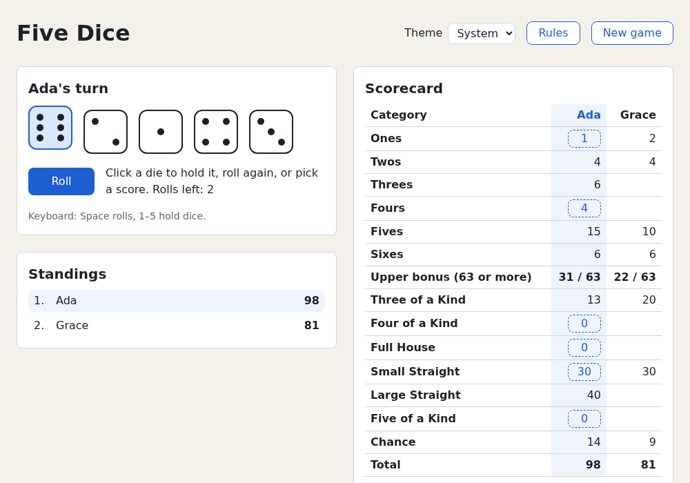

# Learn React by Building Five Dice: A Course for Web Developers

A hands-on React course for web developers who know HTML, CSS and the DOM but haven't used React. You start
from the vanilla DOM code you already write, see where it breaks down, and learn React's core APIs and mental
models one chapter at a time, always compared with how you'd do it by hand. Along the way you build **Five
Dice**, a Yahtzee-style dice game for 1–4 players who take turns at the same screen.



By the end, the game has a dice tray where you click dice to hold them, and a scorecard that shows potential
scores for the current roll. It also has a live scoreboard, a new-game form, keyboard shortcuts, a roll
animation that respects reduced-motion settings, and save/resume. It keeps local high scores, has dark mode
and a responsive layout, and is accessible. It has a fake async leaderboard with optimistic updates, native
`<dialog>` modals, a lazy-loaded rules dialog and a test suite. It uses only React, react-dom and dev tooling:
no UI libraries, CSS frameworks, state libraries or router.

## Who it's for

This course is for web developers who have built pages with HTML, CSS and JavaScript and used the DOM
directly: `querySelector`, `addEventListener`, `classList`, `textContent`, forms, flexbox and grid. It
assumes no React. It doesn't teach the web platform from scratch; it teaches React by contrasting it with the
DOM code you know. [Chapter 2](02-from-vanilla-dom-to-react.md) writes a widget in vanilla DOM code, finds where
it hurts, and maps each DOM habit to its React replacement. [Appendix B](appendix-b-web-platform-reference.md)
is a refresher for the platform features the game uses beyond the basics.

The course also assumes you can read and write everyday TypeScript. If you can't yet, work through the
[TypeScript Crash Course](https://github.com/sipak-gh/learn-typescript-crashcourse) first. It's the
recommended preparation for this course. React-specific typing (props, events, refs, hooks) is taught here,
and [Chapter 1](01-getting-started.md) sets up Vite and the other tools.

## Requirements

- **Node.js 26 LTS or newer** (verified with 26.13.0) and the npm that ships with it (npm 11). Node and npm
  run the tooling: the dev server, the build, the tests. The game itself runs in the browser.
- **Any current evergreen browser**, for example Chrome, Edge, Firefox or Safari.

This course doesn't cover installing Node.js. Check your versions:

```console
$ node --version
v26.13.0
$ npm --version
11.20.0
```

Each project pins its packages in `package-lock.json`. The course was verified with these versions:

| Package | Version |
|---|---|
| React and react-dom | 19.3.1 |
| Vite / @vitejs/plugin-react | 8.3.5 / 6.1.2 |
| TypeScript | 7.0.2 |
| Oxlint (the template's linter) | 1.90.0 |
| Vitest | 5.0.5 |
| Testing Library (react / user-event / jest-dom) | 16.3.3 / 14.6.8 / 7.0.1 |
| jsdom | 30.1.3 |
| React Compiler (babel-plugin-react-compiler) | 1.0.0 |

[Chapter 1](01-getting-started.md) creates the project with `npm create vite@latest`, so you get these
versions (or newer) without installing anything by hand.

## How to use this course

1. Read the chapters in order. [Chapter 1](01-getting-started.md) creates the `five-dice` project. Every
   chapter after that changes it a little, and you type each change yourself.
2. Type the small examples from each chapter as well. Each one is in `examples/chNN/`, where `NN` is the
   chapter number, and runs as shown in its chapter.
3. `project/chNN/` is a complete copy of the project at the **end** of chapter NN. If you get stuck, compare
   your code with it or start over from it. Each snapshot is a standalone app:

   ```console
   $ cd project/ch07
   $ npm ci
   $ npm run dev
   ```

   Then open the URL that Vite prints (usually `http://localhost:5173/`). From Chapter 8 on, `npm test` runs
   the test suite. From Chapter 19 on, `npm run check` runs every check: type-check, lint, tests and build.
4. Do the exercises at the end of each chapter before you open their solutions.

`project/ch20/` is the finished game. Its own [README](project/ch20/README.md) explains how to play.

## Table of contents

### Part I — From the DOM to React

| Chapter | Title | Project milestone |
|---|---|---|
| 1 | [Getting Started](01-getting-started.md) | Scaffold `five-dice` with Vite, strip the template, render a heading, inspect it in React DevTools |
| 2 | [From Vanilla DOM to React](02-from-vanilla-dom-to-react.md) | A hand-written dice roller versus `UI = f(state)`; base CSS (reset, custom properties) and the page layout skeleton |
| 3 | [The JavaScript React Depends On](03-javascript-for-react.md) | `src/game/dice.ts` with an injectable random number generator, and the first Vitest tests |

### Part II — React Core

| Chapter | Title | Project milestone |
|---|---|---|
| 4 | [Components and JSX](04-components-and-jsx.md) | Static board: `Die`, `DiceTray` and a `Scorecard` with all 13 categories |
| 5 | [State and Events](05-state-and-events.md) | Roll button (3 rolls), click a die to hold it, rolls-left indicator |
| 6 | [Thinking in React](06-thinking-in-react.md) | `scoring.ts` with tests; potential scores, click to score, upper bonus, totals |
| 7 | [Reducers](07-reducers.md) | `gameReducer`: a complete 13-turn single-player game with game over |
| 8 | [Testing](08-testing.md) | Component and reducer test suite with Testing Library; coverage |
| 9 | [Forms](09-forms.md) | New-game form: 1–4 player names and the Five of a Kind bonus option |
| 10 | [Composition and Context](10-composition-and-context.md) | Multiplayer: turn rotation, live standings, winners and ties |
| 11 | [Effects](11-effects.md) | Tab title, keyboard shortcuts, save and resume in `localStorage` |
| 12 | [Refs and the DOM](12-refs-and-the-dom.md) | Dice roll animation and focus management |
| 13 | [Custom Hooks](13-custom-hooks.md) | Logic moved into hooks; local high-score table |
| 14 | [Styling](14-styling.md) | CSS Modules, responsive layout, dark mode toggle |
| 15 | [Accessibility](15-accessibility.md) | Accessibility pass: live announcements, table semantics, focus, tests |
| 16 | [Rendering and Performance](16-rendering-and-performance.md) | Measure with `<Profiler>`, then enable the React Compiler |
| 17 | [Async React](17-async-react.md) | Fake async leaderboard: Suspense, error boundary, optimistic saving |
| 18 | [Portals and Dialogs](18-portals-and-dialogs.md) | Rules, confirm-new-game and game-over dialogs |
| 19 | [Building and Shipping](19-building-and-shipping.md) | Lazy-loaded rules dialog, environment variables, production build, `npm run check` |
| 20 | [Where Next](20-where-next.md) | Final polish and a README for the game |

### Appendices

- [Appendix A — React Cheat Sheet](appendix-a-react-cheatsheet.md): every hook and core API with its
  signature and a one-line use.
- [Appendix B — Web Platform Beyond the Basics](appendix-b-web-platform-reference.md): the CSS, DOM APIs,
  ARIA, events and devtools the game uses beyond W3Schools-level basics, plus short refreshers on the cascade,
  event delegation, the event loop and reference equality.
- [Appendix C — Five Dice Rules](appendix-c-five-dice-rules.md): the rules as implemented, the scoring table
  and the edge-case decisions.

References: [REFERENCES.md](REFERENCES.md) lists the sources behind each chapter, with archived copies
(Wayback Machine / Software Heritage) of every link.

## Repository layout

```text
README.md                 this file
01-getting-started.md …   chapters
appendix-*.md             appendices
examples/chNN/            every complete example from chapter NN
project/chNN/             the five-dice project at the end of chapter NN (run npm ci, then npm run dev)
images/                   screenshots used in the chapters
```
